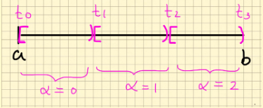

# Conjuntos

## 1.1 Definición

Decimos que dos conjuntos, $A$ y $B$, son equivalentes si existe una biyección entre entre ellos, es decir, existe una función $f:\,A \longleftarrow B$ que es inyectiva y suprayectiva.

Si $A$ y $B$ son equivalentes escribimos $A \sim B$. Se puede probar que la relación $\sim$ es una relación de equivalencia. LLamamos cardinalidad de $A$ a la clase de equivalencia de $A$ y si $A \sim B$ decimos que $A$ y $B$ tienen la misma cardinalidad.

Un conjunto se llama _finito_ si es vacio o si es equivalente a un conjunto de la forma $\{1,\ldots, n\}$, con $n \in \mathbb{N} = \{1,2,\ldots\}$

Un conjunto se llama _infinito_ si no es finito.

Por ejemplo, $\mathbb{N}$ es infinito, razón:

Para cualquier $n \in  \mathbb{N}$ y cualquier función inyectiva $f:\,\{1,2,\ldots,n\} \to \mathbb{N}$, tenemos que $\text{máx}\{f(1),f(2),\ldots,f(n)\}\,+\,1\,\in\mathbb{N}$ no es imagen de ningún elemento de $\{1,\ldots,n\}$, por lo tanto $f$ no es suprayectiva.

Un conjunto se llama _contable_ si es finito o numerable.

La idea de que dos conjuntos sean equivalentes es que ambos van a tener la misma cardinalidad de elementos.

## 1.2 Lema

La noción de conjuntos equivalentes define una realación de equivalencia.

i) $A \sim A\;\checkmark$  
ii) $B \sim A \Rightarrow A \sim B\;\checkmark$  
iii) $A \sim B \land B \sim C \Rightarrow A \sim C$
$$A \underset{\text{biyectiva}}{\overset{f}{\longrightarrow}} B,\;B \underset{\text{biyectiva}}{\overset{g}{\longrightarrow}} C$$
$$\Rightarrow A {\overset{g \circ f}{\longrightarrow}} C\quad \text{es biyectiva}$$

## 1.3 Lema

### 1. Si $A \subseteq \mathbb{N}$ es infinito, entonces $A$ es equivalente a $\mathbb{N}$ (es decir, $A$ es numerable).

**Dem.**

P.d. $\exists\; f: \mathbb{N} \to A$ biyectiva.

**Principio del buen orden de $\mathbb{N}$:** Si $B \subseteq \mathbb{N}$, $B \neq \emptyset$, entonces $B$ tiene mínimo, denotado $\min(B)$.

### Construcción de $f$

$$
\begin{aligned}
A \text{ infinito} &\Rightarrow A \neq \emptyset\\
&\Rightarrow \exists\; a_1 = \min(A)
\end{aligned}
$$

$$
\begin{aligned}
A \text{ infinito} &\Rightarrow A\setminus\{a_1\} \neq \emptyset\\
&\Rightarrow \exists\; a_2 = \min(A\setminus\{a_1\})
\end{aligned}
$$

$$
\begin{aligned}
A \text{ infinito} &\Rightarrow A\setminus\{a_1,a_2\} \neq \emptyset\\
&\Rightarrow \exists\; a_3 = \min(A\setminus\{a_1,a_2\})
\end{aligned}
$$

**Observación:** $a_1 < a_2 < a_3$.

En general, si ya se construyeron $a_1,\dots,a_n \in A$ con $a_1 < a_2 < \dots < a_n$, definimos
$$
a_{n+1} = \min\big(A\setminus\{a_1,\dots,a_n\}\big).
$$

$a_{n+1}$ está bien definido pues $A$ es infinito, luego $A\setminus\{a_1,\dots,a_n\} \neq \emptyset$.

Definimos
$$
f:\mathbb{N}\to A,\qquad f(n) = a_n.
$$

#### Paso 1: $f$ es inyectiva

Sean $n,m \in \mathbb{N}$, $n\neq m$. Sin pérdida de generalidad $n<m$. Por construcción, $a_n < a_m$ (pues $a_m = \min(A\setminus\{a_1,\dots,a_{m-1}\})$ y $a_n \in \{a_1,\dots,a_{m-1}\}$, con los $a_i$ estrictamente crecientes).

Luego $f(n) = a_n \neq a_m = f(m)$.

$\therefore f$ es inyectiva.

#### Paso 2: $f$ es suprayectiva

Sea $a \in A$. Definimos
$$
J = \{n \in \mathbb{N} \mid a \leq a_n\}.
$$

**$J \neq \emptyset$:** Si $J = \emptyset$, entonces $a_n < a$ para todo $n\in\mathbb{N}$. Como los $a_n$ son todos distintos (por el Paso 1), tendríamos
$$
\{a_1, a_2, a_3,\dots\} \subseteq \{1,\dots,a-1\},
$$
un conjunto infinito contenido en un conjunto finito, contradicción. Por lo tanto $J \neq \emptyset$.

Por el buen orden de $\mathbb{N}$, existe $n_0 = \min(J)$.

**Afirmación:** $a_{n_0} = a$.

- Como $n_0 \in J$, se tiene $a \leq a_{n_0}$.
- Como $n_0$ es el mínimo de $J$, para todo $k < n_0$ se cumple $k \notin J$, es decir $a_k < a$. En particular,
$$
a \notin \{a_1, \dots, a_{n_0 - 1}\}.
$$
Como además $a \in A$, se sigue que $a \in A\setminus\{a_1,\dots,a_{n_0-1}\}$. Pero
$$
a_{n_0} = \min\big(A\setminus\{a_1,\dots,a_{n_0-1}\}\big) \leq a,
$$
por ser el mínimo de ese conjunto y $a$ pertenecer a él.

De $a \leq a_{n_0}$ y $a_{n_0} \leq a$ concluimos
$$
a_{n_0} = a.
$$

Por lo tanto $f(n_0) = a_{n_0} = a$, es decir, $a$ tiene preimagen bajo $f$.

Como $a \in A$ era arbitrario, $f$ es suprayectiva.

#### Conclusión

$f$ es inyectiva y suprayectiva, luego $f$ es biyectiva. Por lo tanto $A$ es equivalente a $\mathbb{N}$. $\blacksquare$

### 2. $\mathbb{N} \times \mathbb{N}$ es equivalente a $\mathbb{N}$

#### Demostración

Dado $k \in \mathbb{N}$, por el teorema fundamental de la aritmética, $k$ se puede escribir de forma única como

$$k = 2^{m-1}(2n-1), \quad \text{para algunos } n, m \in \mathbb{N}.$$

Definimos $f : \mathbb{N} \times \mathbb{N} \to \mathbb{N}$ por

$$f(m,n) = 2^{m-1}(2n-1).$$

**Inyectividad.** Supongamos que $f(m_1,n_1) = f(m_2,n_2)$, es decir

$$2^{m_1-1}(2n_1-1) = 2^{m_2-1}(2n_2-1).$$

Sin pérdida de generalidad, supongamos $m_2 \le m_1$. Dividiendo ambos lados entre $2^{m_2-1}$:

$$2^{m_1-m_2}(2n_1-1) = 2n_2-1.$$

El lado derecho, $2n_2-1$, es impar. Por lo tanto el lado izquierdo también debe ser impar. Pero $2^{m_1-m_2}$ solo es impar cuando el exponente es cero (si $m_1-m_2 \ge 1$, el factor $2^{m_1-m_2}$ sería par, y el producto también lo sería, contradiciendo la paridad del lado derecho). Por lo tanto,

$$m_1 - m_2 = 0 \;\Rightarrow\; m_1 = m_2.$$

Sustituyendo de vuelta:

$$2n_1 - 1 = 2n_2 - 1 \;\Rightarrow\; n_1 = n_2.$$

Así, 

$$(m_1,n_1) = (m_2,n_2),$$

lo que prueba que $f$ es inyectiva.

**Suprayectividad.** Dado cualquier $k \in \mathbb{N}$, el teorema fundamental de la aritmética garantiza no solo la existencia de la descomposición $k = 2^{m-1}(2n-1)$, sino también que dicha descomposición existe para *todo* $k \in \mathbb{N}$ (tomando $m-1$ como la mayor potencia de 2 que divide a $k$, y $2n-1$ como el cociente impar resultante). Por lo tanto, para cada $k \in \mathbb{N}$ existe un par $(m,n) \in \mathbb{N}\times\mathbb{N}$ tal que $f(m,n) = k$, lo que prueba que $f$ es suprayectiva.

**Conclusión.** Como $f$ es inyectiva y suprayectiva, es biyectiva. Por lo tanto,

$$\mathbb{N} \times \mathbb{N} \sim \mathbb{N}. \qquad \blacksquare$$

---

## 1.4 Teorema

Unión numerable de conjuntos numerables es numerable. Es decir, si $A_i$ es numerable para todo $i \in \mathbb{N}$, entonces $\bigcup_{i=1}^{\infty} A_i$ es numerable.

**Demostración.**

Al ser cada $A_i$ numerable, existe una biyección $f_i : \mathbb{N} \to A_i$.

**Paso 1: construimos una función sobreyectiva $f:\mathbb{N}\times\mathbb{N}\to\bigcup_{i=1}^\infty A_i$.**

Definimos
$$f(n,m) = f_n(m).$$

Esta función es sobreyectiva: dado $x \in \bigcup_{i=1}^{\infty} A_i$, existe un $n$ tal que $x \in A_n$, y al ser $f_n$ una biyección, existe $m$ con $f_n(m) = x$. Entonces $f(n,m) = x$.

**Nota importante:** $f$ es sobreyectiva, pero en general **no es inyectiva** (un mismo elemento $x$ podría repetirse en distintos $A_i$ si estos no son disjuntos). Por lo tanto $f$ **no tiene función inversa** $f^{-1}: \bigcup_i A_i \to \mathbb{N}\times\mathbb{N}$ en el sentido usual. Lo que sí podemos definir, para cada $a \in \bigcup_i A_i$, es el conjunto de **preimágenes** de $a$ bajo $f$:
$$f^{-1}(a) := \{(n,m) \in \mathbb{N}\times\mathbb{N} : f(n,m) = a\}.$$
Este $f^{-1}(a)$ es un **subconjunto** de $\mathbb{N}\times\mathbb{N}$, no un único par ordenado — puede tener uno, varios, o infinitos elementos. La notación "$f^{-1}$" acá denota la **imagen inversa** (una operación que siempre está definida, exista o no la función inversa), no la función inversa de $f$.

**Paso 2: construimos una función inyectiva $g : \bigcup_{i=1}^{\infty} A_i \longrightarrow \mathbb{N}\times\mathbb{N}$.**

Como $f$ es sobreyectiva, para cada $a \in \bigcup_i A_i$ se tiene $f^{-1}(a) \neq \emptyset$.

Como $f^{-1}(a)$ puede tener más de un elemento, no hay una manera canónica de "elegir uno solo" sin más información — por eso se invoca el **axioma de elección** (numerable): existe una función $g$ que, a cada $a \in \bigcup_i A_i$, le asigna **un** elemento $g(a) \in f^{-1}(a)$, es decir:
$$g(a) \in f^{-1}(a) \quad\text{para cada } a.$$

Por la definición misma de $f^{-1}(a)$ como el conjunto de pares que $f$ manda a $a$, elegir $g(a)$ dentro de ese conjunto significa exactamente que
$$f(g(a)) = a \qquad \text{para todo } a \in \bigcup_{i=1}^\infty A_i.$$

(Esta igualdad **no** dice que $g = f^{-1}$ como funciones — $f^{-1}$ ni siquiera es una función aquí. Dice que $g$ es una **sección** de $f$: una función que, compuesta con $f$ del lado izquierdo, da la identidad en $\bigcup_i A_i$.)

**Paso 3: $g$ es inyectiva.**

Si $g(a_1) = g(a_2)$, entonces
$$a_1 = f(g(a_1)) = f(g(a_2)) = a_2.$$

Por lo tanto $g$ es una biyección entre $\bigcup_{i=1}^\infty A_i$ y su imagen, que es subconjunto de $\mathbb{N} \times \mathbb{N}$. Por el lema anterior $\mathbb{N} \times \mathbb{N}$ es numerable y por lo tanto $\bigcup_{i=1}^\infty A_i$ es un conjunto infinito contenido en un conjunto numerable, por lo que $\bigcup_{i=1}^\infty A_i$ es numerable.

---

## 1.5 Nota

### Expansión decimal

Dado $x \in (0,1)$ podemos expandirlo en decimales como

$$x = 0.x(1)x(2)x(3)\cdots$$

donde $x(i) \in \{0,1,\ldots,9\}$. Esta expansión decimal la reescribimos como:

$$x = \sum_{i=1}^{\infty} \frac{x(i)}{10^i}.$$

Por ejemplo

$$0.5 = \frac{5}{10},\qquad 0.1 = 0.099999999\cdots$$

---

**p.d. $\;0.1=0.0999\ldots$**

**Serie geométrica** ($|r|<1$)

$$
\begin{aligned}
S_N &= \sum_{i=0}^Nr^i \\
&= 1+r+r^2+\ldots+r^N \\
\implies \qquad \;\; rS_N &= r+r^2+r^3+\ldots+r^{N+1} \\
\implies \; S_N-rS_N &= 1-r^{N+1} \\
\implies \; S_N(1-r) &= 1-r^{N+1} \\
\implies \qquad \quad S_N &= \frac{1-r^{N+1}}{1-r} \\
\implies \quad \lim_{N \to \infty}S_N &= \lim_{N \to \infty}\frac{1-r^{N+1}}{1-r} \\
&= \frac{1}{1-r} \qquad \qquad \text{(*)}
\end{aligned}
$$

Sea

$$
\begin{aligned}
0.0999\ldots &= \sum_{n=2}^\infty \frac{9}{10}^n \\
&= \left(\frac{9}{10^2}\right)\left(\sum_{i=0}^\infty\frac{1}{10^i}\right) \\
&\overset{\text{*}}{=} \left(\frac{9}{10^2}\right)\left(\frac{1}{1-\frac{1}{10}}\right) \\
&= \left(\frac{9}{10^2}\right)\left(\frac{10}{9}\right) \\
&= \frac{1}{10} \\
&= 0.1
\end{aligned}
$$

---

Cuando un número se puede escribir de tal forma que $x(i) = 0$ a partir de cierta $i$ (en otras palabras, la serie termina) o $x(i) = 9$ a partir de cierta $i$, decimos que la expansión decimal tiene una cola de 0's o una cola de 9's.

---

## 1.6 Lema

Un número $x \in (0,1)$, admite dos expansiones decimales distintas si y sólo si tiene una expasión con cola de $0's$ o una con cola de $9's$

Primero notamos la siguiente identidad (válida para todo natural $N$)

$$\sum_{i=N+1}^{\infty} \frac{9}{10^n} = \frac{1}{10^N}$$

$\Rightarrow$] Supongamos que

$$x = \sum_{n=0}^{\infty} \frac{\alpha_n}{10^n} = \sum_{n=0}^{\infty} \frac{\beta_n}{10^n}$$

donde $\alpha_n, \beta_n \in \{0, 1, \dots, 9\}$ y existe al menos un $m$ donde $\alpha_m \neq \beta_m$. Sea $m_0$ el mínimo natural donde $\alpha_m \neq \beta_m$. Cancelando podemos llegar a

$$\sum_{n=m_0}^{\infty} \frac{\alpha_n}{10^n} = \sum_{n=m_0}^{\infty} \frac{\beta_n}{10^n}$$

Ya que $\alpha_{m_0} \neq \beta_{m_0}$ sin pérdida de generalidad podemos suponer que $\alpha_{m_0} < \beta_{m_0}$ (y por lo tanto $\alpha_{m_0} + 1 \leq \beta_{m_0}$).

Usando que $\alpha_n \leq 9$ para toda $n$ obtenemos las siguientes estimaciones

$$
\begin{aligned}
\sum_{n=m_0}^{\infty} \frac{\alpha_n}{10^n} &= \frac{\alpha_{m_0}}{10^{m_0}} + \sum_{n=m_0+1}^{\infty} \frac{\alpha_n}{10^n} \\
&\leq \frac{\alpha_{m_0}}{10^{m_0}} + \sum_{n=m_0+1}^{\infty} \frac{9}{10^n} \\
&= \frac{\alpha_{m_0}}{10^{m_0}} + \frac{1}{10^{m_0}} \\
&= \frac{\alpha_{m_0}+1}{10^{m_0}} \\
&\leq \frac{\beta_{m_0}}{10^{m_0}} \\
&\leq \sum_{n=m_0}^{\infty} \frac{\beta_n}{10^n}
\end{aligned}
$$

Comparando el primer y último término de la cadena de desigualdades concluimos que las desigualdades son realmente igualdades y por lo tanto $\alpha_n = 9$ y $\beta_n = 0$ para todo $n \geq m_0 + 1$.

$\Leftarrow$] Entonces si $x$ tiene una cola de 0's:

$$x = \sum_{n=1}^{N} \frac{x(n)}{10^n}$$

con $x(N) \neq 0$ (por lo tanto $x(N) \geq 1$) podemos reescribirlo como

$$
\begin{aligned}
x &= \sum_{n=1}^{N} \frac{x(n)}{10^n} \\
&= \sum_{n=1}^{N-1} \frac{x(n)}{10^n} + \frac{x(N)-1}{10^N} + \sum_{n=N+1}^{\infty} \frac{9}{10^n}
\end{aligned}
$$

obteniendo una cola de 9's.

Por otro lado si $x$ tiene una cola de 9's lo podemos re-escribir como

$$\sum_{n=1}^{N} \frac{x(n)}{10^n} + \sum_{n=N+1}^{\infty} \frac{9}{10^n} = \sum_{n=1}^{N-1} \frac{x(n)}{10^n} + \frac{x(N)+1}{10^N}$$

obteniendo una cola de 0's.

---

## 1.7 Teorema

Un conjunto infinito que no es numerable se llama no numerable.

Prueba que $(0,1)$ es no numerable.

En consecuencia $\mathbb{R}$ es no numerable.

**Demostración**

Es suficiente probar que un subconjunto de $(0,1)$ es no numerable. Definimos $A$ como el conjunto de puntos en $(0,1)$ que tiene una única expansión decimal.

Vamos a proceder por contradicción y supongamos que $A$ es numerable. Entonces podemos escribir $A = \{a_m\}_{m \in \mathbb{N}}$. Ahora escribimos cada $a_n$ en forma decimal:

$$a_m = \sum_{n=1}^{\infty} \frac{a_m(n)}{10^n},$$

donde $a_m(n) \in \{0, 1, \dots, 9\}$ y la sucesión $(a_m(n))_{n \in \mathbb{N}}$ es única para cada $m$. De esta forma podemos pasar la información a una lista de sucesiones que podemos acomodar como sigue:

$$a_1 = (a_1(1), a_1(2), a_1(3), \dots)$$
$$a_2 = (a_2(1), a_2(2), a_2(3), \dots)$$
$$a_3 = (a_3(1), a_3(2), a_3(3), \dots)$$
$$\vdots$$
$$a_m = (a_m(1), a_m(2), a_m(3), \dots)$$
$$\vdots$$

y el problema se reduce a encontrar una sucesión que no esté en esta lista. Para lograrlo para cada $m \in \mathbb{N}$ definimos $y(m) = 2$ si $a_m(m) = 1$ y $y(m) = 5$ si $a_m(m) \neq 1$. Entonces la sucesión $(y(m))_{m \in \mathbb{N}}$ difiere de todas en la lista de arriba (pues difiere en la diagonal).

Finalmente definimos

$$y = \sum_{n=1}^{\infty} \frac{y(m)}{10^m}$$

Ya que $y$ no tiene cola de 0's ni cola de 9's, $y \in A$. Además por construcción, $(y(n))_{n \in \mathbb{N}} \neq (a_m(n))_{n \in \mathbb{N}}$, para toda $m$, por lo que $y \neq a_m$ para toda $m$, contradiciendo que $A = \{a_m\}_{m \in \mathbb{N}}$.

---

## 1.8 Teorema (Cantor - Bersntein)

Sean $A$ y $B$ dos conjuntos y supon que exsisten funciones inyectivas $f:\;A \longleftarrow B$ y $f:\;B \longleftarrow A$. Entonces $A$ y $B$ son equivalentes.

**Demostración**

p.d. $\exist\;h:\; A \longrightarrow B$ biyectiva.

Idea: $h \backslash S = f, \quad h \backslash A|S = g^{-1}$
Encontrar un $S \subseteq tal que:

$$g(B \backslash f(S)) = A\S$$

---

## 1.9 Definición. El conjunto de Cantor.

Se inicia con el intervalo unitario

$$F_0 = [0,1]$$

$F_0$ se parte en tres partes iguales y se remueve el intervalo abierto que corresponde a la parte de en medio

$$F_1 = \left[0, \frac{1}{3}\right] \cup \left[\frac{2}{3}, 1\right].$$

Entonces $F_1$ es la unión de $2^1 = 2$ intervalos cerrados de la forma $[k/3, (k+1)/3]$, para $k = 0, 2$.

Se sigue el mismo procedimiento, partiendo cada subintervalo de $F_1$ en tres partes iguales y removiendo los intervalos abiertos correspondientes a la parte de en medio.

$$F_2 = \left[0, \frac{1}{9}\right] \cup \left[\frac{2}{9}, \frac{1}{3}\right] \cup \left[\frac{2}{3}, \frac{7}{9}\right] \cup \left[\frac{8}{9}, 1\right].$$

Entonces $F_2$ es la unión de $2^2 = 4$ intervalos cerrados de la forma $[k/3^2, (k+1)/3^2]$, para $k = 0, 2, 6, 8$.

Siguiendo con ésta construcción, $F_n$ es la unión de $2^n$ intervalos cerrados, de la forma $[k/3^n, (k+1)/3^n]$, para ciertos valores de $k$. Para construir $F_{n+1}$, cada subintervalo de $F_n$ se parte en tres partes iguales removiendo el intervalo abierto que corresponde a la mitad de en medio.

El conjunto de Cantor es lo que "queda" al aplicar este proceso hasta el infinito, es decir se define como el conjunto

$$\Delta := \cap_{n=1}^{\infty} F_n$$

Por ejemplo, los puntos $0$ y $1$ están en $\Delta$, pues en cada subdivisión de intervalos que genera a los $F_n$, siempre existe un intervalo de $F_n$ que tiene a $0$ como punto inicial y siempre hay un subintervalo de $F_n$ que tiene a $1$ como punto final. De manera similar, los puntos inicial y final de cada subintervalo que forman a $F_n$ pertenece a $\Delta$, por ejemplo

$$\frac{1}{3}, \frac{2}{3}, \frac{1}{9}, \frac{2}{9}, \frac{7}{9}, \frac{8}{9} \in \Delta.$$

Lo impresionante es que si a $\Delta$ le quitamos todos estos puntos "sencillos" lo que resulta es suficientemente numeroso como para ser equivalente a $[0,1]$. Es decir, los puntos de $\Delta$ que se pueden ver "fácilmente" son realmente una minoría. En los ejercicios que siguen se explora ésta y otras características de $\Delta$.

---

## 1.10 Lema

Sean $a, b \in \mathbb{R}$ con $a < b$ y fija $x \in [a, b)$.

Divide el intervalo $[a,b]$ en tres partes iguales, digamos que los puntos de esta partición son $a = t_0 < t_1 < t_2 < t_3 = b$. Entonces existe un único $i = 0, 1, 2$ tal que $x \in [t_i, t_{i+1})$. Define

$$\alpha = i \quad \text{si } x \in [t_i, t_{i+1})$$

Es decir, $\alpha = 0$ si $x$ está en el primer tercio de $[a,b)$, $\alpha = 1$ si está en el segundo y $\alpha = 2$ si está en el tercero.

Toma $s = \dfrac{\alpha(b-a)}{3}$. Prueba que:

$$|a + s - x| \leq \frac{b-a}{3}$$

y $x \in [a+s, a+s+(b-a)/3)$.

**Solución**

Primero notamos que $t_0 = a, t_1 = a + \dfrac{b-a}{3}, t_2 = a + \dfrac{2(b-a)}{3}, t_3 = b$.

Tenemos varios casos.

Caso $x \in [t_0, t_1)$. En este caso, $\alpha = 0$ y $s = 0$. Por lo tanto

$$|a + s - x| = |a - x| = |t_0 - x| \leq t_1 - t_0 = \frac{b-a}{3}$$

y ya que $t_0 = a+s$, $t_1 = a+s+\dfrac{b-a}{3}$ resulta que $x \in [a+s, a+s+(b-a)/3)$.

Caso $x \in [t_1, t_2)$. En este caso, $\alpha = 1$ y $s = \dfrac{b-a}{3}$. Por lo tanto $a+s = t_1$,

$$|a + s - x| = |t_1 - x| \leq t_2 - t_1 = \frac{b-a}{3}$$

y $x \in [t_1, t_2) = [a+s, a+s+(b-a)/3)$.

Caso $x \in [t_2, t_3)$. En este caso, $\alpha = 2$ y $s = \dfrac{2(b-a)}{3}$. Por lo tanto $a+s = t_2$,

$$|a + s - x| = |t_2 - x| \leq t_3 - t_2 = \frac{b-a}{3}$$

y $x \in [t_2, t_3) = [a+s, a+s+(b-a)/3)$.

---

## 1.11 Lema

Todo elemento $x \in [0,1]$ admite una representación ternaria, es decir se puede escribir

$$x = \sum_{n=1}^{\infty} \frac{\alpha_n}{3^n}$$

donde $\alpha_n \in \{0, 1, 2\}$.

**Respuesta**

Primero notamos que, para el caso $x = 1$ tenemos, por series geométricas

$$\sum_{i=1}^{\infty} \frac{2}{3^i} = 2\frac{\frac{1}{3}}{1-\frac{1}{3}} = 1.$$

Así, podemos suponer $x \in [0,1)$. Ahora aplicamos el ejercicio anterior.

Tomando $a = 0, b = 1$, $\alpha_1$ y $s_1$ como la $\alpha$ y $s$ del ejercicio anterior, tenemos que

$$|a + s - x| = \left|\frac{\alpha_1}{3} - x\right| \leq \frac{b-a}{3} = \frac{1}{3}.$$

Tomando $a = s_1, b = s_1 + 1/3$, $\alpha_2$ y $s_2$ como la $\alpha$ y la $s$ del ejercicio anterior, tenemos que

$$\left|a + s - x\right| = \left|\frac{\alpha_1}{3} + \frac{\alpha_2}{3^2} - x\right| \leq \frac{b-a}{3} = \frac{1}{3^2}.$$

Notamos que $x \in [s_1+s_2, s_1+s_2+(b-a)/3) = [s_1+s_2, s_1+s_2+1/3^2)$.

Continuando con este proceso, si $x \in [s_1+\cdots+s_n, s_1+\cdots+s_n+\dfrac{1}{3^n})$, tomando $a = s_1+\cdots+s_n$, $b = s_1+\cdots+s_n+\dfrac{1}{3^n}$, $\alpha_{n+1}, s_{n+1}$ como en el ejercicio anterior, tenemos

$$\left|a + s - x\right| = \left|\sum_{i=1}^{n+1} \frac{\alpha_i}{3^i} - x\right| \leq \frac{b-a}{3} = \frac{1}{3^n}$$

Tomando límites, cuando $n \to \infty$, en la desigualdad anterior concluimos

$$\sum_{i=1}^{\infty} \frac{\alpha_i}{3^i} = x.$$

---

## 1.12 Lema

Sea $x \in [0,1]$, con $x \neq 1, 0$.

1. Prueba que si $x$ admite dos representaciones ternarias distintas entonces $x$ es de la forma $\dfrac{k}{3^n}$, para $n, k \in \mathbb{N}$, $k \leq 3^n$.
2. Supon además que $x \in \Delta$ y es de la forma $\dfrac{k}{3^n}$. Es decir, es un punto inicial o final de alguno de los intervalos de algún $F_n$. Prueba que $x$ admite una descomposición ternaria de la forma

$$\sum_{i=1}^{\infty} \frac{\alpha_i}{3^i}$$

donde, para toda $i$, $\alpha_i \in \{0, 2\}$.

Además, si $x$ es un punto final la representación tiene una cola de 2's, si $x$ es un punto inicial la representación tiene una cola de 0's.

**Demostración**

### Parte 1.

Supongamos que $x$ admite dos representaciones ternarias distintas
$$x = \sum_{i=1}^{\infty} \frac{\alpha_i}{3^i} = \sum_{i=1}^{\infty} \frac{\beta_i}{3^i}$$
con $\alpha_i, \beta_i \in \{0,1,2\}$, y sea $N$ el mínimo natural tal que $\alpha_N \neq \beta_N$. Cancelando los primeros $N-1$ términos (que son iguales) obtenemos

$$\sum_{i=N}^{\infty} \frac{\alpha_i}{3^i} = \sum_{i=N}^{\infty} \frac{\beta_i}{3^i}.$$

Sin pérdida de generalidad supongamos $\alpha_N < \beta_N$, de modo que $\alpha_N + 1 \leq \beta_N$. Usando que $\alpha_i \leq 2$ para toda $i$, obtenemos las siguientes estimaciones:

$$
\begin{aligned}
\sum_{i=N}^{\infty} \frac{\alpha_i}{3^i}
&= \frac{\alpha_N}{3^N} + \sum_{i=N+1}^{\infty} \frac{\alpha_i}{3^i} \\
&\leq \frac{\alpha_N}{3^N} + \sum_{i=N+1}^{\infty} \frac{2}{3^i} \\
&= \frac{\alpha_N}{3^N} + \frac{2}{3^N}\sum_{i=1}^{\infty}\frac{1}{3^{i}} \\
&= \frac{\alpha_N}{3^N} + \frac{2}{3^N}\left(\frac{\frac13}{1-\frac13}\right) \\
&= \frac{\alpha_N}{3^N} + \frac{1}{3^N} \\
&= \frac{\alpha_N + 1}{3^N} \\
&\leq \frac{\beta_N}{3^N} \\
&\leq \sum_{i=N}^{\infty} \frac{\beta_i}{3^i}.
\end{aligned}
$$

Comparando el primer y el último término de la cadena, concluimos que todas las desigualdades son en realidad igualdades. En particular:

- $\alpha_i = 2$ para toda $i > N$,
- $\beta_i = 0$ para toda $i > N$,
- $\alpha_N + 1 = \beta_N$.

Es decir, una de las representaciones de $x$ termina en una cola de 2's y la otra en una cola de 0's. Por lo tanto

$$x = \sum_{i=1}^{N} \frac{\alpha_i}{3^i} + \sum_{i=N+1}^{\infty} \frac{2}{3^i} = \sum_{i=1}^{N} \frac{\alpha_i}{3^i} + \frac{1}{3^N},$$

donde usamos el cálculo anterior de la cola geométrica. Multiplicando por $3^N$:

$$x = \frac{\displaystyle\sum_{i=1}^{N}\alpha_i 3^{N-i} + 1}{3^N} = \frac{k}{3^N}, \qquad k := \sum_{i=1}^N \alpha_i 3^{N-i} + 1 \in \mathbb{N}.$$

Por ejemplo, si $\alpha_1=1,\ \alpha_2=1$, la suma parcial correspondiente es
$$\frac13 + \frac{1}{3^2} = \frac{3}{3^2} + \frac{1}{3^2} = \frac{4}{3^2},$$
lo que ilustra cómo la suma finita de dígitos ternarios se convierte en una fracción con denominador $3^N$.

Finalmente, como $\alpha_i \leq 2$ para toda $i\leq N$,
$$\sum_{i=1}^N \alpha_i 3^{N-i} \leq 2\sum_{i=1}^{N} 3^{N-i} = 2\cdot\frac{3^N-1}{2} = 3^N - 1,$$
así que $k \leq 3^N$. Esto prueba que $x = k/3^N$ con $n,k\in\mathbb{N}$, $k\leq 3^n$, como se quería.

### Parte 2.

Supongamos ahora que $x \in \Delta$ y que $x = k/3^n$ es un punto inicial o final de alguno de los intervalos que forman $F_n$.

Por construcción de $F_n$: cada uno de los $2^n$ intervalos cerrados que lo componen se obtiene, en cada una de las $n$ etapas, escogiendo el subintervalo izquierdo (correspondiente al dígito ternario $0$) o el subintervalo derecho (correspondiente al dígito ternario $2$) de la trisección —nunca el intervalo de en medio (dígito $1$), que es removido. Por lo tanto, todo intervalo de $F_n$ es de la forma

$$\left[\sum_{i=1}^n \frac{\gamma_i}{3^i},\ \sum_{i=1}^n \frac{\gamma_i}{3^i} + \frac{1}{3^n}\right], \qquad \gamma_i \in \{0,2\}\ \text{para toda } i=1,\dots,n.$$

**Caso 1: $x$ es el punto inicial del intervalo.** Entonces

$$x = \sum_{i=1}^{n} \frac{\gamma_i}{3^i} = \sum_{i=1}^n \frac{\gamma_i}{3^i} + \sum_{i=n+1}^{\infty}\frac{0}{3^i},$$

es decir, tomando $\alpha_i = \gamma_i \in \{0,2\}$ para $i\leq n$ y $\alpha_i = 0$ para $i > n$, obtenemos una representación ternaria de $x$ con $\alpha_i \in \{0,2\}$ para toda $i$, y con una cola de $0$'s.

**Caso 2: $x$ es el punto final del intervalo.** Entonces

$$x = \sum_{i=1}^{n} \frac{\gamma_i}{3^i} + \frac{1}{3^n} = \sum_{i=1}^n \frac{\gamma_i}{3^i} + \sum_{i=n+1}^{\infty} \frac{2}{3^i},$$

usando nuevamente que $\sum_{i=n+1}^{\infty} 2/3^i = 1/3^n$ (por el cálculo de la Parte 1). Tomando $\alpha_i = \gamma_i \in \{0,2\}$ para $i \leq n$ y $\alpha_i = 2$ para $i > n$, obtenemos una representación ternaria de $x$ con $\alpha_i \in \{0,2\}$ para toda $i$, y con una cola de $2$'s.

En ambos casos, $x$ admite una representación ternaria

$$x = \sum_{i=1}^{\infty} \frac{\alpha_i}{3^i}, \qquad \alpha_i \in \{0,2\}\ \text{para toda } i,$$

con cola de $0$'s si $x$ es punto inicial, y cola de $2$'s si $x$ es punto final. $\blacksquare$

---

# Teorema 1.13

$$x \in \Delta \iff x = \sum_{i=1}^{\infty} \frac{\alpha_i}{3^i}, \qquad \forall i,\ \alpha_i \in \{0,2\}$$

donde $\Delta$ es el conjunto de Cantor y $F_n$ es la $n$-ésima etapa de su construcción (unión de $2^n$ intervalos cerrados de longitud $1/3^n$), de modo que $\Delta = \bigcap_{n=1}^{\infty} F_n$.

## Demostración

### $[\Rightarrow]$ Hipótesis: $x \in \Delta$

**P.d.** $x$ se escribe como $x = \displaystyle\sum_{i=1}^{\infty}\frac{\alpha_i}{3^i}$ con $\alpha_i \in \{0,2\}$, $\forall i$.

**Caso 1: $x$ es extremo inicial o final** (de algún intervalo de la construcción).

Aplicamos directamente el lema anterior: los extremos de los intervalos de cada $F_n$ admiten representación ternaria con dígitos en $\{0,2\}$, así que el resultado es inmediato.

**Caso 2: $x$ no es extremo inicial ni final** (de ningún intervalo).

- En $F_1=[0,\tfrac13]\cup[\tfrac23,1]$: como $x$ no es extremo, $x$ cae en el *interior* de exactamente uno de los dos intervalos. Definimos
$$\alpha_1 = 0 \text{ si } x \in \Big[0,\tfrac13\Big], \qquad \alpha_1 = 2 \text{ si } x \in \Big[\tfrac23,1\Big].$$

- En $F_2$ (cuatro intervalos, dos dentro de cada tercio anterior): nuevamente $x$ cae en el interior de exactamente uno de ellos, lo que determina $\alpha_2 \in \{0,2\}$ según si $x$ está en el subintervalo izquierdo o derecho del tercio ya seleccionado.

- Repitiendo este argumento, en cada etapa $F_n$ el punto $x$ cae en el interior de un único intervalo, lo que determina de manera única un dígito $\alpha_n \in \{0,2\}$.

**Conclusión:** para todo $n$, $\alpha_n \in \{0,2\}$, y como la longitud de los intervalos de $F_n$ tiende a $0$, éstos "atrapan" a $x$ cada vez con mayor precisión, de donde
$$x = \sum_{n=1}^{\infty} \frac{\alpha_n}{3^n}, \qquad \alpha_n \in \{0,2\}.$$

**Obs. (Ejemplo).** $\displaystyle x = \frac{0}{3}+\frac{2}{3^2}+\frac{0}{3^3}+\frac{2}{3^4}+\cdots$, con $x \in \Delta$ y $x$ no es punto inicial ni final.

---

### $[\Leftarrow]$ Hipótesis: $x = \displaystyle\sum_{i=1}^{\infty}\frac{\alpha_i}{3^i}$, $\forall i,\ \alpha_i \in \{0,2\}$

**P.d.** $\forall n,\ x \in F_n$ (y por lo tanto $x \in \bigcap_n F_n = \Delta$).

Procedemos por **inducción sobre $n$**.

**Base $n=1$:** Como $\alpha_i\ge 0$ para toda $i$,
$$0 \;\le\; \sum_{i=2}^{\infty}\frac{\alpha_i}{3^i} \;\le\; \sum_{i=2}^{\infty}\frac{2}{3^i} = \frac13.$$
Si $\alpha_1=0$, entonces $x=\sum_{i\ge 2}\alpha_i/3^i \in [0,\tfrac13]$; si $\alpha_1=2$, entonces $x = \tfrac23+\sum_{i\ge2}\alpha_i/3^i \in [\tfrac23,1]$. En ambos casos $x\in F_1$. ✓

**Paso inductivo:** Supongamos $x \in F_{n-1}$. Sea
$$a_0 = \sum_{i=1}^{n-1}\frac{\alpha_i}{3^i},$$
que es exactamente el extremo izquierdo del intervalo de $F_{n-1}$ (de longitud $1/3^{n-1}$) que contiene a $x$. Al pasar de $F_{n-1}$ a $F_n$, ese intervalo se subdivide (quitando el tercio medio) en
$$\Big[a_0,\ a_0+\tfrac{1}{3^n}\Big] \quad (\alpha_n=0) \qquad \text{y} \qquad \Big[a_0+\tfrac{2}{3^n},\ a_0+\tfrac{1}{3^{n-1}}\Big] \quad (\alpha_n=2).$$

Notamos que
$$x - a_0 = \sum_{i=1}^{\infty}\frac{\alpha_i}{3^i} - \sum_{i=1}^{n-1}\frac{\alpha_i}{3^i} = \sum_{i=n}^{\infty}\frac{\alpha_i}{3^i}.$$

**Caso $\alpha_n=0$:**
$$|x-a_0| = \sum_{i=n+1}^{\infty}\frac{\alpha_i}{3^i} \;\le\; \sum_{i=n+1}^{\infty}\frac{2}{3^i} = 2\left(\sum_{i=1}^{\infty}\frac{1}{3^{n+i}}\right)\cdot 3 \;=\; \frac{1}{3^n}.$$
Por lo tanto $x \in \big[a_0,\ a_0+\tfrac{1}{3^n}\big] \subseteq F_n$, así que $x\in F_n$.

**Caso $\alpha_n=2$ (análogo):**
$$\Big|x-\Big(a_0+\tfrac{2}{3^n}\Big)\Big| = \sum_{i=n+1}^{\infty}\frac{\alpha_i}{3^i} \le \frac{1}{3^n},$$
de donde $x \in \big[a_0+\tfrac{2}{3^n},\ a_0+\tfrac{1}{3^{n-1}}\big] \subseteq F_n$, y nuevamente $x \in F_n$.

En cualquier caso, $x \in F_n$. Por inducción, $x \in F_n$ para todo $n \in \mathbb{N}$, y por lo tanto
$$x \in \bigcap_{n=1}^{\infty} F_n = \Delta. \qquad \blacksquare$$

