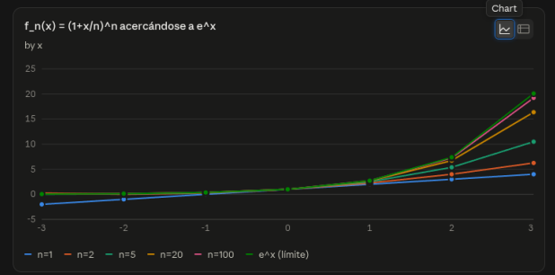
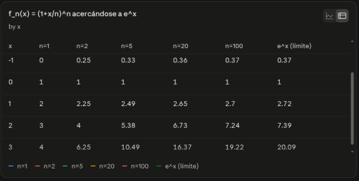
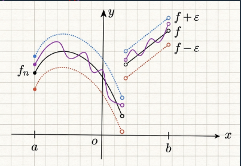

# Convergencia puntual y uniforme

## 2.1 Introducción

En esta sección vemos dos tipos de convergencia de sucesiones de funciones: convergencia puntual y uniforme. Se muestra mediante varios ejemplos que la convergencia puntual no interactua muy bien con varias operaciones, como la continuidad o la integral pero se prueba que la conevergencia uniforme si se "lleva bien" con estas propiedades. Al final se da el Teorema de Dini que da un criterio para la convergencia uniforme de una sucesión de funciones.

## 2.2 Definición

Sea $X$ un conjunto distinto del vacío y $(f_n : X \to \mathbb{R})_{n=1}^{\infty}$ una sucesión de funciones. Dado $A \subseteq X$, decimos que la sucesión $(f_n)_{n=1}^{\infty}$ converge puntualmente en $A$ a la función $f : A \to \mathbb{R}$ si para todo $a \in A$, $\lim_{n \to \infty} f_n(a) = f(a)$.

Para ser más específicos, para toda $a \in A$ y toda $\varepsilon > 0$ existe $N \in \mathbb{N}$ tal que para toda $n \geq N$,

$$|f_n(a) - f(a)| < \varepsilon$$

Nota: la $N$ va a depender tanto de $\varepsilon$ como de $a$.

## Ejemplos

- Por ejemplo, de cálculo sabemos que para toda $x \in \mathbb{R}$,

$$\lim_{n \to \infty} \left(1 + \frac{x}{n}\right)^n = e^x,$$

$$\lim_{n \to \infty} \left(1 - \frac{x}{n}\right)^{-n} = e^x$$

  Por lo tanto las sucesiones de funciones $(f_n : \mathbb{R} \to \mathbb{R})_{n=1}^{\infty}$, $(g_n : \mathbb{R} \to \mathbb{R})_{n=1}^{\infty}$, dadas por $f_n(x) = \left(1 + \frac{x}{n}\right)^n$, $g_n(x) = \left(1 - \frac{x}{n}\right)^{-n}$ convergen puntualmente a la función exponencial para todo punto de $\mathbb{R}$.

- Definamos la sucesión de funciones $f_n : [-1,1] \to \mathbb{R}$ por $f_n(x) = x^n$. Usando que $\lim_{n \to \infty} r^n = 0$ para $r \in \mathbb{R}$ con $|r| < 1$ tenemos que

$$
\lim_{n \to \infty} f_n(x) =
\begin{cases}
1, & x = 1, \\
0, & |x| < 1, \\
\text{no existe}, & x = -1.
\end{cases}
$$

  Por lo tanto, la sucesión no converge puntualmente en $[-1,1]$ (por la obstrucción que hay en $x = -1$), pero sí converge puntualmente en $(-1,1]$ y converge puntualmente a la función

$$
f(x) =
\begin{cases}
1, & x = 1, \\
0, & |x| < 1.
\end{cases}
$$

Nota. En esta definición se puede substituir a $\mathbb{R}$ por cualquier $\mathbb{R}^n$ y entonces $(f_n)_{n=1}^{\infty}$ converge puntualmente a $f$ en $A$ si para toda $a \in A$ y toda $\varepsilon > 0$ existe $N \in \mathbb{N}$ tal que $\|f_n(a) - f(a)\| < \varepsilon$ para toda $n \geq N$ (nota ahora que tanto $f_n(a)$ como $f(a)$ son vectores).

## 2.3 Ejemplo

Encuentra el límite puntual (si existe) de la siguiente sucesión $f_n : \mathbb{R} \setminus \{-1\} \to \mathbb{R}$ dada por

$$f_n(x) = \frac{x^n}{1+x^n}.$$

**Solución**

Para $|x| < 1$, $\lim_{n\to\infty} x^n = 0$, por lo que:

$$\lim_{n\to\infty} \frac{x^n}{1+x^n} = 0.$$

Para $x = 1$,

$$\lim_{n\to\infty} \frac{1^n}{1+1^n} = \frac{1}{2}.$$

Para $|x| > 1$, $\lim_{n\to\infty} \frac{1}{x^n} = 0$, usando que

$$\frac{x^n}{1+x^n} = \frac{1}{\frac{1}{x^n}+1}$$

obtenemos que:

$$\lim_{n\to\infty} \frac{x^n}{1+x^n} = 1.$$

En conclusión

$$\lim_{n\to\infty} f_n(x) = \begin{cases} 0 & |x| < 1 \\ \frac{1}{2} & x = 1 \\ 1 & |x| > 1 \end{cases}$$

---

## 2.4 Definición

Sea $X$ un conjunto cualquiera y $(f_n : X \to \mathbb{R})_{n=1}^{\infty}$ una sucesión de funciones. Decimos que la sucesión $(f_n)_{n=1}^{\infty}$ converge uniformemente a la función $f$ en el subconjunto $A \subseteq X$, si para toda $\varepsilon > 0$, existe una $N \in \mathbb{N}$ con la propiedad de que, para toda $a \in A$ y $n \geq N$:

$$|f_n(a) - f(a)| < \varepsilon.$$

Una de las partes más importantes de la definición es que la $N$ que aparece sirve para todos los puntos de $A$, de ahí viene el nombre, pues la $N$ es uniforme (la misma) para todo punto en $A$.

**Notación:** $f_n \xrightarrow[n \to \infty]{} f$ uniformemente en $A$.

### Notas

1. Para la convergencia uniforme no es necesario pedir al dominio de las funciones (denotado por $X$ arriba) ningún tipo de estructura. Más adelante le daremos más estructura a $X$ para obtener más resultados sobre las sucesiones de funciones.

2. El codominio de las funciones no tiene que ser necesariamente $\mathbb{R}$ y se puede cambiar por cualquier $\mathbb{R}^n$ y en tal caso los valores absolutos se cambian por normas.

3. La convergencia uniforme depende mucho del dominio de las funciones. Puede pasar que una sucesión no sea uniformemente convergente en unos subconjuntos del dominio pero sí sea uniformemente convergente en otros.

4. La convergencia uniforme implica convergencia puntual pero la implicación de regreso no es cierta.

5. La convergencia uniforme tiene una interpretación geométrica. Si copiamos la gráfica de $f$, epsilon arriba y epsilon abajo de la gráfica de $f$ obtenemos una franja de radio $\varepsilon$ centrada en la gráfica de $f$. Si $f_n \subset [a,b] \to f$ uniformemente en $[a,b]$ entonces las gráficas de las $f_n$ eventualmente caen dentro de ésta franja.

## 2.5 Nota

### Convergencia uniforme y la norma uniforme

Otra forma de reescribir la convergencia uniforme es utilizando lo que se conoce como la norma uniforme o norma infinito. Dada una función $g: X \to \mathbb{R}$ acotada y $A \subseteq X$ denotamos

$$\|g\|_A := \sup_{a \in A}\{|g(a)|\}$$

Si el dominio es claro también se escribe $\|g\|_\infty$. Con esta notación se puede escribir la convergencia uniforme de la siguiente forma.

La sucesión $(f_n : X \to \mathbb{R})_{n=1}^{\infty}$ converge uniformemente en el subconjunto $A \subseteq X$ a la función $f : X \to \mathbb{R}$ si, para toda $\varepsilon > 0$ existe una $N \in \mathbb{N}$ tal que para toda $n \geq N$

$$\|f_n - f\|_A < \varepsilon$$

Esta forma de escribir tiene la ventaja de que $\|f_n - f\|_A$ es un número real. Así la convergencia uniforme sobre $A$ está codificada en la sucesión de números reales $(\|f_n - f\|_A)_{n=1}^{\infty}$ y notamos que, en términos de esta sucesión, la convergencia uniforme se puede escribir simplemente como

$$\lim_{n \to \infty} \|f_n - f\|_A = 0,$$

claro que el problema importante es calcular los números $\|f_n - f\|_A$.

### Ejemplos

1. La sucesión de funciones $(f_n : \mathbb{R} \to \mathbb{R})_{n=1}^{\infty}$ dada por $f_n(x) = \dfrac{1}{n}\operatorname{sen}(nx)$ converge uniformemente en $\mathbb{R}$ a la función constante cero. Para probarlo, usamos que $|\operatorname{sen}(\theta)| \leq 1$ para toda $\theta$ para obtener

$$\|f_n - 0\|_{\mathbb{R}} = \|f_n\|_{\mathbb{R}}$$

$$= \sup_{x \in \mathbb{R}} \left\{ \frac{1}{n} |\operatorname{sen}(nx)| \right\}$$

$$\leq \frac{1}{n}$$

   Por lo tanto $\lim_{n \to \infty} \|f_n\|_{\mathbb{R}} = 0$.

2. Consideremos $f : [a,b] \to \mathbb{R}$ cualquier función y definamos las sucesión de funciones $f_n : [a,b] \to \mathbb{R}$ dada por $f_n(x) = f(x) + \dfrac{1}{n}$. La sucesión $(f_n)_{n=1}^{\infty}$ converge uniformemente en $[a,b]$ a $f$. Para probarlo sólo notamos que, para toda $x \in [a,b]$

$$|f_n(x) - f(x)| = \frac{1}{n}$$

   por lo que $\|f_n - f\|_{[a,b]} \leq \dfrac{1}{n}$ y por lo tanto $\lim_{n \to \infty} \|f_n - f\|_{[a,b]} = 0$.

El número $\|·\|_A$ se llama norma uniforme por que cumple las propiedades de una norma (cuyas pruebas se dejan de ejercicio).

**1**. Para toda función, $\|f\|_A \geq 0.$

**Demostración**

Recordemos la definición: para $f: X \to \mathbb{R}$ acotada en $A \subseteq X$,
$$\|f\|_A := \sup_{x \in A} |f(x)|.$$

Para cada $x \in A$ se tiene $|f(x)| \geq 0$, pues el valor absoluto de cualquier número real es no negativo. Como $\|f\|_A$ es el supremo de un conjunto de números todos $\geq 0$, y el supremo de un conjunto de números no negativos es no negativo (el supremo es una cota superior, en particular es $\geq$ que cualquier elemento del conjunto, y en particular $\geq 0$ ya que $0$ es una cota inferior del conjunto), concluimos

$$\|f\|_A = \sup_{x\in A}|f(x)| \geq 0.$$

**2**. Para toda función, $\|f\|_A = 0$ si y sólo si **f** es idénticamente cero en **A**.

**($\Leftarrow$)** Supongamos que $f(x) = 0$ para todo $x \in A$. Entonces $|f(x)| = 0$ para todo $x\in A$, de modo que el conjunto $\{|f(x)| : x \in A\}$ es simplemente $\{0\}$ (o vacío si $A=\emptyset$, caso trivial). Por lo tanto

$$\|f\|_A = \sup_{x\in A} |f(x)| = 0.$$

**($\Rightarrow$)** Supongamos que $\|f\|_A = 0$, es decir, $\sup_{x\in A}|f(x)| = 0$. Como $0$ es el supremo del conjunto $\{|f(x)| : x\in A\}$, en particular $0$ es cota superior de dicho conjunto, es decir,

$$|f(x)| \leq 0 \quad \text{para todo } x \in A.$$

Pero por la parte (1) sabemos que $|f(x)| \geq 0$ siempre. Combinando ambas desigualdades,

$$0 \leq |f(x)| \leq 0 \quad \Longrightarrow \quad |f(x)| = 0 \quad \Longrightarrow \quad f(x) = 0$$

para todo $x \in A$. Es decir, $f$ es idénticamente cero en $A$.

**3**. Para cuales quiera funciones acontadas en **A, _f_, _g_** $:\;A \longrightarrow \mathbb{R}$ y escalar $\alpha$:

$$\|\alpha f + g \|_A \leq |\alpha|\|f\|_A + \|g\|_A$$

**Demostración**

Sea $x \in A$ arbitrario. Por la desigualdad del triángulo para el valor absoluto en $\mathbb{R}$,

$$|\alpha f(x) + g(x)| \leq |\alpha f(x)| + |g(x)| = |\alpha|\,|f(x)| + |g(x)|.$$

Ahora bien, como $f$ y $g$ son acotadas en $A$, para todo $x\in A$ se cumple

$$|f(x)| \leq \|f\|_A \qquad \text{y} \qquad |g(x)| \leq \|g\|_A,$$

por definición de supremo (el supremo es cota superior del conjunto de valores $|f(x)|$, resp. $|g(x)|$).

Sustituyendo en la desigualdad anterior:

$$|\alpha f(x) + g(x)| \leq |\alpha|\,|f(x)| + |g(x)| \leq |\alpha|\,\|f\|_A + \|g\|_A.$$

Esta desigualdad es válida para **todo** $x \in A$, lo que significa que el número $|\alpha|\,\|f\|_A + \|g\|_A$ es una cota superior del conjunto

$$\{\,|\alpha f(x) + g(x)| : x \in A\,\}.$$

Como $\|\alpha f + g\|_A$ es, por definición, el **supremo** (la menor cota superior) de ese mismo conjunto, se sigue que

$$\|\alpha f + g\|_A = \sup_{x\in A} |\alpha f(x) + g(x)| \leq |\alpha|\,\|f\|_A + \|g\|_A,$$

que es lo que queríamos demostrar. $\blacksquare$

---

**Observación:** Esta última propiedad usa dos hechos básicos: (i) la desigualdad del triángulo ordinaria en $\mathbb{R}$, válida punto por punto, y (ii) la propiedad de que si una cota superior vale para todos los elementos de un conjunto, entonces el supremo (la *mínima* cota superior) es menor o igual que dicha cota. Junto con (1) y (2), estas tres propiedades confirman que $\|\cdot\|_A$ es efectivamente una **norma** sobre el espacio de funciones acotadas de $A$ en $\mathbb{R}$.

## 2.6 Ejemplo

Considera la sucesión de funciones $(f_n : [-1,1] \to \mathbb{R})_{n=1}^{\infty}$ dada por $f_n(x) = x^n$. Tenemos que ésta sucesión de funciones converge puntualmente en $(-1,1]$ a la función

$$
f(x) = \begin{cases} 1 & \text{si } |x| = 1 \\ 0 & \text{si } |x| < 1 \end{cases}
$$

1. Prueba que la sucesión $(f_n)_{n=1}^{\infty}$ no converge uniformemente en $(-1,1]$ a la función $f$.
2. Prueba que, para todo subintervalo cerrado $[a,b] \subset (-1,1)$, $(f_n)_{n=1}^{\infty}$ sí converge uniformemente en $[a,b]$ a la función cero.

Este ejercicio muestra que convergencia puntual no implica convergencia uniforme y que la convergencia uniforme también depende del dominio que se está considerando.

---

**Respuesta**

Primer inciso.

Para probar que $(f_n)_{n=1}^{\infty}$ no converge uniformemente a $f$ veremos dos métodos.

El primer método es geométrico, y consiste en observar las bolas, en la norma $\|\cdot\|_{\infty}$, centradas en $f$. Geométricamente sabemos que cualquier función que esté en $B_r(f)$ tiene la propiedad de que su gráfica queda dentro de la franja centrada en la gráfica de $f$ de radio $r$. Ahora, ya que cualquiera de las funciones $f_n$ es continua y $f$ tiene una discontinuidad de salto en $x=1$, ninguna de las gráficas de las funciones $f_n$ queda totalmente contenida en dicha franja, por lo tanto la sucesión no converge uniformemente a **f**.

El segundo método es estimar las normas $\|f_n - f\|_{\infty}$. Ya que el punto $x = 1$ parece especial notamos que $|f_n(1) - f(1)| = |1 - 1| = 0$, por lo que el supremo de los valores $|f_n(x) - f(x)|$, corriendo $x \in [0,1]$, está determinado cuando $0 < x < 1$, y para estos valores tenemos

$$
|f_n(x) - f(x)| = |x^n| = x^n
$$

Finalmente, usando que $x \mapsto x^n$ es estrictamente creciente en $[0,1]$, tenemos

$$
\sup_{x \in [0,1]} \{|f_n(x) - f(x)|\} = \sup_{x \in (0,1)} \{x^n\} = 1
$$

Por lo tanto, $\|f_n - f\|_{\infty} = 1$, para toda $n$, y la sucesión no converge uniformemente.

Segundo inciso.

Para este inciso es muy importante notar que estamos cambiando el dominio, de $(-1,1]$ a $[a,b]$. Por lo tanto el cálculo de las normas infinito cambia teniendo

$$
\|f_n\|_{\infty} = \sup_{x \in [a,b]} \{|f_n(x)|\}
$$

Para calcular $\|f_n\|_{\infty}$ notamos que:

- Para $n$ impar $f_n$ es estrictamente creciente en $(-1,1]$ y por lo tanto

$$
\sup_{x \in [a,b]} \{|f_n(x)|\} = |b|^n
$$

- Para $n$ par $f_n$ es decreciente en $(-1,0]$ y creciente en $[0,1)$, por lo tanto

$$
\sup_{x \in [a,b]} \{|f_n(x)|\} = \begin{cases} |a|^n & \text{si } [a,b] \subset (-1,0], \\ |b|^n & \text{si } [a,b] \subset [0,1), \\ \max\{|a|^n, |b|^n\} & \text{si } a < 0 < b. \end{cases}
$$

En cualquier caso, ya que $[a,b] \subset (-1,1)$, tenemos que $-1 < a < b < 1$ y por lo tanto $\lim_{n\to\infty} |a|^n = \lim_{n\to\infty} |b|^n = 0$. Por lo tanto,

$$\lim_{n \to \infty}\|f_n\|_\infty = 0$$

---

## 2.7 Teorema

Sean $(f_n : [a,b] \to \mathbb{R}^n)_{n=1}^{\infty}$ una sucesión de funciones tal que cada una de las $f_n$ es continua en el punto $x_0 \in [a,b]$.

Si $(f_n)_{n=1}^{\infty}$ converge uniformemente en $[a,b]$ a una función $f$, entonces $f$ también es continua en $x_0$.

En particular, si las $f_n$ son continuas en todo $[a,b]$ también $f$ lo es.

---

**Demostración**

La demostración es un argumento del tipo $3\varepsilon$.

Primero, usamos la convergencia uniforme de $(f_n)_{n=1}^{\infty}$ para asegurar que existe una $N \in \mathbb{N}$ tal que

$$
\|f(x) - f_n(x)\| < \varepsilon \tag{1}
$$

para todo $x \in [a,b]$ y todo $n \geq N$.

Segundo, usando que $f_N$ es continua en $x_0$ aseguramos que existe una $\delta > 0$ tal que

$$
\|f_N(x) - f_N(x_0)\| < \varepsilon \tag{2}
$$

siempre que $x \in [a,b]$ con $|x - x_0| < \delta$.

Finalmente, juntando (1) y (2), para $x \in [a,b]$ con $|x - x_0| < \delta$ se tiene:

$$
\begin{aligned}
|f(x) - f(x_0)| &\leq \|f(x) - f_N(x)\| + \|f_N(x) - f_N(x_0)\| + \|f_N(x_0) - f(x_0)\| \\
&< \varepsilon + \|f_N(x) - f_N(x_0)\| + \varepsilon \\
&< 3\varepsilon
\end{aligned}
$$

---

## 2.8 Teorema

Sea $(f_n : [a,b] \to \mathbb{R})$ una sucesión de funciones Riemann integrables en $[a,b]$. Supongamos que la sucesión converge uniformemente en $[a,b]$ a la función $f : [a,b] \to \mathbb{R}$. Entonces $f$ es Riemann integrable y

$$\lim_{n \to \infty} \int_a^b f_n(t)\,dt = \int_a^b f(t)\,dt.$$

**Demostración escrita**

---

Antes de iniciar la demostración recordamos la definición de que una función es Riemann integrable y un criterio de integración.

Sea $g : [a,b] \to \mathbb{R}$ una función acotada. La integral inferior de $g$ en $[a,b]$, denotada $\underline{\int_a^b} g(x)\,dx$, se define como

$$\underline{\int_a^b} g(x)\,dx = \sup\left\{ \int_a^b s(x)\,dx : s \text{ es una función escalonada y } s \leq g \right\}$$

La integral superior de $g$, en $[a,b]$, denotada $\overline{\int_a^b} g(x)\,dx$, se define como

$$\overline{\int_a^b} g(x)\,dx = \inf\left\{ \int_a^b t(x)\,dx : t \text{ es una función escalonada y } g \leq t \right\}$$

Decimos que $g$ Riemann integrable sii

$$\underline{\int_a^b} g(x)\,dx = \overline{\int_a^b} g(x)\,dx.$$

El criterio de Cauchy para probar si una función es Riemann integrable dice lo siguiente:

Sea $g : [a,b] \to \mathbb{R}$ una función acotada. $g$ es integrable si y sólo si para toda $\varepsilon > 0$ existen $s, t : [a,b] \to \mathbb{R}$ funciones escalonadas con:

1. $$s(x) \leq g(x) \leq t(x), \; \forall x \in [a,b],$$

2. $$\int_a^b t(x)\,dx - \int_a^b s(x)\,dx < \varepsilon$$

Vamos a aplicar este criterio para probar que $f$ es Riemann integrable.

Primero probamos que $f$ es acotada. Como cada $f_n$ es acotada existe un $M_n > 0$, cota para $f_n$. Por la convergencia uniforme, tomando $\varepsilon = 1$, existe un $N \in \mathbb{N}$ tal que: $|f_n(x) - f(x)| < 1$ para todo $n \geq N$ y todo $x \in [a,b]$. Usando que $||f_N(x)| - |f(x)|| \leq |f_N(x) - f(x)|$ se sigue que para todo $x \in [a,b]$

$$|f(x)| \leq |f_N(x)| + |f_N(x) - f(x)| \leq |f_N(x)| + 1 \leq M_N + 1$$

por lo tanto $M_N + 1$ es una cota para $f$.

Ahora usamos el criterio de Cauchy para probar que $f$ es integrable.

Por convergencia uniforme dada $\varepsilon > 0$ existe un $N \in \mathbb{N}$ tal que $|f_n(x) - f(x)| \leq \dfrac{\varepsilon}{4(b-a)}$ para todo $n \geq N$ y todo $x \in [a,b]$. Ya que $f_N$ es integrable por el criterio de Cauchy existen funciones escalonadas $s_N, t_N : [a,b] \to \mathbb{R}$ tal que $s_N(x) \leq f_N(x) \leq t_N(x)$ para todo $x \in [a,b]$ y con

$$\int_a^b t_N(x) - s_N(x)\,dx < \frac{\epsilon}{2}$$

Ahora definimos

$$s := s_N - \frac{\varepsilon}{4(b-a)}, \quad t := t_N + \frac{\varepsilon}{4(b-a)}$$

Entonces $s$ y $t$ son funciones escalonadas y satisfacen

$$\int_a^b t(x) - s(x)\,dx = \int_a^b \left(t_N(x) + \frac{\varepsilon}{4(b-a)}\right) - \left(s_N(x) - \frac{\varepsilon}{4(b-a)}\right)dx$$

$$< \int_a^b t_N(x) - s_N(x)\,dx + \int_a^b \frac{\epsilon}{2(b-a)}\,dx$$

$$< \frac{\varepsilon}{2} + \frac{\epsilon}{2} = \varepsilon$$

Finalmente, para toda $x \in [a,b]$, usando $|f(x) - f_N(x)| < \dfrac{\varepsilon}{4(b-a)}$ obtenemos:

$$s(x) = s_N(x) - \frac{\varepsilon}{4(b-a)} \leq f_N(x) + f(x) - f_N(x) = f(x)$$

y

$$t(x) = t_N(x) + \frac{\varepsilon}{4(b-a)} \geq f_N(x) + f(x) - f_N(x) = f(x).$$

Por lo tanto $f$ es Riemann integrable.

Para terminar resta probar $\lim_{n \to \infty} \int_a^b f_n(x)\,dx = \int_a^b f(x)\,dx$. Por las propiedades de la integral obtenemos

$$\left| \int_a^b f_n(x)\,dx - \int_a^b f(x)\,dx \right| \leq \int_a^b |f_n(x) - f(x)|\,dx$$

$$\leq \int_a^b \|f_n - f\|_{[a,b]}\,dx$$

$$= (b-a)\|f_n - f\|_{[a,b]}$$

Tomando límites cuando $n \to \infty$ y usando que la convergencia uniforme implica $\lim_{n \to \infty} \|f_n - f\|_{[a,b]} = 0$ concluimos

$$\lim_{n \to \infty} \left| \int_a^b f_n(x)\,dx - \int_a^b f(x)\,dx \right| \leq \lim_{n \to \infty} (b-a)\|f_n - f\|_{[a,b]} = 0.$$

---

## 2.9 Teorema

Sea $(f_n : [a,b] \to \mathbb{R})_{n=1}^{\infty}$ una sucesión de funciones continuas en $[a,b]$. Supongamos que:

1. para toda $n$, $f_n'$ existe y es continua en $[a,b]$.
2. $(f_n')$ converge uniformemente en $[a,b]$ a una función $g : [a,b] \to \mathbb{R}$.
3. Existe un punto $x_0 \in [a,b]$ tal que la sucesión $(f_n(x_0))_{n=1}^{\infty}$ converge.

Entonces existe $f : [a,b] \to \mathbb{R}$ continua y diferenciable en $[a,b]$ tal que:

1. $f_n \underset{n \to \infty}{\to} f$ uniformemente en $[a,b]$.
2. $f_n' \underset{n \to \infty}{\to} f'$ uniformemente en $[a,b]$.

Es decir, podemos meter el límite en la derivada

$$
\lim_{n \to \infty} \frac{d}{dx} f_n(x) = \frac{d}{dx}\left( \lim_{n \to \infty} f_n(x) \right)
$$

---

**Demostración**

Observamos que si es cierto que $f_n' \underset{n \to \infty}{\to} f'$ uniformemente en $[a,b]$ la hipótesis de que $f_n' \underset{n \to \infty}{\to} g$ uniformemente en $[a,b]$ nos fuerza a que $f' = g$. Por lo tanto proponemos

$$
f(x) = \int_{x_0}^{x} g(t)\, dt + c
$$

donde $c = \lim_{n \to \infty} f_n(x_0)$, el cual existe por hipótesis.

De la definición de $f$ y el segundo teorema fundamental del cálculo tenemos que $f$ es continua, diferenciable en $[a,b]$ y que $f' = g$. Así pues ya tenemos que $f_n' \underset{n \to \infty}{\to} g = f'$ uniformemente en $[a,b]$.

Sólo resta probar que $f_n \underset{n \to \infty}{\to} f$ uniformemente en $[a,b]$.

Fijemos $x \in [a,b]$. Entonces por el segundo teorema fundamental del cálculo tenemos que

$$
\begin{aligned}
f(x) - f_n(x) &= \int_{x_0}^{x} g(t)\, dt + c - \int_{x_0}^{x} f_n'(t)\, dt - f_n(x_0) \\
&= \int_{x_0}^{x} (g(t) - f_n'(t))\, dt + (c - f_n(x_0)).
\end{aligned}
$$

Tomando valor absoluto y usando la desigualdad del triángulo obtenemos

$$
\begin{aligned}
|f(x) - f_n(x)| &\leq \int_{x_0}^{x} |g(t) - f_n'(t)|\, dt + |c - f_n(x_0)| \\
&\leq \|f_n' - g\|_{[a,b]} |x - x_0| + |c - f_n(x_0)| \\
&\leq \|f_n' - g\|_{[a,b]} (b - a) + |c - f_n(x_0)|
\end{aligned}
$$

Tomando supremo sobre las $x \in [a,b]$ obtenemos

$$
\|f_n - f\|_{[a,b]} \leq \|f_n' - g\|_{[a,b]} (b - a) + |c - f_n(x_0)|
$$

Por hipótesis tenemos que $\lim_{n\to\infty} \|f_n' - g\|_{[a,b]} = 0$ y $\lim_{n\to\infty} |c - f_n(x_0)| = 0$ por lo que

$$
\lim_{n \to \infty} \|f_n - f\|_{[a,b]} = 0
$$

y por lo tanto $f_x \underset{n \to \infty}{\longrightarrow} f$ uniformemente en $[a,b]$

---

## 2.10 Teorema

**Teorema de Dini**

Sea $(f_n : [a,b] \to \mathbb{R})_{n=1}^{\infty}$ una sucesión de funciones continuas en $[a,b]$. Supón que:

1. para todo $x \in [a,b]$ y para todo $n \in \mathbb{N}$ se cumple:

$$
f_{n+1}(x) \leq f_n(x)
$$

2. para todo $x \in [a,b]$ el límite $\lim_{n\to\infty} f_n(x)$ existe y la función $f : [a,b] \to \mathbb{R}$ definida por

$$
f(x) = \lim_{n \to \infty} f_n(x)
$$

   es continua en $[a,b]$.

Entonces $(f_n)_{n=1}^{\infty}$ converge uniformemente a $f$ en $[a,b]$.

---

**Demostración**

Observación: ya que $f_n(x) \geq f_{n+1}(x)$ tenemos que, para toda $x$:

$$
f(x) = \lim_{n \to \infty} f_n(x) = \inf_{n \geq 1} \{f_n(x)\}
$$

Caso 1: $f = 0$.

Por la observación anterior resulta que para toda $x$, $f_n(x) \geq 0$.

Si $(f_n)_{n=1}^{\infty}$ NO converge uniformemente a $0$ en $[a,b]$, existe un $\varepsilon_0 > 0$, una sucesión de puntos $(x_k)_{k=1}^{\infty} \subset [a,b]$ y una subsucesión $(f_{n_k})_{k=1}^{\infty}$ tal que

$$
f_{n_k}(x_k) \geq \varepsilon_0 \tag{3}
$$

para toda $k$.

Por Heine-Borel existe una subsucesión $(x_{k_s})_{s=1}^{\infty}$ y un $y \in [a,b]$ tal que $\lim_{s\to\infty} x_{k_s} = y$.

Ya que la sucesión converge puntualmente a cero tenemos que

$$
\lim_{n \to \infty} f_n(y) = 0
$$

por lo tanto existe $N \in \mathbb{N}$ tal que

$$
f_N(y) < \varepsilon_0.
$$

Ahora, por continuidad de $f_N$ existe una $\delta > 0$ tal que si $|x - y| < \delta$ entonces $f_N(x) < \varepsilon_0$.

Pero tenemos que $\lim_{s\to\infty} x_{k_s} = y$ por lo que existe un $t$ tal que $n_{k_t} > N$ y $|x_{k_t} - y| < \delta$. Por lo tanto $f_N(x_{k_t}) < \varepsilon_0$. Pero ya que la sucesión $(f_n)_{n=1}^{\infty}$ es monótona decreciente también tenemos $f_{n_{k_t}}(x_{k_t}) \leq f_N(x_{k_t})$ obteniendo que

$$
f_{n_{k_t}}(x_{k_t}) \leq f_N(x_{k_t}) < \varepsilon_0
$$

contradiciendo (3).

Caso 2: caso general.

Para este caso tomamos $g_n := f_n - f$. Entonces $(g_n)_{n=1}^{\infty}$ es una sucesión de funciones continuas, satisfce $g_n(x) \geq g_{n+1}(x)$ y para todo $x$, $\lim_{n\to\infty} g_n(x) = 0$. Por lo tanto $(g_n)_{n=1}^{\infty}$ satisface las hipótesis del caso anterior y por lo tanto $(g_n)_{n=1}^{\infty}$ converge uniformemente a cero en $[a,b]$ y por lo tanto $(f_n)_{n=1}^{\infty}$ converge uniformemente a $f$ en $[a,b]$.

---

## 2.11 Teorema

**Criterio M de Weierstrass**

Sea $(f_n : X \to \mathbb{R})_{n=1}^{\infty}$ una sucesión de funciones. Supongamos que existe una sucesión de números no negativos $(M_n)_{n=1}^{\infty}$ tal que

- La serie $\sum_{n=1}^{\infty} M_n$ es convergente.
- Para todo $x \in X$ y para todo $n \in \mathbb{N}$, $|f_n(x)| \leq M_n$.

Entonces la sucesión de funciones $(S_N)_{N=1}^{\infty}$, dada por $S_N(x) = \sum_{n=1}^{N} f_n(x)$ converge uniformemente en $X$. También se dice que la serie $\sum_{n=1}^{\infty} f_n(x)$ es uniformemente convergente en $X$.

Usando la norma $\|\cdot\|_{\infty}$ el criterio M se puede resumir como sigue. Si

$$
\sum_{n=1}^{\infty} \|f_n\|_{\infty} < +\infty
$$

entonces

$$
\sum_{n=1}^{\infty} f_n(x)
$$

converge uniformemente en $X$.

**Demostración**

Primero notamos que la serie $\sum_{n=1}^{\infty} f_n(x)$ es absolutamente convergente, pues

$$
\sum_{n=1}^{\infty} |f_n(x)| \leq \sum_{n=1}^{\infty} M_n < +\infty
$$

para todo $x \in X$. Por lo tanto $\sum_{n=1}^{\infty} f_n(x)$ converge puntualmente en $X$.

Sea $S(x) := \sum_{n=1}^{\infty} f_n(x)$. Ahora vamos a probar que

$$
\lim_{N \to \infty} \|S_N - S\|_{\infty} = 0
$$

Sea $\varepsilon > 0$. Debido a que $\sum_{n=1}^{\infty} M_n < +\infty$, existe $M \in \mathbb{N}$ tal que para todo $n \geq M$, $\sum_{k=n}^{\infty} M_k < \varepsilon$. Se sigue que si $N \geq M$ y $x \in X$ tenemos

$$
\begin{aligned}
|S(x) - S_N(x)| &= \left| \sum_{n=N+1}^{\infty} f_n(x) \right| \\
&\leq \sum_{n=N+1}^{\infty} |f_n(x)| \\
&\leq \sum_{n=N+1}^{\infty} M_n \\
&< \varepsilon.
\end{aligned}
$$

Tomando supremo sobre $x \in X$ obtenemos

$$
\|S - S_N\|_{\infty} < \varepsilon,
$$

para todo $N \geq M$. Por lo tanto $\lim_{N\to\infty} \|S_N - S\|_{\infty} = 0$.