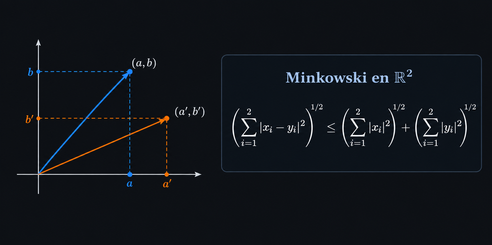

# EJERCICIOS Espacios Métricos

## 4.10 Ejercicio

Prueba que $(\ell_\infty, \|\cdot\|_\infty)$ es un espacio vectorial normado.

---

$$\ell_\infty=\left\{(x_i)_{i=1}^\infty \subset \mathbb{R}:\, \sup_{i \in \mathbb{N}}|x_i| < +\infty\right\}, \qquad \|\bar{x}\|_\infty = \sup_{i \in \mathbb{N}}|x_i|$$

con las operaciones:

- $\bar{x} + \bar{y} = (x_i + y_i)_{i=1}^\infty$
- $\lambda \bar{x} = (\lambda x_i)_{i=1}^\infty$
- $\bar{0}=(0,0,\ldots)$

**$\ell_\infty$ es un espacio vectorial**

Se debe probar:

- $\ell_\infty \neq \emptyset$
- Cerradura para la suma
- Cerradura para el producto por escalar

Los demás axiomas (conmutatividad, asociatividad, distributividad, etc.) se heredan de $\mathbb{R}$, porque las operaciones se hacen coordenada a coordenada.

 

**$\ell_\infty \neq \emptyset$**

$$\sup_i|0|= 0 < \infty \quad \checkmark$$

$$\therefore \bar{0} \in \ell_\infty$$

**Cerradura para la suma**

$$
\begin{aligned}
\bar{x},\bar{y} &\in \ell_\infty \\
\\
\implies \exists \; M_x, M_y &\geq 0 \quad \text{tales que}\\
\\
|x_i| \leq M_x \quad \text{y} &\quad |y_i| \leq M_y \quad \forall \; i
\end{aligned}
$$

(basta tomar $M_x=\|\bar{x}\|_\infty$ y $M_y=\|\bar{y}\|_\infty$, que son finitos).

Por la desigualdad triangular en $\mathbb{R}$:

$$
\begin{aligned}
|x_i + y_i| &\leq |x_i| + |y_i| \\
&\leq M_x + M_y \quad \forall \; i
\end{aligned}
$$

Entonces $M_x+M_y$ es una cota superior de $\{|x_i+y_i| : i\in\mathbb{N}\}$ y, al ser el supremo la menor cota superior:

$$
\sup_i|x_i+y_i| \leq M_x + M_y < \infty
$$

$$\therefore \; \bar{x} + \bar{y} \in \ell_\infty$$

**Cerradura para el producto por escalar**

Sean $\lambda \in \mathbb{R}$ y $\bar{x} \in \ell_\infty$ (con $|x_i|\leq M_x$ para toda $i$).

$$
\begin{aligned}
|\lambda x_i| &= |\lambda||x_i| \\
&\leq |\lambda|M_x \quad \forall \; i
\end{aligned}
$$

Entonces $|\lambda|M_x$ es una cota superior de $\{|\lambda x_i| : i\in\mathbb{N}\}$ y, al ser el supremo la menor cota superior:

$$
\sup_i|\lambda x_i| \leq |\lambda|M_x < \infty
$$

$$\therefore \; \lambda \bar{x} \in \ell_\infty$$

Por lo tanto, $\ell_\infty$ es un espacio vectorial. En particular, para $\bar{x} \in \ell_\infty$, $\|\bar{x}\|_\infty$ es un número real finito, de modo que $\|\cdot\|_\infty: \ell_\infty \longrightarrow \mathbb{R}$ está bien definida.

**$\|\cdot\|_\infty$ es una norma**

Sean $\bar{x}=(x_i)_{i=1}^\infty,\;\bar{y}=(y_i)_{i=1}^\infty \in \ell_\infty$ y $\lambda \in \mathbb{R}$.

**(i)** $\;\|\bar{x}\|_\infty\geq 0$

$$
\begin{aligned}
0 &\leq |x_i| \quad \forall \; i \\
&\leq \sup_{i \in \mathbb{N}}|x_i| \\
&= \|\bar{x}\|_\infty
\end{aligned}
$$

**(ii)** $\;\|\bar{x}\|_\infty=0 \Longleftrightarrow \bar{x}=\bar{0}$

$\mathbf{(\Longrightarrow)}$

$$
\begin{aligned}
\sup_i|x_i| &= 0 \\
\implies 0 \leq |x_i| &\leq \sup_j|x_j| = 0 \quad \forall \; i \\
\implies \qquad |x_i|&=0 \quad \forall \; i \\
\implies \quad \;\;\quad x_i&=0 \quad \forall \; i \\
\implies \qquad \quad \bar{x}&=\bar{0} \quad \checkmark
\end{aligned}
$$

$\mathbf{(\Longleftarrow)}$

$$
\begin{aligned}
\bar{x} = \bar{0} \implies \|\bar{x}\|_\infty &=\sup_i|0| \\
&=0 \quad \checkmark
\end{aligned}
$$

**(iii)** $\;\|\lambda \bar{x}\|_\infty = |\lambda|\|\bar{x}\|_\infty$

$$
\begin{aligned}
\|\lambda \bar{x}\|_\infty&=\sup_i|\lambda x_i| \\
&= \sup_i|\lambda||x_i| \\
&=|\lambda|\sup_i|x_i| \qquad (*) \\
&=|\lambda|\|\bar{x}\|_\infty
\end{aligned}
$$

Justificación de $(*)$:

- Si $\lambda=0$, ambos lados valen $0$.
- Si $\lambda\neq0$: para toda $i$, $|\lambda||x_i|\leq|\lambda|\|\bar{x}\|_\infty$, luego $\sup_i|\lambda||x_i|\leq|\lambda|\|\bar{x}\|_\infty$. Recíprocamente, para toda $i$, $|x_i|=\frac{1}{|\lambda|}|\lambda x_i|\leq\frac{1}{|\lambda|}\sup_j|\lambda x_j|$, luego $\|\bar{x}\|_\infty\leq\frac{1}{|\lambda|}\sup_j|\lambda x_j|$, es decir, $|\lambda|\|\bar{x}\|_\infty\leq\sup_j|\lambda x_j|$.

**(iv)** $\;\|\bar{x}+\bar{y}\|_\infty \leq \|\bar{x}\|_\infty + \|\bar{y}\|_\infty$

$$
\begin{aligned}
|x_i + y_i| &\leq |x_i| + |y_i| \\
&\leq \|\bar{x}\|_\infty + \|\bar{y}\|_\infty \quad \forall \; i
\end{aligned}
$$

Entonces $\|\bar{x}\|_\infty + \|\bar{y}\|_\infty$ es una cota superior de $\{|x_i+y_i| : i\in\mathbb{N}\}$ y, por ser el supremo la menor cota superior:

$$
\|\bar{x}+\bar{y}\|_\infty=\sup_{i \in \mathbb{N}}|x_i+y_i| \leq \|\bar{x}\|_\infty + \|\bar{y}\|_\infty
$$

$$\therefore \; (\ell_\infty, \|\cdot\|_\infty) \quad \text{es un espacio vectorial normado} \quad \blacksquare$$

---

## 4.11 Ejercicio

Demostrar

$$p \in [1, \infty) \implies \; \big(\left(\ell_p \subseteq \ell_\infty\right) \; \land \; \left(\bar{x} \in \ell_p \implies \|\bar{x}\|_\infty \leq \|\bar{x}\|_p\right)\big)$$

---

Sea $p \in [1, \infty)$ arbitraria y $\bar{x}=(x_i)_{i=1}^\infty \in \ell_p$ cualquiera.

$$
\begin{aligned}
\bar{x}\in\ell_p \implies \sum_{i =1}^\infty |x_i|^p &< \infty \\
\implies \quad \; |x_j|^p &\leq \sum_{i=1}^\infty|x_i|^p \quad \forall \; j \in \mathbb{N} \qquad \text{(los demás términos son } \geq 0) \\
\implies \; (|x_j|^p)^{\frac{1}{p}} &\leq \left(\sum_{i=1}^\infty|x_i|^p\right)^{\frac{1}{p}} \qquad (t\mapsto t^{1/p} \text{ es creciente}) \\
\implies \qquad |x_j| &\leq \|\bar{x}\|_p < \infty \quad \forall \; j \in \mathbb{N}
\end{aligned}
$$

Entonces $\|\bar{x}\|_p$ es una cota superior de $\{|x_j| : j\in\mathbb{N}\}$ y, al ser el supremo la menor cota superior:

$$
\|\bar{x}\|_\infty=\sup_{j \in \mathbb{N}}|x_j| \leq \|\bar{x}\|_p < \infty
$$

Por lo tanto, $\bar{x} \in \ell_\infty$ y $\|\bar{x}\|_\infty \leq \|\bar{x}\|_p$. Como $\bar{x}\in\ell_p$ era arbitrario,

$$\therefore \; \ell_p \subseteq \ell_\infty \quad \text{y} \quad \|\bar{x}\|_\infty \leq \|\bar{x}\|_p \quad \forall \; \bar{x} \in \ell_p \qquad \blacksquare$$

---

## 4.12 Ejercicio

Sean $1 \leq p < \infty$, $d \in \mathbb{N}$ y $\bar{x} \in \mathbb{R}^d$, con

$$\|\bar{x}\|_p=\left(\sum_{i=1}^d|x_i|^p\right)^{\frac{1}{p}}, \qquad \|\bar{x}\|_\infty=\max_{1\leq i \leq d}\{|x_i|\}.$$

**1.** Demostrar

$$p \in [1,\infty) \implies \big((\|\bar{x}\|_\infty \leq \|\bar{x}\|_p) \; \land \; (\|\bar{x}\|_p \leq d^{\frac{1}{p}}\|\bar{x}\|_\infty) \big)$$

Como $\{|x_1|,\ldots,|x_d|\}$ es finito, el máximo se alcanza: existe $i_0\in\{1,\ldots,d\}$ con

$$\|\bar{x}\|_\infty = |x_{i_0}|.$$

**Primera desigualdad.**

$$
\begin{aligned}
\|\bar{x}\|_p &= \left(\underbrace{|x_1|^p}_{\geq 0}+\ldots+|x_{i_0}|^p+\ldots+\underbrace{|x_d|^p}_{\geq 0}\right)^{\frac{1}{p}} \\
&\geq \left(|x_{i_0}|^p\right)^{\frac{1}{p}} \qquad (t\mapsto t^{1/p} \text{ es creciente}) \\
&= |x_{i_0}| \\
&= \|\bar{x}\|_\infty \\
\therefore \; \|\bar{x}\|_\infty &\leq \|\bar{x}\|_p
\end{aligned}
$$

**Segunda desigualdad.** 

$$
\begin{aligned}
   |x_j| &\leq |x_{i_0}| \quad \forall \; j \\
   |x_j|^p &\leq|x_{i_0}|^p \qquad \text{(}t \to t^2 \; \text{es creciente)}   
\end{aligned}
$$

$$
\begin{aligned}
\|\bar{x}\|_p &= \left(\underbrace{|x_1|^p}_{\leq |x_{i_0}|^p}+\ldots+\underbrace{|x_{i_0}|^p}_{=|x_{i_0}|^p}+\ldots+\underbrace{|x_d|^p}_{\leq |x_{i_0}|^p}\right)^{\frac{1}{p}} \\
&\leq \left(\underbrace{|x_{i_0}|^p+\ldots+|x_{i_0}|^p}_{d \text{ veces}}\right)^{\frac{1}{p}} \\
&=\left(d|x_{i_0}|^p\right)^{\frac{1}{p}} \\
&= d^{\frac{1}{p}}|x_{i_0}| \\
&= d^{\frac{1}{p}}\|\bar{x}\|_\infty \\
\therefore \; \|\bar{x}\|_p &\leq d^{\frac{1}{p}}\|\bar{x}\|_\infty \qquad \blacksquare
\end{aligned}
$$

**2.** Prueba que

$$
\lim_{p\to\infty} \|\bar{x}\|_p = \|\bar{x}\|_\infty.
$$

Sea $\bar{x}\in\mathbb{R}^d$, con $d\in\mathbb{N}$ fijo. Por el inciso 1, para todo $p\in[1,\infty)$,

$$
\|\bar{x}\|_\infty \leq \|\bar{x}\|_p \leq d^{\frac{1}{p}}\|\bar{x}\|_\infty.
$$

**Límite del extremo derecho.** Como $d\geq 1$ está fijo (no depende de $p$), la función $s\mapsto d^{s}$ es continua en $s=0$. Como $\frac{1}{p}\to 0$ cuando $p\to\infty$,

$$
d^{\frac{1}{p}} \xrightarrow{\;p \to \infty\;} d^{0}=1.
$$

$$
\implies \lim_{p \to \infty}d^{\frac{1}{p}}\|\bar{x}\|_\infty=\|\bar{x}\|_\infty
$$

**Límite del extremo izquierdo.** $\|\bar{x}\|_\infty$ no depende de $p$, así que

$$
\lim_{p \to \infty}\|\bar{x}\|_\infty=\|\bar{x}\|_\infty
$$

**Conclusión.** Como $\|\bar{x}\|_p$ está acotada entre dos expresiones que tienden a $\|\bar{x}\|_\infty$ cuando $p\to\infty$, por el teorema del sándwich el límite de en medio existe y

$$
\therefore \; \lim_{p \to \infty}\|\bar{x}\|_p=\|\bar{x}\|_\infty \qquad \blacksquare
$$

---

## 4.13 Ejercicio

Sea $(V, \|\cdot\|)$ un espacio vectorial normado. Prueba que

$$\big|\|x\| - \|y\|\big| \leq \|x-y\|.$$

Sean $x,y\in V$ arbitrarios.

$$
\begin{aligned}
x&=(x-y)+y \\
\|x\|&=\|(x-y)+y\| \\
&\leq \|x-y\| + \|y\| \\
\implies \; \|x\| - \|y\| &\leq \|x-y\| \qquad \qquad \qquad \qquad \text{(1)}
\end{aligned}
$$

$$
\begin{aligned}
y&=(y-x)+x \\
\|y\|&=\|(y-x)+x\| \\
&\leq\|y-x\|+\|x\| \\
&=\|x-y\|+\|x\| \qquad \text{(N3 con } \alpha=-1) \\
\implies \qquad \|y\| - \|x\| &\leq \|x-y\| \\
\implies \; -(\|x\|-\|y\|) &\leq \|x-y\| \\
\implies \qquad \|x\|-\|y\| &\geq -\|x-y\| \qquad \qquad \qquad \text{(2)}
\end{aligned}
$$

Por (1) y (2) tenemos que

$$-\|x-y\| \leq \|x\| - \|y\| \leq \|x-y\|,$$

y como $|a|\leq c \iff -c\leq a\leq c$,

$$\therefore \; \big|\|x\|-\|y\|\big| \leq \|x-y\| \qquad \blacksquare$$

---

## 4.14 Ejercicio

Sea $V$ un espacio vectorial y sean $\|\cdot\|_a,\;\|\cdot\|_b:\;V \longrightarrow \mathbb{R}\;$ dos normas en $V$. Sea $\alpha > 0$. Prueba que

$$\|v\|:= \alpha\|v\|_a + \|v\|_b$$

define una norma en $V$.

Sean $v,w \in V$ y $\lambda \in \mathbb{R}$ arbitrarios.

**$\|\cdot\|$ está bien definida.** $\|\cdot\|_a$ y $\|\cdot\|_b$ son funciones de $V$ en $\mathbb{R}$ y $\alpha \in \mathbb{R}$, entonces la expresión $\alpha\|v\|_a+\|v\|_b$ es un número real. Por lo tanto, $\|\cdot\|:V\to\mathbb{R}$ está bien definida.

**(i)** $\;\|v\| \geq 0$

Como $\|v\|_a \geq 0$ y $\|v\|_b \geq 0$,

$$
\begin{aligned}
   \alpha > 0 &\implies \; \alpha\|v\|_a \geq 0 \\
   &\implies \; \alpha\|v\|_a + \|v\|_b \geq 0 \\
   &\therefore \; \|v\| \geq 0 \quad \checkmark
\end{aligned}
$$

**(ii)** $\;\|v\|=0 \Leftrightarrow v=0$

$\mathbf{(\Longrightarrow)}$

$$\|v\|=0 \iff \alpha\|v\|_a +\|v\|_b=0$$

Ambos términos de la suma son $\geq 0$. Una suma de términos no negativos es cero sólo si cada término es cero, es decir,

$$\alpha\|v\|_a=0 \quad \land \quad \|v\|_b=0$$

$$
\begin{aligned}
   \alpha > 0 &\implies \|v\|_a=0 \\
   &\implies \; v=0 \; \checkmark
\end{aligned}
$$

$\mathbf{(\Longleftarrow)}$

$$
\begin{aligned}
   v=0 &\implies \; \|0\|_a=0 \; \land \; \|0\|_b=0 \\
   &\implies \; \|0\|=\alpha \cdot 0 + 0 = 0 \; \checkmark
\end{aligned}
$$

**(iii)** $\;\|\lambda v\|=|\lambda|\|v\|$

$$
\begin{aligned}
   \|\lambda v\|&=\alpha \|\lambda v\|_a + \|\lambda v\|_b \\
   &=\alpha |\lambda|\|v\|_a + |\lambda|\|v\|_b \\
   &=|\lambda|\left(\alpha \|v\|_a + \|v\|_b\right) \\
   &=|\lambda|\|v\| \quad \checkmark
\end{aligned}
$$

**(iv)** $\;\|v+w\| \leq \|v\| + \|w\|$

$$
\begin{aligned}
   \|v+w\|&=\alpha\|v+w\|_a + \|v+w\|_b \\
   &\leq \alpha(\|v\|_a+\|w\|_a)+(\|v\|_b+\|w\|_b) \\
   &=\alpha \|v\|_a+\alpha \|w\|_a + \|v\|_b + \|w\|_b \\
   &=(\alpha \|v\|_a+\|v\|_b)+(\alpha\|w\|_a+\|w\|_b) \\
   &=\|v\|+\|w\|
\end{aligned}
$$

$$\therefore \; \|v\|=\alpha \|v\|_a+\|v\|_b \; \text{ es una norma en } V \; \blacksquare$$

---

## 4.15 Ejercicio

Sea $V$ un espacio vectorial y sean $\,\|\cdot\|_a, \|\cdot\|_b\;$ dos normas en $V$. Decimos que son equivalentes, denotado $\|\cdot\|_a \sim \|\cdot\|_b$, si existen constantes positivas $\alpha > 0$ y $\beta > 0$ tales que, para todo $v \in V$:

$$
\|v\|_b \leq \alpha\|v\|_a, \qquad \|v\|_a \leq \beta\|v\|_b.
$$

Prueba que lo anterior define una relación de equivalencia entre las normas en $V$, es decir, que satisface:

1. $\|\cdot\|_a \sim \|\cdot\|_a$ (reflexividad).
2. $\|\cdot\|_a \sim \|\cdot\|_b \Rightarrow \|\cdot\|_b \sim \|\cdot\|_a$ (simetría).
3. $\|\cdot\|_a \sim \|\cdot\|_b$ y $\|\cdot\|_b \sim \|\cdot\|_c \Rightarrow \|\cdot\|_a \sim \|\cdot\|_c$ (transitividad).

**1. Reflexividad:** $\|\cdot\|_a \sim \|\cdot\|_a$

Sean $\alpha=\beta=1 > 0$. Para todo $v \in V$ se cumple $\|v\|_a = \|v\|_a$; en particular,

$$\|v\|_a \leq \alpha\|v\|_a \quad \land \quad \|v\|_a \leq \beta\|v\|_a.$$

$$\therefore \; \|\cdot\|_a \sim \|\cdot\|_a$$

**2. Simetría:** $\|\cdot\|_a \sim \|\cdot\|_b \Rightarrow \|\cdot\|_b \sim \|\cdot\|_a$

$\|\cdot\|_a \sim \|\cdot\|_b \implies \exists \; \alpha, \beta >0$ tales que, para todo $v \in V$,

$$\|v\|_b \leq \alpha\|v\|_a, \qquad \|v\|_a \leq \beta\|v\|_b.$$

Para ver que $\|\cdot\|_b \sim \|\cdot\|_a$, hay que encontrar constantes $\alpha',\beta'>0$ con

$$\|v\|_a \leq \alpha'\|v\|_b, \qquad \|v\|_b \leq \beta'\|v\|_a \qquad \forall\, v\in V.$$

Basta tomar $\alpha'=\beta>0$ y $\beta'=\alpha>0$.

$$\therefore \; \|\cdot\|_b \sim \|\cdot\|_a$$

**3. Transitividad:** $\|\cdot\|_a \sim \|\cdot\|_b \; \land \; \|\cdot\|_b \sim \|\cdot\|_c \implies \; \|\cdot\|_a \sim \|\cdot\|_c$

$\|\cdot\|_a \sim \|\cdot\|_b \implies \exists \; \alpha_1, \beta_1 >0$ tales que, para todo $v \in V$,

$$\underbrace{\|v\|_b \leq \alpha_1\|v\|_a}_{\text{(i)}},\; \underbrace{\|v\|_a \leq \beta_1\|v\|_b}_{\text{(ii)}}$$

$\|\cdot\|_b \sim \|\cdot\|_c \implies \exists \; \alpha_2, \beta_2 >0$ tales que, para todo $v \in V$,

$$\underbrace{\|v\|_c \leq \alpha_2\|v\|_b}_{\text{(iii)}},\; \underbrace{\|v\|_b \leq \beta_2\|v\|_c}_{\text{(iv)}}$$

Para todo $v \in V$,

$$\|v\|_c \leq \alpha_2\|v\|_b \leq \alpha_1\alpha_2\|v\|_a \hspace{1.5cm} \text{(iii), (i)}$$

y también

$$\|v\|_a \leq \beta_1\|v\|_b \leq \beta_1\beta_2\|v\|_c \hspace{1.5cm} \text{(ii), (iv)}$$

Sean

$$\alpha = \alpha_1\alpha_2 > 0 \quad \land \quad \beta=\beta_1\beta_2 > 0.$$

Entonces, para todo $v \in V$,

$$\|v\|_c \leq \alpha\|v\|_a \quad \land \quad \|v\|_a \leq \beta\|v\|_c$$

$$\therefore \; \|\cdot\|_a \sim \|\cdot\|_c$$

Por lo tanto, $\sim$ es una relación de equivalencia entre las normas de $V$. $\blacksquare$

---

## 4.16 Ejercicio

Sea $(U, \|\cdot\|_U), (V, \|\cdot\|_V)$ dos espacios vectoriales normados. Para las siguientes funciones definidas en $U \times V$ determina cuáles son normas en $U \times V$, en caso de que no lo sean, exhibe por que.

**1**. $\|(u,v)\| = \left(\|u\|_U^2 + \|v\|_V^2\right)^{1/2}$.  
**2**. $\|(u,v)\| = \|u\|_U \|v\|_V$.  
**3**. $\|(u,v)\| = \max\{\|u\|_U, \|v\|_V\}$.  
**4**. $\|(u,v)\| = \left(\|u\|^{1/2} + \|v\|^{1/2}\right)^2$.  

---

**1**. $\|(u,v)\| = \left(\|u\|_U^2 + \|v\|_V^2\right)^{1/2}$.

$$\|\cdot\|_U:\;U \longrightarrow \mathbb{R}$$
$$\|\cdot\|_V:\;V \longrightarrow \mathbb{R}$$
$$\|\cdot\|_{U \times V}:\;U \times V \longrightarrow \mathbb{R}$$

$$\|(u,v)\|=\left(\|u\|_U^2+\|v\|_V^2\right)^{\frac{1}{2}}$$

**p.d.** que $\|(u,v)\|$ es una norma.

$U \times V$ espacio vectorial

- $(u,v)+(u',v')=(u+u',v+v')$
- $\lambda(u,v)=(\lambda u, \lambda v)$

Denotamos:

$$\|u\|_U=a,\;\|v\|_V=b,\;\|u'\|_U=a',\;\|v'\|_V=b'$$

**(i)**. $\;\|(u,v)\| \geq 0$

$$
\begin{aligned}
\|(u,v)\| &= \left(\|u\|_U^2+\|v\|_V^2\right)^{\frac{1}{2}} \\
&\geq 0 \quad \checkmark
\end{aligned}
$$

**(ii)** $\|(u,v)\|=0 \Leftrightarrow (u,v)=0$

$$
\begin{aligned}
   \|(u,v)\|=0 \iff \; \left(\|u\|_U^2+\|v\|_V^2\right)^{\frac{1}{2}}&=0 \\
   \iff \, (a^2+b^2)^{\frac{1}{2}}&=0 \\
   \iff \quad \; a^2+b^2 &= 0 \\
   \iff \qquad a=b&=0 \\
   \iff \qquad (u,v)&=0 \quad \checkmark
\end{aligned}
$$

**(iii)** $\;\|(\lambda u,\lambda v)\|=|\lambda|\|(u,v)\|$

$$
\begin{aligned}
   \|(\lambda u, \lambda v)\| &=\left(\|\lambda u\|_U^2 + \|\lambda v\|_V^2\right)^\frac{1}{2} \\
   &=\left(|\lambda|^2a^2+|\lambda|^2b^2\right)^{\frac{1}{2}} \\
   &=\left(|\lambda|^2(a^2+b^2)\right)^{\frac{1}{2}} \\
   &=|\lambda|(a^2+b^2)^{\frac{1}{2}} \\
   &=|\lambda|\|(u,v)\| \quad \checkmark
\end{aligned}
$$

**(iv)** $\;\|(u,v)+(u',v')\| \leq \|(u,v)\|+\|(u',v')\|$

donde

- $\|(u,v)\|=\sqrt{a^2+b^2}$
- $\|(u',v')\|=\sqrt{a'^2+b'^2}$

**Paso 1.** Por definición:

$$
\begin{aligned}
   \|(u,v)+(u',v')\|&=\|(u+u',v+v')\| \\
   &\overset{\text{def}}{=}\left(\|u+u'\|_U^2+\|v+v'\|_V^2\right)^{\frac{1}{2}}  \tag{1}
\end{aligned}
$$

**Paso 2.** Usamos la desigualdad del triángulo en la norma de cada espacio:

$$
\begin{aligned}
\|u+u'\|_U &\leq \|u\|_U+\|u'\|_U = a + a' \\
\|v+v'\|_V &\leq \|v\|_V+\|v'\|_V = b+b'
\end{aligned}
$$

**Paso 3.** Como $\;t \mapsto t^2\;$ es creciente en $[0,\infty)$ y los números $\|u+u'\|_U,\;\|v+v'\|_V,\;a+a',\;b+b'\;$ son $\geq 0$:

$$
\begin{aligned}
   \|u+u'\|_U^2 &\leq (a+a')^2 \\
   \|v+v'\|_V^2 &\leq (b+b')^2
\end{aligned}
$$

Sumando ambas desigualdades:

$$\|u+u'\|_U^2+\|v+v'\|_V^2 \leq (a+a')^2 + (b+b')^2 \tag{2}$$

**Paso 4.** Como la raíz cuadrada es creciente en $[0,\infty)$, aplicándola a (2) y usando (1):

$$\|(u+u',v+v')\| = (\|u+u'\|_U^2+\|v+v'\|_V^2)^{\frac{1}{2}} \leq \sqrt{(a+a')^2 + (b+b')^2} \tag{3}$$

**Paso 5.** Podemos ver las parejas de normas como parejas de números $(a,b),\;(a',b') \in \mathbb{R}^2$:

$$(a,b) + (a',b')=(a+a',\, b+b') \in \mathbb{R}^2$$

 

  

 

Su norma euclidiana es

$$
\begin{aligned}
\|(a,b)+(a',b')\|_2 &= \|(a+a',b+b')\|_2 \\
&= \sqrt{(a+a')^2+(b+b')^2}
\end{aligned}
$$

Por la desigualdad triangular de $\|\cdot\|_2$ en $\mathbb{R}^2$ (Minkowski con $p=2$):

$$
\sqrt{(a+a')^2+(b+b')^2} \leq \underbrace{\sqrt{a^2+b^2}}_{\|(u,v)\|} + \underbrace{\sqrt{a'^2+b'^2}}_{\|(u',v')\|} \tag{4}
$$

**Paso 6.** Combinando (1), (3) y (4):

$$
\begin{aligned}
\|(u,v)+(u',v')\| &= \|(u+u',v+v')\| \\
&=(\|u+u'\|_U^2+\|v+v'\|_V^2)^{\frac{1}{2}} \\
&\leq \sqrt{(a+a')^2+(b+b')^2} \\
&\leq \sqrt{a^2+b^2} + \sqrt{a'^2+b'^2} \\
&= \|(u,v)\|+\|(u',v')\| \quad \checkmark
\end{aligned}
$$

$$\therefore \;\; \|(u,v)\|=\left(\|u\|_U^2+\|v\|_V^2\right)^{\frac{1}{2}} \;\text{ es una norma en }\; U \times V$$

---

**2**. $\|(u,v)\| = \|u\|_U \|v\|_V$.

$$\|\cdot\|_U:\;U \longrightarrow \mathbb{R}$$
$$\|\cdot\|_V:\;V \longrightarrow \mathbb{R}$$
$$\|\cdot\|_{U \times V}:\;U \times V \longrightarrow \mathbb{R}$$

$$\|(u,v)\|=\|u\|_U\,\|v\|_V$$

**p.d.** que $\|(u,v)\|$ **no** es una norma.

Supongamos $U\neq\{0\}$ y $V\neq\{0\}$ (si no, no existirían los elementos no nulos que usamos).

$U \times V$ espacio vectorial

- $(u,v)+(u',v')=(u+u',v+v')$
- $\lambda(u,v)=(\lambda u, \lambda v)$

**(ii)** $\;\|(u,v)\|=0 \Leftrightarrow (u,v)=0\;$ **No se cumple**

Sea $u\neq 0$ en $U$. Entonces $(u,0)\neq(0,0)$, pero

$$
\begin{aligned}
\|(u,0)\|&=\|u\|_U\,\|0\|_V \\
&=\|u\|_U\cdot 0 \\
&=0
\end{aligned}
$$

Por lo que existe $(u,0) \neq 0$ con $\|(u,0)\|=0$.

**Ejemplo concreto.** Con $U=V=\mathbb{R}$ y $\|\cdot\|=|\cdot|$: $\|(1,0)\|=1\cdot 0=0$ y $(1,0)\neq(0,0)$.

**(iv)** $\;\|(u,v)+(u',v')\| \leq \|(u,v)\|+\|(u',v')\|\;$ **No se cumple**

Sean $u\neq0$ en $U$ y $v'\neq0$ en $V$. Entonces $(u,0)+(0,v')=(u,v'),\;$ y

$$\|(u,0)+(0,v')\|=\|(u,v')\|=\|u\|_U\,\|v'\|_V>0,$$

porque ambas normas son positivas. En cambio

$$
\begin{aligned}
\|(u,0)\|+\|(0,v')\|&=\|u\|_U\|0\|_V+\|0\|_U\|v'\|_V \\
&=0+0 \\
&=0.
\end{aligned}
$$

Si se cumpliera la desigualdad triangular tendríamos

$$0 < \|(u,0)+(0,v')\| \leq \|(u,0)\|+\|(0,v')\| = 0 \quad \mathbf{\text{!}}$$

lo cual es absurdo.

**Ejemplo concreto.** Con $U=V=\mathbb{R}$: $\|(1,0)+(0,1)\|=1\cdot1=1>0=\|(1,0)\|+\|(0,1)\|$.

$$\therefore \;\; \|(u,v)\|=\|u\|_U\|v\|_V \;\text{ no es una norma en }\; U \times V$$

---

**3**. $\|(u,v)\| = \max\{\|u\|_U,\|v\|_V\}$.

$$\|\cdot\|_U:\;U \longrightarrow \mathbb{R}$$
$$\|\cdot\|_V:\;V \longrightarrow \mathbb{R}$$
$$\|\cdot\|_{U \times V}:\;U \times V \longrightarrow \mathbb{R}$$

$$\|(u,v)\|=\max\{\|u\|_U,\|v\|_V\}$$

**p.d.** que $\|(u,v)\|$ es una norma.

$U \times V$ espacio vectorial

- $(u,v)+(u',v')=(u+u',v+v')$
- $\lambda(u,v)=(\lambda u, \lambda v)$

Denotamos:

$$\|u\|_U=a,\;\|v\|_V=b,\;\|u'\|_U=a',\;\|v'\|_V=b'$$

**(i)**. $\;\|(u,v)\| \geq 0$

$$
\begin{aligned}
   \|(u,v)\| &= \max\{a,b\} \\
   &\geq 0 \quad \checkmark
\end{aligned}
$$

pues $a,b\geq 0$.

**(ii)** $\;\|(u,v)\|=0 \Leftrightarrow (u,v)=0$

$$
\begin{aligned}
   \|(u,v)\|=0 &\iff \max\{a,b\}=0 \\
   &\iff a = 0 \; \land \; b = 0 \\
   &\iff \|u\|_U = 0 \; \land \; \|v\|_V = 0 \\
   &\iff u=0 \; \land \; v=0 \\
   &\iff (u,v)=0 \quad \checkmark
\end{aligned}
$$

Para "$\Rightarrow$" en la segunda línea: $0\leq a,b\leq\max\{a,b\}=0$. Para "$\Leftarrow$": $\max\{0,0\}=0$.

**(iii)** $\;\|(\lambda u,\lambda v)\| = |\lambda|\|(u,v)\|$

$$
\begin{aligned}
   \|(\lambda u,\lambda v)\|&=\max\{\|\lambda u\|_U,\|\lambda v\|_V\} \\
   &=\max\{|\lambda|\| u\|_U,|\lambda|\| v\|_V\} \\
   &=\max\{|\lambda|a,|\lambda|b\} \\
   &=|\lambda|\max\{a,b\} \\
   &=|\lambda|\,\|(u,v)\| \quad \checkmark
\end{aligned}
$$

**(iv)** $\;\|(u,v)+(u',v')\| \leq \|(u,v)\|+\|(u',v')\|$

Sean $M=\max\{a,b\}$ y $M'=\max\{a',b'\}$.

**Paso 1.** Por definición:

$$\|(u,v)+(u',v')\|=\|(u+u',v+v')\|=\max\{\|u+u'\|_U,\|v+v'\|_V\} \tag{1}$$

**Paso 2.** Desigualdad del triángulo en cada espacio (aquí es $\leq$, no $=$):

$$
\begin{aligned}
\|u+u'\|_U &\leq \|u\|_U+\|u'\|_U = a+a' \\
\|v+v'\|_V &\leq \|v\|_V+\|v'\|_V = b+b'
\end{aligned}
$$

**Paso 3.** Como $a\leq M,\; b\leq M,\; a'\leq M',\; b'\leq M'$:

$$a+a'\leq M+M', \qquad b+b'\leq M+M'.$$

**Paso 4.** Juntando los pasos 2 y 3:

$$
\begin{aligned}
\|u+u'\|_U \leq a+a' &\leq M+M', \\
\|v+v'\|_V \leq b+b' &\leq M+M'.
\end{aligned}
$$

**Paso 5.** Si dos números son $\leq c$, su máximo también es $\leq c$. Con $c=M+M'$ y usando (1):

$$
\begin{aligned}
\|(u,v)+(u',v')\| &= \max\{\|u+u'\|_U,\|v+v'\|_V\} \\
&\leq M+M' \\
&= \max\{a,b\}+\max\{a',b'\} \\
&= \|(u,v)\|+\|(u',v')\| \quad \checkmark
\end{aligned}
$$

$$\therefore \;\; \|(u,v)\|=\max\{\|u\|_U,\|v\|_V\} \;\text{ es una norma en }\; U \times V$$

---

**4**. $\;\|(u,v)\| = \left(\|u\|_U^{1/2} + \|v\|_V^{1/2}\right)^2$

$$\|\cdot\|_U:\;U \longrightarrow \mathbb{R}$$
$$\|\cdot\|_V:\;V \longrightarrow \mathbb{R}$$
$$\|\cdot\|_{U \times V}:\;U \times V \longrightarrow \mathbb{R}$$

$$\|(u,v)\|=\left(\|u\|_U^{\frac{1}{2}} + \|v\|_V^{\frac{1}{2}}\right)^2$$

**p.d.** que $\|(u,v)\|$ **no** es una norma.

**(iv)** $\;\|(u,v)+(u',v')\| \leq \|(u,v)\|+\|(u',v')\|\;$ **No se cumple**

Supongamos $\;U\neq\{0\}$ y $V\neq\{0\}$ (si alguno fuera trivial, $U\times V$ sería esencialmente el otro espacio). Elegimos $u\in U,\;v'\in V$ con

$$\|u\|_U=1, \qquad \|v'\|_V=1,$$

lo cual es posible: si $x\neq 0$, entonces $\frac{x}{\|x\|}$ tiene norma $1$.

Consideremos los vectores $\;(u,0)$ y $(0,v')$ en $\;U\times V$. Entonces

$$\|(u,0)\|=\left(\|u\|_U^{1/2}+\|0\|_V^{1/2}\right)^2=\left(1+0\right)^2=1,$$

$$\|(0,v')\|=\left(\|0\|_U^{1/2}+\|v'\|_V^{1/2}\right)^2=\left(0+1\right)^2=1,$$

y como $(u,0)+(0,v')=(u,v')$,

$$\|(u,0)+(0,v')\|=\|(u,v')\|=\left(1^{1/2}+1^{1/2}\right)^2=4.$$

Por lo tanto

$$\|(u,0)+(0,v')\|=4>2=\|(u,0)\|+\|(0,v')\|,$$

y no se cumple la desigualdad del triángulo.

$$\therefore\;\|(u,v)\|=\left(\|u\|_U^{1/2}+\|v\|_V^{1/2}\right)^2\;\text{ no es una norma en }\;U\times V$$

---

## 4.17 Ejercicio

Prueba que $d(x,y)=\left|\frac{1}{x} - \frac{1}{y}\right|$ es una métrica en $(0, \infty)$.

**Demostración**

$d(x,y)=\big|\frac{1}{x} - \frac{1}{y}\big|$ esta bien definido, ya que $x,y \in (0,\infty)$

**(i)** $\;d(x,y)\geq 0$

$$
\begin{aligned}
   d(x,y)&=\left|\frac{1}{x} - \frac{1}{y}\right| \\
   &\geq 0 \quad \checkmark
\end{aligned}
$$

**(ii)** $\;d(x,y)= \Leftrightarrow x=y$

$$
\begin{aligned}
   d(x,y)=0 &\iff \left|\frac{1}{x} - \frac{1}{y}\right|=0 \\
   &\iff \frac{1}{x} - \frac{1}{y} =0 \\
   &\iff \frac{1}{x} = \frac{1}{y} \\
   &\iff x=y \quad \checkmark
\end{aligned}
$$

**(iii)** $\;d(x,y)=d(y,x)$

$$
\begin{aligned}
   d(x,y) &= \left|\frac{1}{x}-\frac{1}{y}\right| \\
   &= \left|-\left(\frac{1}{y}-\frac{1}{x}\right)\right| \\
   &= |-1|\left|\frac{1}{y}-\frac{1}{x}\right| \\
   &= \left|\frac{1}{y}-\frac{1}{x}\right| \\
   &= d(y,x) \quad \checkmark
\end{aligned}
$$

**(iv)** $\;d(x,y)\leq d(x,z)+d(z,y)$

$$
\begin{aligned}
   d(x,y)&=\left|\frac{1}{x}-\frac{1}{y}\right| \\
   &=\left|\frac{1}{x}-\frac{1}{z}+\frac{1}{z}-\frac{1}{y}\right| \\
   &=\left|\left(\frac{1}{x}-\frac{1}{z}\right)+\left(\frac{1}{z}-\frac{1}{y}\right)\right| \\
   &\leq \left|\frac{1}{x}-\frac{1}{z}\right|+\left|\frac{1}{z}-\frac{1}{y}\right| \\
   &=d(x,z)+d(z,y) \quad \checkmark
\end{aligned}
$$

$$\therefore \;d(x,y)=\left|\frac{1}{x} - \frac{1}{y}\right|\;\text{\;es una métrica en\;} (0, \infty)$$

---

## 4.18 Ejercicio

La otra desigualdad del triángulo

Sea $(X,d)$ un espacio métrico. Prueba que para todos $x,y,z \in X$

$$|d(x,z)-d(y,z)| \leq d(x,y)$$

**Demostración**

Sean $x,y,z \in X$. Recordemos que para $a,b \in \mathbb{R}$:

$$|a| \leq b \iff -b \leq a \leq b$$

Por lo tanto, basta probar

$$-d(x,y) \leq d(x,z)-d(y,z) \leq d(x,y)$$

**(i)** $\;d(x,z)-d(y,z) \leq d(x,y)$

Por la desigualdad del triángulo:

$$
\begin{aligned}
d(x,z) &\leq d(x,y)+d(y,z) \\
\implies d(x,z)-d(y,z) &\leq d(x,y) \quad \checkmark
\end{aligned}
$$

**(ii)** $\;-d(x,y) \leq d(x,z)-d(y,z)$

Por la desigualdad del triángulo y la simetría:

$$
\begin{aligned}
d(y,z) &\leq d(y,x)+d(x,z) \\
&= d(x,y)+d(x,z) \\
\implies d(y,z)-d(x,z) &\leq d(x,y) \\
\implies -d(x,y) &\leq d(x,z)-d(y,z) \quad \checkmark
\end{aligned}
$$

**Conclusión**

De (i) y (ii):

$$-d(x,y) \leq d(x,z)-d(y,z) \leq d(x,y)$$

$$\therefore \; |d(x,z)-d(y,z)| \leq d(x,y) \quad \blacksquare$$

---

## 4.19 Ejercicio

Sea $(X,d)$ un espacio métrico. Define una nueva función $\rho: X \times X \to \mathbb{R}$ dada por

$$
\rho(x,y) = \frac{d(x,y)}{1 + d(x,y)}
$$

Prueba que $\rho$ es una métrica.

**Sugerencia**: Considera la función 

$$
\varphi: [0,\infty) \to [0,1), \\[0.5em]
\varphi(t) = \frac{t}{1+t}
$$

- Probar que es monónotona creciente: $s \leq t \implies \varphi(s) \leq \varphi(t)$
- Probar que separa argumentos en la suma: $\varphi(s+t) \leq \varphi(s) + \varphi(t)$

### Version Jaenette

**Demostración**

- **$\varphi$ es monótona creciente**

   Sean $s,t \in [0,\infty)$ tales que $s \leq t.\;$ p.d. $\varphi(s) \leq \varphi(t)$.

   Notemos que

   $$
   \begin{aligned}
   \varphi(t)-\varphi(s) &= \frac{t}{1+t}-\frac{s}{1+s} \\
   \\
   &= \frac{t(1+s)-s(1+t)}{(1+t)(1+s)} \\
   \\
   &= \frac{t-s}{(1+t)(1+s)}
   \end{aligned}
   $$

   Como $s \leq t \implies t-s \geq 0$.

   Como $s,t \in [0,\infty)$ sabemos que $(1+t),(1+s)>0 \implies (1+t)(1+s)>0$.

   $$
   \begin{array}{rc}
   \implies & \frac{t-s}{(1+t)(1+s)} \geq 0 \\[0.5em]
   \implies & \varphi(t)-\varphi(s) \geq 0 \\[0.5em]
   \implies & \varphi(s) \leq \varphi(t)
   \end{array}
   $$

   $$\therefore \; \varphi \text{ es monótona creciente.}$$

- **$\varphi(s+t) \leq \varphi(s)+\varphi(t)$**

   Ahora veamos que $\varphi(s+t) \leq \varphi(s)+\varphi(t) \quad \forall \; s,t \in [0,\infty)$.

   Sean $s,t \in [0,\infty)$.

   Notemos que

   $$
   \begin{aligned}
   1+s &\leq 1+s+t \\
   \implies \frac{1}{1+s+t} &\leq \frac{1}{1+s} \\
   \implies \frac{s}{1+s+t} &\leq \frac{s}{1+s}
   \end{aligned}
   $$

   y

   $$
   \begin{aligned}
   1+t &\leq 1+s+t \\
   \implies \frac{1}{1+s+t} &\leq \frac{1}{1+t} \\
   \implies \frac{t}{1+s+t} &\leq \frac{t}{1+t}
   \end{aligned}
   $$

   Sumando tenemos que

   $$
   \begin{aligned}
   \frac{s}{1+s+t}+\frac{t}{1+s+t} &\leq \frac{s}{1+s}+\frac{t}{1+t} \\
   \\
   \implies \frac{s+t}{1+s+t} &\leq \frac{s}{1+s}+\frac{t}{1+t} \\
   \\
   \implies \varphi(s+t) &\leq \varphi(s)+\varphi(t)
   \end{aligned}
   $$

**$\rho$ es una métrica**

Sean $x,y,z \in X$.

**(M1)** $\;$ P.d. $\rho(x,y) \geq 0$

$d$ es métrica

$$
\begin{aligned}
d(x,y) &\geq 0 \\
\implies 1+d(x,y) &\geq 1 \\ 
&> 0
\end{aligned}
$$

$$
\begin{aligned}
\implies \; \rho(x,y)&=\frac{d(x,y)}{1+d(x,y)} \\
&\geq 0 \quad \checkmark
\end{aligned}
$$

**(M2)** $\;$ p.d. $\rho(x,y)=0 \iff x=y$

$$
\begin{aligned}
\rho(x,y)=0 &\iff \frac{d(x,y)}{1+d(x,y)}=0 \\
&\iff d(x,y)=0 \\
&\iff x=y \quad \text{pues } d \text{ es métrica}
\end{aligned}
$$

**(M3)** $\;$ p.d. $\rho(x,y)=\rho(y,x)$

$$
\begin{aligned}
\rho(x,y) &= \frac{d(x,y)}{1+d(x,y)} \\
\\
&= \frac{d(y,x)}{1+d(y,x)} \qquad d \text{ es métrica} \\
\\
&= \rho(y,x)
\end{aligned}
$$

**(M4)** $\;$ p.d. $\rho(x,y) \leq \rho(x,z)+\rho(z,y)$

Como $d$ es métrica, tenemos que $d(x,y) \leq d(x,z)+d(z,y)$.

$$
\begin{aligned}
\implies \varphi\big(d(x,y)\big) &\leq \varphi\big(d(x,z)+d(z,y)\big) \\
&\leq \varphi\big(d(x,z)\big)+\varphi\big(d(z,y)\big) \\
\\
\implies \frac{d(x,y)}{1+d(x,y)} &\leq \frac{d(x,z)}{1+d(x,z)}+\frac{d(z,y)}{1+d(z,y)} \\
\\
\implies \rho(x,y) &\leq \rho(x,z)+\rho(z,y)
\end{aligned}
$$

$$\therefore \; \rho(x,y)=\frac{d(x,y)}{1+d(x,y)} \text{ es una métrica en } X \quad \blacksquare$$

### Version Fco. Javier Torres

**Demostración**

Tomando la función $\varphi : [0,\infty) \to [0,1)$ como en la sugerencia notamos que

$$\rho(x,y) = \varphi(d(x,y)).$$

De la ecuación anterior, y usando que $d$ es una métrica, se puede checar directamente que $\rho$ satisface:

1. $\rho(x,y) \geq 0$.
2. $\rho(x,y) = 0$ si y sólo si $x = y$. Ojo, aquí se usa que $\varphi(t) = 0$ sii $t = 0$.
3. $\rho(x,y) = \rho(y,x)$.

La condición que no es tan clara es la desigualdad del triángulo. Para esto primero vamos a probar las dos condiciones dadas en la sugerencia.

1. Primero vamos a probar que $\varphi$ es estrictamente creciente. Esto se puede hacer de varias formas, veamos dos.

   **De manera directa.**

   Tomamos $0 \leq s < t$ y debemos probar que $\varphi(s) < \varphi(t)$ o equivalentemente, $0 < \varphi(t) - \varphi(s)$. Haciendo la cuenta resulta

$$
\begin{aligned}
\varphi(t) - \varphi(s) &= \frac{t}{1+t} - \frac{s}{1+s} \\
\\
&= \frac{t(1+s) - s(1+t)}{(1+t)(1+s)} \\
\\
&= \frac{t-s}{(1+t)(1+s)}
\end{aligned}
$$

   donde vemos que éste último cociente es positivo pues $t > s$.

   **Usando derivadas.**

   Ya que $\varphi$ es diferenciable en $[0,\infty)$ sabemos que si su derivada es positiva entonces es estrictamente creciente. Aplicando la regla del cociente obtenemos

$$
\varphi'(t) = \frac{(1+t)(1) - t(1)}{(1+t)^2} = \frac{1}{(1+t)^2}
$$

   el cual claramente es positivo.

2. Ahora veamos que se satisface $\varphi(s+t) < \varphi(s) + \varphi(t)$, para todos $s,t > 0$. Vamos a proceder de manera directa.

   Primero notamos que

$$
\frac{s}{1+s+t} \leq \frac{s}{1+s}, \qquad \frac{t}{1+t+s} < \frac{t}{1+t}
$$

   sumando ambas desigualdades obtenemos

$$
\frac{t+s}{1+t+s} < \frac{t}{1+t} + \frac{s}{1+s}
$$

   lo cual se traduce a $\varphi(s+t) < \varphi(s) + \varphi(t)$.

Ahora sí, se puede probar fácilmente que $\rho$ satisface la desigualdad del triángulo. Empezando con la desigualdad del triángulo para $d$ tenemos

$$
d(x,y) \leq d(x,z) + d(z,y)
$$

aplicando $\varphi$ a ambos lados, usando que $\varphi$ es monótona creciente y usando la propiedad 2 de la sugerencia llegamos a

$$
\begin{aligned}
\varphi(d(x,y)) &\leq \varphi(d(x,z) + d(z,y)) \\
&\leq \varphi(d(x,z)) + \varphi(d(z,y)),
\end{aligned}
$$

y podemos concluir

$$
\rho(x,y) = \varphi(d(x,y)) \leq \varphi(d(x,z)) + \varphi(d(z,y)) = \rho(x,z) + \rho(z,y).
$$

---

## 4.20 Ejercicio

Por $\{0,1\}^{\mathbb{N}}$ denotamos al conjunto de todas las sucesiones de 0's y 1's. Es decir $a \in \{0,1\}^{\mathbb{N}}$ si y sólo si $a = (a_n)_{n=1}^{\infty}$, con $a_n \in \{0,1\}$, para toda $n$.

En $\{0,1\}^{\mathbb{N}}$ define

$$
d(a,b) = \sum_{n=1}^{\infty} \frac{1}{2^n}|a_n - b_n|
$$

Prueba que $d$ es una métrica en $\{0,1\}^{\mathbb{N}}$.

**Demostración**

**$d$ está bien definida**

Sean $a,b \in \{0,1\}^{\mathbb{N}}$. Como $a_n,b_n \in \{0,1\}$, entonces $|a_n-b_n| \leq 1$.

$$
\begin{aligned}
0 \leq \frac{1}{2^n}|a_n-b_n| &\leq \frac{1}{2^n} \quad \forall \; n
\end{aligned}
$$

Como $\sum_{n=1}^{\infty}\frac{1}{2^n}=1$ converge, por el criterio de comparación $\sum_{n=1}^{\infty}\frac{1}{2^n}|a_n-b_n|$ converge, y además

$$d(a,b) \leq 1 < \infty$$

Por lo tanto $d:\{0,1\}^{\mathbb{N}}\times\{0,1\}^{\mathbb{N}} \to \mathbb{R}$ está bien definida.

Sean $a=(a_n)_{n=1}^{\infty},\;b=(b_n)_{n=1}^{\infty},\;c=(c_n)_{n=1}^{\infty} \in \{0,1\}^{\mathbb{N}}$.

**(M1)** $\;d(a,b)\geq 0$

$$
\begin{aligned}
\frac{1}{2^n}|a_n-b_n| &\geq 0 \quad \forall \; n \\
\implies \sum_{n=1}^{\infty}\frac{1}{2^n}|a_n-b_n| &\geq 0 \\
\implies d(a,b) &\geq 0 \quad \checkmark
\end{aligned}
$$

**(M2)** $\;d(a,b)=0 \iff a=b$

$\mathbf{(\Longleftarrow)}$

$$
\begin{aligned}
a=b \implies |a_n-b_n| &= 0 \quad \forall \; n \\
\implies d(a,b) &= \sum_{n=1}^{\infty}0 \\
&= 0 \quad \checkmark
\end{aligned}
$$

$\mathbf{(\Longrightarrow)}$

Sea $k \in \mathbb{N}$ cualquiera. Como todos los términos de la serie son no negativos:

$$
\begin{aligned}
0 \leq \frac{1}{2^k}|a_k-b_k| &\leq \sum_{n=1}^{\infty}\frac{1}{2^n}|a_n-b_n| \\
&= d(a,b) \\
&= 0 \\
\implies \frac{1}{2^k}|a_k-b_k| &= 0 \\
\implies |a_k-b_k| &= 0 \\
\implies a_k &= b_k \quad \forall \; k \\
\implies a &= b \quad \checkmark
\end{aligned}
$$

**(M3)** $\;d(a,b)=d(b,a)$

$$
\begin{aligned}
d(a,b) &= \sum_{n=1}^{\infty}\frac{1}{2^n}|a_n-b_n| \\
&= \sum_{n=1}^{\infty}\frac{1}{2^n}|-(b_n-a_n)| \\
&= \sum_{n=1}^{\infty}\frac{1}{2^n}|b_n-a_n| \\
&= d(b,a) \quad \checkmark
\end{aligned}
$$

**(M4)** $\;d(a,b)\leq d(a,c)+d(c,b)$

Por la desigualdad del triángulo en $\mathbb{R}$, para toda $n$:

$$
\begin{aligned}
|a_n-b_n| &= |(a_n-c_n)+(c_n-b_n)| \\
&\leq |a_n-c_n|+|c_n-b_n| \\
\implies \frac{1}{2^n}|a_n-b_n| &\leq \frac{1}{2^n}|a_n-c_n|+\frac{1}{2^n}|c_n-b_n|
\end{aligned}
$$

Las series $d(a,c)$ y $d(c,b)$ convergen (bien definida), por lo que podemos sumar sobre $n$ y separar la serie de la derecha:

$$
\begin{aligned}
\sum_{n=1}^{\infty}\frac{1}{2^n}|a_n-b_n| &\leq \sum_{n=1}^{\infty}\frac{1}{2^n}|a_n-c_n|+\sum_{n=1}^{\infty}\frac{1}{2^n}|c_n-b_n| \\
\implies d(a,b) &\leq d(a,c)+d(c,b) \quad \checkmark
\end{aligned}
$$

$$\therefore \; d(a,b)=\sum_{n=1}^{\infty}\frac{1}{2^n}|a_n-b_n| \text{ es una métrica en } \{0,1\}^{\mathbb{N}} \quad \blacksquare$$

---

## 4.21 Ejercicio

Por $C[a,b]$ denotamos al conjunto de funciones continuas en el intervalo $[a,b]$. En $C[a,b]$ define

$$
d(f,g) = \int_a^b |f(t) - g(t)|\,dt.
$$

Prueba que $d$ es una métrica en $C[a,b]$.

### Version Fco.Javier Torres.

**Demostración**

**(1)** $\;d(a,b) \leq 0$

$$
\begin{aligned}
   0 &\leq \int_a^b |f(t) - g(t)|\,dt \\
   &=d(a,b) \quad \checkmark
\end{aligned}
$$

**(ii)** $\;d(a,b)=0 \; \iff \; a=b$

$\mathbf{\implies \big]}$:

$d(f,g) = 0$

$$
\implies \; \int_a^b |f(t) - g(t)|\,dt = 0.
$$

Supongamos que $f(s) \neq g(s)$ para algún $s \in [a,b]$, por continuidad de $f$ y $g$ existe un intervalo alrededor de $s$, $(s-r, s+r)$, y un número positivo $\alpha$ tal que $|f(t) - g(t)| \geq \alpha$ para toda $t \in (s-r, s+r)$. Usando la monotonía de la integral se sigue que

$$
2\alpha r = \int_{s-r}^{s+r} \alpha\,dt \leq \int_{s-r}^{s+r} |f(t) - g(t)|\,dt \leq \int_a^b |f(t) - g(t)|\,dt = 0
$$

por lo que $2\alpha r = 0$, una contradicción pues $\alpha > 0, r > 0$. Por lo tanto debemos tener que $f = g$.

**(iii)** $\;d(a,b)=d(b,a)$

Ya que $|f(t) - g(t)| = |g(t) - f(t)|$ para toda $t \in [a,b]$ se sigue que $d(f,g) = d(g,f)$.

**(iv)** $\;d(f,g) \leq d(f,h) + d(h,g)$

Fijamos funciones $f, g, h$. Para la desigualdad del triángulo, primero iniciamos con la desigualdad del triángulo para los reales y obtenemos que, todo $t \in [a,b]$:

$$
\begin{aligned}
&|f(t) - g(t)| \leq |f(t) - h(t)| + |h(t) - g(t)| \\
\Rightarrow\ &\int_a^b |f(t) - g(t)|\,dt \leq \int_a^b \left(|f(t) - h(t)| + |h(t) - g(t)|\right)dt \\
\Rightarrow\ &d(f,g) \leq d(f,h) + d(h,g).
\end{aligned}
$$

### Version Jaenette

**Demostración**

**$d_1$ está bien definida**

Sean $f,g \in C[a,b]$. Como $f-g$ es continua en $[a,b]$ y el valor absoluto es continuo, entonces $|f-g|$ es continua en $[a,b]$.

Toda función continua en un intervalo cerrado y acotado es integrable, por lo que

$$d_1(f,g)=\int_a^b |f(t)-g(t)|\,dt < \infty$$

Por lo tanto $d_1:C[a,b]\times C[a,b] \to \mathbb{R}$ está bien definida.

Sean $f,g,h \in C[a,b]$.

**(M1)** $\;$ P.d. $d_1(f,g) \geq 0$

Notemos que $\forall \; t \in [a,b]$, $|f(t)-g(t)| \geq 0$.

$$
\begin{aligned}
\implies \int_a^b |f(t)-g(t)|\,dt &\geq 0 \\
\implies d_1(f,g) &\geq 0
\end{aligned}
$$

**(M2)** $\;$ P.d. $d_1(f,g)=0 \iff f=g$

$\mathbf{(\Longleftarrow)}$ Supongamos que $f=g$.

$$
\begin{aligned}
\implies f(t) &= g(t) \quad \forall \; t \in [a,b] \\
\implies f(t)-g(t) &= 0 \quad \forall \; t \in [a,b] \\
\implies |f(t)-g(t)| &= 0 \quad \forall \; t \in [a,b] \\
\implies \int_a^b |f(t)-g(t)|\,dt &= \int_a^b 0\,dt \\
\implies d_1(f,g) &= 0
\end{aligned}
$$

$\mathbf{(\Longrightarrow)}$ Supongamos que $d_1(f,g)=0$. Para llegar a una contradicción supongamos que $f \neq g$.

Como $f \neq g$, existe $s_0 \in [a,b]$ tal que $f(s_0) \neq g(s_0)$.

$$
\begin{aligned}
\implies f(s_0)-g(s_0) &\neq 0 \\
\implies |f(s_0)-g(s_0)| &> 0
\end{aligned}
$$

Sea $h(t)=|f(t)-g(t)|$ para $t \in [a,b]$. Entonces $h$ es continua en $[a,b]$ y $h(s_0)>0$.

Sea $\varepsilon := \dfrac{h(s_0)}{2} > 0$. Como $h$ es continua en $s_0$ existe $\delta>0$ tal que $\forall \; t \in [a,b]$ con $|t-s_0|<\delta$ se cumple que $|h(t)-h(s_0)|<\varepsilon$.

$$
\begin{aligned}
\implies -\varepsilon &< h(t)-h(s_0) < \varepsilon \\
\implies -\varepsilon + h(s_0) &< h(t) < \varepsilon + h(s_0)
\end{aligned}
$$

En particular

$$
\begin{aligned}
h(t) &> h(s_0)-\varepsilon \\
&= h(s_0)-\frac{h(s_0)}{2} \\
&= \frac{h(s_0)}{2} \\
&= \varepsilon
\end{aligned}
$$

$$\implies \forall \; t \in [a,b] \text{ con } |t-s_0|<\delta \text{ se cumple que } h(t)>\varepsilon \qquad (\star)$$

Sean $u := \max\left\{a,\,s_0-\dfrac{\delta}{2}\right\}$ y $v := \min\left\{b,\,s_0+\dfrac{\delta}{2}\right\}$.

Como $a<b$ y $\delta>0$ tenemos que

$$a \leq u < v \leq b$$

**$u<v$**

Debemos probar que cada elemento del máximo que define a $u$ es menor que cada elemento del mínimo que define a $v$:

$$
\begin{aligned}
a &< b \\
\\
a \leq s_0 < s_0+\frac{\delta}{2} &\implies a < s_0+\frac{\delta}{2} \\
\\
s_0-\frac{\delta}{2} < s_0 \leq b &\implies s_0-\frac{\delta}{2} < b \\
\\
s_0-\frac{\delta}{2} &< s_0+\frac{\delta}{2}
\end{aligned}
$$

$$\therefore \; u<v$$

Notemos que $\forall \; t \in [u,v]$:

$$
\begin{aligned}
\implies u &\leq t \leq v \\
\implies s_0-\frac{\delta}{2} &\leq t \leq s_0+\frac{\delta}{2} \\
\implies -\frac{\delta}{2} &\leq t-s_0 \leq \frac{\delta}{2} \\
\implies |t-s_0| &\leq \frac{\delta}{2} < \delta \\
\implies |t-s_0| &< \delta
\end{aligned}
$$

Entonces por $(\star)$

$$h(t) > \varepsilon \implies h(t) \geq \varepsilon \quad \forall \; t \in [u,v]$$

Por lo tanto

$$
\begin{aligned}
0 = d_1(f,g) &= \int_a^b |f(t)-g(t)|\,dt \\
&= \int_a^b h(t)\,dt \\
&\geq \int_u^v h(t)\,dt \qquad \text{pues } [u,v] \subseteq [a,b] \text{ y } h \geq 0 \\
&\geq \int_u^v \varepsilon\,dt \qquad \text{pues } \varepsilon \leq h(t) \;\; \forall \; t \in [u,v] \\
&= \varepsilon(v-u) \\
&> 0 \qquad \text{pues } u<v \implies v-u>0 \implies \varepsilon(v-u)>0
\end{aligned}
$$

$$\implies 0 < \varepsilon(v-u) \leq 0 \quad \text{¡Contradicción!}$$

$$\therefore \; f=g \quad \checkmark.$$

**(M3)** $\;$ P.d. $d_1(f,g)=d_1(g,f)$

$$
\begin{aligned}
d_1(f,g) &= \int_a^b |f(t)-g(t)|\,dt \\
&= \int_a^b |-(g(t)-f(t))|\,dt \\
&= \int_a^b |g(t)-f(t)|\,dt \\
&= d_1(g,f)
\end{aligned}
$$

**(M4)** $\;$ P.d. $d_1(f,g) \leq d_1(f,h)+d_1(h,g)$

$$
\begin{aligned}
d_1(f,g) &= \int_a^b |f(t)-g(t)|\,dt \\
&= \int_a^b |(f(t)-h(t))+(h(t)-g(t))|\,dt \\
&\leq \int_a^b \big(|f(t)-h(t)|+|h(t)-g(t)|\big)\,dt \\
&= \int_a^b |f(t)-h(t)|\,dt+\int_a^b |h(t)-g(t)|\,dt \\
&= d_1(f,h)+d_1(h,g)
\end{aligned}
$$

$$\therefore \; d_1 \text{ es una métrica en } C[a,b] \quad \blacksquare$$

---

**Definición.** Sea $(X,d)$ un espacio métrico. Dado $x_0 \in X$, definimos la **bola abierta** centrada en $x_0$ y de radio $r>0$ como

$$B_r(x_0)=\{x \in X : d(x,x_0)<r\}$$

**Definición.** Sea $(X,d)$ un espacio métrico. Un subconjunto $A \subseteq X$ se llama **acotado** si existe $r>0$ y un punto $x_0 \in X$ tal que $A \subseteq B_r(x_0)$.

**Definición.** Sea $(X,d)$ un espacio métrico y sea $A \subseteq X$ no vacío. El **diámetro** del subconjunto $A$ se define como

$$\operatorname{diam}(A)=\sup_{a,b \in A}\{d(a,b)\}$$

**Nota:** El diámetro puede ser infinito si el conjunto $\{d(a,b) : a,b \in A\}$ no está acotado superiormente.

**Observación:** $\operatorname{diam}(A) \geq 0$.

*Razón.*

Notemos que $\forall \; a,b \in A$, $d(a,b) \geq 0$. Entonces

$$
\begin{aligned}
\sup_{a,b \in A} d(a,b) &\geq 0 \\
\implies \operatorname{diam}(A) &\geq 0
\end{aligned}
$$

---

## 4.22 Ejercicio

Supongamos que $(X, d_X), (Y, d_Y)$ son dos espacios métricos. Define

$$
\begin{aligned}
d((x_1,y_1),(x_2,y_2)) &= d_X(x_1,x_2) + d_Y(y_1,y_2), \\
\rho((x_1,y_1),(x_2,y_2)) &= \max\{d_X(x_1,x_2),\, d_Y(y_1,y_2)\} \\
\sigma((x_1,y_1),(x_2,y_2)) &= \sqrt{d_X(x_1,x_2)^2 + d_Y(y_1,y_2)^2}
\end{aligned}
$$

Prueba que $d$, $\rho$ y $\sigma$ son métricas en $X \times Y$.

Sean $p=(x_1,y_1),\; q=(x_2,y_2),\; r=(x_3,y_3) \in X \times Y$ arbitrarios.

Usaremos que $d_X$ y $d_Y$ satisfacen (P1)-(P4).

---

### Prueba de que $d$ es métrica

**(P1)** $\;d(p,q)\geq 0$

$$
\begin{aligned}
d(p,q) &= \underbrace{d_X(x_1,x_2)}_{\geq 0} + \underbrace{d_Y(y_1,y_2)}_{\geq 0} \\
&\geq 0
\end{aligned}
$$

**(P2)** $\;d(p,q)=0 \iff p=q$

$\mathbf{(\Longrightarrow)}$

$$
\begin{aligned}
d(p,q)=0 &\implies d_X(x_1,x_2) + d_Y(y_1,y_2) = 0 \\
&\implies d_X(x_1,x_2) = 0 \quad \text{y} \quad d_Y(y_1,y_2) = 0 \qquad \text{(suma de términos } \geq 0\text{)} \\
&\implies x_1 = x_2 \quad \text{y} \quad y_1 = y_2 \\
&\implies p = q
\end{aligned}
$$

$\mathbf{(\Longleftarrow)}$

$$
\begin{aligned}
p = q \implies d(p,q) &= d_X(x_1,x_1) + d_Y(y_1,y_1) \\
&= 0 + 0 \\
&= 0 \quad \checkmark
\end{aligned}
$$

**(P3)** $\;d(p,q)=d(q,p)$

$$
\begin{aligned}
d(p,q) &= d_X(x_1,x_2) + d_Y(y_1,y_2) \\
&= d_X(x_2,x_1) + d_Y(y_2,y_1) \qquad \text{(P3 en } X \text{ y } Y\text{)} \\
&= d(q,p)
\end{aligned}
$$

**(P4)** $\;d(p,q)\leq d(p,r)+d(r,q)$

$$
\begin{aligned}
d(p,q) &= d_X(x_1,x_2) + d_Y(y_1,y_2) \\
&\leq \big[d_X(x_1,x_3)+d_X(x_3,x_2)\big] + \big[d_Y(y_1,y_3)+d_Y(y_3,y_2)\big] \qquad \text{(P4 en } X \text{ y } Y\text{)} \\
&= \big[d_X(x_1,x_3)+d_Y(y_1,y_3)\big] + \big[d_X(x_3,x_2)+d_Y(y_3,y_2)\big] \\
&= d(p,r) + d(r,q)
\end{aligned}
$$

$$\therefore \; d \quad \text{es una métrica en } X \times Y$$

---

### Prueba de que $\rho$ es métrica

**(P1)** $\;\rho(p,q)\geq 0$

$$
\begin{aligned}
\rho(p,q) &= \max\{\underbrace{d_X(x_1,x_2)}_{\geq 0},\, \underbrace{d_Y(y_1,y_2)}_{\geq 0}\} \\
&\geq 0
\end{aligned}
$$

**(P2)** $\;\rho(p,q)=0 \iff p=q$

$\mathbf{(\Longrightarrow)}$

$$
\begin{aligned}
\rho(p,q)=0 &\implies 0 \leq d_X(x_1,x_2) \leq \max\{d_X(x_1,x_2),d_Y(y_1,y_2)\} = 0 \\
&\implies d_X(x_1,x_2) = 0 \quad \text{y análogamente} \quad d_Y(y_1,y_2) = 0 \\
&\implies x_1 = x_2 \quad \text{y} \quad y_1 = y_2 \\
&\implies p = q
\end{aligned}
$$

$\mathbf{(\Longleftarrow)}$

$$
\begin{aligned}
p = q \implies \rho(p,q) &= \max\{d_X(x_1,x_1),\, d_Y(y_1,y_1)\} \\
&= \max\{0,0\} \\
&= 0 \quad \checkmark
\end{aligned}
$$

**(P3)** $\;\rho(p,q)=\rho(q,p)$

$$
\begin{aligned}
\rho(p,q) &= \max\{d_X(x_1,x_2),\, d_Y(y_1,y_2)\} \\
&= \max\{d_X(x_2,x_1),\, d_Y(y_2,y_1)\} \qquad \text{(P3 en } X \text{ y } Y\text{)} \\
&= \rho(q,p)
\end{aligned}
$$

**(P4)** $\;\rho(p,q)\leq \rho(p,r)+\rho(r,q)$

Por (P4) en $X$ y por definición de máximo:

$$
\begin{aligned}
d_X(x_1,x_2) &\leq d_X(x_1,x_3) + d_X(x_3,x_2) \\
&\leq \rho(p,r) + \rho(r,q)
\end{aligned}
$$

Análogamente, por (P4) en $Y$:

$$
\begin{aligned}
d_Y(y_1,y_2) &\leq d_Y(y_1,y_3) + d_Y(y_3,y_2) \\
&\leq \rho(p,r) + \rho(r,q)
\end{aligned}
$$

Entonces $\rho(p,r)+\rho(r,q)$ es una cota superior de $\{d_X(x_1,x_2),\, d_Y(y_1,y_2)\}$ y, al ser el máximo la menor cota superior:

$$
\rho(p,q)=\max\{d_X(x_1,x_2),\, d_Y(y_1,y_2)\} \leq \rho(p,r)+\rho(r,q)
$$

$$\therefore \; \rho \quad \text{es una métrica en } X \times Y$$

---

### Prueba de que $\sigma$ es métrica

**(P1)** $\;\sigma(p,q)\geq 0$

$$
\begin{aligned}
\sigma(p,q) &= \sqrt{d_X(x_1,x_2)^2 + d_Y(y_1,y_2)^2} \\
&\geq 0 \qquad \text{(la raíz cuadrada es } \geq 0\text{)}
\end{aligned}
$$

**(P2)** $\;\sigma(p,q)=0 \iff p=q$

$\mathbf{(\Longrightarrow)}$

$$
\begin{aligned}
\sigma(p,q)=0 &\implies d_X(x_1,x_2)^2 + d_Y(y_1,y_2)^2 = 0 \\
&\implies d_X(x_1,x_2)^2 = 0 \quad \text{y} \quad d_Y(y_1,y_2)^2 = 0 \qquad \text{(suma de términos } \geq 0\text{)} \\
&\implies d_X(x_1,x_2) = 0 \quad \text{y} \quad d_Y(y_1,y_2) = 0 \\
&\implies x_1 = x_2 \quad \text{y} \quad y_1 = y_2 \\
&\implies p = q
\end{aligned}
$$

$\mathbf{(\Longleftarrow)}$

$$
\begin{aligned}
p = q \implies \sigma(p,q) &= \sqrt{d_X(x_1,x_1)^2 + d_Y(y_1,y_1)^2} \\
&= \sqrt{0+0} \\
&= 0 \quad \checkmark
\end{aligned}
$$

**(P3)** $\;\sigma(p,q)=\sigma(q,p)$

$$
\begin{aligned}
\sigma(p,q) &= \sqrt{d_X(x_1,x_2)^2 + d_Y(y_1,y_2)^2} \\
&= \sqrt{d_X(x_2,x_1)^2 + d_Y(y_2,y_1)^2} \qquad \text{(P3 en } X \text{ y } Y\text{)} \\
&= \sigma(q,p)
\end{aligned}
$$

**(P4)** $\;\sigma(p,q)\leq \sigma(p,r)+\sigma(r,q)$

Definimos los vectores de $\mathbb{R}^2$ con entradas $\geq 0$:

$$
\begin{aligned}
\bar{a} &= \big(d_X(x_1,x_2),\; d_Y(y_1,y_2)\big) \\
\bar{u} &= \big(d_X(x_1,x_3),\; d_Y(y_1,y_3)\big) \\
\bar{v} &= \big(d_X(x_3,x_2),\; d_Y(y_3,y_2)\big)
\end{aligned}
$$

de modo que, con $\|\cdot\|_2$ la norma euclidiana en $\mathbb{R}^2$:

$$
\sigma(p,q)=\|\bar{a}\|_2, \qquad \sigma(p,r)=\|\bar{u}\|_2, \qquad \sigma(r,q)=\|\bar{v}\|_2
$$

Por (P4) en $X$ y $Y$, coordenada a coordenada:

$$
0 \leq a_1 \leq u_1 + v_1 \qquad \text{y} \qquad 0 \leq a_2 \leq u_2 + v_2
$$

Como $t \mapsto t^2$ es creciente en $[0,\infty)$ y $t \mapsto \sqrt{t}$ es creciente:

$$
\begin{aligned}
\sigma(p,q) = \|\bar{a}\|_2 &= \sqrt{a_1^2 + a_2^2} \\
&\leq \sqrt{(u_1+v_1)^2 + (u_2+v_2)^2} \\
&= \|\bar{u}+\bar{v}\|_2 \\
&\leq \|\bar{u}\|_2 + \|\bar{v}\|_2 \qquad \text{(desigualdad triangular de la norma euclidiana)} \\
&= \sigma(p,r) + \sigma(r,q)
\end{aligned}
$$

$$\therefore \; \sigma \quad \text{es una métrica en } X \times Y$$

$$\therefore \; d, \; \rho \; \text{y} \; \sigma \quad \text{son métricas en } X \times Y \qquad \blacksquare$$

---

## 4.23 Ejercicio

Sea $f: [0,\infty) \to [0,\infty)$ una función que satisface

- $f$ es monótona creciente.
- $f(0) = 0$,
- $f(x) > 0$ para $x > 0$,
- $f(x+y) \leq f(x) + f(y)$, para todos $x, y$.

Sea $(X,d)$ un espacio métrico. Prueba que $\rho(x,y) := f(d(x,y))$ es una métrica en $X$.

---

Sean $x,y,z \in X$ arbitrarios.

Como $d(x,y)\geq 0$, la composición $\rho(x,y)=f(d(x,y))$ está bien definida.

**(P1)** $\;\rho(x,y)\geq 0$

$$
\begin{aligned}
\rho(x,y) &= f(d(x,y)) \\
&\geq 0 \qquad \text{(el codominio de } f \text{ es } [0,\infty)\text{)}
\end{aligned}
$$

**(P2)** $\;\rho(x,y)=0 \iff x=y$

$\mathbf{(\Longrightarrow)}$

Probamos la contrapositiva: si $x\neq y$, entonces $\rho(x,y)\neq 0$.

$$
\begin{aligned}
x \neq y &\implies d(x,y) > 0 \qquad \text{(P1 y P2 para } d\text{)} \\
&\implies f(d(x,y)) > 0 \qquad (f(t)>0 \text{ para } t>0) \\
&\implies \rho(x,y) > 0
\end{aligned}
$$

$\mathbf{(\Longleftarrow)}$

$$
\begin{aligned}
x = y \implies \rho(x,y) &= f(d(x,x)) \\
&= f(0) \\
&= 0 \quad \checkmark
\end{aligned}
$$

**(P3)** $\;\rho(x,y)=\rho(y,x)$

$$
\begin{aligned}
\rho(x,y) &= f(d(x,y)) \\
&= f(d(y,x)) \qquad \text{(P3 para } d\text{)} \\
&= \rho(y,x)
\end{aligned}
$$

**(P4)** $\;\rho(x,y)\leq \rho(x,z)+\rho(z,y)$

Por (P4) para $d$:

$$
d(x,y) \leq d(x,z) + d(z,y)
$$

Como $f$ es monótona creciente, conserva la desigualdad:

$$
\begin{aligned}
\rho(x,y) &= f(d(x,y)) \\
&\leq f\big(d(x,z)+d(z,y)\big) \qquad \text{(} f \text{ creciente)} \\
&\leq f(d(x,z)) + f(d(z,y)) \qquad \text{(subaditividad de } f\text{)} \\
&= \rho(x,z) + \rho(z,y)
\end{aligned}
$$

$$\therefore \; \rho = f \circ d \quad \text{es una métrica en } X \qquad \blacksquare$$

---

## 4.24 Ejercicio

Sea $(X,d)$ un espacio métrico. Define, $\rho, \sigma: X \times X \to \mathbb{R}$ por

$$
\rho(x,y) = \min\{d(x,y), 1\}, \qquad \sigma(x,y) = \sqrt{d(x,y)}
$$

Prueba que $\rho$ y $\sigma$ son métricas.

Sugerencia: utiliza el ejercicio anterior.

---

Por el ejercicio 4.23, basta probar que las funciones

$$
f_1(t)=\min\{t,1\}, \qquad f_2(t)=\sqrt{t}, \qquad t\in[0,\infty)
$$

satisfacen las hipótesis de dicho ejercicio, ya que $\rho = f_1\circ d$ y $\sigma = f_2\circ d$.

---

### Prueba de que $\rho$ es métrica: $f_1(t)=\min\{t,1\}$

Es claro que $f_1:[0,\infty)\to[0,\infty)$.

**Monótona creciente**

$$
\begin{aligned}
0 \leq s \leq t &\implies \min\{s,1\} \leq \min\{t,1\} \\
&\implies f_1(s) \leq f_1(t)
\end{aligned}
$$

(si $t\leq 1$, $f_1(s)=s\leq t=f_1(t)$; si $t>1$, $f_1(s)\leq 1=f_1(t)$).

**$f_1(0)=0$**

$$
f_1(0)=\min\{0,1\}=0 \quad \checkmark
$$

**$f_1(t)>0$ para $t>0$**

$$
\begin{aligned}
t>0 &\implies t>0 \quad \text{y} \quad 1>0 \\
&\implies \min\{t,1\}>0 \quad \checkmark
\end{aligned}
$$

**Subaditividad:** $\;f_1(x+y)\leq f_1(x)+f_1(y)$

Sean $x,y\geq 0$. Se distinguen dos casos.

*Caso 1:* $x\geq 1$ o $y\geq 1$. Digamos $x\geq 1$ (el otro es análogo).

$$
\begin{aligned}
f_1(x+y) &= \min\{x+y,1\} \\
&\leq 1 \\
&= f_1(x) \qquad (x\geq 1) \\
&\leq f_1(x)+f_1(y) \qquad (f_1(y)\geq 0)
\end{aligned}
$$

*Caso 2:* $x<1$ y $y<1$.

$$
\begin{aligned}
f_1(x+y) &= \min\{x+y,1\} \\
&\leq x+y \\
&= f_1(x)+f_1(y) \qquad (f_1(x)=x \text{ y } f_1(y)=y)
\end{aligned}
$$

$$\therefore \; \rho(x,y)=\min\{d(x,y),1\} \quad \text{es una métrica en } X$$

---

### Prueba de que $\sigma$ es métrica: $f_2(t)=\sqrt{t}$

Es claro que $f_2:[0,\infty)\to[0,\infty)$.

**Monótona creciente**

$$
\begin{aligned}
0 \leq s \leq t &\implies \sqrt{s} \leq \sqrt{t} \qquad (\sqrt{\cdot} \text{ es creciente en } [0,\infty)) \\
&\implies f_2(s) \leq f_2(t)
\end{aligned}
$$

**$f_2(0)=0$**

$$
f_2(0)=\sqrt{0}=0 \quad \checkmark
$$

**$f_2(t)>0$ para $t>0$**

$$
t>0 \implies \sqrt{t}>0 \quad \checkmark
$$

**Subaditividad:** $\;f_2(x+y)\leq f_2(x)+f_2(y)$

Sean $x,y\geq 0$.

$$
\begin{aligned}
\left(\sqrt{x}+\sqrt{y}\right)^2 &= x + 2\sqrt{xy} + y \\
&\geq x+y \qquad (\sqrt{xy}\geq 0)
\end{aligned}
$$

Como $\sqrt{\cdot}$ es creciente y $\sqrt{x}+\sqrt{y}\geq 0$:

$$
\begin{aligned}
\sqrt{x+y} &\leq \sqrt{\left(\sqrt{x}+\sqrt{y}\right)^2} \\
&= \sqrt{x}+\sqrt{y}
\end{aligned}
$$

es decir, $f_2(x+y)\leq f_2(x)+f_2(y)$.

$$\therefore \; \sigma(x,y)=\sqrt{d(x,y)} \quad \text{es una métrica en } X$$

$$\therefore \; \rho \; \text{y} \; \sigma \quad \text{son métricas en } X \qquad \blacksquare$$

---

## 4.25 Ejercicio

1. Sea $\rho: X \times X \to \mathbb{R}$ una función que satisface, para todos $x,y,z \in X$:
   1. $\rho(x,y) = 0$ si y sólo si $x = y$,
   2. $\rho(x,y) = \rho(y,x)$,
   3. $\rho(x,y) \leq \rho(x,z) + \rho(z,y)$.

   Prueba que $\rho$ es una métrica en $X$.

2. Da un ejemplo de un conjunto $X$ y función $d: X \times X \to \mathbb{R}$ tal que, para todos $x,y,z \in X$ satisface:
   1. $d(x,y) = 0$ si y sólo si $x = y$,
   2. $d(x,y) \leq d(x,z) + d(z,y)$,

   y sin embargo $d$ no es una métrica.

   Sugerencia: piensa en un conjunto $X$ con sólo dos puntos.

3. Sea $\sigma: X \times X \to \mathbb{R}$ una función que satisface, para todos $x,y,z \in X$:
   1. $\sigma(x,y) = 0$ si y sólo si $x = y$,
   2. $\sigma(x,y) \leq \sigma(x,z) + \sigma(y,z)$.

   Prueba que $\sigma$ es una métrica en $X$.

---

### Inciso 1

Sean $x,y,z \in X$ arbitrarios. Las propiedades (P2), (P3) y (P4) son hipótesis, por lo que solo falta probar (P1).

**(P1)** $\;\rho(x,y)\geq 0$

$$
\begin{aligned}
0 &= \rho(x,x) \qquad \text{(hipótesis 1)} \\
&\leq \rho(x,y) + \rho(y,x) \qquad \text{(hipótesis 3 con } z=y\text{)} \\
&= \rho(x,y) + \rho(x,y) \qquad \text{(hipótesis 2)} \\
&= 2\rho(x,y)
\end{aligned}
$$

$$
\implies \rho(x,y) \geq 0
$$

$$\therefore \; \rho \quad \text{es una métrica en } X \qquad \blacksquare$$

---

### Inciso 2

Sea $X=\{a,b\}$ y definimos $d:X\times X\to\mathbb{R}$ por

$$
d(a,a)=d(b,b)=0, \qquad d(a,b)=1, \qquad d(b,a)=2
$$

**Se cumple 1:** $\;d(x,y)=0 \iff x=y$

$$
\begin{aligned}
d(x,y)=0 &\iff (x,y)\in\{(a,a),(b,b)\} \qquad (d(a,b)=1\neq 0,\; d(b,a)=2\neq 0) \\
&\iff x=y
\end{aligned}
$$

**Se cumple 2:** $\;d(x,y)\leq d(x,z)+d(z,y)$

Sean $x,y,z\in X$. Como $X$ tiene solo dos puntos, se distinguen los casos:

*Caso $x=y$:*

$$
\begin{aligned}
d(x,y) &= 0 \\
&\leq d(x,z)+d(z,y) \qquad (d\geq 0)
\end{aligned}
$$

*Caso $x\neq y$ y $z=x$:*

$$
\begin{aligned}
d(x,y) &= 0 + d(x,y) \\
&= d(x,x) + d(x,y) \\
&= d(x,z) + d(z,y)
\end{aligned}
$$

*Caso $x\neq y$ y $z=y$:*

$$
\begin{aligned}
d(x,y) &= d(x,y) + 0 \\
&= d(x,y) + d(y,y) \\
&= d(x,z) + d(z,y)
\end{aligned}
$$

Como $z\in\{a,b\}$, no hay más casos.

**Sin embargo, $d$ no es métrica:** no cumple (P3).

$$
d(a,b)=1 \neq 2=d(b,a)
$$

$$\therefore \; (X,d) \quad \text{satisface 1 y 2, pero } d \text{ no es una métrica} \qquad \blacksquare$$

---

### Inciso 3

Sean $x,y,z \in X$ arbitrarios. Por el inciso 1, basta probar que $\sigma$ es simétrica y que cumple la desigualdad triangular usual, pues la hipótesis 1 es (P2).

**Simetría:** $\;\sigma(x,y)=\sigma(y,x)$

Aplicamos la hipótesis 2 con $z=x$:

$$
\begin{aligned}
\sigma(x,y) &\leq \sigma(x,x) + \sigma(y,x) \\
&= 0 + \sigma(y,x) \qquad \text{(hipótesis 1)} \\
&= \sigma(y,x)
\end{aligned}
$$

Intercambiando los papeles de $x$ y $y$ (el argumento vale para todos $x,y\in X$):

$$
\sigma(y,x) \leq \sigma(x,y)
$$

$$
\implies \sigma(x,y)=\sigma(y,x) \quad \checkmark
$$

**Desigualdad triangular:** $\;\sigma(x,y)\leq \sigma(x,z)+\sigma(z,y)$

$$
\begin{aligned}
\sigma(x,y) &\leq \sigma(x,z) + \sigma(y,z) \qquad \text{(hipótesis 2)} \\
&= \sigma(x,z) + \sigma(z,y) \qquad \text{(simetría)}
\end{aligned}
$$

Entonces $\sigma$ satisface 1, 2 y 3 del inciso 1, por lo que es una métrica.

$$\therefore \; \sigma \quad \text{es una métrica en } X \qquad \blacksquare$$

---

## 4.26 Ejercicio

Sea $(X,d)$ un espacio métrico. Dado $x_0 \in X$ y $r > 0$ definimos la bola abierta centrada en $x_0$ y de radio $r$ como

$$
B_r(x_0) = \{x \in X \mid d(x,x_0) < r\}
$$

Un subconjunto $A$ de un espacio métrico $(X,d)$ se llama acotado si existe un $r > 0$ y un punto $x_0$ en $X$ tal que $A \subseteq B_r(x_0)$.

1. Prueba que la unión finita de subconjuntos acotados sigue siendo acotada.
2. El diámetro de un subconjunto $A \subseteq X$ se define como

   $$
   \operatorname{diam}(A) = \sup_{a,b \in A}\{d(a,b)\}.
   $$

   Prueba que $\operatorname{diam}(B_r(x_0)) \leq 2r$.
3. De un ejemplo de espacio métrico dónde la desigualdad anterior sea estricta.
4. Si $(X,d)$ proviene de un espacio vectorial normado (no cero) prueba que $\operatorname{diam}(B_r(x_0)) = 2r$.

---

### Inciso 1

Sean $A_1,\dots,A_n \subseteq X$ acotados. Por definición, existen $x_1,\dots,x_n \in X$ y $r_1,\dots,r_n>0$ tales que

$$
A_i \subseteq B_{r_i}(x_i) \qquad \forall \; i=1,\dots,n
$$

Fijamos el centro $x_1$ y definimos

$$
R = \max_{1\leq i\leq n}\{\, d(x_1,x_i) + r_i \,\}
$$

Entonces $R \geq d(x_1,x_1)+r_1 = r_1 > 0$.

Sean $i\in\{1,\dots,n\}$ y $a \in A_i$ arbitrarios.

$$
\begin{aligned}
a \in A_i &\implies d(a,x_i) < r_i \\
\\
d(a,x_1) &\leq d(a,x_i) + d(x_i,x_1) \qquad \text{(P4)} \\
&< r_i + d(x_1,x_i) \qquad \text{(P3)} \\
&\leq R \\
\\
&\implies a \in B_R(x_1)
\end{aligned}
$$

Como $i$ y $a\in A_i$ eran arbitrarios,

$$
\bigcup_{i=1}^n A_i \subseteq B_R(x_1), \qquad R>0
$$

$$\therefore \; \bigcup_{i=1}^n A_i \quad \text{es acotado} \qquad \blacksquare$$

---

### Inciso 2

Notemos que $B_r(x_0)\neq\emptyset$, pues $d(x_0,x_0)=0<r$, por lo que el supremo está bien definido.

Sean $a,b \in B_r(x_0)$ arbitrarios.

$$
\begin{aligned}
d(a,b) &\leq d(a,x_0) + d(x_0,b) \qquad \text{(P4)} \\
&= d(a,x_0) + d(b,x_0) \qquad \text{(P3)} \\
&< r + r \\
&= 2r
\end{aligned}
$$

Entonces $2r$ es una cota superior de $\{d(a,b) : a,b\in B_r(x_0)\}$ y, al ser el supremo la menor cota superior:

$$
\operatorname{diam}(B_r(x_0)) = \sup_{a,b\in B_r(x_0)}\{d(a,b)\} \leq 2r
$$

$$\therefore \; \operatorname{diam}(B_r(x_0)) \leq 2r \qquad \blacksquare$$

---

### Inciso 3

Sea $X$ un conjunto con la métrica discreta

$$
d(x,y)=
\begin{cases}
0 & \text{si } x=y \\
1 & \text{si } x\neq y
\end{cases}
$$

Tomamos $x_0\in X$ y $r=1$.

$$
\begin{aligned}
B_1(x_0) &= \{x\in X \mid d(x,x_0)<1\} \\
&= \{x_0\} \qquad (d(x,x_0)<1 \iff d(x,x_0)=0 \iff x=x_0)
\end{aligned}
$$

$$
\begin{aligned}
\operatorname{diam}(B_1(x_0)) &= \sup\{d(x_0,x_0)\} \\
&= 0 \\
&< 2 = 2r
\end{aligned}
$$

$$\therefore \; \text{en } (X,d) \text{ discreto, } \operatorname{diam}(B_1(x_0)) = 0 < 2 \qquad \blacksquare$$

---

### Inciso 4

Sea $(V,\|\cdot\|)$ un espacio vectorial normado con $V\neq\{\bar{0}\}$, y $d(x,y)=\|x-y\|$.

Por el inciso 2, $\operatorname{diam}(B_r(x_0))\leq 2r$. Falta probar que $\operatorname{diam}(B_r(x_0))\geq 2r$.

Como $V\neq\{\bar{0}\}$, existe $v\in V$ con $v\neq\bar{0}$. Definimos

$$
u=\frac{v}{\|v\|}, \qquad \|u\| = \frac{1}{\|v\|}\|v\| = 1
$$

Sea $t\in(0,r)$ arbitrario y definimos

$$
a = x_0 + t u, \qquad b = x_0 - t u
$$

**Los puntos $a$ y $b$ están en la bola**

$$
\begin{aligned}
d(a,x_0) &= \|tu\| \\
&= |t|\|u\| \qquad \text{(homogeneidad absoluta)} \\
&= t \\
&< r \\
\\
d(b,x_0) &= \|-tu\| \\
&= |-t|\|u\| \\
&= t \\
&< r
\end{aligned}
$$

$$
\implies a,b \in B_r(x_0)
$$

**Distancia entre ellos**

$$
\begin{aligned}
d(a,b) &= \|(x_0+tu)-(x_0-tu)\| \\
&= \|2tu\| \\
&= 2t\|u\| \\
&= 2t
\end{aligned}
$$

Entonces

$$
2t = d(a,b) \leq \sup_{a',b'\in B_r(x_0)}\{d(a',b')\} = \operatorname{diam}(B_r(x_0)) \qquad \forall \; t\in(0,r)
$$

Tomando $t\to r^{-}$:

$$
2r \leq \operatorname{diam}(B_r(x_0))
$$

Combinando con el inciso 2:

$$
2r \leq \operatorname{diam}(B_r(x_0)) \leq 2r
$$

$$\therefore \; \operatorname{diam}(B_r(x_0)) = 2r \qquad \blacksquare$$

---

## 4.27 Ejercicio

Dado un subconjunto $A \neq \emptyset$ de un espacio métrico $(X,d)$, se define su diámetro como

$$
\operatorname{diam}(A) = \sup_{a,b \in A}\{d(a,b)\}.
$$

Nota: el diámetro puede ser infinito si $\{d(a,b) : a,b \in A\}$ no está acotado superiormente.

Prueba que $A$ está acotado si y sólo si $\operatorname{diam}(A) < \infty$.

---

$\mathbf{(\Longrightarrow)}$

Supongamos que $A$ está acotado. Por definición, existen $x_0 \in X$ y $r>0$ tales que $A \subseteq B_r(x_0)$.

Sean $a,b \in A$ arbitrarios. Entonces $a,b \in B_r(x_0)$, es decir,

$$
d(a,x_0) < r \quad \text{y} \quad d(b,x_0) < r
$$

$$
\begin{aligned}
d(a,b) &\leq d(a,x_0) + d(x_0,b) \qquad \text{(P4)} \\
&= d(a,x_0) + d(b,x_0) \qquad \text{(P3)} \\
&< r + r \\
&= 2r
\end{aligned}
$$

$$
\implies d(a,b) < 2r \qquad \forall \; a,b \in A
$$

Entonces $2r$ es una cota superior de $\{d(a,b) : a,b\in A\}$ y, al ser el supremo la menor cota superior:

$$
\sup_{a,b \in A}\{d(a,b)\} \leq 2r
$$

$$
\implies \operatorname{diam}(A) < \infty \quad \checkmark
$$

$\mathbf{(\Longleftarrow)}$

Supongamos que $\operatorname{diam}(A) < \infty$. Para facilitar la notación, sea

$$
D := \operatorname{diam}(A) \geq 0
$$

Consideremos

$$
r := D + 1 > 0
$$

Como $A \neq \emptyset$, existe $a_0 \in A$.

P.d. $A \subseteq B_r(a_0)$.

Sea $a \in A$ arbitrario. Como $a, a_0 \in A$, sabemos que

$$
d(a,a_0) \in \{d(a,b) : a,b \in A\}
$$

$$
\begin{aligned}
\implies d(a,a_0) &\leq \sup_{a,b \in A}\{d(a,b)\} \\
&= D \\
&< D + 1 \\
&= r
\end{aligned}
$$

$$
\implies a \in B_r(a_0)
$$

Como $a \in A$ era arbitrario,

$$
A \subseteq B_r(a_0), \qquad r > 0
$$

$$
\implies A \quad \text{está acotado} \quad \checkmark
$$

$$\therefore \; A \quad \text{está acotado} \iff \operatorname{diam}(A) < \infty \qquad \blacksquare$$

---

## 4.28 Ejercicio

Dados dos subconjuntos no vacíos, $A, B$, de un espacio métrico $(X,d)$, se define la distancia entre ellos como

$$
d(A,B) = \inf_{a \in A,\, b \in B}\{d(a,b)\}
$$

Prueba que

$$
\operatorname{diam}(A \cup B) \leq \operatorname{diam}(A) + d(A,B) + \operatorname{diam}(B).
$$

---

Notemos que $d(A,B)$ es un número real con $d(A,B)\geq 0$, pues $\{d(a,b) : a\in A,\, b\in B\}$ es no vacío y acotado inferiormente por $0$ (P1).

**Caso 1:** $\operatorname{diam}(A)=\infty$ o $\operatorname{diam}(B)=\infty$.

$$
\operatorname{diam}(A) + d(A,B) + \operatorname{diam}(B) = \infty
$$

y la desigualdad se cumple trivialmente.

**Caso 2:** $\operatorname{diam}(A)<\infty$ y $\operatorname{diam}(B)<\infty$.

Sean $u,v \in A\cup B$ arbitrarios. Como cada uno está en $A$ o en $B$, se distinguen cuatro subcasos.

*Subcaso (a):* $u,v \in A$.

$$
\begin{aligned}
d(u,v) &\leq \sup_{a,a' \in A}\{d(a,a')\} \\
&= \operatorname{diam}(A) \\
&\leq \operatorname{diam}(A) + d(A,B) + \operatorname{diam}(B) \qquad (d(A,B)\geq 0,\; \operatorname{diam}(B)\geq 0)
\end{aligned}
$$

*Subcaso (b):* $u,v \in B$. Análogo al (a):

$$
\begin{aligned}
d(u,v) &\leq \operatorname{diam}(B) \\
&\leq \operatorname{diam}(A) + d(A,B) + \operatorname{diam}(B)
\end{aligned}
$$

*Subcaso (c):* $u \in A$ y $v \in B$.

Sean $a \in A$ y $b \in B$ arbitrarios.

$$
\begin{aligned}
d(u,v) &\leq d(u,a) + d(a,v) \qquad \text{(P4)} \\
&\leq d(u,a) + d(a,b) + d(b,v) \qquad \text{(P4)} \\
&\leq \operatorname{diam}(A) + d(a,b) + \operatorname{diam}(B) \qquad (u,a\in A \text{ y } b,v \in B)
\end{aligned}
$$

$$
\implies d(u,v) - \operatorname{diam}(A) - \operatorname{diam}(B) \leq d(a,b) \qquad \forall \; a\in A,\; b\in B
$$

Entonces $d(u,v) - \operatorname{diam}(A) - \operatorname{diam}(B)$ es una cota inferior de $\{d(a,b) : a\in A,\, b\in B\}$ y, al ser el ínfimo la mayor cota inferior:

$$
\begin{aligned}
d(u,v) - \operatorname{diam}(A) - \operatorname{diam}(B) &\leq \inf_{a\in A,\, b\in B}\{d(a,b)\} \\
&= d(A,B)
\end{aligned}
$$

$$
\implies d(u,v) \leq \operatorname{diam}(A) + d(A,B) + \operatorname{diam}(B)
$$

*Subcaso (d):* $u \in B$ y $v \in A$.

$$
\begin{aligned}
d(u,v) &= d(v,u) \qquad \text{(P3)} \\
&\leq \operatorname{diam}(A) + d(A,B) + \operatorname{diam}(B) \qquad \text{(subcaso (c) con } v\in A,\; u\in B\text{)}
\end{aligned}
$$

En todos los subcasos:

$$
d(u,v) \leq \operatorname{diam}(A) + d(A,B) + \operatorname{diam}(B) \qquad \forall \; u,v \in A\cup B
$$

Entonces $\operatorname{diam}(A) + d(A,B) + \operatorname{diam}(B)$ es una cota superior de $\{d(u,v) : u,v\in A\cup B\}$ y, al ser el supremo la menor cota superior:

$$
\operatorname{diam}(A\cup B) = \sup_{u,v \in A\cup B}\{d(u,v)\} \leq \operatorname{diam}(A) + d(A,B) + \operatorname{diam}(B)
$$

$$\therefore \; \operatorname{diam}(A \cup B) \leq \operatorname{diam}(A) + d(A,B) + \operatorname{diam}(B) \qquad \blacksquare$$

---

## 4.29 Ejercicio

Sea $V$ un espacio vectorial y $d$ una métrica en $V$ que satisface

1. $d(x,y) = d(x-y,0)$.
2. $d(\alpha x, \alpha y) = |\alpha|\, d(x,y)$.

Prueba que $\|\cdot\|: V \to \mathbb{R}$ dada por $\|x\| = d(x,0)$ define una norma en $V$ y que la métrica asociada a esta norma es $d$.

Además da un ejemplo de una métrica en $\mathbb{R}$ que no pueda ser asociada a una norma de ésta manera.

---

### $\|\cdot\|$ es una norma

Sean $x,y \in V$ y $\alpha \in \mathbb{R}$ arbitrarios.

**(i)** $\;\|x\|\geq 0$

$$
\begin{aligned}
\|x\| &= d(x,0) \\
&\geq 0 \qquad \text{(P1 para } d\text{)}
\end{aligned}
$$

**(ii)** $\;\|x\|=0 \iff x=0$

$$
\begin{aligned}
\|x\|=0 &\iff d(x,0)=0 \\
&\iff x=0 \qquad \text{(P2 para } d\text{)}
\end{aligned}
$$

**(iii)** $\;\|\alpha x\|=|\alpha|\|x\|$

$$
\begin{aligned}
\|\alpha x\| &= d(\alpha x,0) \\
&= d(\alpha x,\alpha \cdot 0) \qquad (\alpha \cdot 0 = 0) \\
&= |\alpha|\, d(x,0) \qquad \text{(propiedad 2)} \\
&= |\alpha|\|x\|
\end{aligned}
$$

**(iv)** $\;\|x+y\|\leq \|x\|+\|y\|$

Primero, por la propiedad 1:

$$
\begin{aligned}
d(x,-y) &= d(x-(-y),0) \\
&= d(x+y,0) \\
&= \|x+y\|
\end{aligned}
$$

Además:

$$
\begin{aligned}
d(0,-y) &= d(-y,0) \qquad \text{(P3 para } d\text{)} \\
&= \|-y\| \\
&= |-1|\|y\| \qquad \text{(por (iii))} \\
&= \|y\|
\end{aligned}
$$

Entonces:

$$
\begin{aligned}
\|x+y\| &= d(x,-y) \\
&\leq d(x,0) + d(0,-y) \qquad \text{(P4 para } d\text{)} \\
&= \|x\| + \|y\|
\end{aligned}
$$

$$\therefore \; \|\cdot\| \quad \text{es una norma en } V$$

---

### La métrica asociada a $\|\cdot\|$ es $d$

Sean $x,y \in V$ arbitrarios.

$$
\begin{aligned}
\|x-y\| &= d(x-y,0) \\
&= d(x,y) \qquad \text{(propiedad 1)}
\end{aligned}
$$

$$\therefore \; \text{la métrica asociada a } \|\cdot\|, \; (x,y)\mapsto\|x-y\|, \text{ es } d \qquad \blacksquare$$

---

### Ejemplo de una métrica en $\mathbb{R}$ que no proviene de una norma

Sea $d:\mathbb{R}\times\mathbb{R}\to\mathbb{R}$ dada por

$$
d(x,y)=\min\{|x-y|,1\}
$$

Por el ejercicio 4.24 (con la métrica usual $|x-y|$ de $\mathbb{R}$), $d$ es una métrica en $\mathbb{R}$.

**$d$ no proviene de una norma**

Supongamos que existe una norma $\|\cdot\|$ en $\mathbb{R}$ tal que $d(x,y)=\|x-y\|$ para todos $x,y\in\mathbb{R}$. Entonces:

$$
\begin{aligned}
d(\alpha x,\alpha y) &= \|\alpha x-\alpha y\| \\
&= \|\alpha(x-y)\| \\
&= |\alpha|\|x-y\| \qquad \text{(homogeneidad absoluta)} \\
&= |\alpha|\, d(x,y) \qquad \forall \; x,y,\alpha \in \mathbb{R}
\end{aligned}
$$

Pero tomando $x=1$, $y=0$ y $\alpha=2$:

$$
\begin{aligned}
d(\alpha x,\alpha y) &= d(2,0) \\
&= \min\{2,1\} \\
&= 1 \\
\\
|\alpha|\, d(x,y) &= 2\, d(1,0) \\
&= 2\min\{1,1\} \\
&= 2
\end{aligned}
$$

$$
\implies d(2,0)=1 \neq 2 = 2\,d(1,0)
$$

Esto es una contradicción.

$$\therefore \; d(x,y)=\min\{|x-y|,1\} \quad \text{es una métrica en } \mathbb{R} \text{ que no proviene de ninguna norma} \qquad \blacksquare$$

---

## 4.30 Ejercicio

(propuesto por Cruz Olivera Fernando "Fercho")

Este ejercicio generaliza el Ejercicio 4.22.

Sean $(X,d_X), (Y,d_Y)$ dos espacios métricos y $\|\cdot\|: \mathbb{R}^2 \to \mathbb{R}$ una norma en $\mathbb{R}^2$. En el producto cartesiano $X \times Y$ define

$$
d((x_1,y_1),(x_2,y_2)) = \left\|\left(d_X(x_1,x_2),\, d_Y(y_1,y_2)\right)\right\|
$$

Prueba que $d$ define una métrica en $X \times Y$.

---

### Observación: hace falta que la norma sea monótona

Para una norma arbitraria, (P4) puede fallar. Sea $X=Y=\mathbb{R}$ con la métrica usual y la norma en $\mathbb{R}^2$

$$
N(a,b)=|a|+|b-a|
$$

($N$ es una norma: es la norma $\|\cdot\|_1$ compuesta con la biyección lineal $(a,b)\mapsto(a,b-a)$).

Sean $p=(0,0),\; q=(1,0),\; r=(\tfrac12,\tfrac12)$.

$$
\begin{aligned}
d(p,q) &= N(1,0) = 1+|0-1| = 2 \\
d(p,r) &= N(\tfrac12,\tfrac12) = \tfrac12+0 = \tfrac12 \\
d(r,q) &= N(\tfrac12,\tfrac12) = \tfrac12 \\
\\
\implies d(p,q) = 2 &> 1 = d(p,r)+d(r,q)
\end{aligned}
$$

Por lo tanto, se requiere la siguiente hipótesis adicional sobre la norma:

$$
\text{(M)} \qquad |a_1|\leq|c_1| \;\text{ y }\; |a_2|\leq|c_2| \implies \|(a_1,a_2)\|\leq\|(c_1,c_2)\|
$$

(se cumple para $\|\cdot\|_p$ con $1\leq p\leq\infty$: $\|(a_1,a_2)\|_p^p=|a_1|^p+|a_2|^p$ es creciente en cada $|a_i|$, y $\|\cdot\|_\infty$ es el máximo).

---

Sean $p=(x_1,y_1),\; q=(x_2,y_2),\; r=(x_3,y_3) \in X \times Y$ arbitrarios.

**(P1)** $\;d(p,q)\geq 0$

$$
\begin{aligned}
d(p,q) &= \left\|\left(d_X(x_1,x_2),\, d_Y(y_1,y_2)\right)\right\| \\
&\geq 0 \qquad \text{(propiedad 1 de norma)}
\end{aligned}
$$

**(P2)** $\;d(p,q)=0 \iff p=q$

$\mathbf{(\Longrightarrow)}$

$$
\begin{aligned}
d(p,q)=0 &\implies \left\|\left(d_X(x_1,x_2),\, d_Y(y_1,y_2)\right)\right\| = 0 \\
&\implies \left(d_X(x_1,x_2),\, d_Y(y_1,y_2)\right) = (0,0) \qquad \text{(propiedad 2 de norma)} \\
&\implies d_X(x_1,x_2) = 0 \quad \text{y} \quad d_Y(y_1,y_2) = 0 \\
&\implies x_1 = x_2 \quad \text{y} \quad y_1 = y_2 \\
&\implies p = q
\end{aligned}
$$

$\mathbf{(\Longleftarrow)}$

$$
\begin{aligned}
p = q \implies d(p,q) &= \left\|\left(d_X(x_1,x_1),\, d_Y(y_1,y_1)\right)\right\| \\
&= \|(0,0)\| \\
&= 0 \quad \checkmark
\end{aligned}
$$

**(P3)** $\;d(p,q)=d(q,p)$

$$
\begin{aligned}
d(p,q) &= \left\|\left(d_X(x_1,x_2),\, d_Y(y_1,y_2)\right)\right\| \\
&= \left\|\left(d_X(x_2,x_1),\, d_Y(y_2,y_1)\right)\right\| \qquad \text{(P3 en } X \text{ y } Y\text{)} \\
&= d(q,p)
\end{aligned}
$$

**(P4)** $\;d(p,q)\leq d(p,r)+d(r,q)$

Definimos los vectores de $\mathbb{R}^2$ con entradas $\geq 0$:

$$
\begin{aligned}
\bar{a} &= \big(d_X(x_1,x_2),\; d_Y(y_1,y_2)\big) \\
\bar{u} &= \big(d_X(x_1,x_3),\; d_Y(y_1,y_3)\big) \\
\bar{v} &= \big(d_X(x_3,x_2),\; d_Y(y_3,y_2)\big)
\end{aligned}
$$

de modo que

$$
d(p,q)=\|\bar{a}\|, \qquad d(p,r)=\|\bar{u}\|, \qquad d(r,q)=\|\bar{v}\|
$$

Por (P4) en $X$ y $Y$, coordenada a coordenada:

$$
0 \leq a_1 \leq u_1 + v_1 \qquad \text{y} \qquad 0 \leq a_2 \leq u_2 + v_2
$$

Como $|a_i| = a_i \leq u_i+v_i = |u_i+v_i|$ para $i=1,2$, por (M):

$$
\begin{aligned}
d(p,q) = \|\bar{a}\| &\leq \|\bar{u}+\bar{v}\| \qquad \text{(M)} \\
&\leq \|\bar{u}\| + \|\bar{v}\| \qquad \text{(propiedad 4 de norma)} \\
&= d(p,r) + d(r,q)
\end{aligned}
$$

$$\therefore \; d \quad \text{es una métrica en } X \times Y \quad \text{(para } \|\cdot\| \text{ monótona)} \qquad \blacksquare$$

---

## 4.31 Ejercicio

Supongamos que $\{\rho_n\}_{n=1}^{\infty}$ es una familia numerable de pseudo métricas en $X$ que separan los puntos. Prueba que la función $d: X \times X \to \mathbb{R}$ definida por

$$
d(x,y) = \sum_{n=1}^{\infty} \frac{1}{2^n}\,\frac{\rho_n(x,y)}{1 + \rho_n(x,y)}
$$

es una métrica en $X$.

---

Sea $f:[0,\infty)\to[0,\infty)$ dada por

$$
f(t)=\frac{t}{1+t}
$$

de modo que

$$
d(x,y)=\sum_{n=1}^{\infty}\frac{1}{2^n}f\big(\rho_n(x,y)\big)
$$

Recordemos que toda pseudométrica satisface $\rho_n\geq 0$, por lo que $f(\rho_n(x,y))$ está bien definida.

### Propiedades de $f$

**(f1)** $\;0\leq f(t)<1$

$$
0\leq \frac{t}{1+t} < \frac{1+t}{1+t} = 1 \qquad \forall \; t\geq 0
$$

**(f2)** $\;f(t)=0 \iff t=0$

$$
\frac{t}{1+t}=0 \iff t=0
$$

**(f3)** $\;f$ es monótona creciente

$$
\begin{aligned}
f(t) &= \frac{t}{1+t} \\
&= 1-\frac{1}{1+t}
\end{aligned}
$$

Si $0\leq s\leq t$, entonces $1+s\leq 1+t$, luego $\frac{1}{1+t}\leq\frac{1}{1+s}$, y por lo tanto

$$
f(s)=1-\frac{1}{1+s}\leq 1-\frac{1}{1+t}=f(t)
$$

**(f4)** $\;f(s+t)\leq f(s)+f(t)$

Sean $s,t\geq 0$.

$$
\begin{aligned}
f(s+t) &= \frac{s+t}{1+s+t} \\
&= \frac{s}{1+s+t}+\frac{t}{1+s+t} \\
&\leq \frac{s}{1+s}+\frac{t}{1+t} \qquad (1+s+t\geq 1+s \text{ y } 1+s+t\geq 1+t) \\
&= f(s)+f(t)
\end{aligned}
$$

### $d$ está bien definida

Sean $x,y\in X$ arbitrarios. Por (f1), para toda $n$:

$$
0\leq \frac{1}{2^n}f\big(\rho_n(x,y)\big) \leq \frac{1}{2^n}
$$

Como $\sum_{n=1}^{\infty}\frac{1}{2^n}=1<\infty$, por el criterio de comparación la serie $d(x,y)$ converge, y además

$$
0\leq d(x,y)\leq 1
$$

---

Sean $x,y,z \in X$ arbitrarios.

**(P1)** $\;d(x,y)\geq 0$

$$
\begin{aligned}
d(x,y) &= \sum_{n=1}^{\infty}\underbrace{\frac{1}{2^n}f\big(\rho_n(x,y)\big)}_{\geq 0} \\
&\geq 0
\end{aligned}
$$

**(P2)** $\;d(x,y)=0 \iff x=y$

$\mathbf{(\Longrightarrow)}$

Probamos la contrapositiva: si $x\neq y$, entonces $d(x,y)\neq 0$.

Como $\{\rho_n\}$ separa los puntos, existe $N\in\mathbb{N}$ tal que $\rho_N(x,y)>0$.

$$
\begin{aligned}
d(x,y) &= \sum_{n=1}^{\infty}\frac{1}{2^n}f\big(\rho_n(x,y)\big) \\
&\geq \frac{1}{2^N}f\big(\rho_N(x,y)\big) \qquad \text{(todos los términos son } \geq 0\text{)} \\
&> 0 \qquad \text{(por (f2), } f(\rho_N(x,y))>0\text{)}
\end{aligned}
$$

$\mathbf{(\Longleftarrow)}$

$$
\begin{aligned}
x = y \implies \rho_n(x,y) &= 0 \quad \forall \; n \qquad \text{(propiedad 1 de pseudométrica)} \\
\implies d(x,y) &= \sum_{n=1}^{\infty}\frac{1}{2^n}f(0) \\
&= 0 \quad \checkmark
\end{aligned}
$$

**(P3)** $\;d(x,y)=d(y,x)$

$$
\begin{aligned}
d(x,y) &= \sum_{n=1}^{\infty}\frac{1}{2^n}f\big(\rho_n(x,y)\big) \\
&= \sum_{n=1}^{\infty}\frac{1}{2^n}f\big(\rho_n(y,x)\big) \qquad \text{(propiedad 2 de pseudométrica)} \\
&= d(y,x)
\end{aligned}
$$

**(P4)** $\;d(x,y)\leq d(x,z)+d(z,y)$

Para toda $n$, por la desigualdad triangular de $\rho_n$, (f3) y (f4):

$$
\begin{aligned}
f\big(\rho_n(x,y)\big) &\leq f\big(\rho_n(x,z)+\rho_n(z,y)\big) \qquad \text{(f3)} \\
&\leq f\big(\rho_n(x,z)\big)+f\big(\rho_n(z,y)\big) \qquad \text{(f4)} \\
\\
\implies \frac{1}{2^n}f\big(\rho_n(x,y)\big) &\leq \frac{1}{2^n}f\big(\rho_n(x,z)\big)+\frac{1}{2^n}f\big(\rho_n(z,y)\big)
\end{aligned}
$$

Las series $d(x,z)$ y $d(z,y)$ convergen (bien definida), por lo que podemos sumar sobre $n$ y separar la serie de la derecha:

$$
\begin{aligned}
\sum_{n=1}^{\infty}\frac{1}{2^n}f\big(\rho_n(x,y)\big) &\leq \sum_{n=1}^{\infty}\frac{1}{2^n}f\big(\rho_n(x,z)\big)+\sum_{n=1}^{\infty}\frac{1}{2^n}f\big(\rho_n(z,y)\big) \\
\implies d(x,y) &\leq d(x,z)+d(z,y)
\end{aligned}
$$

$$\therefore \; d(x,y)=\sum_{n=1}^{\infty}\frac{1}{2^n}\frac{\rho_n(x,y)}{1+\rho_n(x,y)} \quad \text{es una métrica en } X \qquad \blacksquare$$

---

## 4.32 Ejercicio

Dado $U \subseteq \mathbb{R}^n$ un conjunto abierto por $C^{\infty}(U)$ denotamos al conjunto de funciones infinitamente diferenciales en $U$.

Un multi-índice es un vector

$$
\alpha = (\alpha_1, \ldots, \alpha_n)
$$

donde para toda $i$, $\alpha_i \geq 0$ es un natural. Dado un multi-índice $\alpha$ denotamos $D^{\alpha}: C^{\infty}(U) \to C^{\infty}(U)$ dada por

$$
D^{\alpha} f = \partial_{x_1}^{\alpha_1} \cdots \partial_{x_n}^{\alpha_n} f
$$

y definimos su orden como $|\alpha| := \alpha_1 + \cdots + \alpha_n$.

Nota: $|\alpha| = 0$, $D^{\alpha} f = f$, para toda función.

Si escribimos $U = \bigcup_{n=1}^{\infty} K_n$, donde cada $K_n \subset U$ es compacto la familia

$$
\rho_n(f) := \max_{x \in K_n,\, |\alpha| \leq n} \left\{ |D^{\alpha} f(x)| \right\}
$$

define una familia de seminormas que separan los puntos de $C^{\infty}(U)$.

---

Supondremos $K_n \neq \emptyset$ para toda $n$ (de lo contrario el máximo no está definido).

Una seminorma en un espacio vectorial $V$ es una función $\rho: V\to\mathbb{R}$ que satisface, para todos $f,g\in V$ y $\lambda\in\mathbb{R}$:

$$
\begin{aligned}
&\text{(i)}\quad \rho(f)\geq 0 \\
&\text{(ii)}\quad \rho(\lambda f)=|\lambda|\rho(f) \\
&\text{(iii)}\quad \rho(f+g)\leq\rho(f)+\rho(g)
\end{aligned}
$$

y la familia $\{\rho_n\}$ separa los puntos si, para todo $f\neq g$, existe $n$ tal que $\rho_n(f-g)>0$ (es decir, la pseudométrica $\rho_n(f,g):=\rho_n(f-g)$ cumple $\rho_n(f,g)>0$).

---

### $\rho_n$ está bien definida

Sea $n\in\mathbb{N}$ fijo y $f\in C^\infty(U)$.

El conjunto $\{\alpha : |\alpha|\leq n\}$ es finito, y para cada $\alpha$ la función $|D^\alpha f|$ es continua en el compacto $K_n$, por lo que alcanza su máximo. El máximo de un número finito de números reales existe, de modo que

$$
\rho_n(f)=\max_{|\alpha|\leq n}\;\max_{x\in K_n}|D^\alpha f(x)| < \infty
$$

está bien definido y se alcanza: existen $x^*\in K_n$ y $\alpha^*$ con $|\alpha^*|\leq n$ tales que $\rho_n(f)=|D^{\alpha^*}f(x^*)|$.

### $\rho_n$ es una seminorma

Sean $f,g\in C^\infty(U)$ y $\lambda\in\mathbb{R}$. Recordemos que cada $D^\alpha$ es lineal.

**(i)** $\;\rho_n(f)\geq 0$

$$
\begin{aligned}
\rho_n(f) &= \max_{x\in K_n,\,|\alpha|\leq n}|D^\alpha f(x)| \\
&\geq 0 \qquad \text{(es el máximo de números } \geq 0\text{)}
\end{aligned}
$$

**(ii)** $\;\rho_n(\lambda f)=|\lambda|\rho_n(f)$

Para todos $x\in K_n$ y $|\alpha|\leq n$:

$$
\begin{aligned}
|D^\alpha(\lambda f)(x)| &= |\lambda D^\alpha f(x)| \qquad \text{(linealidad de } D^\alpha\text{)} \\
&= |\lambda||D^\alpha f(x)| \\
&\leq |\lambda|\rho_n(f)
\end{aligned}
$$

con igualdad en $(x^*,\alpha^*)$, donde se alcanza $\rho_n(f)$. Entonces

$$
\rho_n(\lambda f)=\max_{x\in K_n,\,|\alpha|\leq n}|D^\alpha(\lambda f)(x)|=|\lambda|\rho_n(f) \quad \checkmark
$$

**(iii)** $\;\rho_n(f+g)\leq\rho_n(f)+\rho_n(g)$

Para todos $x\in K_n$ y $|\alpha|\leq n$:

$$
\begin{aligned}
|D^\alpha(f+g)(x)| &= |D^\alpha f(x)+D^\alpha g(x)| \qquad \text{(linealidad de } D^\alpha\text{)} \\
&\leq |D^\alpha f(x)|+|D^\alpha g(x)| \\
&\leq \rho_n(f)+\rho_n(g)
\end{aligned}
$$

Entonces $\rho_n(f)+\rho_n(g)$ es una cota superior de $\{|D^\alpha(f+g)(x)| : x\in K_n,\, |\alpha|\leq n\}$ y, al ser el máximo la menor cota superior:

$$
\rho_n(f+g)\leq\rho_n(f)+\rho_n(g) \quad \checkmark
$$

$$\therefore \; \rho_n \quad \text{es una seminorma en } C^\infty(U) \quad \forall \; n\in\mathbb{N}$$

### La familia $\{\rho_n\}_{n=1}^\infty$ separa los puntos

Sean $f,g\in C^\infty(U)$ con $f\neq g$, y sea $h=f-g\in C^\infty(U)$.

$$
\begin{aligned}
f\neq g &\implies h\neq 0 \\
&\implies \exists \; x_0\in U \quad \text{tal que} \quad h(x_0)\neq 0
\end{aligned}
$$

Como $U=\bigcup_{n=1}^\infty K_n$, existe $N\in\mathbb{N}$ tal que $x_0\in K_N$.

Tomamos $\alpha=(0,\ldots,0)$, que cumple $|\alpha|=0\leq N$ y $D^\alpha h=h$. Entonces

$$
\begin{aligned}
\rho_N(f-g) &= \max_{x\in K_N,\,|\alpha|\leq N}|D^\alpha h(x)| \\
&\geq |h(x_0)| \\
&> 0
\end{aligned}
$$

Es decir, $\rho_N(f,g):=\rho_N(f-g)>0$.

$$\therefore \; \{\rho_n\}_{n=1}^\infty \quad \text{es una familia de seminormas que separan los puntos de } C^\infty(U) \qquad \blacksquare$$

---

## 4.33 Ejercicio

Una función $f: \mathbb{R} \to \mathbb{R}$ se anula en el infinito si para toda $\varepsilon > 0$ existe una $M > 0$ tal que $|f(x)| < \varepsilon$ para todo $x$ con $|x| \geq M$.

Por $C_0(\mathbb{R})$ denotamos al conjunto de funciones en $\mathbb{R}$ que se anula en el infinito.

1. Prueba que toda $f \in C_0(\mathbb{R})$ es acotada.
2. Para $f, g \in C_0(\mathbb{R})$ define

   $$
   d_\infty(f,g) = \sup_{x \in \mathbb{R}} \{|f(x) - g(x)|\}
   $$

   Prueba que $d_\infty$ es una métrica en $C_0(\mathbb{R})$.

---

Por la notación $C_0$, entendemos que las funciones de $C_0(\mathbb{R})$ son **continuas** y se anulan en el infinito. (Sin continuidad el inciso 1 es falso: $f(x)=\frac{1}{x}$ para $x\neq 0$, $f(0)=0$, se anula en el infinito pero no es acotada.)

---

### Inciso 1

Sea $f \in C_0(\mathbb{R})$ arbitraria.

Tomamos $\varepsilon = 1$. Como $f$ se anula en el infinito, existe $M>0$ tal que

$$
|f(x)| < 1 \qquad \forall \; x \text{ con } |x|\geq M
$$

Por otro lado, $f$ es continua en el compacto $[-M,M]$, por lo que $|f|$ alcanza su máximo ahí. Sea

$$
K := \max_{x\in[-M,M]}|f(x)| < \infty
$$

Entonces, para todo $x\in\mathbb{R}$:

$$
|f(x)| \leq
\begin{cases}
K & \text{si } |x|< M \\
1 & \text{si } |x|\geq M
\end{cases}
\;\; \leq \max\{K,1\}
$$

$$\therefore \; f \quad \text{es acotada} \qquad \blacksquare$$

---

### Inciso 2

**$d_\infty$ está bien definida**

Sean $f,g\in C_0(\mathbb{R})$. Por el inciso 1, existen $M_f,M_g\geq 0$ tales que $|f(x)|\leq M_f$ y $|g(x)|\leq M_g$ para todo $x\in\mathbb{R}$.

$$
\begin{aligned}
|f(x)-g(x)| &\leq |f(x)|+|g(x)| \\
&\leq M_f+M_g \qquad \forall \; x\in\mathbb{R}
\end{aligned}
$$

Entonces $M_f+M_g$ es una cota superior de $\{|f(x)-g(x)| : x\in\mathbb{R}\}$ (que es no vacío) y, al ser el supremo la menor cota superior:

$$
d_\infty(f,g)=\sup_{x\in\mathbb{R}}|f(x)-g(x)|\leq M_f+M_g<\infty
$$

Por lo tanto $d_\infty:C_0(\mathbb{R})\times C_0(\mathbb{R})\to\mathbb{R}$ está bien definida.

Sean $f,g,h\in C_0(\mathbb{R})$ arbitrarias.

**(P1)** $\;d_\infty(f,g)\geq 0$

$$
\begin{aligned}
0 &\leq |f(x)-g(x)| \quad \forall \; x\in\mathbb{R} \\
&\leq \sup_{t\in\mathbb{R}}|f(t)-g(t)| \\
&= d_\infty(f,g)
\end{aligned}
$$

**(P2)** $\;d_\infty(f,g)=0 \iff f=g$

$\mathbf{(\Longrightarrow)}$

$$
\begin{aligned}
\sup_{t}|f(t)-g(t)| &= 0 \\
\implies 0 \leq |f(x)-g(x)| &\leq \sup_{t}|f(t)-g(t)| = 0 \quad \forall \; x\in\mathbb{R} \\
\implies \qquad |f(x)-g(x)| &= 0 \quad \forall \; x\in\mathbb{R} \\
\implies \qquad\quad f(x) &= g(x) \quad \forall \; x\in\mathbb{R} \\
\implies \qquad\qquad\;\; f &= g \quad \checkmark
\end{aligned}
$$

$\mathbf{(\Longleftarrow)}$

$$
\begin{aligned}
f = g \implies d_\infty(f,g) &= \sup_{x\in\mathbb{R}}|f(x)-f(x)| \\
&= \sup_{x\in\mathbb{R}}0 \\
&= 0 \quad \checkmark
\end{aligned}
$$

**(P3)** $\;d_\infty(f,g)=d_\infty(g,f)$

$$
\begin{aligned}
d_\infty(f,g) &= \sup_{x\in\mathbb{R}}|f(x)-g(x)| \\
&= \sup_{x\in\mathbb{R}}|-(g(x)-f(x))| \\
&= \sup_{x\in\mathbb{R}}|g(x)-f(x)| \qquad (|-a|=|a|) \\
&= d_\infty(g,f)
\end{aligned}
$$

**(P4)** $\;d_\infty(f,g)\leq d_\infty(f,h)+d_\infty(h,g)$

Para todo $x\in\mathbb{R}$, por la desigualdad triangular en $\mathbb{R}$:

$$
\begin{aligned}
|f(x)-g(x)| &= |(f(x)-h(x))+(h(x)-g(x))| \\
&\leq |f(x)-h(x)|+|h(x)-g(x)| \\
&\leq d_\infty(f,h)+d_\infty(h,g)
\end{aligned}
$$

Entonces $d_\infty(f,h)+d_\infty(h,g)$ es una cota superior de $\{|f(x)-g(x)| : x\in\mathbb{R}\}$ y, al ser el supremo la menor cota superior:

$$
d_\infty(f,g)=\sup_{x\in\mathbb{R}}|f(x)-g(x)|\leq d_\infty(f,h)+d_\infty(h,g)
$$

$$\therefore \; d_\infty \quad \text{es una métrica en } C_0(\mathbb{R}) \qquad \blacksquare$$