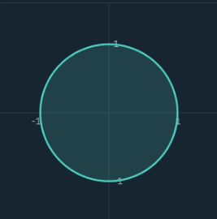
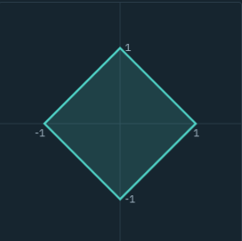
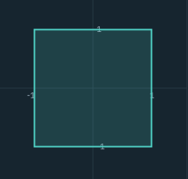
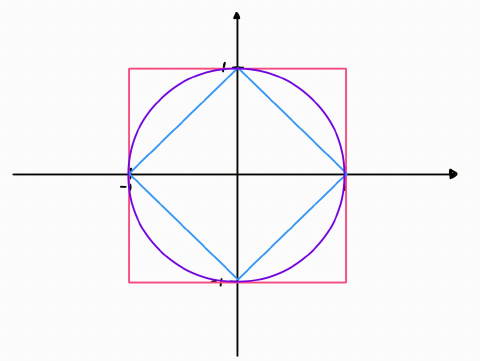
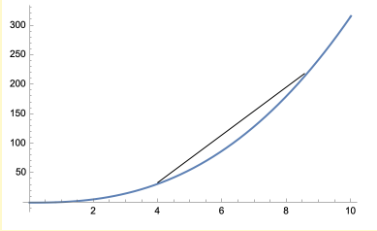

# Espacios métricos

## 4.1 Preámbulo

Hasta la sección anterior, las herramientas que hemos utilizado son principalmente de cálculo (límites, desigualdades, algo de combinatoria). Pero si queremos analizar con más profundidad las propiedades de funciones o sucesiones de funciones, es necesario introducir más herramientas. Por ejemplo, consideremos el siguiente teorema.

### Teorema de Bolzano-Weierstrass

Si $(x_n)_{n=1}^{\infty} \subseteq \mathbb{R}^p$ está acotada, entonces existen $x \in \mathbb{R}^p$ y una subsucesión $\left(x_{n_k}\right)_{k=1}^\infty$ tales que

$$\lim_{k \to \infty}\|x_{n_k}-x\|=0$$

---

Parte de la importancia de este teorema es que asegura, directa o indirectamente, la existencia de soluciones, desde el algoritmo para calcular $\sqrt{2}$ hasta el método de Newton.

Ahora consideremos la pregunta: ¿existe un teorema de Bolzano-Weierstrass para sucesiones de funciones continuas con la norma uniforme? Como ejemplo, veamos la utilidad de un teorema de este tipo para asegurar la existencia de soluciones de ecuaciones diferenciales ordinarias.

### Teorema (Peano)

Sea $f: [t_0, t_0 + a] \times \mathbb{R} \longrightarrow \mathbb{R}$ una función continua $(a > 0)$. Dado $x_0 \in \mathbb{R}$, el problema de valores iniciales

$$
\begin{aligned}
\frac{dx(t)}{dt} &= f(t,x(t)) \qquad (1) \\
x(t_0) &= x_0 \qquad (2)
\end{aligned}
$$

tiene una solución $x: [t_0, t_0+\delta] \to \mathbb{R}$, para alguna $\delta \in (0, a]$.

---

Veamos un bosquejo de la demostración para enfatizar la importancia de obtener subsucesiones uniformemente convergentes.

### Bosquejo de la demostración del Teorema de Peano

Fijamos un $b>0$, tomamos

$$
M=\sup_{(t,x)\in[t_0,t_0+a]\times[-b,b]} |f(t,x)|
$$

y definimos $\delta=\min\{a,b/M\}$.

Para $n\in\mathbb{N}$, sea $(t_k)_{k=0}^n$ la partición uniforme de $[t_0,t_0+\delta]$ en $n$ subintervalos, y denotemos $h_n=\frac{\delta}{n}$. Definimos

$$
x_n(t)=\int_{t_0}^t f(s,x_n(s-h_n))\,ds+x_0
$$

con $x_n(s-h_n)=x_0$ si $t_0<s<t_1$.

Si de alguna manera Bolzano-Weierstrass fuese aplicable en este caso, podríamos encontrar una función continua $x:[t_0,t_0+\delta]\to\mathbb{R}$ y una subsucesión $(x_{n_k})_{k=1}^\infty$ tales que $x_{n_k}\to x$ uniformemente en $[t_0,t_0+\delta]$. Ya que la convergencia uniforme permite meter límites dentro de la integral, se sigue que

$$
\begin{aligned}
x(t)&=\lim_{k\to\infty}x_{n_k}(t)\\
&=\lim_{k\to\infty}\int_{t_0}^t f(s,x_{n_k}(s-h_{n_k}))\,ds+x_0\\
&=\int_{t_0}^t f(s,x(s))\,ds+x_0
\end{aligned}
$$

donde usamos que $\lim_{k\to\infty}h_{n_k}=0$. Por lo tanto

$$
x(t)=\int_{t_0}^t f(s,x(s))\,ds+x_0
$$

que es otra forma de escribir que $x$ es solución de $(1)-(2)$.

---

Por lo tanto, vemos la utilidad de obtener un teorema tipo Bolzano-Weierstrass para sucesiones de funciones. La idea en lo que sigue es desarrollar herramientas para encontrar dicho teorema en el contexto de sucesiones de funciones con la norma uniforme. Un primer intento es copiar directamente las hipótesis, pero para sucesiones de funciones:

### Conjetura

Sea $(f_n:[a,b]\to\mathbb{R})_{n=1}^\infty$ una sucesión de funciones continuas tal que existe $M>0$ con $\|f_n\|_{[a,b]}\le M$ para toda $n$. Entonces existen una función continua $f:[a,b]\to\mathbb{R}$ y una subsucesión $(f_{n_k})_{k=1}^\infty$ tales que $\lim_{k\to\infty}\|f-f_{n_k}\|_{[a,b]}=0$.

Desafortunadamente, esta conjetura es falsa.

### Contraejemplo

Sea $(f_n:[-\pi,\pi]\to\mathbb{R})_{n=1}^\infty$ dada por $f_n(x)=\operatorname{sen}(nx)$. Entonces $\|f_n\|_{[-\pi,\pi]}=1$ para toda $n$, pero no existe una subsucesión de $(f_n)_{n=1}^\infty$ uniformemente convergente, ya que para algún $x\in[-\pi,\pi]$ el límite puntual $\lim_{k\to\infty}\operatorname{sen}(n_kx)$ no existe.

---

## 4.2 Definición

Un espacio métrico es una pareja $(X,d)$, donde $X$ es un conjunto no vacío y $d:X\times X\to\mathbb{R}$ satisface, para todos $x,y,z\in X$:

$$
\begin{aligned}
&\text{(P1)}\quad d(x,y)\geq 0 \\
&\text{(P2)}\quad d(x,y)=0 \iff x=y \\
&\text{(P3)}\quad d(x,y)=d(y,x) \\
&\text{(P4)}\quad d(x,y)\leq d(x,z)+d(z,y) \qquad \text{(desigualdad del triángulo)}
\end{aligned}
$$

### Ejemplos

#### Ejemplo 1. En $\mathbb{R}$: $d(x,y)=|x-y|$

**(P1)** $\;d(x,y)\geq 0$

$$
\begin{aligned}
d(x,y) &= |x-y| \\
&\geq 0
\end{aligned}
$$

**(P2)** $\;d(x,y)=0 \iff x=y$

$$
\begin{aligned}
d(x,y)=0 &\Longrightarrow |x-y|=0 \\
&\Longrightarrow x-y=0 \qquad (|a|=0 \iff a=0) \\
&\Longrightarrow x=y
\end{aligned}
$$

(El recíproco es inmediato: si $x=y$, entonces $|x-y|=|0|=0$.)

**(P3)** $\;d(x,y)=d(y,x)$

$$
\begin{aligned}
d(x,y) &= |x-y| \\
&= |-(y-x)| \\
&= |y-x| \qquad (|-a|=|a|) \\
&= d(y,x)
\end{aligned}
$$

**(P4)** $\;d(x,y) \leq d(x,z) + d(z,y)$

$$
\begin{aligned}
d(x,y) &= |x-y| \\
&= |(x-z)+(z-y)| \\
&\leq |x-z| + |z-y| \\
&= d(x,z) + d(z,y)
\end{aligned}
$$

---

#### Ejemplo 2. En $\mathbb{R}^n$ (métrica euclidiana)

$$
\begin{aligned}
d(x,y)&=\|x-y\|_2 \\
&=\sqrt{\sum_{i=1}^n(x_i-y_i)^2}
\end{aligned}
$$

**Recordar las propiedades de norma** (las damos por vistas):

1. $\|x\| \geq 0$
2. $\|x\| = 0 \Leftrightarrow x = 0$
3. Homogeneidad absoluta: para todo $x \in V$ y todo escalar $\alpha$, $\|\alpha x\|=|\alpha|\|x\|$.
4. $\|x+y\| \leq \|x\| + \|y\|$

**(P1)** $\;d(x,y)\geq 0$

$$d(x,y)=\|x-y\|\geq 0 \quad \checkmark \; \text{por definición de norma}.$$

**(P2)** $\;d(x,y)=0 \iff x=y$

$$
\begin{aligned}
d(x,y)=0 &\iff \|x-y\|=0 \\
&\iff x- y = 0 \\
&\iff x=y
\end{aligned}
$$

**(P3)** $\;d(x,y)=d(y,x)$

$$
\begin{aligned}
d(x,y)&=\|x-y\| \\
&= \|(-1)(y-x)\| \\
&= |-1|\|y-x\| \\
&= \|y-x\| \\
&= d(y,x)
\end{aligned}
$$

**(P4)** $\;d(x,y)\leq d(x,z)+d(z,y)$

$$
\begin{aligned}
d(x,y) &= \|x-y\| \\
&= \|(x-z)+(z-y)\| \\
&\leq \|x-z\|+\|z-y\| \\
&= d(x,z)+d(z,y)
\end{aligned}
$$

La desigualdad triangular de la norma euclidiana es el caso $p=2$ de la desigualdad de Minkowski (4.7), o bien se prueba con Cauchy-Schwarz. En general, toda norma produce una métrica (Lema 4.4).

---

#### Ejemplo 3. La métrica discreta

Sea $X\neq\emptyset$ cualquier conjunto y $d:X\times X\to\mathbb{R}$,

$$
d(x,y)=
\begin{cases}
0, & x=y,\\
1, & x\ne y.
\end{cases}
$$

**(P1)** $\;d(x,y)\geq 0$

$$
\begin{aligned}
d(x,y) &\in\{0,1\} \\
\Longrightarrow d(x,y)&\geq 0
\end{aligned}
$$

**(P2)** $\;d(x,y)=0 \iff x=y$

$$d(x,y)=0 \iff x=y \quad \checkmark \; \text{por definición.}$$

**(P3)** $\;d(x,y)=d(y,x)$

- Caso $x=y$:

$$d(x,y)=0=d(y,x)$$

- Caso $x \neq y$:

$$d(x,y) =1 =d(y,x)$$

**(P4)** $\;d(x,y) \leq d(x,z) + d(z,y)$

- Caso $x=y$:

$$
\begin{aligned}
0 &= d(x,y) \\
&\leq d(x,z) + d(z,y) \quad \forall \; z \in X
\end{aligned}
$$

- Caso $x \neq y$:

  - Subcaso $z \neq x$:

    $$
    \begin{aligned}
    1 &= d(x,y) \\
    &\leq 1 + d(z,y) \\
    &= d(x,z) + d(z,y) \; \checkmark
    \end{aligned}
    $$

  - Subcaso $z = x$ (entonces $z \neq y$):

    $$
    \begin{aligned}
    1 &= d(x,y) \\
    &\leq 0 + 1 \\
    &=d(x,z)+d(z,y) \; \checkmark
    \end{aligned}
    $$

$$\therefore \; d \; \text{es una métrica para } X.$$

Esta métrica sirve en **cualquier** conjunto, aunque no tenga estructura de espacio vectorial.

---

#### Ejemplo 4. La métrica de una gráfica conexa

Sea $G=(V,E)$ una gráfica conexa. Dados $v,w\in V$, un **camino** de $v$ a $w$ es una sucesión de vértices

$$v=v_0,\; v_1,\; \ldots,\; v_l=w \qquad \text{con } \{v_{i-1},v_i\}\in E \text{ para cada } i.$$

La **longitud** del camino es $l$. Se define

$$
d(v,w)=\min\{\, l \;:\; \text{existe un camino de } v \text{ a } w \text{ de longitud } l \,\}.
$$

El mínimo existe porque $G$ es conexa (hay al menos un camino) y las longitudes son enteros no negativos.

**(P1)** $\;d(v,w) \geq 0$

$$
\begin{aligned}
d(v,w)&=l \in \{0,1,2,\ldots\} \\
\Longrightarrow  \quad d(v,w)&\geq 0
\end{aligned}
$$

**(P2)** $\;d(v,w)=0 \iff  v=w$

$$
\begin{aligned}
d(v,w)&=0 \\
\iff \; l&=0 \\
\iff \; v&=v_0 =v_l =w
\end{aligned}
$$

**(P3)** $\;d(v,w)=d(w,v)$

Un camino $v=v_0,v_1,\ldots,v_l=w$ de longitud $l$ de $v$ a $w$ se recorre al revés, $w=v_l,v_{l-1},\ldots,v_0=v$, y es un camino de $w$ a $v$ de la misma longitud (las aristas no están dirigidas). Por lo tanto ambos conjuntos de longitudes coinciden y

$$d(v,w)=d(w,v).$$

**(P4)** $\;d(v,w) \leq d(v,z) + d(z,w)$

Sean un camino de $v$ a $z$ de longitud $d(v,z)$ y un camino de $z$ a $w$ de longitud $d(z,w)$. Al concatenarlos se obtiene un camino de $v$ a $w$ de longitud $d(v,z)+d(z,w)$. Como $d(v,w)$ es la longitud mínima entre todos los caminos de $v$ a $w$,

$$d(v,w) \leq d(v, z) + d(z, w).$$

 

  

---

## 4.3 Definición

Sea $V$ un espacio vectorial sobre $\mathbb{R}$. Una norma en $V$ es una función $\|\cdot\| : V \to \mathbb{R}$ que satisface:

$$
\begin{aligned}
&\text{(N1)}\quad \|x\|\geq 0 \quad \forall\, x\in V \\
&\text{(N2)}\quad \|x\|=0 \iff x=0 \\
&\text{(N3)}\quad \|\alpha x\|=|\alpha|\,\|x\| \quad \forall\, x\in V,\ \forall\, \alpha\in \mathbb{R} \\
&\text{(N4)}\quad \|x+y\|\leq\|x\|+\|y\| \quad \forall\, x,y\in V \qquad \text{(desigualdad del triángulo)}
\end{aligned}
$$

Un espacio vectorial normado es una pareja $(V, \|\cdot\|)$, donde $V$ es un espacio vectorial y $\|\cdot\|$ es una norma.

---

### Ejemplos

#### Ejemplo 1. Norma euclidiana en $\mathbb{R}^n$

En $\mathbb{R}^n$, la función $\|\cdot\|_2:\;\mathbb{R}^n \longrightarrow \mathbb{R}$ dada por

$$\|(x_1,\ldots,x_n)\|_2 = \sqrt{\sum_{i=1}^nx_i^2}$$

es una norma. Se le conoce como norma euclidiana.

Consideremos el espacio vectorial normado $(\mathbb{R}^2, \|\cdot\|_2)$. La esfera unitaria de $(\mathbb{R}^2,\|\cdot\|_2)$ es el conjunto

$$S_{\|\cdot\|_2} = \{(x,y) \in \mathbb{R}^2: \|(x,y)\|_2=1\}$$

 

  

$$
\begin{aligned}
\|(x,y)\|_2&=1 \\
\Rightarrow \sqrt{x^2+y^2}&=1 \\
\Rightarrow \quad x^2+y^2&=1
\end{aligned}
$$

---

#### Ejemplo 2. Norma del taxista

En $\mathbb{R}^n$, la función $\|\cdot\|_1: \mathbb{R}^n \longrightarrow \mathbb{R}$ dada por

$$
\begin{aligned}
\|x\|_1&= \|(x_1,\ldots,x_n)\|_1 \\
&=\sum_{i=1}^{n}|x_i|
\end{aligned}
$$

es una norma. Se le conoce como norma del taxista.

**Demostración**

Sean $\bar{x}=(x_1,\ldots,x_n),\;\bar{y}=(y_1,\ldots,y_n) \in \mathbb{R}^n$ y $\alpha$ cualquier escalar.

**(N1)** $\;\|\bar{x}\|_1\geq 0$

$$
\begin{aligned}
|x_i| &\geq 0 \quad \forall \; i=1,\ldots,n \\
\Longrightarrow \quad \sum_{i=1}^n|x_i| &\geq 0 \\
\Longrightarrow \quad \|\bar{x}\|_1 &\geq 0
\end{aligned}
$$

**(N2)** $\;\|\bar{x}\|_1 = 0 \Leftrightarrow \bar{x}=\bar{0}$

$$
\begin{aligned}
\|\bar{x}\|_1 = 0 &\iff \sum_{i=1}^n|x_i|=0 \\
&\iff |x_i|=0 \quad \forall \; i=1,\ldots,n \qquad \text{(suma de términos} \geq 0\text{)} \\
&\iff x_i=0 \quad \forall \; i=1,\ldots,n \\
&\iff \bar{x}=\bar{0}
\end{aligned}
$$

**(N3)** $\;\|\alpha\bar{x}\|_1 = |\alpha|\|\bar{x}\|_1$

$$
\begin{aligned}
\|\alpha\bar{x}\|_1&=\|(\alpha x_1,\ldots,\alpha x_n)\|_1 \\
&=\sum_{i=1}^n|\alpha x_i| \\
&= \sum_{i=1}^n|\alpha||x_i| \\
&= |\alpha|\sum_{i=1}^n|x_i| \\
&= |\alpha|\|\bar{x}\|_1
\end{aligned}
$$

**(N4)** $\;\|\bar{x}+\bar{y}\|_1 \leq \|\bar{x}\|_1+\|\bar{y}\|_1$

$$
\begin{aligned}
\|\bar{x}+\bar{y}\|_1 &= \sum_{i=1}^{n}|x_i+y_i| \\
&\leq \sum_{i=1}^{n}\big(|x_i|+|y_i|\big) \qquad \text{(triangular en } \mathbb{R}) \\
&= \sum_{i=1}^{n}|x_i|+\sum_{i=1}^{n}|y_i| \\
&= \|\bar{x}\|_1+\|\bar{y}\|_1
\end{aligned}
$$

$$\therefore \; \|\cdot\|_1 \text{ es una norma en } \mathbb{R}^n$$

Consideremos el espacio vectorial normado $(\mathbb{R}^2, \|\cdot\|_1)$. Su esfera unitaria es el conjunto

$$S_{\|\cdot\|_1}=\{(x,y) \in \mathbb{R}^2: \|(x,y)\|_1=1\}$$

- Si $x \leq 0,\, y \geq 0$:

$$
\begin{aligned}
-x + y &= 1 \\
\Longrightarrow \quad y &= 1+x
\end{aligned}
$$

- Si $x,y \geq 0$:

$$
\begin{aligned}
x+y &= 1 \\
\Longrightarrow \quad y&=1-x
\end{aligned}
$$

- Los otros dos cuadrantes son análogos.

 

  

$$
\begin{aligned}
\|(x,y)\|_1 &= 1 \\
\Longrightarrow \quad |x|+|y|&=1
\end{aligned}
$$

---

#### Ejemplo 3. Norma infinito en $\mathbb{R}^n$

En $\mathbb{R}^n$, la función $\|\cdot\|_\infty:\;\mathbb{R}^n \longrightarrow \mathbb{R}$ dada por

$$
\begin{aligned}
\|\bar{x}\|_\infty&=\|(x_1,\ldots,x_n)\|_\infty \\
&=\max_{1\leq i\leq n}|x_i|
\end{aligned}
$$

es una norma. Se le conoce como norma infinito.

**Demostración**

Sean $\bar{x}=(x_1,\ldots,x_n),\;\bar{y}=(y_1,\ldots,y_n) \in \mathbb{R}^n$ y $\alpha$ cualquier escalar.

**(N1)** $\;\|\bar{x}\|_\infty \geq 0$

$$
\begin{aligned}
0 &\leq |x_i| \quad \forall \; i=1,\ldots,n \\
\Longrightarrow \quad 0 &\leq \max_{1 \leq i \leq n}|x_i| \\
&= \|\bar{x}\|_\infty
\end{aligned}
$$

**(N2)** $\;\|\bar{x}\|_\infty=0 \iff \bar{x}=\bar{0}$

$$
\begin{aligned}
\|\bar{x}\|_\infty = 0 &\iff \max_{1 \leq i \leq n}|x_i|=0 \\
&\iff |x_i|=0 \quad \forall \; i=1,\ldots,n \\
&\iff x_i=0 \quad \forall \; i=1,\ldots,n \\
&\iff \bar{x}=\bar{0}
\end{aligned}
$$

**(N3)** $\;\|\alpha\bar{x}\|_\infty=|\alpha|\|\bar{x}\|_\infty$

$$
\begin{aligned}
\|\alpha \bar{x}\|_\infty &= \|(\alpha x_1, \ldots, \alpha x_n)\|_\infty \\
&= \max_{1\leq i \leq n}|\alpha||x_i| \\
&= |\alpha|\max_{1\leq i \leq n}|x_i| \\
&= |\alpha|\|\bar{x}\|_\infty
\end{aligned}
$$

**(N4)** $\;\|\bar{x}+\bar{y}\|_\infty \leq \|\bar{x}\|_\infty + \|\bar{y}\|_\infty$

$$
\begin{aligned}
|x_i+y_i| &\leq |x_i|+|y_i| \qquad \forall \; i \qquad \text{(triangular en } \mathbb{R}) \\
&\leq \|\bar{x}\|_\infty+\|\bar{y}\|_\infty \qquad (|x_i|\leq\|\bar{x}\|_\infty,\ |y_i|\leq\|\bar{y}\|_\infty) \\
\Longrightarrow \quad \max_{1\leq i \leq n}|x_i+y_i|&\leq\|\bar{x}\|_\infty+\|\bar{y}\|_\infty \\
\Longrightarrow \qquad \quad \|\bar{x}+\bar{y}\|_\infty&\leq\|\bar{x}\|_\infty+\|\bar{y}\|_\infty
\end{aligned}
$$

Consideremos el espacio vectorial normado $(\mathbb{R}^2, \|\cdot\|_\infty)$. Su esfera unitaria es el conjunto

$$S_{\|\cdot\|_{\infty}}=\{(x,y) \in \mathbb{R}^2: \|(x,y)\|_{\infty}=1\}$$

$$
\begin{aligned}
&\|(x,y)\|_\infty=1 \\
&\iff \max\{|x|,|y|\} = 1 \\
&\iff \big(|x| \leq 1 \; \text{y} \; |y| \leq 1\big) \; \text{y} \; \big(|x|=1 \; \text{o} \; |y|=1\big)
\end{aligned}
$$

Es decir, es el borde del cuadrado $[-1,1]\times[-1,1]$. (La condición $|x|\leq 1$ y $|y|\leq 1$ por sí sola describe la bola cerrada, es decir, el cuadrado completo.)

 

  

**Comparación**

- $(\mathbb{R}^2, \|\cdot\|_1) \quad S_{\|\cdot\|_1} \; \text{(azul)}$
- $(\mathbb{R}^2, \|\cdot\|_2) \quad S_{\|\cdot\|_2} \; \text{(morado)}$
- $(\mathbb{R}^2, \|\cdot\|_\infty) \quad S_{\|\cdot\|_\infty} \; \text{(rosa)}$

 

  

---

#### Ejemplo 4. Norma $p$ en $\mathbb{R}^n$

Sea $1 \leq p < \infty$ (parámetro real). La función

$$
\begin{aligned}
\|\cdot\|_p&:\,\mathbb{R}^n \longrightarrow \mathbb{R} \\
\\
\|\bar{x}\|_p &= \|(x_1,\ldots,x_n)\|_p \\
&= \left(\sum_{i=1}^n|x_i|^p\right)^{\frac{1}{p}}
\end{aligned}
$$

es, en efecto, una norma.

Sean $\bar{x}=(x_1,\ldots,x_n),\;\bar{y}=(y_1,\ldots,y_n) \in \mathbb{R}^n$ y $\alpha \in \mathbb{R}$.

**(N1)** $\;\|\bar{x}\|_p \geq 0$

$$
\begin{aligned}
0 &\leq |x_i| \quad \forall \; i=1,\ldots,n \\
\Longrightarrow \; 0 &\leq |x_i|^p \\
\Longrightarrow \; 0 &\leq \sum_{i=1}^n|x_i|^p \\
\Longrightarrow \; 0 &\leq \left(\sum_{i=1}^n|x_i|^p\right)^{\frac{1}{p}} \\
&=\|\bar{x}\|_p
\end{aligned}
$$

**(N2)** $\;\|\bar{x}\|_p=0 \Leftrightarrow \bar{x}=\bar{0}$

$$
\begin{aligned}
\|\bar{x}\|_p = 0 &\iff \left(\sum_{i=1}^n|x_i|^p\right)^{\frac{1}{p}}=0 \\
&\iff \sum_{i=1}^n|x_i|^p=0 \\
&\iff |x_i|^p=0 \quad \forall \; i=1,\ldots,n \\
&\iff x_i=0 \quad \forall \; i=1,\ldots,n \\
&\iff \bar{x}=\bar{0}
\end{aligned}
$$

**(N3)** $\;\|\alpha\bar{x}\|_p = |\alpha|\|\bar{x}\|_p$

$$
\begin{aligned}
\|\alpha\bar{x}\|_p&=\|(\alpha x_1,\ldots,\alpha x_n)\|_p \\
&=\left(\sum_{i=1}^n|\alpha x_i|^p\right)^{\frac{1}{p}} \\
&= \left(\sum_{i=1}^n|\alpha|^p|x_i|^p\right)^{\frac{1}{p}} \\
&= \left(|\alpha|^p\sum_{i=1}^n|x_i|^p\right)^{\frac{1}{p}} \\
&= \left(|\alpha|^p\right)^{\frac{1}{p}}\left(\sum_{i=1}^n|x_i|^p\right)^{\frac{1}{p}} \\
&= |\alpha|\|\bar{x}\|_p
\end{aligned}
$$

**(N4)** $\;\|\bar{x}+\bar{y}\|_p \leq \|\bar{x}\|_p + \|\bar{y}\|_p$

Es la desigualdad de Minkowski (su demostración, para sumas infinitas, está en 4.7; para sumas finitas es idéntica).

$$\therefore \; \|\cdot\|_p \text{ es una norma en } \mathbb{R}^n.$$

Por lo que $(\mathbb{R}^n, \|\cdot\|_p)$ es un espacio vectorial normado. A $\|\cdot\|_p$ se le conoce como la **norma-$p$**.

---

## 4.4 Lema

Sea $(V, \|\cdot\|)$ un espacio vectorial normado y sea

$$d: V \times V \longrightarrow \mathbb{R}, \qquad d(x, y) = \|x-y\|.$$

Entonces $d$ es una métrica en $V$. Se le conoce como la métrica inducida por la norma.

**Demostración**

**(P1)** $\;d(x,y)\geq0$

$$
\begin{aligned}
0 &\leq \|x-y\| \\
&=d(x,y)
\end{aligned}
$$

**(P2)** $\;d(x,y)=0 \iff x=y$

$$
\begin{aligned}
d(x,y)=0 &\iff \|x-y\|=0 \\
&\iff x-y=0 \\
&\iff x=y
\end{aligned}
$$

**(P3)** $\;d(x,y)=d(y,x)$

$$
\begin{aligned}
d(x,y) &= \|x-y\| \\
&= \|(-1)(y-x)\| \\
&= |-1|\,\|y-x\| \\
&= \|y-x\| \\
&= d(y,x)
\end{aligned}
$$

**(P4)** $\;d(x,y)\leq d(x,z)+d(z,y)$

$$
\begin{aligned}
d(x, y) &= \|x - y\| \\
&= \|(x - z) + (z - y)\| \\
&\leq \|x - z\| + \|z - y\| \\
&= d(x, z) + d(z, y)
\end{aligned}
$$

Con ello hemos demostrado que $d(x, y) = \|x - y\|$ es una métrica en $V$. $\blacksquare$

**Observación.** El único paso difícil es (P4), que depende de (N4). Por eso las pruebas de la desigualdad triangular para $\|\cdot\|_2$ (Cauchy-Schwarz) y para $\|\cdot\|_p$ (Minkowski) son lo que realmente hay que probar. Los ejemplos de 4.3 dan entonces las métricas $d_1$, $d_2$, $d_\infty$ y $d_p$ en $\mathbb{R}^n$.

**Observación.** No toda métrica viene de una norma. Las métricas inducidas por una norma cumplen $d(\alpha x,\alpha y)=|\alpha|\,d(x,y)$. En cambio, la métrica discreta en $\mathbb{R}$ no:

$$
\begin{gathered}
d(0,1)=1 \\
d(0,2)=1 \neq 2=2\cdot d(0,1) \\
\Longrightarrow \text{la métrica discreta no proviene de alguna norma}
\end{gathered}
$$

---

## 4.5 Definición

**Espacios $\;\ell_p, \, p \in [1, \infty]$**

Para $p \in [1, \infty)$ se define el espacio $\ell_p$ como

$$
\ell_p = \left\{ (x_i)_{i=1}^{\infty} \subset \mathbb{R} : \sum_{i=1}^{\infty} |x_i|^p < +\infty \right\}
$$

Nota: la notación $\sum_{i=1}^{\infty} |x_i|^p < +\infty$ significa que la serie $\sum_{i=1}^{\infty} |x_i|^p$ es convergente.

Si $x \in \ell_p$, definimos

$$
\|x\|_p = \left( \sum_{i=1}^{\infty} |x_i|^p \right)^{1/p}
$$

Por ejemplo, si $p = 1$, $x \in \ell_1$ si y sólo si $\sum_{i=1}^{\infty} |x_i|$ es convergente, lo que suele expresarse diciendo que la serie $\sum x_i$ es absolutamente convergente. Por lo tanto, $\ell_1$ es el conjunto de sucesiones cuya serie es absolutamente convergente.

Si $p = \infty$, definimos $\ell_\infty$ como

$$
\ell_\infty = \left\{ (x_i)_{i=1}^{\infty} \subset \mathbb{R} : \sup_{i \in \mathbb{N}} |x_i| < +\infty \right\},
\qquad
\|x\|_\infty=\sup_{i\in\mathbb{N}}|x_i|
$$

Nota: la notación $\sup_{i \in \mathbb{N}} |x_i| < +\infty$ significa que la sucesión está acotada. Entonces $\ell_\infty$ es el conjunto de sucesiones acotadas.

**Qué cambia respecto a $\mathbb{R}^n$:** se pasa de $n$ entradas a infinitas, y por eso se exige que la serie converja. Sin esa condición, $\|x\|_p$ no sería un número finito. "Acotada" es la condición de $\ell_\infty$, no la de $\ell_p$ con $p<\infty$.

---

## 4.6 Lema

Sea $1 \leq p < \infty$.

1. Si $a, b \geq 0$, entonces $(a + b)^p \leq 2^p (a^p + b^p)$.
2. Usa el inciso anterior para probar que $\ell_p$ es cerrado bajo la suma, es decir, $x, y \in \ell_p \Rightarrow x + y \in \ell_p$.
3. $\ell_p$ es cerrado bajo el producto por escalar.

Conclusión: $\ell_p$ es un espacio vectorial.

**Demostración**

**1.**

$$
\begin{aligned}
c &= \max\{a, b\} \\
&\Longrightarrow \; a \leq c, \quad b \leq c \\
&\Longrightarrow \; a+b \leq c+c \\
t\mapsto t^p \text{ creciente en } [0,\infty) &\Longrightarrow (a + b)^p \leq (c + c)^p \\
&= (2c)^p \\
&= 2^p c^p \tag{*} \\
\\
c=a \text{ o } c=b, \text{ ambos} \geq 0 &\Longrightarrow c^p \leq a^p + b^p \\
&\Longrightarrow 2^p c^p \leq 2^p (a^p + b^p) \\
&\overset{\text{(*)}}{\Longrightarrow} (a + b)^p \leq 2^p c^p \leq 2^p (a^p + b^p)
\end{aligned}
$$

$$\therefore \; (a + b)^p \leq 2^p (a^p + b^p)$$

**2.** Sean $x, y \in \ell_p$, es decir,

$$
\sum_{i=1}^{\infty} |x_i|^p < \infty \quad \text{y} \quad \sum_{i=1}^{\infty} |y_i|^p < \infty.
$$

Para cada $i$ se tiene $|x_i|,|y_i|\geq 0$, y por la desigualdad triangular en $\mathbb{R}$ y el inciso 1:

$$
\begin{aligned}
|x_i + y_i|^p &\leq \big(|x_i|+|y_i|\big)^p \\
&\leq 2^p\big(|x_i|^p+|y_i|^p\big) \qquad \text{(inciso 1)} \\
\\
\sum_{i=1}^{\infty} |x_i + y_i|^p &\leq 2^p\sum_{i=1}^\infty \big(|x_i|^p+|y_i|^p\big) \\
&= 2^p \left( \sum_{i=1}^{\infty} |x_i|^p + \sum_{i=1}^{\infty} |y_i|^p \right) \\
&< \infty \\
&\Longrightarrow x + y \in \ell_p
\end{aligned}
$$

**3.** Sean $\lambda\in\mathbb{R}$ y $x\in\ell_p$.

$$
\sum_{i=1}^{\infty}|\lambda x_i|^p=|\lambda|^p\sum_{i=1}^{\infty}|x_i|^p<\infty \Longrightarrow \lambda x\in\ell_p.
$$

Además, $\bar{0}\in\ell_p$. Los demás axiomas de espacio vectorial se heredan de $\mathbb{R}$, porque las operaciones se realizan coordenada a coordenada. $\blacksquare$

---

## 4.7 Teorema

**Desigualdad de Minkowski**

Sea $1 \leq p < \infty$ y $x,y \in \ell_p$. Entonces

$$\|x + y\|_p \leq \|x\|_p + \|y\|_p.$$

**Demostración**

Sea

$$
f:\;[0,\infty) \longrightarrow \mathbb{R}, \qquad
f(t)=t^p.
$$

 

  

Como $1 \leq p$, $f$ es convexa:

$$
\begin{aligned}
f(\lambda s + (1 - \lambda)t) &\leq \lambda f(s) + (1 - \lambda)f(t),\; \forall\;s,t \in [0, \infty),\;\lambda \in (0, 1) \\
\Longrightarrow \quad (\lambda s + (1 - \lambda)t)^p &\leq \lambda s^p + (1 - \lambda)t^p
\end{aligned}
$$

Sin pérdida de generalidad podemos suponer que $x \neq 0$ y $y \neq 0$ (si uno es $0$, la desigualdad es una igualdad).

**Paso 1.** Normalizar

$$
\begin{aligned}
\tilde{x} &= \frac{1}{\|x\|_p}\,x, \qquad \tilde{y} = \frac{1}{\|y\|_p}\,y \\
\|\tilde{x}\|_p &= \frac{1}{\|x\|_p}\|x\|_p=1 \qquad \text{(homogeneidad, } \tfrac{1}{\|x\|_p}>0) \\
\|\tilde{y}\|_p &= 1
\end{aligned}
$$

**Paso 2.** Elegir $\lambda$

$$
\begin{aligned}
\lambda &= \frac{\|y\|_p}{\|x\|_p + \|y\|_p} \\
\|x\|_p,\|y\|_p>0 &\Longrightarrow 0<\|y\|_p<\|x\|_p+\|y\|_p \\
&\Longrightarrow \lambda\in(0,1) \\
1 - \lambda &= \frac{\|x\|_p+\|y\|_p}{\|x\|_p+\|y\|_p}-\frac{\|y\|_p}{\|x\|_p+\|y\|_p}=\frac{\|x\|_p}{\|x\|_p + \|y\|_p}
\end{aligned}
$$

**Paso 3.** Aplicar la convexidad en cada coordenada $i$ (con $s=|\tilde{x}_i|$, $t=|\tilde{y}_i|$)

$$
\begin{aligned}
&\big((1-\lambda)|\tilde{x}_i|+\lambda|\tilde{y}_i|\big)^p \leq (1-\lambda)|\tilde{x}_i|^p+\lambda|\tilde{y}_i|^p \\
&\qquad\Downarrow \quad \text{(sustituir } \lambda,\ 1-\lambda,\ \tilde{x}_i,\ \tilde{y}_i) \\
&\frac{1}{(\|x\|_p + \|y\|_p)^p} \left( \|x\|_p \frac{|x_i|}{\|x\|_p} + \|y\|_p \frac{|y_i|}{\|y\|_p} \right)^p \leq (1 - \lambda)\frac{|x_i|^p}{\|x\|_p^p} + \lambda\frac{|y_i|^p}{\|y\|_p^p} \\
&\qquad\Downarrow \quad \text{(simplificar)} \\
&\frac{1}{(\|x\|_p + \|y\|_p)^p}\,(|x_i| + |y_i|)^p \leq (1 - \lambda)\frac{|x_i|^p}{\|x\|_p^p} + \lambda\frac{|y_i|^p}{\|y\|_p^p}
\end{aligned}
$$

**Paso 4.** Sumar sobre $i$

$$
\begin{aligned}
\frac{1}{(\|x\|_p + \|y\|_p)^p} \sum_{i=1}^{\infty} (|x_i| + |y_i|)^p &\leq (1 - \lambda)\frac{\|x\|_p^p}{\|x\|_p^p} + \lambda\frac{\|y\|_p^p}{\|y\|_p^p} \\
&= (1-\lambda)+\lambda \\
&= 1
\end{aligned}
$$

**Paso 5.** Concluir

$$
\begin{aligned}
&\Longrightarrow \sum_{i=1}^{\infty} (|x_i| + |y_i|)^p \leq (\|x\|_p + \|y\|_p)^p \\
\\
|x_i+y_i|\leq|x_i|+|y_i| &\Longrightarrow \sum_{i=1}^{\infty}|x_i+y_i|^p\leq\sum_{i=1}^{\infty}(|x_i|+|y_i|)^p \qquad \text{(} t\mapsto t^p \text{ creciente)} \\
&\Longrightarrow \sum_{i=1}^{\infty}|x_i+y_i|^p\leq(\|x\|_p+\|y\|_p)^p \\
&\Longrightarrow \|x+y\|_p\leq\|x\|_p+\|y\|_p \qquad \text{(raíz } p\text{-ésima, creciente)} \quad \blacksquare
\end{aligned}
$$

**Por qué se pide $p\geq 1$.** Para $p<1$ la función $t\mapsto t^p$ ya no es convexa y la desigualdad falla. Contraejemplo con $p=\tfrac12$, $x=(1,0)$, $y=(0,1)$:

$$
\begin{aligned}
\|x\|_{1/2} &= \big(1^{1/2}+0\big)^2=1 \\
\|y\|_{1/2} &= \big(0+1^{1/2}\big)^2=1 \\
\|x+y\|_{1/2} &= \big(1^{1/2}+1^{1/2}\big)^2=4 \\
\\
\|x+y\|_{1/2}=4 &> 2=\|x\|_{1/2}+\|y\|_{1/2}
\end{aligned}
$$

---

### Definición

Para $1 \leq p \leq +\infty$:

$$
\begin{aligned}
\ell_p &= \left\{ (x_i)_{i=1}^\infty \subset \mathbb{R} : \sum_{i=1}^\infty |x_i|^p < +\infty \right\} \quad (p<\infty) \\
\ell_\infty &= \left\{ (x_i)_{i=1}^\infty \subset \mathbb{R} : \sup_{i \in \mathbb{N}} |x_i| < +\infty \right\}
\end{aligned}
$$

con las operaciones

- Suma:
$$
\begin{aligned}
x+y&=(x_i)_{i=1}^\infty + (y_i)_{i=1}^\infty \\
&= (x_i + y_i)_{i=1}^\infty
\end{aligned}
$$

- Producto por escalar:
$$
\begin{aligned}
\lambda x &= \lambda(x_i)_{i=1}^\infty, \; \lambda \in \mathbb{R} \\
&=(\lambda x_i)_{i=1}^\infty
\end{aligned}
$$

- Vector cero:
$$
\bar{0} = (0,0,\ldots)
$$

Los $\ell_p$, $p \in [1, \infty]$, son espacios vectoriales.

**Idea**: $x \in \ell_p \longleftrightarrow x =\;$ "vector infinito con norma $p$ finita".

---

$$\underbrace{(\ell_p, \|\cdot\|_p)}_{\text{dimensión infinita}} \xleftrightarrow{\text{pasamos de}} \underbrace{(\mathbb{R}^n, \|\cdot\|)}_{\text{dimensión finita}}$$

**Advertencia**: muchos teoremas de $\mathbb{R}^n$ no se cumplen en $\ell_p$, en particular «Bolzano-Weierstrass».

---

## 4.8 Corolario

Para $1\leq p < +\infty,\, \ell_p\;$ es un espacio vectorial normado.

**Demostración**

**(N1)** $\;\|\bar{x}\|_p \geq 0 \; \forall \; \bar{x} \in \ell_p$

$$
\begin{aligned}
|x_i|^p &\geq 0 \quad \forall \; i \\
\Longrightarrow \quad \sum_{i=1}^\infty|x_i|^p &\geq 0 \\
\Longrightarrow \quad \left(\sum_{i=1}^\infty|x_i|^p\right)^{\frac{1}{p}} &\geq 0
\end{aligned}
$$

**(N2)** $\;\|\bar{x}\|_p=0 \iff \bar{x}=\bar{0}$

$$
\begin{aligned}
\|\bar{x}\|_p=0 &\iff \left(\sum_{i=1}^\infty|x_i|^p\right)^{\frac{1}{p}}=0 \\
&\iff \sum_{i=1}^\infty|x_i|^p=0 \\
&\iff |x_i|^p=0  \quad \forall \; i=1,2,\ldots \\
&\iff x_i=0 \quad \forall \; i=1,2,\ldots \\
&\iff \bar{x}=\bar{0}
\end{aligned}
$$

**(N3)** $\;\|\lambda \bar{x}\|_p=|\lambda|\|\bar{x}\|_p$

$$
\begin{aligned}
\|\lambda\bar{x}\|_p &= \left(\sum_{i=1}^\infty|\lambda x_i|^p\right)^{\frac{1}{p}} \\
&= \left(\sum_{i=1}^\infty|\lambda|^p|x_i|^p\right)^{\frac{1}{p}} \\
&= \left(|\lambda|^p\sum_{i=1}^\infty|x_i|^p\right)^{\frac{1}{p}} \\
&= \left(|\lambda|^p\right)^{\frac{1}{p}}\left(\sum_{i=1}^\infty|x_i|^p\right)^{\frac{1}{p}} \\
&= |\lambda|\|\bar{x}\|_p
\end{aligned}
$$

**(N4)** $\;\|\bar{x}+\bar{y}\|_p \leq \|\bar{x}\|_p + \|\bar{y}\|_p$

$\checkmark$ Por Minkowski (4.7). $\blacksquare$

---

### Ejemplo

- $f \in \underbrace{\mathcal{C}[a,b]}_{\text{compacto}}, \quad \|f\|=\sup_{t \in [a,b]}|f(t)|$
- $f \in \underbrace{\mathcal{C}(\mathbb{R})}_{\text{no compacto}}, \quad \|f\|=\sup_{t \in \mathbb{R}}|f(t)|$

**Observación.** En el segundo caso el supremo puede ser $+\infty$ (por ejemplo, con $f(x)=e^x$), de modo que $\|\cdot\|$ sólo está bien definida en las funciones continuas acotadas $\mathcal{C}_b(\mathbb{R})$. Tampoco $\ln(x)$ es una función definida en todo $\mathbb{R}$.

---

## 4.9 Definición

Una pseudométrica en el conjunto $X$ es una función $\rho : X \times X \to \mathbb{R}$ que satisface

$$
\begin{aligned}
&1.\quad x = y \; \Longrightarrow \; \rho(x, y) = 0 \\
&2.\quad \rho(x, y) = \rho(y, x) \\
&3.\quad \rho(x, y) \leq \rho(x, z) + \rho(z, y) \qquad \text{(desigualdad del triángulo)}
\end{aligned}
$$

para todos $x, y, z \in X$. (De estas propiedades se sigue que $\rho\geq 0$: $0=\rho(x,x)\leq\rho(x,y)+\rho(y,x)=2\rho(x,y)$.)

**No se cumple** $\rho(x,y)=0 \Rightarrow x=y$, que es lo que haría falta para que fuera una métrica.

Una familia de pseudométricas $\{\rho_i\}_{i \in I}$ **separa los puntos** de $X$ si y sólo si, para $x, y \in X$ con $x \neq y$, existe $\rho_j$ tal que $\rho_j(x, y) > 0$.

---

### Ejemplo

Sea $X = \mathcal{C}(\mathbb{R})$. Para cada $n = 1, 2, \ldots$ definimos

$$
\rho_n(f,g)=\max_{t\in[-n,n]}|f(t)-g(t)|.
$$

**(a) Cada $\rho_n$ es una pseudométrica.**

El máximo existe y es finito porque $|f-g|$ es continua en el compacto $[-n,n]$. Además:

- $\rho_n(f,f)=0$.
- $\rho_n(f,g)=\rho_n(g,f)$.
- Desigualdad del triángulo: para cada $t\in[-n,n]$,
$$
|f(t)-g(t)| \leq |f(t)-h(t)| + |h(t)-g(t)| \leq \rho_n(f,h)+\rho_n(h,g),
$$
y tomando el máximo sobre $t$ se obtiene $\rho_n(f,g)\leq\rho_n(f,h)+\rho_n(h,g)$.

**(b) Ninguna $\rho_n$ es una métrica.**

Sean $f(t)=0$ y $g(t)=\max\{0,\,|t|-n\}$. Entonces $g(t)=0$ para todo $t\in[-n,n]$, pero $g(n+1)=1\neq 0=f(n+1)$. Luego

$$
f\neq g \quad\text{y sin embargo}\quad \rho_n(f,g)=0,
$$

así que falla la propiedad $\rho(x,y)=0\Rightarrow x=y$.

**(c) La familia $\{\rho_n\}_{n=1}^\infty$ separa los puntos de $\mathcal{C}(\mathbb{R})$.**

Sean $f,g\in\mathcal{C}(\mathbb{R})$ con $f\neq g$. Existe $t_0\in\mathbb{R}$ con $f(t_0)\neq g(t_0)$. Elegimos $N\in\mathbb{N}$ tal que $|t_0|\leq N$, es decir, $t_0\in[-N,N]$. Entonces

$$
\rho_N(f,g)=\max_{t\in[-N,N]}|f(t)-g(t)|\;\geq\;|f(t_0)-g(t_0)|>0.
$$

Por tanto, para el par $f,g$ existe una $\rho_N$ con $\rho_N(f,g)>0$. (Para otro par puede hacer falta otro $N$: ninguna $\rho_n$ separa por sí sola, pero la familia completa sí.)

---

**Nota.** La familia $\{\rho_n\}_{n\ge 1}$ genera una topología $\Gamma$ en $\mathcal{C}(\mathbb{R})$, cuya base de vecindades de una función $f$ es

$$
V_{n,\varepsilon}(f)=\{g\in\mathcal{C}(\mathbb{R}) : \rho_n(f,g)<\varepsilon\},\qquad n\in\mathbb{N},\ \varepsilon>0.
$$

Esta topología caracteriza la convergencia así:

$$
\begin{aligned}
f_k \xrightarrow{\;k\to\infty\;} f \ \text{en } \Gamma
&\iff \rho_n(f_k,f)\xrightarrow{\;k\to\infty\;} 0 \quad \forall\, n\in\mathbb{N} \\[4pt]
&\iff \forall\, K\subset\mathbb{R} \text{ compacto},\ \ f_k \xrightarrow{\;k\to\infty\;} f \ \text{uniformemente en } K.
\end{aligned}
$$

A $\Gamma$ se le llama la **topología de la convergencia uniforme en compactos**.
