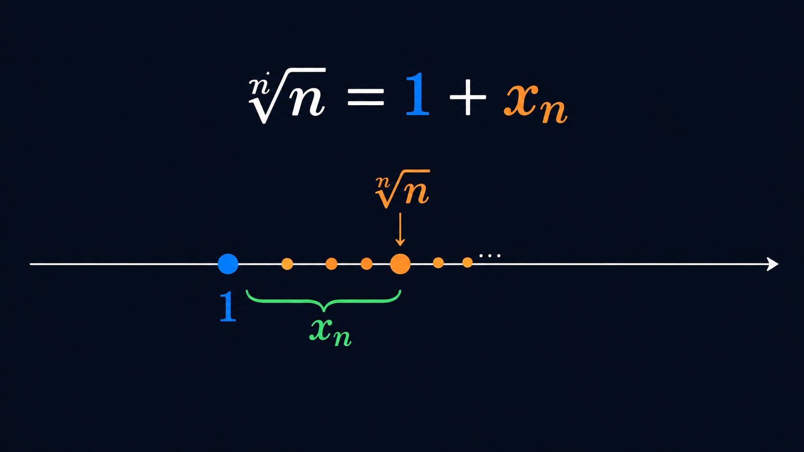
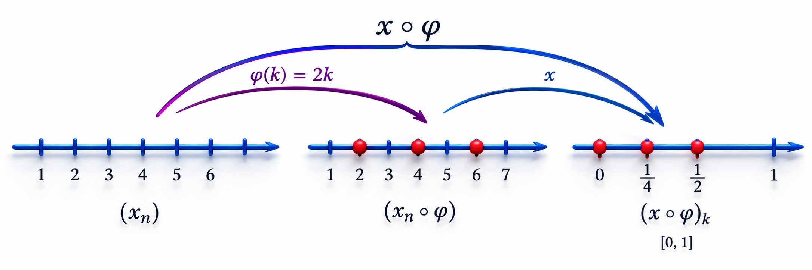

# Sucesiones

## 5.1 Introducción

Una sucesión de números reales es simplemente una función $x: \mathbb{N} \longrightarrow \mathbb{R}$, pero en vez de usar una notación de función se usa la notación $(x_n)_{n=1}^\infty$, como si fuese un vector infinito (de ahí la notación $\mathbb{R}^{\mathbb{N}}$ para el conjunto de todas las sucesiones de números reales).

### Ejemplos

Sucesiones aritméticas

Son sucesiones donde la diferencia de elementos consecutivos es siempre una constante (digamos $p$), es decir, $x_{n+1}-x_n=p$, para toda $n \geq 1$. Por lo tanto se puede ver como

$$x_1,x_2=x_1+p,x_3=x_2+p=x_1+2p,\ldots,x_n=x_{n-1}+p=x_1+(n-1)p.$$

Sucesiones geométricas

Son sucesiones para las cuales existe una constante $r \in \mathbb{R}$ tal que la división de sus términos consecutivos es $r$, es decir $x_{n+1}/x_n=r$ para toda $n \geq 1$. Por lo tanto la sucesión se ve

$$x_1,x_2=x_1r,x_3=x_2r=x_1r^2,\ldots,x_n=x_1r^{n-1}.$$

### Convergencia

$$(x_n)_{n=1}^\infty \longrightarrow x$$
$$\forall \; \varepsilon > 0 \; \exists \; N \in \mathbb{N}\; \text{tal que\;}|x_n-x|<\varepsilon, \; \forall \; n\geq N$$

 

  

Ya que el valor absoluto induce la distancia usual en los reales, podemos generalizar la definición anterior reemplazando $|x_n-x|$ por $d(x_n,x)$, donde $d$ es una métrica y los $x_n$ y $x$ son puntos de un espacio métrico $(X,d)$. El objetivo del material que sigue es presentar estas generalizaciones en espacios métricos, ver ejemplos, similitudes al caso real y diferencias.

### No convergencia a $x$

$$
(x_n)_{n=1}^\infty \mathrel{\rlap{\kern.6em/}\longrightarrow} x
$$
$$\exists \; \varepsilon > 0 \; \text{tal que} \; \forall \; N \in \mathbb{N} \; \exists \; n \geq N \; \text{con} \; |x_n - x| \geq \varepsilon$$

### Propiedades algebraicas de los límites en $\mathbb{R}$

Sean $(x_n)_{n=1}^{\infty}$, $(y_n)_{n=1}^{\infty}$ sucesiones <u>convergentes</u> de números reales, entonces:

1. Abre sumas y saca escalares: para $\alpha \in \mathbb{R}$

$$\lim_{n\to\infty}(\alpha x_n + y_n) = \alpha \lim_{n\to\infty} x_n + \lim_{n\to\infty} y_n,$$

2. Abre productos:

$$\lim_{n\to\infty}(x_n y_n) = \lim_{n\to\infty} x_n \lim_{n\to\infty} y_n,$$

3. Si $\lim_{n\to\infty} y_n \neq 0$ entonces

$$\lim_{n\to\infty}\left(\frac{x_n}{y_n}\right) = \frac{\lim_{n\to\infty} x_n}{\lim_{n\to\infty} y_n}$$

4. $m,M \in \mathbb{R}\; \text{tal que} \; \forall \; n \in \mathbb{N}, \; m \leq a_n \leq M$

$$\implies \; m \leq \lim_{n\to\infty} x_n \leq M$$

5. Ley del Sándwich.

$$
(x_n)_{n \in \mathbb{N}}, (y_n)_{n \in \mathbb{N}}, (z_n)_{n \in \mathbb{N}}, \\
$$

$$
(x_n)_{n \in \mathbb{N}}, (y_n)_{n \in \mathbb{N}} \xrightarrow{\;n \to \infty\;} L \\
$$

$$x_n \leq z_n \leq y_n \quad \forall \; n \in \mathbb{N}$$

$$\implies z_n \xrightarrow{\;n \to \infty\;} L$$

### Ejemplos sucesiones convergentes

- $(x_n)_{n=1}^{\infty}$ monótona creciente 

  $$x_1 \leq x_2 \leq \cdots \leq x_n \leq x_{n+1} \leq \cdots$$

  tal que $\;x_n \leq M\;$ (acotada superiormente).

  $$\implies \lim_{n \to \infty}x_n = \sup_{n \in \mathbb{N}}\{x_n\}$$

**Demostración**

*Existencia del supremo.* El conjunto $A = \{x_n : n \in \mathbb{N}\}$ es no vacío y está acotado superiormente por $M$. Por el axioma del supremo (completitud de $\mathbb{R}$), existe

$$L := \sup A = \sup_{n \in \mathbb{N}}\{x_n\}.$$

**p.d.** $\lim_{n \to \infty}x_n = L$, es decir, 

$$
\forall \; \varepsilon > 0 \; \exists \; N \in \mathbb{N} \; \text{\; tal que \; } \forall \; n \geq N \\[0.5em]
\implies |x_n -L| < \varepsilon
$$

Sea $\varepsilon > 0$.

$L$ es cota superior de $A$:

$$
\begin{aligned}
x_n &\leq L \\
\Longrightarrow\quad x_n - L &\leq 0
\end{aligned}
$$

$L$ es la *mínima* cota superior, $L - \varepsilon$ **no** es cota superior de $A$ (pues $L - \varepsilon < L$). Entonces existe $N \in \mathbb{N}$ tal que

$$L - \varepsilon < x_N $$

Al ser $(x_n)_{n \in \mathbb{N}}$ monótona creciente, para todo $n \geq N$:

$$L - \varepsilon < x_N \leq x_n$$

$$
\begin{array}{rc}
\implies & L - \varepsilon < x_n \leq L < L + \varepsilon \\
\implies & -\varepsilon < x_n - L \leq 0 < \varepsilon \\
\implies & |x_n - L| < \varepsilon.
\end{array}
$$

Como $\varepsilon > 0$ es arbitrario, 

$$\lim_{n \to \infty}x_n = L = \sup_{n \in \mathbb{N}}\{x_n\} \;\blacksquare .$$

---

- $(x_n)_{n=1}^{\infty}$ monótona decreciente 

  $$x_1 \geq x_2 \geq \cdots \geq x_n \geq x_{n+1} \geq \cdots$$

  tal que $\;x_n \geq M\;$ (acotada inferiormente).

  $$\implies \lim_{n \to \infty}x_n = \inf_{n \in \mathbb{N}}\{x_n\}$$

**Demostración**

*Existencia del ínfimo.* El conjunto $A = \{x_n : n \in \mathbb{N}\}$ es no vacío y está acotado inferiormente por $M$. Por el axioma del supremo (completitud de $\mathbb{R}$), existe

$$L := \inf A = \inf_{n \in \mathbb{N}}\{x_n\}.$$

**p.d.** $\lim_{n \to \infty}x_n = L$, es decir, 

$$
\forall \; \varepsilon > 0 \; \exists \; N \in \mathbb{N} \; \text{\; tal que \; } \forall \; n \geq N \\
\implies |x_n -L| < \varepsilon
$$

Sea $\varepsilon > 0$.

$L$ es cota inferior de $A$:

$$
\begin{aligned}
L &\leq x_n \\
\Longrightarrow\quad 0 &\leq x_n-L
\end{aligned}
$$

$L$ es la *máxima* cota inferior, $L + \varepsilon$ **no** es cota inferior de $A$ (pues $L < L + \varepsilon$). Entonces existe $N \in \mathbb{N}$ tal que

$$x_N < L+\varepsilon$$

$(x_n)_{n \in \mathbb{N}}$ es monótona decreciente, así que para todo $n \geq N$:

$$x_n \leq x_N < L+\varepsilon$$

$$
\begin{array}{rc}
\implies & L - \varepsilon < L \leq x_n < L + \varepsilon \\
\implies & -\varepsilon < 0 \leq x_n-L < \varepsilon \\
\implies & |x_n - L| < \varepsilon.
\end{array}
$$

Como $\varepsilon > 0$ es arbitrario, 

$$\lim_{n \to \infty}x_n = L = \inf_{n \in \mathbb{N}}\{x_n\} \;\blacksquare .$$

---

- $\lim_{n\to\infty} \sqrt[n]{n} = 1$.

**Demostración**

$$
\begin{aligned}
\sqrt[n]{n} &\geq 1 \\
\implies \sqrt[n]{n} &= 1 + x_n, \quad x_n \geq 0
\end{aligned}
$$

 

  

**p.d.** $\lim_{n \to \infty}x_n=0$

$$
\begin{aligned}
n = (1+x_n)^n &=\sum_{k=0}^n\underbrace{\binom{n}{k}x_n^k}_{\geq 0} \\
&\geq \binom{n}{2}x_n^2 \\
&= \frac{n!}{2!(n-2)!}x_n^2 \\
&= \frac{n(n-1)}{2}x_n^2 \\
\implies \qquad 1 &\geq \left(\frac{n-1}{2}\right)x_n^2 \qquad \text{(Dividiendo entre 'n')}\\
\implies \frac{2}{n-1} &\geq x_n^2 \geq 0 \qquad (n \geq 2) \\
\implies \qquad 0 &\leq x_n \leq \sqrt{\frac{2}{n-1}}
\end{aligned}
$$

$$
\begin{aligned}
\sqrt{\frac{2}{n-1}} \xrightarrow{\;n \to \infty\;} 0 \\[1em]
0 \xrightarrow{\;n \to \infty\;} 0
\end{aligned}
$$

Por la ley del sándwich

$$\lim_{n \to \infty} x_n =0$$

Por lo tanto

$$
\lim_{n \to \infty}\sqrt[n]{n} = \lim_{n \to \infty}(1 + x_n) = 1
$$

---

## 5.2 Definición (Sucesiones)

Sea $X \neq \emptyset$ un conjunto. Una sucesión en $X$ es una función

$$
x:\;\mathbb{N} \longrightarrow X \\
n \longmapsto x_n
$$

Se usa la notacion $(x_n)_{n\in\mathbb{N}}$ ó $(x_n)_{n\geq 1}$, donde para toda $n$, $x_n$ es un elemento en $X$. 

Por ejemplo

1. En $\mathbb{R}^3$,

$$x_n = \left(\cos(n\pi),\ \frac{1}{n^2},\ \sqrt[n]{2}\right),\ n = 1, 2, \ldots$$

2. En $\ell_\infty$,
   
   $$
   \begin{aligned}
    X &= \ell_\infty \\
    &= \{(x_n)_{n=1}^\infty \; : \; x_n \in \mathbb{R}, \sup_{n \in \mathbb{N}}\{|x_n|\}<+\infty\} \qquad \text{(sucesiones acotadas)}
   \end{aligned}
   $$

3. Definimos

    $$
    \left.
    \begin{aligned}
    e_1&=(1,0,0,\ldots) \\
    e_2&=(0,1,0,\ldots) \\
    &\vdots \\
    e_n&=(0,0,\ldots,\underbrace{1}_{\text{lugar } n},0,\ldots)
    \end{aligned}
    \right\}
    \ \text{canónicos en } \ell_\infty
    $$
    
    $$\therefore \; (e_n)_{n=1}^\infty \; \text{sucesión en }\; \ell_\infty$$

4. En $C([0,1])$,

$$f_n(x) = \frac{x^n}{1 + x^n},\ n = 1, 2, \ldots$$

---

## 5.3 Definición (Sucesiones convergentes)

Sea $(X,d)$ un espacio métrico y $(x_n)_{n \in \mathbb{N}}$ una sucesión en $X$. Decimos que la sucesión es convergente en $X$ si existe un $x \in X$ que satisface:

$$\forall \; \varepsilon > 0 \; \exists \; N \in \mathbb{N} \; \text{tal que \;} \forall \; n \geq N,\;d(x_n,x) < \varepsilon$$

Por simplicidad, si $(x_n)_{n \in \mathbb{N}}$ converge a $x$, escribimos $\lim_{n \to \infty}x_n=x.$

Geométricamente la idea es muy parecida al caso real sólo que ahora $\varepsilon$ representa el radio de una bola y la métrica $d$ determina la forma de la bola o vecindad centrada en $x$.

 

  

Notas:

1. Usualmente la $N$ en la definición anterior depende de $\varepsilon$ y ésta dependencia puede denotarse como $N(\varepsilon)$.
2. A pesar que en la definición se pide $d(x_n, x) < \varepsilon$, se puede cambiar a $d(x_n, x) \leq \varepsilon$, esto debido al cuantificador "para toda $\varepsilon > 0$". Pues si tenemos que se vale la condición con $\leq$ simplemente tomamos $\varepsilon/2$ para obtener: $d(x_n, x) \leq \varepsilon/2 < \varepsilon$.
3. La definición puede pensarse de la siguiente forma: a partir de cierto instante de la sucesión (el instante es $N$) la distancia entre los elementos de la sucesión y el punto de convergencia se hace tan chiquita como queramos (que tan chiquito lo mide la $\varepsilon$).
4. $\lim_{n\to\infty} x_n = x, \; \text{en }\; X\; \Leftrightarrow \; \lim_{n\to\infty} d(x_n, x) = 0$, en $\mathbb{R}$.

---

## 5.4 Nota

### Límites en espacios vectoriales normados

Recordamos que dado un espacio vectorial normado, $(V, \|\cdot\|)$, la norma induce una métrica mediante, $d(v,w) = \|v - w\|$. En este contexto la definición de que $\lim_{n\to\infty} v_n = v$ se escribe como:

$$
\forall \; \varepsilon > 0 \; \exists \; N \in \mathbb{N} \; \text{tal que } \; \forall n \geq N \\[1em]
\implies \|v_n - v\| < \varepsilon
$$

Nota que lo anterior se puede escribir como

$$\left(\lim_{n \to \infty} v_n = v \; \text{en} \; V\right) \Leftrightarrow \left(\lim_{n\to\infty} \|v_n - v\| = 0 \; \text{ en } \; \mathbb{R}\right)$$

y la ventaja de éste último límite es que es un límite de números reales, de los que se ven en cálculo.

Compartando con el espacio métrico

- $\lim_{n \to \infty}x_n=x \; \text{en} \; (X,d) \; \iff \; \left[\forall \; \varepsilon > 0 \; \exists \; N \in \mathbb{N} \; \text{tal que} \; n \geq N \implies d(x_n,x) < \varepsilon \right]$

- $\lim_{n \to \infty}v_n=v \; \text{en} \; (V,\|\cdot\|) \; \iff \; \left[\forall \; \varepsilon > 0 \; \exists \; N \in \mathbb{N} \; \text{tal que} \; n \geq N \implies \|v_n-v\| < \varepsilon\right]$

Un ejemplo concreto es $V = \mathbb{R}^2$ con la norma euclidiana. Entonces $v_n=(a_n,b_n)$ es una sucesión de vectores del plano

$$
\begin{aligned}
v_n &\longmapsto v=(a,b) \\[1em]
\sqrt{(a_n-a)^2 + (b_n-b)^2} &\longmapsto 0
\end{aligned}
$$

---

## 5.5 Definición (Subsucesiones)

Sea $X \neq \emptyset$ un conjunto y sea $(x_n)_{n=1}^{\infty}$ una sucesión en $X$, es decir, una función

$$
x:\; \mathbb{N} \longrightarrow X, \\[1em]
n \longmapsto x_n
$$

Una **subsucesión** de $(x_n)_{n=1}^\infty$ es una función de la forma $x \circ \varphi$, donde

$$\varphi:\;\mathbb{N} \longrightarrow \mathbb{N} \; \text{ es estrictamente creciente.}$$

 

 

**Notación.** Se escribe $\varphi(k)=n_k$, y la subsucesión de $(x_n)_{n=1}^\infty$ se denota $(x_{n_k})_{k=1}^\infty$, o bien $(x_{\varphi(k)})_{k=1}^{\infty}$. Por costumbre, se entiende que $n_k=\varphi(k)$ para alguna función $\varphi$ estrictamente creciente.

$$(x\circ\varphi)(k)=x(\varphi(k))=x_{\varphi(k)}=x_{n_k}.$$

**Ejemplos.**

- Si $\varphi(k)=k$, se obtiene la propia sucesión.
- $(x_{2k})_{k\in\mathbb{N}}$ es una subsucesión de $(x_n)_{n\in\mathbb{N}}$, con $\varphi(k)=2k$.
- $(x_{2k+1})_{k\in\mathbb{N}}$ es una subsucesión de $(x_n)_{n\in\mathbb{N}}$, con $\varphi(k)=2k+1$.

En ambos casos $\varphi$ es estrictamente creciente.

**Ejemplo concreto.** Sea $X=\mathbb{R}$, $x_n=\dfrac{1}{n}$ y $\varphi(k)=n_k=2k$.

Veamos que $\varphi$ es estrictamente creciente. Sean $k,l\in\mathbb{N}$ con $k<l$. Multiplicando por $2>0$ se obtiene $2k<2l$, es decir,

$$\varphi(k)<\varphi(l).$$

Por lo tanto, $\varphi$ es estrictamente creciente y $x\circ\varphi$ es una subsucesión de $(x_n)_{n=1}^\infty$. Su término general es

$$(x\circ\varphi)(k)=x_{\varphi(k)}=x_{n_k}=x_{2k}=\frac{1}{2k}.$$

Los primeros términos se obtienen aplicando primero $\varphi$ y después $x$:

$$
\begin{aligned}
1 &\overset{\varphi}{\longmapsto} 2 \overset{x}{\longmapsto} x_{2}=\tfrac{1}{2}=0.5 \\[0.5em]
2 &\overset{\varphi}{\longmapsto} 4 \overset{x}{\longmapsto} x_{4}=\tfrac{1}{4}=0.25 \\[0.5em]
3 &\overset{\varphi}{\longmapsto} 6 \overset{x}{\longmapsto} x_{6}=\tfrac{1}{6}\approx 0.1667 \\[0.5em]
4 &\overset{\varphi}{\longmapsto} 8 \overset{x}{\longmapsto} x_{8}=\tfrac{1}{8}=0.125
\end{aligned}
$$

Es decir, $x_{n_1}=x_2$, $x_{n_2}=x_4$, $x_{n_3}=x_6$ y $x_{n_4}=x_8$, de modo que

$$(x_{n_k})_{k=1}^{\infty}=\left(\frac{1}{2},\frac{1}{4},\frac{1}{6},\frac{1}{8},\dots\right).$$

La subsucesión conserva los términos de índice par de $(x_n)_{n=1}^\infty$, omite los de índice impar y no altera el orden.

**Observación.** Una subsucesión de una subsucesión es una subsucesión. Precisamente:

$$
\begin{aligned}
&(x_{\varphi(k)})_{k=1}^{\infty}\ \text{es una subsucesión de}\ (x_n)_{n=1}^{\infty}, \\[1em]
&(x_{\varphi(\psi(s))})_{s=1}^{\infty}\ \text{es una subsucesión de}\ (x_{\varphi(k)})_{k=1}^{\infty}, \\[1em]
\implies\ \; &\varphi\circ\psi:\mathbb{N}\to\mathbb{N}\ \text{es estrictamente creciente}, \\[1em]
&\therefore\ (x_{(\varphi\circ\psi)(s)})_{s=1}^{\infty}\ \text{es una subsucesión de}\ (x_n)_{n=1}^{\infty}.
\end{aligned}
$$

**Razón.** Sean $\varphi,\psi:\mathbb{N}\to\mathbb{N}$ estrictamente crecientes. Entonces $\varphi\circ\psi$ es estrictamente creciente. En efecto, si $s<t$, entonces $\psi(s)<\psi(t)$ y, como $\varphi$ es estrictamente creciente,

$$\varphi(\psi(s))<\varphi(\psi(t)).$$

En notación de funciones: si $y=x\circ\varphi$ y $z=y\circ\psi$, entonces $z_s=y_{\psi(s)}=x_{\varphi(\psi(s))}$, es decir,

$$z=x\circ(\varphi\circ\psi).$$

---

## 5.6 Lema

$(X,d)$ espacio métrico, $\;(x_n)_{n \in \mathbb{N}}$ una sucesión en $\;X, \; x \in X$.

$$\text{p.d}\; \left(\lim_{n \to \infty}x_n=x\right) \Longrightarrow \left(\lim_{n \to \infty}x_{n_k}=x\right), \quad \forall \: (x_{n_k}) \; \text{en} \; X.$$

### Demostración

Sea $(x_{n_k})_{k=1}^\infty$ una subsucesión de $(x_n)_{n=1}^\infty$.

Sea $\varepsilon > 0$

$$
\text{p.d.}\;\exists \; k_0 \in \mathbb{N} \; \text{ tal que } \; \forall \; k \geq k_0 \\[1em]
\implies \; d(x_{n_k},x) < \varepsilon
$$

Por hipótesis

$$
\lim_{n \to \infty}x_n=x, \; \text{ en } \; X \\[1em]
\iff \; \forall \; \varepsilon > 0 \;\, \exists \; N \in \mathbb{N} \; \text{ tal que } \; \forall \; n \geq N, \; d(x_n,x) < \varepsilon  
$$

Sea $\;\varphi:\;\mathbb{N} \longrightarrow \mathbb{N}\;$ estrictamente creciente tal que $n_k=\varphi(k)$, es decir, $x_{n_k}=x_{\varphi(k)}$

$\varphi\;$ es creciente $\implies \exists \; \ell, \; \varphi(\ell) > N$

 

 

Sea $k_0=\min\{\ell \in \mathbb{N} \;|\;\varphi(\ell) > N\}$

$$\text{p.d.} \; k \geq k_0 \; \implies \; d(x_{n_k},x) < \varepsilon$$

Si $k \geq k_0$, entonces

$$
\begin{aligned}
N &< \varphi(k_0) \qquad \text{(Por definición de}\; k_0 \text{)}\\
&\leq \varphi(k) \\
&= n_k
\end{aligned}
$$

$$\implies \; d(x_{n_k}, x)<\varepsilon \;\blacksquare .$$

---

## 5.7 Lema

$(X,d)$ espacio métrico, $(x_n)_{n \in \mathbb{N}}$ sucesión en $X$, $x \in X$

$$
\begin{gathered}
\Big[\, \forall \, (x_{n_k})_{k \in \mathbb{N}} \;\; \exists \, (x_{n_{k_m}})_{m \in \mathbb{N}} \;\text{ tal que }\; (x_{n_{k_m}})_{m \in \mathbb{N}} \xrightarrow{\;m \to \infty\;} x \,\Big] \\[1em]
\implies (x_n)_{n \in \mathbb{N}} \xrightarrow{\;n \to \infty\;} x
\end{gathered}
$$

**Demostración** por contradicción.

$$x_n \xrightarrow{\;\;\;} \!\!\!\!\!\!\!/ \;\;\; x$$

$$
\begin{gathered}
\implies \; \exists \; \varepsilon > 0 \; \text{tal que} \; \forall \; N \in \mathbb{N} \; \exists \; n \geq N \; \text{con} \; d(x_n,x) \geq \varepsilon
\end{gathered}
$$

**Paso 1**. El conjunto de índices malos es infinito

$$A = \{n \in \mathbb{N} \;|\; d(x_n,x)\geq \varepsilon\}$$

Si $A$ fuera finito, tomaríamos $\;N > \max A\;$ y no existiría algún $n \geq N\; \text{en}\; A$, contradiciendo la elección de $\varepsilon$. Luego $A$ es infinito.

**Paso 2**. Subsucesión alejada de $x$.

Como $\;A \subseteq \mathbb{N}\;$ es infinito, podemos enumerarlo en orden creciente

$$A = \{n_1 < n_2 < \ldots \}$$

Esto define una subsucesión $(x_{n_k})_{k \in \mathbb{N}}\;$ con $d(x_{n_k},x) \geq \varepsilon \quad \forall \; k$

**Paso 3**. Contradicción por hipótesis

Por hipótesis, a $(x_{n_k})_{k \in \mathbb{N}}$ se le puede extraer una subsucesión

$$
\begin{gathered}
(x_{n_{k_m}})_{m \in \mathbb{N}} \xrightarrow{\;m \to \infty\;} x \\[0.5em]
\implies \exists \; M \; \text{tal que} \; d(x_{n_{k_m}},x)<\varepsilon \quad \forall \; m \geq M
\end{gathered}
$$

Pero todos los términos de $\;(x_{n_k})_{k \in \mathbb{N}}\;$ cumplen $\;d(x_{n_k},x)\geq \varepsilon,\;$ en particular los de la sub-subsucesión. Contradicción.

$$\therefore \; x_n \longrightarrow x \; \blacksquare .$$

---

Sea $(x_n)_{n \in \mathbb{N}}$ una sucesión acotada de números reales, _i.e._, existe $M > 0 \; \text{tal que} \; |x_n|\leq M \; \forall\;n\in \mathbb{N}$

Para estudiar el comportamiento de una sucesión a medida que $n \longrightarrow \infty$, no nos interesan tanto sus primeros términos, sino lo que sucede con los términos que aparecen cada vez más adelante. Por eso vamos a estudiar las colas de la sucesión.

Para cada $n \in \mathbb{N}$ consideramos al conjunto

$$A_n=\{x_k\;:\;k\geq n\}$$

Es el conjunto de términos de la cola de la sucesión $(x_n)_{n \in \mathbb{N}}$ que comienza en el índice $n$

$$
\begin{aligned}
A_1 &= \{x_k : k \geq 1\} = \{x_1, x_2, x_3, \dots\} \\[0.5em]
A_2 &= \{x_k : k \geq 2\} = \{x_2, x_3, x_4, \dots\} \\[0.5em]
A_3 &= \{x_k : k \geq 3\} = \{x_3, x_4, x_5, \dots\} \\[0.5em]
&\;\;\vdots \\[0.5em]
A_n &= \{x_k : k \geq n\} = \{x_n, x_{n+1}, x_{n+2}, \dots\}
\end{aligned}
$$

Notemos que cada $A_n$ es acotado pues $(x_n)_{n \in \mathbb{N}}$ es acotada y además observemos que

$$
A_{n+1} = \{x_k : k \geq n+1\} \subseteq A_n = \{x_k : k \geq n\}
$$

pues si $k \geq n+1 > n \implies k \geq n$.

Como cada $A_n$ es acotado y no vacío sabemos que $\forall \; n \in \mathbb{N}$ existe el supremo e ínfimo de $A_n \; \forall n \in \mathbb{N}$, i.e.,

$$
\alpha_n := \inf A_n = \inf \{x_k : k \geq n\} = \inf_{k \geq n} \{x_k\} \quad \text{existe} \quad \text{y}
$$

$$
\beta_n := \sup A_n = \sup \{x_k : k \geq n\} = \sup_{k \geq n} \{x_k\} \quad \text{existe.}
$$

Así tenemos que $(\alpha_n)_{n \in \mathbb{N}}$ y $(\beta_n)_{n \in \mathbb{N}}$ son dos sucesiones de números reales.

Sea $n \in \mathbb{N}$ arbitraria. Sabemos que

$$
\alpha_n = \inf_{k \geq n} \{x_k\} \leq \sup_{k \geq n} \{x_k\} = \beta_n \implies \alpha_n \leq \beta_n
$$

Como sabemos que $-M \leq x_k \leq M \;\; \forall \; k \in \mathbb{N}$ (en particular $\forall \; k \geq n$) por def. de ínfimo y supremo, $\forall \; k \geq n$

$$
-M \leq \alpha_n = \inf_{k \geq n} \{x_k\} \leq x_k \leq \sup_{k \geq n} \{x_k\} = \beta_n \leq M
$$

$$
\implies -M \leq \alpha_n \leq \beta_n \leq M
$$

$$
\implies |\alpha_n| \leq M \;\; \forall \; n \in \mathbb{N} \;\; \text{y} \;\; |\beta_n| \leq M \;\; \forall \; n \in \mathbb{N}.
$$

Así $(\alpha_n)_{n \in \mathbb{N}}$ y $(\beta_n)_{n \in \mathbb{N}}$ son acotadas.

Además como $A_{n+1} \subseteq A_n \;\; \forall \; n \in \mathbb{N}$ sabemos que

$$
\alpha_n = \inf A_n \leq \inf A_{n+1} = \alpha_{n+1} \implies \alpha_n \leq \alpha_{n+1} \;\; \forall \; n \in \mathbb{N} \quad \text{y}
$$

$$
\beta_{n+1} = \sup A_{n+1} \leq \sup A_n = \beta_n \implies \beta_{n+1} \leq \beta_n \;\; \forall n \in \mathbb{N}.
$$

Entonces $(\alpha_n)_{n \in \mathbb{N}}$ es sucesión acotada monótona creciente de números reales y $(\beta_n)_{n \in \mathbb{N}}$ es sucesión acotada monótona decreciente, entonces por el teorema de convergencia monótona $(\alpha_n)_{n \in \mathbb{N}}$ y $(\beta_n)_{n \in \mathbb{N}}$ son convergentes y

$$
\begin{aligned}
\lim_{n \to \infty} \alpha_n &= \sup_{n \geq 1} \{\alpha_n\} = \sup_{n \geq 1} \left\{ \inf_{k \geq n} \{x_k\} \right\} \\[0.5em]
\lim_{n \to \infty} \beta_n &= \inf_{n \geq 1} \{\beta_n\} = \inf_{n \geq 1} \left\{ \sup_{k \geq n} \{x_k\} \right\}
\end{aligned}
$$

---

## 5.8 Definición

### Límites inferior y superior

Dada una sucesión acotada de números reales, $(x_n)_{n\in\mathbb{N}}$, definimos, respectivamente, su límite inferior y superior como

$$\liminf_{n\to\infty} x_n = \sup_{n\geq 1}\left\{\inf_{k\geq n}\{x_k\}\right\}$$

$$\limsup_{n\to\infty} x_n = \inf_{n\geq 1}\left\{\sup_{k\geq n}\{x_k\}\right\}$$

**Observación:** de la definición se sigue directamente que 

$$\liminf_n x_n \leq \limsup_n x_n.$$

**Razón:**

$\forall \; n \in \mathbb{N}$ recordemos que

$$
\alpha_n := \inf_{k \geq n} \{x_k\} \quad \text{y} \quad \beta_n := \sup_{k \geq n} \{x_k\}.
$$

Anteriormente vimos que $(\alpha_n)_{n \in \mathbb{N}}$ y $(\beta_n)_{n \in \mathbb{N}}$ convergen y

$$
\lim_{n \to \infty} \alpha_n = \sup_{n \geq 1} \left\{ \inf_{k \geq n} \{x_k\} \right\}
\quad \text{y} \quad
\lim_{n \to \infty} \beta_n = \inf_{n \geq 1} \left\{ \sup_{k \geq n} \{x_k\} \right\}
$$

Entonces por def. de límite superior e inferior tenemos que

$$
\lim_{n \to \infty} \alpha_n = \liminf_{n \to \infty} x_n
\quad \text{y} \quad
\lim_{n \to \infty} \beta_n = \limsup_{n \to \infty} x_n.
$$

Sabemos que $\forall \; n \in \mathbb{N}$ $\;\alpha_n \leq \beta_n$

$$
\implies \lim_{n \to \infty} \alpha_n \leq \lim_{n \to \infty} \beta_n
$$

$$
\implies \liminf_{n \to \infty} x_n \leq \limsup_{n \to \infty} x_n \quad \blacksquare
$$

**Nota**: Para todo $(x_n)_{n \in \mathbb{N}}$ sucesión acotada de números reales, su límite inferiror y su límite superior siempre existe en $\mathbb{R}$. (No importa si la sucesión converge o no).

---

### Ejemplo 

$\forall \; n \in \mathbb{N}$ sea $x_n = (-1)^n$. Calcula el límite superior y el límite inferior de la sucesión $(x_n)_{n\in\mathbb{N}}$.

$$
x_n =
\begin{cases}
-1 & \text{si } n \text{ es impar} \\
1 & \text{si } n \text{ es par}
\end{cases}
$$

Sea $n \in \mathbb{N}$ arbitraria.

**Límite inferior**

$$
\begin{aligned}
\inf_{k \ge n} \{x_k\} &= \inf \{x_k : k \ge n\} \\
&= \inf \{-1, 1\} \\
&= -1
\end{aligned}
$$

$\Rightarrow \displaystyle\inf_{k \ge n} \{x_k\} = -1 \quad \forall n \in \mathbb{N}$

$$
\begin{aligned}
\Rightarrow \sup_{n \ge 1} \left\{ \inf_{k \ge n} \{x_k\} \right\} &= \sup_{n \ge 1} \{-1\} \\
&= \sup \{-1 : n \ge 1\} \\
&= -1
\end{aligned}
$$

$$
\Rightarrow \boxed{\liminf_{n \to \infty} x_n = -1}
$$

**Límite superior**

$$
\begin{aligned}
\sup_{k \ge n} \{x_k\} &= \sup \{x_k : k \ge n\} \\
&= \sup \{-1, 1\} \\
&= 1
\end{aligned}
$$

$\Rightarrow \displaystyle\sup_{k \ge n} \{x_k\} = 1 \quad \forall n \in \mathbb{N}$

$$
\begin{aligned}
\Rightarrow \inf_{n \ge 1} \left\{ \sup_{k \ge n} \{x_k\} \right\} &= \inf \{1\} \\
&= \inf \{1 : n \ge 1\} \\
&= 1
\end{aligned}
$$

$$
\Rightarrow \boxed{\limsup_{n \to \infty} x_n = 1}
$$

---

## 5.9 Lema

Sea $(x_n)_{n=1}^{\infty}$ una sucesión acotada de números reales. Prueba que $(x_n)_{n=1}^{\infty}$ es convergente si y solo si

$$\liminf_{n\to\infty} x_n = \limsup_{n\to\infty} x_n.$$

En cuyo caso se tiene que 

$$\liminf_{n\to\infty} x_n = \limsup_{n\to\infty} x_n = \lim_{n\to\infty} x_n.$$

**Demostración**

$\forall \; n \in \mathbb{N}$ definimos $\alpha_n := \displaystyle\inf_{k \ge n} \{x_k\}$ y $\beta_n := \displaystyle\sup_{k \ge n} \{x_k\}$.

Anteriormente vimos que $(\alpha_n)_{n\in\mathbb{N}}$ y $(\beta_n)_{n\in\mathbb{N}}$ convergen y

$$
\lim_{n \to \infty} \alpha_n = \sup_{n \ge 1} \left\{ \inf_{k \ge n} \{x_k\} \right\}
\qquad \text{y} \qquad
\lim_{n \to \infty} \beta_n = \inf_{n \ge 1} \left\{ \sup_{k \ge n} \{x_k\} \right\}
$$

Entonces, por def. de límite superior e inferior, tenemos que

$$
\lim_{n \to \infty} \alpha_n = \liminf_{n \to \infty} x_n
\qquad \text{y} \qquad
\lim_{n \to \infty} \beta_n = \limsup_{n \to \infty} x_n.
$$

$\Rightarrow)$ Por hipótesis sabemos que $(x_n)_{n\in\mathbb{N}}$ converge, es decir, existe $L \in \mathbb{R}$ tal que $\displaystyle\lim_{n \to \infty} x_n = L$.

P.d. $\displaystyle\lim_{n \to \infty} \alpha_n = L = \lim_{n \to \infty} \beta_n$.

Sea $\varepsilon > 0$ arbitraria. Como $x_n \to L$, por definición de convergencia en $\mathbb{R}$, existe $N \in \mathbb{N}$ tal que

$$
|x_n - L| < \frac{\varepsilon}{2} \quad \forall n \ge N.
$$

$$
\Rightarrow -\frac{\varepsilon}{2} < x_n - L < \frac{\varepsilon}{2} \quad \forall n \ge N
$$

$$
L - \frac{\varepsilon}{2} < x_n < L + \frac{\varepsilon}{2} \quad \forall n \ge N. \qquad \text{(1)}
$$

Sea $n \ge N$ fija pero arbitraria. Notemos que $\forall k \ge n$ tenemos que $k \ge N$, entonces por (1) tenemos que

$$
L - \frac{\varepsilon}{2} < x_k < L + \frac{\varepsilon}{2} \quad \forall k \ge n \ge N
$$

$$
\Rightarrow \quad L - \frac{\varepsilon}{2} < x_k \quad \forall k \ge n \ge N
\qquad , \qquad
x_k < L + \frac{\varepsilon}{2} \quad \forall k \ge n \ge N
$$

$$
\Rightarrow \quad L - \frac{\varepsilon}{2} \le \inf_{k \ge n} \{x_k\}
\qquad , \qquad
\Rightarrow \quad \sup_{k \ge n} \{x_k\} \le L + \frac{\varepsilon}{2}
$$

$$
\Rightarrow \quad L - \frac{\varepsilon}{2} \le \alpha_n
\qquad , \qquad
\Rightarrow \quad \beta_n \le L + \frac{\varepsilon}{2}
$$

Entonces $L - \dfrac{\varepsilon}{2} \le \alpha_n \le \beta_n \le L + \dfrac{\varepsilon}{2} \quad \forall n \ge N$

$$
\Rightarrow \quad -\frac{\varepsilon}{2} \le \alpha_n - L \le \beta_n - L \le \frac{\varepsilon}{2} \quad \forall n \ge N
$$

$$
\Rightarrow \quad |\alpha_n - L| \le \frac{\varepsilon}{2} < \varepsilon \quad \forall n \ge N
\quad \text{y} \quad
|\beta_n - L| \le \frac{\varepsilon}{2} < \varepsilon \quad \forall n \ge N
$$

$$
\Rightarrow \quad |\alpha_n - L| < \varepsilon \quad \forall n \ge N
\quad \text{y} \quad
|\beta_n - L| < \varepsilon \quad \forall n \ge N
$$

$$
\Rightarrow \quad \lim_{n \to \infty} \alpha_n = L = \lim_{n \to \infty} \beta_n
$$

$$
\Rightarrow \quad \liminf_{n \to \infty} x_n = L = \limsup_{n \to \infty} x_n
$$

De hecho,

$$
\liminf_{n \to \infty} x_n = \limsup_{n \to \infty} x_n = \lim_{n \to \infty} x_n.
$$

$\Leftarrow)$ Supongamos que $L := \displaystyle\liminf_{n \to \infty} x_n = \limsup_{n \to \infty} x_n$.

Como $\displaystyle\liminf_{n \to \infty} x_n = \lim_{n \to \infty} \alpha_n$ y $\displaystyle\limsup_{n \to \infty} x_n = \lim_{n \to \infty} \beta_n$,

tenemos que $\displaystyle\lim_{n \to \infty} \alpha_n = L$ y $\displaystyle\lim_{n \to \infty} \beta_n = L$.

Sea $n \in \mathbb{N}$ fija pero arbitraria. Sabemos que

$$
\alpha_n = \inf_{k \ge n} \{x_k\} \le x_k \le \sup_{k \ge n} \{x_k\} = \beta_n \quad \forall k \ge n.
$$

$$
\Rightarrow \quad \alpha_n \le x_n \le \beta_n \quad \forall n \in \mathbb{N}
$$

Como $\displaystyle\lim_{n \to \infty} \alpha_n = L = \lim_{n \to \infty} \beta_n$, por la ley del sándwich

tenemos que $\displaystyle\lim_{n \to \infty} x_n = L$.

$\therefore$ $(x_n)_{n\in\mathbb{N}}$ converge y

$$
\liminf_{n \to \infty} x_n = \limsup_{n \to \infty} x_n = \lim_{n \to \infty} x_n. \qquad \blacksquare
$$

---

**Definición**: Sea $(X,d)$ un espacio métrico y $A \subseteq X$. Decimos que el conjunto «$A$ es acotado en $(X,d)$» si y sólo si existe $r > 0\;$ y un punto $X_0 \in X$ tales que $A \subseteq B_r(x_0)$

En consecuencia también podemos decir que:

«$A \subseteq X\;$ es acotado en $(X,d)$» si y sólo si existen una $r > 0\;$ y $\;x_0 \in X\;$ tales que $d(x_0, a) \leq r \; \forall \; a \in A.$

---

## 5.10 Definición

Sea $(X,d)$ un espacio métrico. Una sucesión en $X$, $(x_n)_{n\in\mathbb{N}}$, se llama de Cauchy o Cauchy respecto a $d$ si las distancias entre sus elementos tienden a cero, es decir

$$\lim_{n,m\to\infty} d(x_n,x_m) = 0$$

$$\text{i.e.} \; \left(\forall \; \varepsilon > 0 \;\exists \; N \in \mathbb{N} \; \text{tal que,} \; \forall \; n,m \geq N \right) \implies \; d(x_n,x_m) < \varepsilon$$

---

## 5.11 Lema

Sea $(X,d)$ un espacio métrico y $(x_n)_{n \in \mathbb{N}}$ una sucesión de Cauchy en $X$.

Supón que $(x_n)_{n \in \mathbb{N}}$ admite una subsucesión convergente en $X$. Prueba que la sucesión original, $(x_n)_{n \in \mathbb{N}}$, también es convergente.

**Demostración**

Sea $(x_{n_k})_{k=1}^{\infty}$ subsucesión con

$$\lim_{k \to \infty}x_{n_k}=x \in X$$

Sea $\varepsilon > 0$.

Como $x_{n_k} \to x$, existe $k_0 \in \mathbb{N}$ tal que

$$d(x_{n_k},x) < \frac{\varepsilon}{2}, \; \forall \; k \geq k_0$$

Como $(x_n)_{n=1}^{\infty}$ es de Cauchy, existe $N \in \mathbb{N}$ tal que

$$\forall \; n,m > N,\; d(x_n, x_m) < \frac{\varepsilon}{2}$$

Sea $k_1 = \max\{k_0, N+1\}$. Como $(n_k)$ es estrictamente creciente, $n_k \geq k$, y por tanto

(i) $k_1 \geq k_0$  
(ii) $n_{k_1} \geq k_1 > N$

Entonces si $n > N$ se sigue

$$
\begin{aligned}
  d(x_n,x) &\leq d(x_n, x_{n_{k_1}}) + d(x_{n_{k_1}},x) \\
  &< \frac{\varepsilon}{2} + \frac{\varepsilon}{2} \\
  &= \varepsilon
\end{aligned}
$$

$$\therefore \; \lim_{n \to \infty}d(x_n,x)=0$$