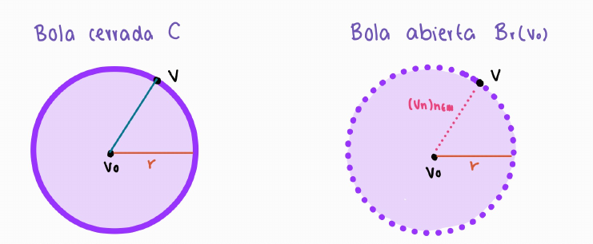

# Ejercicios Topología Espacio Métricos

## 6.18

Sea $(X,d)$ un espacio métrico y $U \subseteq X.$ Las siguientes condiciones son equivalentes.

1. $U$ es abierto.
2. Si $(x_n)_{n \in \mathbb{N}} \subseteq X$ es una sucesión convergente a un punto $x \in U$, entonces ,$x_n \in U$ para todos los $x_n$'s excepto un número finito.

**Demostración**

$1 \implies 2:$

Hipótesis: $U$ es abierto, $(x_n)_{n \in \mathbb{N}} \subseteq X$ y $x_n \to x \in U$.

$$
\begin{array}{rc}
    & U \; \text{abierto y} \; x \in U \\[0.5em]
    \implies & \exists \; r > 0 \; \text{tal que} \; B_r(x) \subseteq U \\[0.5em]
    & x_n \to x \\[0.5em]
    \implies & \exists \; N \in \mathbb{N} \; \text{tal que} \; \forall \; n \geq N, \; d(x_n,x) < r \\[0.5em]
    \implies & \forall \; n \geq N, \; x_n \in B_r(x) \subseteq U \\[0.5em]
    \implies & x_n \in U \;\; \text{para todo} \; n \geq N
\end{array}
$$

$\therefore$ los únicos $x_n$ que pueden no estar en $U$ son $x_1, \ldots, x_{N-1}$, es decir, un número finito. $\blacksquare$

---

$2 \implies 1: \neg 1 \implies \neg 2$

$\neg 1$: $U$ no es abierto.

$$
\begin{array}{rc}
    \implies & \exists \; x \in U \; \text{tal que} \; \forall \; r > 0, \; B_r(x) \not\subseteq U \\[0.5em]
    \text{Tomando} \; r = \dfrac{1}{n}: \;\; \implies & \forall \; n \in \mathbb{N}, \; \exists \; x_n \in B_{\frac{1}{n}}(x) \; \text{con} \; x_n \notin U \\[0.8em]
    \implies & 0 \leq d(x_n,x) < \dfrac{1}{n} \quad \forall \; n \in \mathbb{N} \\[0.8em]
    \overset{\text{sándwich}}{\implies} & \displaystyle\lim_{n \to \infty} d(x_n,x) = 0 \\[0.5em]
    \implies & x_n \to x \in U
\end{array}
$$

Pero $x_n \notin U$ para todo $n \in \mathbb{N}$, es decir, una cantidad infinita de $x_n$'s no están en $U$.

$\therefore \; \neg 2. \;\blacksquare$

---

## 6.19 Ejercicio

Sea $(X, d)$ un espacio métrico. Prueba que todo subconjunto finito de $X$ es cerrado.

**Demostración**

Sea $F \subseteq X$ subconjunto finito arbitrario.

P.d. $F$ es cerrado en $(X,d)$. Por la definición 6.6 debemos probar que su complemento $F^c = X \setminus F$ es abierto en $(X,d)$.

Para eso veamos que $\forall \; x \in F^c = X \setminus F$ existe $r_x > 0$ tal que $B_{r_x}(x) \subseteq F^c = X \setminus F$.

Si $F = \emptyset$ entonces $F$ es cerrado en $(X,d)$, pues $F^c = X$ es abierto.

Supongamos que $F \neq \emptyset$.

Como $F$ es finito podemos escribir $F = \{a_1, \ldots, a_m\}$ para algún $m \in \mathbb{N}$.

Sea $x \in F^c = X \setminus F$ arbitrario, entonces $x \in X$ y $x \notin F$.

Como $x \notin F$ tenemos que $x \neq a_j \;\; \forall \; j = 1, \ldots, m$. Entonces $d(x, a_j) > 0 \;\; \forall \; j = 1, \ldots, m$.

Definimos
$$r_x := \min\{d(x,a_1), \ldots, d(x,a_m)\} > 0$$

Por definición de mínimo sabemos que
$$r_x \leq d(x, a_j) \quad \forall \; j = 1, \ldots, m \quad \dots \; \text{①}$$

Veamos que $B_{r_x}(x) \subseteq F^c = X \setminus F$.

Sea $y \in B_{r_x}(x) \implies d(x,y) < r_x \quad \dots \; \text{②}$

Sabemos también que $y \in X$.

P.d. $y \in F^c = X \setminus F$, i.e., $y \notin F$.

Para llegar a una contradicción supongamos que $y \in F$, entonces existe $j_0 \in \{1, \ldots, m\}$ tal que $y = a_{j_0}$.

Así

$$
\begin{aligned}
r_x &\leq d(x, a_{j_0}) \quad &&\text{por} \; \dots \; \text{①} \\
&= d(x, y) \\
&< r_x \quad &&\text{por} \; \dots \; \text{②}
\end{aligned}
$$

$$\implies r_x < r_x \; \textbf{!}$$

Por lo tanto $y \notin F \implies y \in F^c = X \setminus F$

$$\implies B_{r_x}(x) \subseteq F^c = X \setminus F.$$

Como $x \in F^c = X \setminus F$ fue arbitrario, concluimos que $\forall \; x \in F^c = X \setminus F$ existe $r_x > 0$ tal que $B_{r_x}(x) \subseteq F^c = X \setminus F$.

Entonces $F^c = X \setminus F$ es abierto en $(X,d)$

$$\implies F \; \text{es cerrado en} \; (X,d). \;\; \blacksquare$$

---

**Recordatorio** de una de las diferentes formas de ver si un subconjunto de un espacio métrico es cerrado/abierto:

Sea $(X,d)$ un espacio métrico y sea $A \subseteq X$

- $A$ es cerrado si y sólo si $\bar{A} = A$ $\quad (\text{Cer}(A) = A)$
- $A$ es abierto si y sólo si $\text{int}(A) = A$ $\quad (A^{\circ} = A)$.

---

## 6.20 Ejercicio

Sea $(X, d)$ un espacio métrico, $F \subseteq X$ un conjunto cerrado y $U \subseteq X$ un conjunto abierto.

Prueba que $F \setminus U$ es cerrado y que $U \setminus F$ es abierto.

**P.d.** $F \setminus U$ es cerrado.

$$
\begin{array}{rc}
    & F \setminus U = F \cap U^c \\[0.5em]
    & U \; \text{abierto} \; \implies \; (U^c)^c = U \; \text{es abierto} \\[0.5em]
    \overset{\text{def 6.6}}{\implies} & U^c \; \text{es cerrado} \\[0.5em]
    & F \; \text{y} \; U^c \; \text{son cerrados} \\[0.5em]
    \overset{\text{Prop. 6.7 (1)}}{\implies} & F \cap U^c \; \text{es cerrado} \\[0.5em]
    \implies & F \setminus U \; \text{es cerrado} \quad \blacksquare
\end{array}
$$

---

**P.d.** $U \setminus F$ es abierto.

$$
\begin{array}{rc}
    & U \setminus F = U \cap F^c \\[0.5em]
    & F \; \text{cerrado} \; \overset{\text{def 6.6}}{\implies} \; F^c \; \text{es abierto} \\[0.5em]
    & U \; \text{y} \; F^c \; \text{son abiertos} \\[0.5em]
    \overset{\text{Prop. 6.5 (2)}}{\implies} & U \cap F^c \; \text{es abierto} \\[0.5em]
    \implies & U \setminus F \; \text{es abierto} \quad \blacksquare
\end{array}
$$

---

## 6.21 Ejercicio

Considera el espacio métrico $(\mathbb{R}, |\cdot|)$.

1. Prueba que $\mathbb{Q}$ no es ni abierto ni cerrado en $\mathbb{R}$.
2. ¿Existe un conjunto abierto en $\mathbb{R}$, no vacío, contenido en $\mathbb{Q}$?
3. Da un ejemplo de un subconjunto de $\mathbb{R}$, cerrado y que consiste sólo de números irracionales.

**Recordatorio (densidad):** $\forall \; a < b$ en $\mathbb{R}$, existen $q \in \mathbb{Q}$ y $s \in \mathbb{R} \setminus \mathbb{Q}$ tales que $a < q < b\;$ y $\;a < s < b$.

---

**1.** P.d. $\mathbb{Q}$ no es abierto y no es cerrado.

$\mathbb{Q}$ no es abierto:

$$
\begin{array}{rc}
    & \text{Sea} \; q \in \mathbb{Q} \; \text{y sea} \; r > 0 \\[0.5em]
    & B_r(q) = (q - r, q + r) \\[0.5em]
    \overset{\text{densidad}}{\implies} & \exists \; s \in (q - r, q + r), \; s \notin \mathbb{Q} \\[0.5em]
    \implies & s \in B_r(q) \; \land \; s \notin \mathbb{Q} \\[0.5em]
    \implies & \forall \; r > 0, \; B_r(q) \not\subseteq \mathbb{Q} \\[0.5em]
    \implies & \mathbb{Q} \; \text{no es abierto}
\end{array}
$$

$\mathbb{Q}$ no es cerrado:

$$
\begin{array}{rc}
    & \text{Sea} \; x \in \mathbb{Q}^c = \mathbb{R} \setminus \mathbb{Q} \; \text{(p. ej. } x = \sqrt{2}\text{) y sea} \; r > 0 \\[0.5em]
    & B_r(x) = (x - r, x + r) \\[0.5em]
    \overset{\text{densidad}}{\implies} & \exists \; q \in (x - r, x + r), \; q \in \mathbb{Q} \\[0.5em]
    \implies & q \in B_r(x) \; \land \; q \notin \mathbb{Q}^c \\[0.5em]
    \implies & \forall \; r > 0, \; B_r(x) \not\subseteq \mathbb{Q}^c \\[0.5em]
    \implies & \mathbb{Q}^c \; \text{no es abierto} \\[0.5em]
    \overset{\text{def 6.6}}{\implies} & \mathbb{Q} \; \text{no es cerrado} \quad \blacksquare
\end{array}
$$

---

**2.** **No** existe.

Supongamos que existe $U \subseteq \mathbb{R}$ abierto, $U \neq \emptyset$, con $U \subseteq \mathbb{Q}$.

$$
\begin{array}{rc}
    & \text{Sea} \; x \in U \\[0.5em]
    \implies & \exists \; r > 0 \; \text{tal que} \; B_r(x) \subseteq U \subseteq \mathbb{Q} \\[0.5em]
    \overset{\text{densidad}}{\implies} & \exists \; s \in (x - r, x + r) = B_r(x), \; s \notin \mathbb{Q} \\[0.5em]
    \implies & s \in B_r(x) \subseteq \mathbb{Q} \; \land \; s \notin \mathbb{Q} \; \textbf{!}
\end{array}
$$

$\therefore$ el único abierto contenido en $\mathbb{Q}$ es $\emptyset$. $\blacksquare$

---

**3.** Ejemplo: $F = \{\sqrt{2}\}$.

$$
\begin{array}{rc}
    & \sqrt{2} \notin \mathbb{Q} \implies F \subseteq \mathbb{R} \setminus \mathbb{Q} \\[0.5em]
    & F \; \text{es finito} \\[0.5em]
    \overset{\text{Ejercicio 6.19}}{\implies} & F \; \text{es cerrado en} \; (\mathbb{R}, |\cdot|)
\end{array}
$$

$\therefore$ $F = \{\sqrt{2}\}$ es cerrado y consiste sólo de números irracionales. $\blacksquare$

---

## 6.22 Ejercicio

1. Prueba que todo intervalo abierto de $\mathbb{R}$ es la unión numerable de intervalos cerrados.
2. Prueba que todo intervalo cerrado de $\mathbb{R}$ es la intersección numerable de intervalos abiertos.

**Recordatorio (Arquímedes):** $\forall \; \varepsilon > 0, \; \exists \; n \in \mathbb{N} \; \text{tal que} \; \dfrac{1}{n} < \varepsilon$.

---

**1.** P.d. $(a,b) = \displaystyle\bigcup_{n=n_0}^{\infty}\left[a + \frac{1}{n},\, b - \frac{1}{n}\right]$, con $a < b$ y $n_0 \in \mathbb{N}$ tal que $\dfrac{1}{n_0} < \dfrac{b-a}{2}$.

(Cada $\left[a + \frac{1}{n},\, b - \frac{1}{n}\right]$ es un intervalo cerrado no vacío, pues $a + \frac{1}{n} < b - \frac{1}{n} \iff \frac{1}{n} < \frac{b-a}{2}$.)

$\mathbf{\subseteq \big)}$

$$
\begin{array}{rc}
    & x \in (a,b) \\[0.5em]
    \implies & x - a > 0 \; \land \; b - x > 0 \\[0.5em]
    \overset{\text{Arquímedes}}{\implies} & \exists \; n \geq n_0 \; \text{tal que} \; \dfrac{1}{n} < \min\{x - a,\, b - x\} \\[0.8em]
    \implies & a + \dfrac{1}{n} < x < b - \dfrac{1}{n} \\[0.8em]
    \implies & x \in \left[a + \dfrac{1}{n},\, b - \dfrac{1}{n}\right] \subseteq \displaystyle\bigcup_{n=n_0}^{\infty}\left[a + \dfrac{1}{n},\, b - \dfrac{1}{n}\right]
\end{array}
$$

$\mathbf{\supseteq \big)}$

$$
\begin{array}{rc}
    & x \in \displaystyle\bigcup_{n=n_0}^{\infty}\left[a + \frac{1}{n},\, b - \frac{1}{n}\right] \\[0.8em]
    \implies & \exists \; n \geq n_0 \; \text{tal que} \; a + \dfrac{1}{n} \leq x \leq b - \dfrac{1}{n} \\[0.8em]
    \implies & a < a + \dfrac{1}{n} \leq x \leq b - \dfrac{1}{n} < b \\[0.8em]
    \implies & x \in (a,b)
\end{array}
$$

$\therefore \; (a,b) = \displaystyle\bigcup_{n=n_0}^{\infty}\left[a + \frac{1}{n},\, b - \frac{1}{n}\right]$ es unión numerable de cerrados.

Intervalos abiertos no acotados (misma prueba):

$$
(a,\infty) = \bigcup_{n=1}^{\infty}\left[a + \frac{1}{n},\, n\right]
\qquad
(-\infty,b) = \bigcup_{n=1}^{\infty}\left[-n,\, b - \frac{1}{n}\right]
\qquad
(-\infty,\infty) = \bigcup_{n=1}^{\infty}[-n,\, n] \quad \blacksquare
$$

---

**2.** P.d. $[a,b] = \displaystyle\bigcap_{n=1}^{\infty}\left(a - \frac{1}{n},\, b + \frac{1}{n}\right)$, con $a \leq b$.

$\mathbf{\subseteq \big)}$

$$
\begin{array}{rc}
    & x \in [a,b] \\[0.5em]
    \implies & \forall \; n \in \mathbb{N}, \; a - \dfrac{1}{n} < a \leq x \leq b < b + \dfrac{1}{n} \\[0.8em]
    \implies & x \in \displaystyle\bigcap_{n=1}^{\infty}\left(a - \dfrac{1}{n},\, b + \dfrac{1}{n}\right)
\end{array}
$$

$\mathbf{\supseteq \big)}$

$$
\begin{array}{rc}
    & x \in \displaystyle\bigcap_{n=1}^{\infty}\left(a - \frac{1}{n},\, b + \frac{1}{n}\right) \\[0.8em]
    \implies & \forall \; n \in \mathbb{N}, \; a - \dfrac{1}{n} < x < b + \dfrac{1}{n}
\end{array}
$$

Si $x < a$:

$$
\begin{array}{rc}
    \implies & a - x > 0 \\[0.5em]
    \overset{\text{Arquímedes}}{\implies} & \exists \; n \; \text{tal que} \; \dfrac{1}{n} < a - x \\[0.8em]
    \implies & x < a - \dfrac{1}{n} \; \textbf{!}
\end{array}
$$

Análogamente, si $x > b$, existe $n$ con $\dfrac{1}{n} < x - b$, es decir, $b + \dfrac{1}{n} < x$ $\textbf{!}$

$$\therefore \; a \leq x \leq b \implies x \in [a,b]$$

$\therefore \; [a,b] = \displaystyle\bigcap_{n=1}^{\infty}\left(a - \frac{1}{n},\, b + \frac{1}{n}\right)$ es intersección numerable de abiertos.

Intervalos cerrados no acotados (misma prueba):

$$
[a,\infty) = \bigcap_{n=1}^{\infty}\left(a - \frac{1}{n},\, \infty\right)
\qquad
(-\infty,b] = \bigcap_{n=1}^{\infty}\left(-\infty,\, b + \frac{1}{n}\right)
\qquad
(-\infty,\infty) = \bigcap_{n=1}^{\infty}(-\infty,\infty) \quad \blacksquare
$$

---

## 6.23 Ejercicio

Sea $(X, d_X)$, $(Y, d_Y)$ dos espacios métricos y $A \subseteq X$, $B \subseteq Y$. Considera el espacio métrico $X \times Y$, $d$ con la métrica

$$\sigma((x_1, y_1), (x_2, y_2)) = \sqrt{d_X(x_1, x_2)^2 + d_Y(y_1, y_2)^2}$$

Ver [Ejercicio 4.22](#).

1. Si $A$ es abierto en $X$ y $B$ es abierto en $Y$ prueba que $A \times B$ es abierto en $X \times Y$.
2. Si $A$ es cerrado en $X$ y $B$ es cerrado en $Y$ prueba que $A \times B$ es cerrado en $X \times Y$.

Nota: gracias al [Ejercicio 5.24](#) y [Lema 6.11](#), éste ejercicio sigue siendo válidos si se reemplaza $\sigma$ por cualquier otra de las métricas del [Ejercicio 4.22](#).

**Demostración**

**1.** P.d. $A \times B$ es abierto en $(X \times Y, \sigma)$.

Sea $(a,b) \in A \times B$ arbitrario, entonces $a \in A$ y $b \in B$.

$$
\begin{array}{rc}
    & A \; \text{abierto en} \; X, \; a \in A \\[0.5em]
    \implies & \exists \; r_1 > 0 \; \text{tal que} \; B_{r_1}(a) \subseteq A \\[0.5em]
    & B \; \text{abierto en} \; Y, \; b \in B \\[0.5em]
    \implies & \exists \; r_2 > 0 \; \text{tal que} \; B_{r_2}(b) \subseteq B
\end{array}
$$

Sea $r := \min\{r_1, r_2\} > 0$.

P.d. $B_r\big((a,b)\big) \subseteq A \times B$.

$$
\begin{array}{rc}
    & (x,y) \in B_r\big((a,b)\big) \\[0.5em]
    \implies & \sigma\big((x,y),(a,b)\big) = \sqrt{d_X(x,a)^2 + d_Y(y,b)^2} < r \\[0.5em]
    \implies & d_X(x,a) \leq \sqrt{d_X(x,a)^2 + d_Y(y,b)^2} < r \leq r_1 \\[0.5em]
    \implies & d_Y(y,b) \leq \sqrt{d_X(x,a)^2 + d_Y(y,b)^2} < r \leq r_2 \\[0.5em]
    \implies & x \in B_{r_1}(a) \subseteq A \; \land \; y \in B_{r_2}(b) \subseteq B \\[0.5em]
    \implies & (x,y) \in A \times B
\end{array}
$$

$\therefore \; \forall \; (a,b) \in A \times B, \; \exists \; r > 0 \; \text{tal que} \; B_r\big((a,b)\big) \subseteq A \times B$

$\implies A \times B$ es abierto en $X \times Y$. $\blacksquare$

---

**2.** P.d. $A \times B$ es cerrado en $(X \times Y, \sigma)$, es decir, $(A \times B)^c$ es abierto.

**Afirmación:** $(A \times B)^c = (A^c \times Y) \cup (X \times B^c)$

$$
\begin{array}{rc}
    & (x,y) \in (A \times B)^c \\[0.5em]
    \iff & (x,y) \notin A \times B \\[0.5em]
    \iff & x \notin A \; \lor \; y \notin B \\[0.5em]
    \iff & (x,y) \in A^c \times Y \; \lor \; (x,y) \in X \times B^c \\[0.5em]
    \iff & (x,y) \in (A^c \times Y) \cup (X \times B^c)
\end{array}
$$

$$
\begin{array}{rc}
    & A \; \text{cerrado en} \; X \; \implies \; A^c \; \text{abierto en} \; X \\[0.5em]
    & B \; \text{cerrado en} \; Y \; \implies \; B^c \; \text{abierto en} \; Y \\[0.5em]
    & X \; \text{y} \; Y \; \text{son abiertos en} \; X \; \text{y} \; Y \; \text{respectivamente} \\[0.5em]
    \overset{\text{inciso 1}}{\implies} & A^c \times Y \; \text{y} \; X \times B^c \; \text{son abiertos en} \; X \times Y \\[0.5em]
    \overset{\text{Prop. 6.5 (1)}}{\implies} & (A^c \times Y) \cup (X \times B^c) \; \text{es abierto} \\[0.5em]
    \implies & (A \times B)^c \; \text{es abierto} \\[0.5em]
    \overset{\text{def 6.6}}{\implies} & A \times B \; \text{es cerrado en} \; X \times Y
\end{array}
$$

$\blacksquare$

---

## 6.24 Ejercicio

Para $k \in \mathbb{N}$ denota $e_k$ la sucesión de números reales que es todo cero excepto en el lugar $k$, donde tiene un 1. Prueba que el conjunto $\{e_k\}_{k \in \mathbb{N}}$ es cerrado en $(\ell_p, \|\cdot\|_p)$, para todo $p \in [1, \infty]$.

Sugerencia: primero prueba que $\{e_k\}_{k \in \mathbb{N}}$ no tiene puntos de acumulación y luego usa el [Teorema 6.10].

**Demostración**

Sea $E := \{e_k\}_{k \in \mathbb{N}} \subseteq \ell_p$, con $p \in [1,\infty]$.

**Paso 1.** $\forall \; j \neq k, \;\; \|e_j - e_k\|_p \geq 1$

$e_j - e_k$ es la sucesión con $1$ en el lugar $j$, $-1$ en el lugar $k$ y $0$ en los demás.

$$
\begin{array}{rcl}
    p < \infty: & \|e_j - e_k\|_p = \big(|1|^p + |-1|^p\big)^{\frac{1}{p}} = 2^{\frac{1}{p}} > 1 \\[0.8em]
    p = \infty: & \|e_j - e_k\|_\infty = \sup\{1,\,1,\,0\} = 1
\end{array}
$$

$\therefore \; \|e_j - e_k\|_p \geq 1 \;\; \forall \; j \neq k, \;\; \forall \; p \in [1,\infty]$

---

**Paso 2.** $\forall \; x \in \ell_p$, la bola $B_{\frac{1}{2}}(x)$ contiene a lo más un elemento de $E$.

Supongamos que $e_j, e_k \in B_{\frac{1}{2}}(x)$ con $j \neq k$.

$$
\begin{array}{rc}
    \implies & \|e_j - e_k\|_p \leq \|e_j - x\|_p + \|x - e_k\|_p \\[0.5em]
    & < \dfrac{1}{2} + \dfrac{1}{2} = 1 \\[0.8em]
    \implies & \|e_j - e_k\|_p < 1 \; \textbf{!}
\end{array}
$$

contradice el Paso 1. $\therefore \; e_j = e_k$.

---

**Paso 3.** $E$ no tiene puntos de acumulación.

Supongamos que $x \in \ell_p$ es punto de acumulación de $E$.

$$
\begin{array}{rc}
    \implies & \exists \; (a_n)_{n \in \mathbb{N}} \subseteq E \; \text{tal que} \; \forall \; n \in \mathbb{N}, \; 0 < \|a_n - x\|_p < \dfrac{1}{n} \\[0.8em]
    \implies & \forall \; n \geq 2, \; a_n \in B_{\frac{1}{n}}(x) \subseteq B_{\frac{1}{2}}(x) \\[0.8em]
    \overset{\text{Paso 2}}{\implies} & \exists \; m \in \mathbb{N} \; \text{tal que} \; a_n = e_m \;\; \forall \; n \geq 2 \\[0.8em]
    \implies & 0 < \|e_m - x\|_p < \dfrac{1}{n} \;\; \forall \; n \geq 2
\end{array}
$$

Por Arquímedes, existe $n \geq 2$ tal que $\dfrac{1}{n} < \|e_m - x\|_p$ $\textbf{!}$

$\therefore \; E$ no tiene puntos de acumulación.

---

**Paso 4.** $E$ es cerrado.

$$
\begin{array}{rc}
    & E \; \text{no tiene puntos de acumulación} \\[0.5em]
    \implies & E \; \text{contiene a todos sus puntos de acumulación (vacuamente)} \\[0.5em]
    \overset{\text{Teorema 6.10}}{\implies} & E = \{e_k\}_{k \in \mathbb{N}} \; \text{es cerrado en} \; (\ell_p, \|\cdot\|_p) \quad \blacksquare
\end{array}
$$

---

## 6.25 Ejercicio

Considera el espacio vectorial normado $(\ell_\infty, \|\cdot\|_\infty)$. Por $c_0$ denotamos al conjunto de sucesiones de números reales que convergen a cero. Ya que toda sucesión convergente es acotada tenemos que $c_0 \subseteq \ell_\infty$.

Prueba que $c_0$ es cerrado en $\ell_\infty$.

### Video Fco. Javier Torres

### Version Jeanette

Recordemos que

$$\ell_\infty = \left\{x = (x_i)_{i \in \mathbb{N}} \subseteq \mathbb{R} \;:\; \sup_{i \in \mathbb{N}}|x_i| < \infty\right\} \quad \text{y} \quad \|x\|_\infty = \sup_{i \in \mathbb{N}}|x_i|.$$

$$c_0 = \left\{x = (x_n)_{n \in \mathbb{N}} \subseteq \mathbb{R} \;:\; \lim_{n \to \infty}x_n = 0\right\}$$

Como toda sucesión convergente de números reales es acotada tenemos que $c_0 \subseteq \ell_\infty$.

Veamos que $c_0$ es cerrado en $(\ell_\infty, \|\cdot\|_\infty)$. Para eso veamos que $\overline{c_0} = c_0$.

$\mathbf{\supseteq \big)}$ Sabemos que $c_0 \subseteq \overline{c_0}$.

$\mathbf{\subseteq \big)}$ P.d. $\overline{c_0} \subseteq c_0$.

Sea $x = (x_n)_{n \in \mathbb{N}} \in \overline{c_0}$. P.d. $x = (x_n)_{n \in \mathbb{N}} \in c_0$. Para eso veamos que

$$\lim_{n \to \infty}x_n = 0$$

(P.d. $\forall \; \varepsilon > 0$ existe $N \in \mathbb{N}$ tal que $\forall \; n \geq N, \; |x_n - 0| = |x_n| < \varepsilon$)

Sea $\varepsilon > 0$ arbitraria.

Como $x \in \overline{c_0}$ por lema 6.14 sabemos que $B_{\frac{\varepsilon}{2}}(x) \cap c_0 \neq \emptyset$

$$
\begin{array}{rc}
    \implies & \text{existe} \; y = (y_n)_{n \in \mathbb{N}} \in B_{\frac{\varepsilon}{2}}(x) \cap c_0 \\[0.5em]
    \implies & y \in c_0 \;\; \text{y} \;\; y \in B_{\frac{\varepsilon}{2}}(x) \\[0.5em]
    \implies & y \in c_0 \;\; \text{y} \;\; \|x - y\|_\infty < \dfrac{\varepsilon}{2} \quad \dots \; \text{①}
\end{array}
$$

Sabemos que $\forall \; n \in \mathbb{N}$

$$|x_n - y_n| \leq \sup_{i \in \mathbb{N}}|x_i - y_i| = \|x - y\|_\infty < \frac{\varepsilon}{2} \qquad \text{por} \; \dots \; \text{①}$$

$$\implies |x_n - y_n| < \frac{\varepsilon}{2} \quad \forall \; n \in \mathbb{N}$$

Como $y = (y_n)_{n \in \mathbb{N}} \in c_0$ tenemos que $\displaystyle\lim_{n \to \infty}y_n = 0$, entonces para $\dfrac{\varepsilon}{2} > 0$ existe $N \in \mathbb{N}$ tal que $\forall \; n \geq N, \; |y_n - 0| = |y_n| < \dfrac{\varepsilon}{2}$.

Así $\forall \; n \geq N$

$$
\begin{aligned}
|x_n| &= |x_n - y_n + y_n| \\
&\leq |x_n - y_n| + |y_n| \\
&< \frac{\varepsilon}{2} + \frac{\varepsilon}{2} \\
&= \varepsilon
\end{aligned}
$$

$$
\begin{array}{rc}
    \implies & |x_n| < \varepsilon \quad \forall \; n \geq N \\[0.5em]
    \implies & \displaystyle\lim_{n \to \infty}x_n = 0 \\[0.5em]
    \implies & x = (x_n)_{n \in \mathbb{N}} \in c_0 \\[0.5em]
    \implies & \overline{c_0} \subseteq c_0
\end{array}
$$

Por $\mathbf{\subseteq \big)}$ y $\mathbf{\supseteq \big)}$ concluimos que $\overline{c_0} = c_0$.

$\therefore$ $c_0$ es cerrado en $(\ell_\infty, \|\cdot\|_\infty)$. $\blacksquare$

---

## 6.26 Ejercicio

Prueba las siguientes indentidades.

1. $\operatorname{int}([a, b)) = (a, b)$, $\operatorname{cer}([a, b)) = [a, b]$.
2. $\operatorname{int}(\mathbb{Q}) = \emptyset$, $\operatorname{cer}(\mathbb{Q}) = \mathbb{R}$.
3. $\operatorname{int}(\Delta) = \emptyset$, $\operatorname{cer}(\Delta) = \Delta$, donde $\Delta$ es el conjunto de cantor.

**Recordatorio:**

- $A^{\circ} \subseteq A \subseteq \bar{A}$
- Lema 6.14: $x \in \bar{A} \iff \forall \; r > 0, \; B_r(x) \cap A \neq \emptyset$
- Lema 6.14: $x \in A^{\circ} \iff \exists \; r > 0, \; B_r(x) \subseteq A$
- $\bar{A}$ es el cerrado más chico que contiene a $A$ y $A^{\circ}$ es el abierto más grande contenido en $A$.
- Densidad: $\forall \; a < b$ en $\mathbb{R}$, existen $q \in \mathbb{Q}$ y $s \in \mathbb{R} \setminus \mathbb{Q}$ con $q, s \in (a,b)$.

---

**1.** Sean $a < b$. P.d. $\operatorname{int}([a,b)) = (a,b)$ y $\operatorname{cer}([a,b)) = [a,b]$.

$\operatorname{int}([a,b)) = (a,b)$

$\mathbf{\supseteq \big)}$

$$
\begin{array}{rc}
    & (a,b) \; \text{es abierto y} \; (a,b) \subseteq [a,b) \\[0.5em]
    \overset{\text{abierto más grande}}{\implies} & (a,b) \subseteq \operatorname{int}([a,b))
\end{array}
$$

$\mathbf{\subseteq \big)}$

$$
\begin{array}{rc}
    & \operatorname{int}([a,b)) \subseteq [a,b) \\[0.5em]
    \text{P.d.} & a \notin \operatorname{int}([a,b)) \\[0.5em]
    & \text{Sea} \; r > 0, \; \text{entonces} \; a - \dfrac{r}{2} \in B_r(a) \; \text{y} \; a - \dfrac{r}{2} \notin [a,b) \\[0.8em]
    \implies & \forall \; r > 0, \; B_r(a) \not\subseteq [a,b) \\[0.5em]
    \overset{\text{Lema 6.14}}{\implies} & a \notin \operatorname{int}([a,b)) \\[0.5em]
    \implies & \operatorname{int}([a,b)) \subseteq [a,b) \setminus \{a\} = (a,b)
\end{array}
$$

$\therefore \; \operatorname{int}([a,b)) = (a,b)$. $\blacksquare$

$\operatorname{cer}([a,b)) = [a,b]$

$\mathbf{\subseteq \big)}$

$$
\begin{array}{rc}
    & [a,b]^c = (-\infty,a) \cup (b,\infty) \; \text{es abierto} \\[0.5em]
    \implies & [a,b] \; \text{es cerrado y} \; [a,b) \subseteq [a,b] \\[0.5em]
    \overset{\text{cerrado más chico}}{\implies} & \operatorname{cer}([a,b)) \subseteq [a,b]
\end{array}
$$

$\mathbf{\supseteq \big)}$

$$
\begin{array}{rc}
    & [a,b) \subseteq \operatorname{cer}([a,b)) \\[0.5em]
    \text{P.d.} & b \in \operatorname{cer}([a,b)) \\[0.5em]
    & \text{Sea} \; r > 0 \; \text{y} \; t := \max\left\{b - \dfrac{r}{2},\, \dfrac{a+b}{2}\right\} \\[0.8em]
    \implies & a < t < b \; \implies \; t \in [a,b) \\[0.5em]
    \implies & |t - b| \leq \dfrac{r}{2} < r \; \implies \; t \in B_r(b) \\[0.5em]
    \implies & \forall \; r > 0, \; B_r(b) \cap [a,b) \neq \emptyset \\[0.5em]
    \overset{\text{Lema 6.14}}{\implies} & b \in \operatorname{cer}([a,b)) \\[0.5em]
    \implies & [a,b] \subseteq \operatorname{cer}([a,b))
\end{array}
$$

$\therefore \; \operatorname{cer}([a,b)) = [a,b]$. $\blacksquare$

---

**2.** P.d. $\operatorname{int}(\mathbb{Q}) = \emptyset$ y $\operatorname{cer}(\mathbb{Q}) = \mathbb{R}$.

$\operatorname{int}(\mathbb{Q}) = \emptyset$

$$
\begin{array}{rc}
    & \text{Suponga que} \; x \in \operatorname{int}(\mathbb{Q}) \\[0.5em]
    \overset{\text{Lema 6.14}}{\implies} & \exists \; r > 0 \; \text{tal que} \; (x - r, x + r) = B_r(x) \subseteq \mathbb{Q} \\[0.5em]
    \overset{\text{densidad}}{\implies} & \exists \; s \in (x - r, x + r), \; s \notin \mathbb{Q} \; \textbf{!}
\end{array}
$$

$\therefore \; \operatorname{int}(\mathbb{Q}) = \emptyset$. $\blacksquare$

$\operatorname{cer}(\mathbb{Q}) = \mathbb{R}$

$$
\begin{array}{rc}
    & \text{Sea} \; x \in \mathbb{R} \; \text{y} \; r > 0 \\[0.5em]
    \overset{\text{densidad}}{\implies} & \exists \; q \in (x - r, x + r) \cap \mathbb{Q} \\[0.5em]
    \implies & B_r(x) \cap \mathbb{Q} \neq \emptyset \;\; \forall \; r > 0 \\[0.5em]
    \overset{\text{Lema 6.14}}{\implies} & x \in \operatorname{cer}(\mathbb{Q}) \\[0.5em]
    \implies & \mathbb{R} \subseteq \operatorname{cer}(\mathbb{Q}) \subseteq \mathbb{R}
\end{array}
$$

$\therefore \; \operatorname{cer}(\mathbb{Q}) = \mathbb{R}$. $\blacksquare$

---

**3.** Recordemos: $\Delta = \displaystyle\bigcap_{n=0}^{\infty}C_n$, donde $C_0 = [0,1]$ y $C_n$ se obtiene de $C_{n-1}$ quitando el tercio medio abierto de cada uno de sus intervalos. Así, $C_n$ es unión de $2^n$ intervalos cerrados disjuntos de longitud $3^{-n}$, separados entre sí por huecos de longitud positiva.

$\operatorname{cer}(\Delta) = \Delta$

$$
\begin{array}{rc}
    & C_n \; \text{es unión finita de cerrados} \\[0.5em]
    \overset{\text{Prop. 6.7 (2)}}{\implies} & C_n \; \text{es cerrado} \;\; \forall \; n \\[0.5em]
    \overset{\text{Prop. 6.7 (1)}}{\implies} & \Delta = \displaystyle\bigcap_{n=0}^{\infty}C_n \; \text{es cerrado} \\[0.5em]
    \implies & \operatorname{cer}(\Delta) = \Delta
\end{array}
$$

$\blacksquare$

$\operatorname{int}(\Delta) = \emptyset$

$$
\begin{array}{rc}
    & \text{Suponga que} \; x \in \operatorname{int}(\Delta) \\[0.5em]
    \overset{\text{Lema 6.14}}{\implies} & \exists \; r > 0 \; \text{tal que} \; J := (x - r, x + r) = B_r(x) \subseteq \Delta \\[0.5em]
    \overset{\text{Arquímedes}}{\implies} & \exists \; n \in \mathbb{N} \; \text{tal que} \; 3^{-n} < 2r \\[0.5em]
    \implies & J \subseteq \Delta \subseteq C_n
\end{array}
$$

Sean $I_1, \ldots, I_{2^n}$ los intervalos de $C_n$. Si $J$ tuviera puntos $u \in I_j$ y $v \in I_k$ con $j \neq k$, entonces $[u,v] \subseteq J$ (pues $J$ es un intervalo), pero $[u,v]$ contiene puntos del hueco entre $I_j$ e $I_k$, que no están en $C_n$ $\textbf{!}$

$$
\begin{array}{rc}
    \implies & J \subseteq I_j \; \text{para algún} \; j \\[0.5em]
    \implies & 2r = \text{long}(J) \leq \text{long}(I_j) = 3^{-n} < 2r \; \textbf{!}
\end{array}
$$

$\therefore \; \operatorname{int}(\Delta) = \emptyset$. $\blacksquare$

---

## 6.27 Ejercicio

Sea $(X, d)$ un espacio métrico y $A, B \subseteq X$.

Prueba

1. $\overline{A \cup B}=\bar{A} \cup \bar{B}$
2. $\overline{A \cap B} \subseteq \bar{A} \cap \bar{B}.\;$ Da un ejemplo donde la conteción anterior sea propia.
3. $(A \cap B)^{\circ}=A^{\circ} \cap B^{\circ}$
4. $A^{\circ} \cup B^{\circ} \subseteq (A \cup B)^{\circ}\;$ y da un ejemplo que muestre la contención puede ser propia.

**Recordatorio:**

- $\bar{A}$ es cerrado y $A \subseteq \bar{A}$
- $\bar{A}$ es el cerrado más chico que contiene a $A$, es decir, si $F$ es cerrado y $A \subseteq F \; \implies \bar{A} \subseteq F$
- Prop. 6.7 (2): unión finita de cerrados es cerrada.
- Prop. 6.7 (1): intersección arbitraria de cerrados es cerrada.
- Lema 6.14: $x \in \bar{A} \iff \forall \; r > 0, \; B_r(x) \cap A \neq \emptyset$

---

**1.** P.d. $\overline{A \cup B}=\bar{A} \cup \bar{B}$

$\mathbf{\subseteq \big)}$

P.d. $\overline{A \cup B} \subseteq \bar{A} \cup \bar{B}$

$$
\boxed{
\begin{array}{c}
\{F_i\}_{i = 1}^n \; \text{familia finita de cerrados} \\[0.5em]
\implies \; \displaystyle\bigcup_{i=1}^nF_i \; \text{cerrada}
\end{array}
}
$$

$$
\begin{array}{rc}
    & \bar{A} \; \text{y} \; \bar{B} \; \text{son cerrados} \\[0.5em]
    \overset{\text{Prop. 6.7 (2)}}{\implies} & \bar{A} \cup \bar{B} \; \text{es cerrado} \\[0.5em]
    & A \subseteq \bar{A} \;\; \text{y} \;\; B \subseteq \bar{B} \\[0.5em]
    \implies & A \cup B \subseteq \bar{A} \cup \bar{B} \\[0.5em]
    \overset{\text{cerrado más chico}}{\implies} & \overline{A \cup B} \subseteq \bar{A} \cup \bar{B}
\end{array}
$$

$\mathbf{\supseteq \big)}$

P.d. $\bar{A} \cup \bar{B} \subseteq \overline{A \cup B}$

$$
\begin{array}{rc}
    & A \subseteq A \cup B \\[0.5em]
    \implies & \bar{A} \subseteq \overline{A \cup B} \qquad \dots \; \text{①} \\[0.8em]
    & B \subseteq A \cup B \\[0.5em]
    \implies & \bar{B} \subseteq \overline{A \cup B} \qquad \dots \; \text{②}
\end{array}
$$

(Si $C \subseteq D$, entonces $\overline{D}$ es un cerrado que contiene a $C$, por lo que $\bar{C} \subseteq \bar{D}$.)

$$
\text{①, ②} \implies \bar{A} \cup \bar{B} \subseteq \overline{A \cup B}
$$

Por $\mathbf{\subseteq \big)}$ y $\mathbf{\supseteq \big)}$

$$\therefore \; \overline{A \cup B} = \bar{A} \cup \bar{B} \quad \blacksquare$$

---

**2.** P.d. $\overline{A \cap B} \subseteq \bar{A} \cap \bar{B}$

$$
\boxed{
\begin{array}{c}
\{F_i\}_{i \in I} \; \text{familia arbitraria de cerrados} \\[0.5em]
\implies \; \displaystyle\bigcap_{i \in I}F_i \; \text{cerrada}
\end{array}
}
$$

$$
\begin{array}{rc}
    & \bar{A} \; \text{y} \; \bar{B} \; \text{son cerrados} \\[0.5em]
    \overset{\text{Prop. 6.7 (1)}}{\implies} & \bar{A} \cap \bar{B} \; \text{es cerrado} \\[0.5em]
    & A \subseteq \bar{A} \;\; \text{y} \;\; B \subseteq \bar{B} \\[0.5em]
    \implies & A \cap B \subseteq \bar{A} \cap \bar{B} \\[0.5em]
    \overset{\text{cerrado más chico}}{\implies} & \overline{A \cap B} \subseteq \bar{A} \cap \bar{B} \quad \blacksquare
\end{array}
$$

---

**Ejemplo donde la contención es propia**

En $\mathbb{R}$ con la métrica usual, sean

$$A = (0,1) \qquad B = (1,2)$$

$$
\begin{array}{rc}
    & A \cap B = \emptyset \\[0.5em]
    \implies & \overline{A \cap B} = \overline{\emptyset} = \emptyset
\end{array}
$$

Por el ejercicio 6.26 (1) (y su análogo para intervalos abiertos), $\bar{A} = [0,1]$ y $\bar{B} = [1,2]$

$$\bar{A} \cap \bar{B} = [0,1] \cap [1,2] = \{1\}$$

$$\therefore \; \overline{A \cap B} = \emptyset \subsetneq \{1\} = \bar{A} \cap \bar{B}$$

---

## ¿Por qué no se cumple $\bar{A} \cap \bar{B} \subseteq \overline{A \cap B}$ en general?

Sea $x \in \bar{A} \cap \bar{B}$. Por el Lema 6.14

$$
\begin{array}{rc}
    & \forall \; r > 0, \; B_r(x) \cap A \neq \emptyset \\[0.5em]
    \text{y} & \forall \; r > 0, \; B_r(x) \cap B \neq \emptyset
\end{array}
$$

Para que $x \in \overline{A \cap B}$ necesitaríamos

$$\forall \; r > 0, \; B_r(x) \cap (A \cap B) \neq \emptyset$$

pero los puntos de $B_r(x)$ que caen en $A$ pueden ser distintos de los que caen en $B$, por lo que $B_r(x) \cap A \cap B$ puede ser vacío.

En el ejemplo, para $x = 1$ y $0 < r < 1$

$$
\begin{array}{rc}
    & B_r(1) \cap A = (1-r, 1) \neq \emptyset \\[0.5em]
    & B_r(1) \cap B = (1, 1+r) \neq \emptyset \\[0.5em]
    \text{pero} & B_r(1) \cap (A \cap B) = \emptyset \\[0.5em]
    \overset{\text{Lema 6.14}}{\implies} & 1 \notin \overline{A \cap B}
\end{array}
$$

---

**Recordatorio:**

- $A^{\circ} \subseteq A$ y $A^{\circ}$ es abierto.
- $A^{\circ}$ es el abierto más grande contenido en $A$, es decir, si $U$ es abierto y $U \subseteq A \; \implies U \subseteq A^{\circ}$
- Prop. 6.5: intersección finita de abiertos es abierta, unión arbitraria de abiertos es abierta.
- Lema 6.14: $x \in A^{\circ} \iff \exists \; r > 0, \; B_r(x) \subseteq A$

---

**Monotonía del interior:** si $C \subseteq D \implies C^{\circ} \subseteq D^{\circ}$

$$
\begin{array}{rc}
    & C^{\circ} \; \text{es abierto y} \; C^{\circ} \subseteq C \subseteq D \\[0.5em]
    \overset{\text{abierto más grande}}{\implies} & C^{\circ} \subseteq D^{\circ} \qquad \dots \; (\ast)
\end{array}
$$

---

**3.** P.d. $(A \cap B)^{\circ} = A^{\circ} \cap B^{\circ}$

$\mathbf{\subseteq \big)}$

P.d. $(A \cap B)^{\circ} \subseteq A^{\circ} \cap B^{\circ}$

$$
\begin{array}{rc}
    & A \cap B \subseteq A \\[0.5em]
    \overset{(\ast)}{\implies} & (A \cap B)^{\circ} \subseteq A^{\circ} \qquad \dots \; \text{①} \\[0.8em]
    & A \cap B \subseteq B \\[0.5em]
    \overset{(\ast)}{\implies} & (A \cap B)^{\circ} \subseteq B^{\circ} \qquad \dots \; \text{②} \\[0.8em]
    \text{①, ②} \implies & (A \cap B)^{\circ} \subseteq A^{\circ} \cap B^{\circ}
\end{array}
$$

$\mathbf{\supseteq \big)}$

P.d. $A^{\circ} \cap B^{\circ} \subseteq (A \cap B)^{\circ}$

$$
\begin{array}{rc}
    & A^{\circ} \; \text{y} \; B^{\circ} \; \text{son abiertos} \\[0.5em]
    \overset{\text{Prop. 6.5}}{\implies} & A^{\circ} \cap B^{\circ} \; \text{es abierto} \\[0.5em]
    & A^{\circ} \subseteq A \;\; \text{y} \;\; B^{\circ} \subseteq B \\[0.5em]
    \implies & A^{\circ} \cap B^{\circ} \subseteq A \cap B \\[0.5em]
    \overset{\text{abierto más grande}}{\implies} & A^{\circ} \cap B^{\circ} \subseteq (A \cap B)^{\circ}
\end{array}
$$

Por $\mathbf{\subseteq \big)}$ y $\mathbf{\supseteq \big)}$

$$\therefore \; (A \cap B)^{\circ} = A^{\circ} \cap B^{\circ} \quad \blacksquare$$

---

**4.** P.d. $A^{\circ} \cup B^{\circ} \subseteq (A \cup B)^{\circ}$

$$
\begin{array}{rc}
    & A \subseteq A \cup B \\[0.5em]
    \overset{(\ast)}{\implies} & A^{\circ} \subseteq (A \cup B)^{\circ} \qquad \dots \; \text{①} \\[0.8em]
    & B \subseteq A \cup B \\[0.5em]
    \overset{(\ast)}{\implies} & B^{\circ} \subseteq (A \cup B)^{\circ} \qquad \dots \; \text{②} \\[0.8em]
    \text{①, ②} \implies & A^{\circ} \cup B^{\circ} \subseteq (A \cup B)^{\circ} \quad \blacksquare
\end{array}
$$

---

**Ejemplo donde la contención es propia**

En $\mathbb{R}$ con la métrica usual, sean

$$A = [0,1] \qquad B = [1,2]$$

$$A \cup B = [0,2]$$

$1 \in (A \cup B)^{\circ}$:

$$
\begin{array}{rc}
    & B_1(1) = (0,2) \subseteq [0,2] = A \cup B \\[0.5em]
    \overset{\text{Lema 6.14}}{\implies} & 1 \in (A \cup B)^{\circ}
\end{array}
$$

$1 \notin A^{\circ}$ y $1 \notin B^{\circ}$:

$$
\begin{array}{rc}
    & \text{Sea} \; r > 0, \; \text{entonces} \; 1 + \dfrac{r}{2} \in B_r(1) \; \text{y} \; 1 + \dfrac{r}{2} \notin [0,1] = A \\[0.8em]
    \implies & \forall \; r > 0, \; B_r(1) \not\subseteq A \\[0.5em]
    \overset{\text{Lema 6.14}}{\implies} & 1 \notin A^{\circ} \\[1em]
    & \text{Sea} \; r > 0, \; \text{entonces} \; 1 - \dfrac{r}{2} \in B_r(1) \; \text{y} \; 1 - \dfrac{r}{2} \notin [1,2] = B \\[0.8em]
    \implies & \forall \; r > 0, \; B_r(1) \not\subseteq B \\[0.5em]
    \overset{\text{Lema 6.14}}{\implies} & 1 \notin B^{\circ}
\end{array}
$$

Entonces $1 \notin A^{\circ} \cup B^{\circ}$, pero $1 \in (A \cup B)^{\circ}$.

$$\therefore \; A^{\circ} \cup B^{\circ} \subsetneq (A \cup B)^{\circ}$$

(De hecho, $A^{\circ} \cup B^{\circ} = (0,1) \cup (1,2) \subsetneq (0,2) = (A \cup B)^{\circ}$.)

---

## 6.28 Ejercicio

Sea $(X, d)$ un espacio métrico y $A \subseteq X$.

Si $x \in X$ es un punto límite de $A$ prueba que para todo abierto $U$ tal que $x \in U$ contiene una cantidad infinita de elementos de $A$.

**Recordatorio:**

- Def. 6.8 (2): $x$ es punto de acumulación (o punto límite) de $A$ si
  $$\exists \; (a_n)_{n \in \mathbb{N}} \subseteq A \; \text{tal que} \; \forall \; n \in \mathbb{N}, \; 0 < d(a_n, x) < \frac{1}{n}$$
- $U$ abierto y $x \in U \implies \exists \; r > 0, \; B_r(x) \subseteq U$

---

**Demostración**

Sea $x$ punto límite de $A$ y $U$ abierto con $x \in U$.

Por hipótesis

$$
\begin{array}{rc}
    & \exists \; (a_n)_{n \in \mathbb{N}} \subseteq A \; \text{tal que} \; 0 < d(a_n, x) < \dfrac{1}{n} \;\; \forall \; n \in \mathbb{N} \qquad \dots \; \text{①} \\[0.8em]
    & U \; \text{abierto y} \; x \in U \\[0.5em]
    \implies & \exists \; r > 0 \; \text{tal que} \; B_r(x) \subseteq U \qquad \dots \; \text{②}
\end{array}
$$

P.d. $U \cap A$ es infinito.

Suponga que $U \cap A$ es finito.

Sea $S := (U \cap A) \setminus \{x\}$, que es finito. Definimos

$$
\delta :=
\begin{cases}
    \min\big(\{r\} \cup \{d(y, x) : y \in S\}\big) & \text{si } S \neq \emptyset \\[0.5em]
    r & \text{si } S = \emptyset
\end{cases}
$$

Como $S$ es finito y $d(y, x) > 0 \;\; \forall \; y \in S$ (pues $y \neq x$)

$$\implies \delta > 0 \;\; \text{y} \;\; \delta \leq r$$

Por Arquímedes, sea $n_0 \in \mathbb{N}$ tal que $\dfrac{1}{n_0} < \delta$.

$$
\begin{array}{rc}
    \overset{\text{①}}{\implies} & a_{n_0} \in A \;\; \text{y} \;\; 0 < d(a_{n_0}, x) < \dfrac{1}{n_0} < \delta \leq r \\[0.8em]
    \implies & a_{n_0} \in B_r(x) \\[0.5em]
    \overset{\text{②}}{\implies} & a_{n_0} \in U \\[0.5em]
    \implies & a_{n_0} \in U \cap A \;\; \text{y} \;\; a_{n_0} \neq x \quad (\text{pues } d(a_{n_0}, x) > 0) \\[0.5em]
    \implies & a_{n_0} \in S
\end{array}
$$

Como $a_{n_0} \in S$, por definición de $\delta$

$$\delta \leq d(a_{n_0}, x)$$

Pero $d(a_{n_0}, x) < \delta$ $\;\textbf{!}$

Contradicción, por lo tanto $U \cap A$ no es finito.

$$\therefore \; U \cap A \; \text{es infinito} \quad \blacksquare$$

---

## 6.29 Ejercicio

Sea $(X, d)$ un espacio métrico, $A \subseteq X$ y $x \in X$.

Prueba que $x$ es un punto límite de $A$ si y sólo si existe una sucesión $(a_n)_{n \in \mathbb{N}} \subset A$ tal que $\lim_{n \to \infty} a_n = x$ y $a_n \neq x$, para toda $n$.

## 6.29 Ejercicio

Sea $(X, d)$ un espacio métrico, $A \subseteq X$ y $x \in X$.

Prueba que $x$ es un punto límite de $A$ si y sólo si existe una sucesión $(a_n)_{n \in \mathbb{N}} \subset A$ tal que $\lim_{n \to \infty} a_n = x$ y $a_n \neq x$, para toda $n$.

**Recordatorio:**

- Def. 6.8 (2): $x$ es punto de acumulación (o punto límite) de $A$ si
  $$\exists \; (a_n)_{n \in \mathbb{N}} \subseteq A \; \text{tal que} \; \forall \; n \in \mathbb{N}, \; 0 < d(a_n, x) < \frac{1}{n}$$

---

**Demostración**

$\mathbf{\implies \big]}:$

Suponga que $x$ es un punto límite de $A$. Por la Def. 6.8 (2)

$$\exists \; (a_n)_{n \in \mathbb{N}} \subseteq A \; \text{tal que} \; 0 < d(a_n, x) < \frac{1}{n} \;\; \forall \; n \in \mathbb{N} \qquad \dots \; \text{①}$$

**Convergencia.**

Como $\displaystyle\lim_{n \to \infty} 0 = 0$ y $\displaystyle\lim_{n \to \infty} \frac{1}{n} = 0$, por ① y el teorema del sándwich

$$
\begin{array}{rc}
    & \displaystyle\lim_{n \to \infty} d(a_n, x) = 0 \\[0.8em]
    \implies & \displaystyle\lim_{n \to \infty} a_n = x \;\; \text{en} \;\; (X, d)
\end{array}
$$

**$a_n \neq x$ para toda $n$.**

Suponga que $\exists \; n \in \mathbb{N}$ tal que $a_n = x$

$$
\begin{array}{rc}
    \implies & d(a_n, x) = d(x, x) = 0 \\[0.5em]
    \implies & d(a_n, x) = 0 \; \textbf{!}
\end{array}
$$

lo cual contradice ① ($d(a_n, x) > 0 \;\; \forall \; n \in \mathbb{N}$).

$$\therefore \; a_n \neq x \;\; \forall \; n \in \mathbb{N}$$

Así, $(a_n)_{n \in \mathbb{N}} \subseteq A$ cumple $\displaystyle\lim_{n \to \infty} a_n = x$ y $a_n \neq x$ para toda $n$.

$\mathbf{\Longleftarrow \big]}:$

Hipótesis:

$$\exists \; (a_n)_{n \in \mathbb{N}} \subseteq A \; \text{tal que} \; \lim_{n \to \infty} a_n = x \;\; \text{y} \;\; a_n \neq x \;\; \forall \; n \in \mathbb{N}$$

P.d. $x$ es un punto límite de $A$. Por la Def. 6.8 (2), basta ver que

$$\forall \; k \in \mathbb{N}, \; \exists \; x_k \in A \; \text{tal que} \; 0 < d(x_k, x) < \frac{1}{k}$$

Sea $k \in \mathbb{N}$ arbitraria y sea $\varepsilon = \dfrac{1}{k} > 0$.

Como $\displaystyle\lim_{n \to \infty} a_n = x$ en $(X, d)$, por definición de convergencia

$$\exists \; N_k \in \mathbb{N} \; \text{tal que} \; d(a_n, x) < \varepsilon = \frac{1}{k} \;\; \forall \; n \geq N_k$$

En particular

$$d(a_{N_k}, x) < \frac{1}{k}$$

Definimos $x_k := a_{N_k}$.

$$
\begin{array}{rc}
    & (a_n)_{n \in \mathbb{N}} \subseteq A \\[0.5em]
    \implies & x_k = a_{N_k} \in A \\[1em]
    & a_n \neq x \;\; \forall \; n \in \mathbb{N} \\[0.5em]
    \implies & x_k = a_{N_k} \neq x \\[0.5em]
    \overset{d \; \text{métrica}}{\implies} & d(x_k, x) > 0 \\[1em]
    & d(x_k, x) = d(a_{N_k}, x) < \dfrac{1}{k} \\[0.8em]
    \implies & 0 < d(x_k, x) < \dfrac{1}{k}
\end{array}
$$

Como $k \in \mathbb{N}$ fue arbitraria, la sucesión $(x_k)_{k \in \mathbb{N}} \subseteq A$ cumple

$$0 < d(x_k, x) < \frac{1}{k} \;\; \forall \; k \in \mathbb{N}$$

$\therefore \; x$ es un punto límite de $A$ $\quad \blacksquare$

----

## 6.30 Ejercicio

Sea $(X, d)$ un espacio métrico y $A \subseteq X$. Por $A'$ denotamos al conjunto de todolos puntos de acumulación de $A$.

1. Prueba que $A'$ es un conjunto cerrado.
2. Prueba que $\overline{A} = A \cup A'$.

**Recordatorio:**

- Def. 6.8 (2): $x \in A' \iff \exists \; (a_n)_{n \in \mathbb{N}} \subseteq A \; \text{tal que} \; 0 < d(a_n, x) < \dfrac{1}{n} \;\; \forall \; n \in \mathbb{N}$
- Teorema 6.10: $B$ es cerrado $\iff$ $B$ contiene a todos sus puntos de acumulación.
- Lema 6.14: $x \in \bar{A} \iff \forall \; r > 0, \; B_r(x) \cap A \neq \emptyset$
- Lema 6.15: $x \in \bar{A} \iff \exists \; (a_n)_{n \in \mathbb{N}} \subseteq A \; \text{tal que} \; \displaystyle\lim_{n \to \infty} a_n = x$
- Ejercicio 6.28: si $x \in A'$ y $U$ es abierto con $x \in U$, entonces $U \cap A$ es infinito.

---

**1.** P.d. $A'$ es cerrado.

Por el Teorema 6.10, basta ver que $A'$ contiene a todos sus puntos de acumulación.

Sea $x \in X$ un punto de acumulación de $A'$. P.d. $x \in A'$.

Por la Def. 6.8 (2) aplicada al conjunto $A'$

$$\exists \; (y_n)_{n \in \mathbb{N}} \subseteq A' \; \text{tal que} \; 0 < d(y_n, x) < \frac{1}{n} \;\; \forall \; n \in \mathbb{N} \qquad \dots \; \text{①}$$

Sea $k \in \mathbb{N}$ arbitraria.

$$
\begin{array}{rc}
    & B_{\frac{1}{k}}(x) \; \text{es abierto} \\[0.5em]
    \overset{\text{①}}{\implies} & y_k \in B_{\frac{1}{k}}(x) \;\; \text{y} \;\; y_k \in A' \\[0.8em]
    \overset{\text{Ej. 6.28}}{\implies} & B_{\frac{1}{k}}(x) \cap A \; \text{es infinito} \\[0.8em]
    \implies & \big(B_{\frac{1}{k}}(x) \cap A\big) \setminus \{x\} \neq \emptyset
\end{array}
$$

Sea $a_k \in \big(B_{\frac{1}{k}}(x) \cap A\big) \setminus \{x\}$

$$
\begin{array}{rc}
    \implies & a_k \in A, \;\; a_k \neq x \;\; \text{y} \;\; d(a_k, x) < \dfrac{1}{k} \\[0.8em]
    \implies & 0 < d(a_k, x) < \dfrac{1}{k}
\end{array}
$$

Como $k \in \mathbb{N}$ fue arbitraria, la sucesión $(a_k)_{k \in \mathbb{N}} \subseteq A$ cumple

$$0 < d(a_k, x) < \frac{1}{k} \;\; \forall \; k \in \mathbb{N}$$

$$\implies x \in A'$$

$$
\begin{array}{rc}
    \therefore & A' \; \text{contiene a todos sus puntos de acumulación} \\[0.5em]
    \overset{\text{Teorema 6.10}}{\implies} & A' \; \text{es cerrado} \quad \blacksquare
\end{array}
$$

---

**2.** P.d. $\overline{A} = A \cup A'$

$\mathbf{\supseteq \big)}$

P.d. $A \cup A' \subseteq \overline{A}$

$$A \subseteq \overline{A} \qquad \dots \; \text{②}$$

Sea $x \in A'$

$$
\begin{array}{rc}
    \implies & \exists \; (a_n)_{n \in \mathbb{N}} \subseteq A \; \text{tal que} \; 0 < d(a_n, x) < \dfrac{1}{n} \;\; \forall \; n \in \mathbb{N} \\[0.8em]
    \implies & \displaystyle\lim_{n \to \infty} d(a_n, x) = 0 \quad \text{(teorema del sándwich)} \\[0.5em]
    \implies & \displaystyle\lim_{n \to \infty} a_n = x \\[0.5em]
    \overset{\text{Lema 6.15}}{\implies} & x \in \overline{A}
\end{array}
$$

$$A' \subseteq \overline{A} \qquad \dots \; \text{③}$$

$$\text{②, ③} \implies A \cup A' \subseteq \overline{A}$$

$\mathbf{\subseteq \big)}$

P.d. $\overline{A} \subseteq A \cup A'$

Sea $x \in \overline{A}$. Si $x \in A$ ya terminamos, así que suponga que $x \notin A$.

$$
\begin{array}{rc}
    & x \in \overline{A} \\[0.5em]
    \overset{\text{Lema 6.14}}{\implies} & \forall \; k \in \mathbb{N}, \; B_{\frac{1}{k}}(x) \cap A \neq \emptyset
\end{array}
$$

Sea $k \in \mathbb{N}$ y $a_k \in B_{\frac{1}{k}}(x) \cap A$

$$
\begin{array}{rc}
    & a_k \in A \;\; \text{y} \;\; x \notin A \\[0.5em]
    \implies & a_k \neq x \\[0.5em]
    \implies & d(a_k, x) > 0 \\[0.5em]
    \implies & 0 < d(a_k, x) < \dfrac{1}{k}
\end{array}
$$

Como $k \in \mathbb{N}$ fue arbitraria, existe $(a_k)_{k \in \mathbb{N}} \subseteq A$ con $0 < d(a_k, x) < \dfrac{1}{k}$ para toda $k$

$$\implies x \in A' \subseteq A \cup A'$$

$$\therefore \; \overline{A} \subseteq A \cup A'$$

Por $\mathbf{\subseteq \big)}$ y $\mathbf{\supseteq \big)}$

$$\therefore \; \overline{A} = A \cup A' \quad \blacksquare$$

---

## 6.31 Ejercicio

Sea $(X, d)$ un espacio métrico y $A \subseteq X$. Un punto $x \in X$ se llama punto frontera de $A$ si, para todo $r > 0$ se cumple

$$B_r(x) \cap A \neq \emptyset \quad \text{y} \quad B_r(x) \cap A^c \neq \emptyset.$$

Al conjunto de puntos frontera lo denotamos por $\partial(A)$.

Prueba las siguientes identidades.

1. $\partial(A) = \partial(A^c)$.
2. $\overline{A} = \operatorname{int}(A) \cup \partial(A)$.
3. $X = \operatorname{int}(A) \cup \partial(A) \cup \operatorname{int}(A^c)$.

**Recordatorio:**

- Def. 6.8 (4): $x \in \partial(A) \iff \forall \; r > 0, \; \big(B_r(x) \cap A \neq \emptyset\big) \land \big(B_r(x) \cap A^c \neq \emptyset\big)$
- Lema 6.14: $x \in \bar{A} \iff \forall \; r > 0, \; B_r(x) \cap A \neq \emptyset$
- Lema 6.14: $x \in \operatorname{int}(A) \iff \exists \; r > 0, \; B_r(x) \subseteq A$
- $B_r(x) \subseteq A \iff B_r(x) \cap A^c = \emptyset$
- $A^{\circ} \subseteq A \subseteq \bar{A}$

---

**1.** P.d. $\partial(A) = \partial(A^c)$

$$
\begin{array}{rc}
    & x \in \partial(A) \\[0.5em]
    \iff & \forall \; r > 0, \; \big(B_r(x) \cap A \neq \emptyset\big) \land \big(B_r(x) \cap A^c \neq \emptyset\big) \\[0.5em]
    \iff & \forall \; r > 0, \; \big(B_r(x) \cap A^c \neq \emptyset\big) \land \big(B_r(x) \cap A \neq \emptyset\big) \\[0.5em]
    \iff & \forall \; r > 0, \; \big(B_r(x) \cap A^c \neq \emptyset\big) \land \big(B_r(x) \cap (A^c)^c \neq \emptyset\big) \qquad \big(\text{pues } (A^c)^c = A\big) \\[0.5em]
    \iff & x \in \partial(A^c)
\end{array}
$$

$$\therefore \; \partial(A) = \partial(A^c) \quad \blacksquare$$

---

**2.** P.d. $\overline{A} = \operatorname{int}(A) \cup \partial(A)$

$\mathbf{\subseteq \big)}$

P.d. $\overline{A} \subseteq \operatorname{int}(A) \cup \partial(A)$

Sea $x \in \overline{A}$. Si $x \in \operatorname{int}(A)$ ya terminamos, así que suponga que $x \notin \operatorname{int}(A)$.

$$
\begin{array}{rc}
    & x \notin \operatorname{int}(A) \\[0.5em]
    \overset{\text{Lema 6.14}}{\implies} & \forall \; r > 0, \; B_r(x) \not\subseteq A \\[0.5em]
    \implies & \forall \; r > 0, \; B_r(x) \cap A^c \neq \emptyset \qquad \dots \; \text{①} \\[1em]
    & x \in \overline{A} \\[0.5em]
    \overset{\text{Lema 6.14}}{\implies} & \forall \; r > 0, \; B_r(x) \cap A \neq \emptyset \qquad \dots \; \text{②} \\[1em]
    \text{①, ②} \implies & x \in \partial(A) \subseteq \operatorname{int}(A) \cup \partial(A)
\end{array}
$$

$\mathbf{\supseteq \big)}$

P.d. $\operatorname{int}(A) \cup \partial(A) \subseteq \overline{A}$

$$
\begin{array}{rc}
    & \operatorname{int}(A) \subseteq A \subseteq \overline{A} \qquad \dots \; \text{③} \\[1em]
    & x \in \partial(A) \\[0.5em]
    \implies & \forall \; r > 0, \; B_r(x) \cap A \neq \emptyset \\[0.5em]
    \overset{\text{Lema 6.14}}{\implies} & x \in \overline{A} \\[0.5em]
    \implies & \partial(A) \subseteq \overline{A} \qquad \dots \; \text{④} \\[1em]
    \text{③, ④} \implies & \operatorname{int}(A) \cup \partial(A) \subseteq \overline{A}
\end{array}
$$

Por $\mathbf{\subseteq \big)}$ y $\mathbf{\supseteq \big)}$

$$\therefore \; \overline{A} = \operatorname{int}(A) \cup \partial(A) \quad \blacksquare$$

---

**3.** P.d. $X = \operatorname{int}(A) \cup \partial(A) \cup \operatorname{int}(A^c)$

$\mathbf{\supseteq \big)}$

Es inmediata, pues $\operatorname{int}(A), \; \partial(A), \; \operatorname{int}(A^c) \subseteq X$.

$\mathbf{\subseteq \big)}$

P.d. $X \subseteq \operatorname{int}(A) \cup \partial(A) \cup \operatorname{int}(A^c)$

Sea $x \in X$. Hay dos casos.

*Caso 1:* $x \in \overline{A}$

$$
\begin{array}{rc}
    \overset{\text{inciso 2}}{\implies} & x \in \operatorname{int}(A) \cup \partial(A) \\[0.5em]
    \implies & x \in \operatorname{int}(A) \cup \partial(A) \cup \operatorname{int}(A^c)
\end{array}
$$

*Caso 2:* $x \notin \overline{A}$

$$
\begin{array}{rc}
    \overset{\text{Lema 6.14}}{\implies} & \exists \; r > 0 \; \text{tal que} \; B_r(x) \cap A = \emptyset \\[0.5em]
    \implies & B_r(x) \subseteq A^c \\[0.5em]
    \overset{\text{Lema 6.14}}{\implies} & x \in \operatorname{int}(A^c) \\[0.5em]
    \implies & x \in \operatorname{int}(A) \cup \partial(A) \cup \operatorname{int}(A^c)
\end{array}
$$

$$\therefore \; X \subseteq \operatorname{int}(A) \cup \partial(A) \cup \operatorname{int}(A^c)$$

Por $\mathbf{\subseteq \big)}$ y $\mathbf{\supseteq \big)}$

$$\therefore \; X = \operatorname{int}(A) \cup \partial(A) \cup \operatorname{int}(A^c) \quad \blacksquare$$

---

## 6.32 Ejercicio

Sea $(X, d)$ un espacio métrico, $x_0 \in X$ y $r > 0$. El conjunto

$$\{x \in X : d(x, x_0) \leq r\}$$

se llama la bola cerrada, centrada en $x_0$, de radio $r$.

Prueba que la bola cerrada es un subconjunto cerrado pero da un ejemplo que muestra que la cerradura de la bola abierta no es la bola cerrada, es decir:

$$\overline{B_r(x_0)} \neq \{x \in X : d(x, x_0) \leq r\}$$

Sugerencia: métrica discreta.

**Recordatorio:**

- Def. 6.6: $F$ es cerrado $\iff$ $F^c$ es abierto.
- $U$ es abierto $\iff \forall \; y \in U, \; \exists \; \rho > 0$ tal que $B_\rho(y) \subseteq U$
- Desigualdad del triángulo: $d(y, x_0) \leq d(y, z) + d(z, x_0)$
- Métrica discreta:
$$
d(x,y) =
\begin{cases}
    0 & \text{si } x = y \\
    1 & \text{si } x \neq y
\end{cases}
$$

---

**Notación:** $\overline{B}_r(x_0) := \{x \in X : d(x, x_0) \leq r\}$ (bola cerrada).

**Parte 1.** P.d. $\overline{B}_r(x_0)$ es cerrado.

Por la Def. 6.6, basta ver que $\overline{B}_r(x_0)^c = \{y \in X : d(y, x_0) > r\}$ es abierto.

Sea $y \in \overline{B}_r(x_0)^c$, es decir, $d(y, x_0) > r$. Sea

$$\rho := d(y, x_0) - r > 0$$

P.d. $B_\rho(y) \subseteq \overline{B}_r(x_0)^c$

Sea $z \in B_\rho(y) \implies d(y, z) < \rho$

$$
\begin{array}{rc}
    & d(y, x_0) \leq d(y, z) + d(z, x_0) \\[0.5em]
    \implies & d(z, x_0) \geq d(y, x_0) - d(y, z) \\[0.5em]
    \implies & d(z, x_0) > d(y, x_0) - \rho \qquad \big(\text{pues } d(y,z) < \rho\big) \\[0.5em]
    \implies & d(z, x_0) > r \\[0.5em]
    \implies & z \in \overline{B}_r(x_0)^c
\end{array}
$$

Como $z \in B_\rho(y)$ era arbitrario

$$
\begin{array}{rc}
    \implies & B_\rho(y) \subseteq \overline{B}_r(x_0)^c \\[0.5em]
    \implies & \overline{B}_r(x_0)^c \; \text{es abierto} \\[0.5em]
    \overset{\text{Def. 6.6}}{\implies} & \overline{B}_r(x_0) \; \text{es cerrado} \quad \blacksquare
\end{array}
$$

---

**Parte 2.** Ejemplo donde $\overline{B_r(x_0)} \neq \overline{B}_r(x_0)$.

Sea $X$ un conjunto con al menos dos elementos (por ejemplo $X = \mathbb{R}$) con la métrica discreta $d$. Sea $x_0 \in X$ y $r = 1$.

**Bola abierta:**

$$B_1(x_0) = \{x \in X : d(x, x_0) < 1\} = \{x_0\}$$

(pues $d(x, x_0) < 1 \iff d(x, x_0) = 0 \iff x = x_0$).

**Cerradura de la bola abierta:** $\{x_0\}$ es cerrado, ya que

$$
\begin{array}{rc}
    & \text{Sea} \; y \in \{x_0\}^c, \; \text{es decir,} \; y \neq x_0 \\[0.5em]
    \implies & B_1(y) = \{y\} \subseteq \{x_0\}^c \\[0.5em]
    \implies & \{x_0\}^c \; \text{es abierto} \\[0.5em]
    \implies & \{x_0\} \; \text{es cerrado} \\[0.5em]
    \implies & \overline{B_1(x_0)} = \overline{\{x_0\}} = \{x_0\}
\end{array}
$$

**Bola cerrada:**

$$\overline{B}_1(x_0) = \{x \in X : d(x, x_0) \leq 1\} = X$$

(pues $d(x, x_0) \in \{0, 1\}$ para todo $x \in X$).

**Comparación:** como $X$ tiene al menos dos elementos, existe $y \in X$ con $y \neq x_0$

$$
\begin{array}{rc}
    \implies & y \in X = \overline{B}_1(x_0) \;\; \text{pero} \;\; y \notin \{x_0\} = \overline{B_1(x_0)} \\[0.5em]
    \implies & \overline{B_1(x_0)} \subsetneq \overline{B}_1(x_0)
\end{array}
$$

$$\therefore \; \overline{B_r(x_0)} \neq \{x \in X : d(x, x_0) \leq r\} \quad \blacksquare$$

---

## 6.33 Ejercicio

Sea $(V, \|\cdot\|)$ un espacio vectorial normado, $v_0 \in V$, $r > 0$.

Prueba

$$\overline{B_r(v_0)} = \{v \in V : \|v - v_0\| \leq r\}.$$

Es decir, para espacios vectoriales normados la cerradura de la bola abierta sí es la bola cerrada.

---

Para facilitarnos la notación definimos

$$C := \{v \in V : \|v - v_0\| \leq r\}$$

Recordemos que $(V, \|\cdot\|)$ es un espacio métrico con $d(u, v) = \|u - v\|$, de modo que $B_r(v_0) = \{v \in V : \|v - v_0\| < r\}$ y $C$ es la bola cerrada de radio $r$ centrada en $v_0$.

P.d. $\overline{B_r(v_0)} = C$

$\mathbf{\subseteq \big)}$

P.d. $\overline{B_r(v_0)} \subseteq C$

Notemos que $B_r(v_0) \subseteq C$ y por el Ejercicio 6.32 sabemos que $C$ es cerrado. Entonces, por definición de cerradura

$$\overline{B_r(v_0)} = \bigcap \{F \subseteq V : F \; \text{es cerrado y} \; B_r(v_0) \subseteq F\}$$

tenemos que

$$\overline{B_r(v_0)} \subseteq C$$

$\mathbf{\supseteq \big)}$

P.d. $C \subseteq \overline{B_r(v_0)}$

Sea $v \in C$ arbitrario. P.d. $v \in \overline{B_r(v_0)}$.

Para eso veamos que existe una sucesión $(v_n)_{n \in \mathbb{N}} \subseteq B_r(v_0)$ tal que

$$\lim_{n \to \infty} v_n = v \;\; \text{en} \;\; (V, \|\cdot\|)$$

(y concluiremos por el Lema 6.15.)

**Idea**:

$\mathbf{\supseteq \big)}$

P.d. $C \subseteq \overline{B_r(v_0)}$

Sea $v \in C$ arbitrario. P.d. $v \in \overline{B_r(v_0)}$.

Para eso veamos que existe una sucesión $(v_n)_{n \in \mathbb{N}} \subseteq B_r(v_0)$ tal que

$$\lim_{n \to \infty} v_n = v \;\; \text{en} \;\; (V, \|\cdot\|)$$

y concluiremos por el Lema 6.15.

**Idea para construir la sucesión $(v_n)_{n \in \mathbb{N}}$ de elementos en la bola abierta $B_r(v_0)$ que converja a $v$.**

1. Tenemos un punto $v \in C$ al que queremos aproximarnos mediante puntos que estén dentro de la bola abierta.

2. Como $V$ es espacio vectorial, podemos considerar el segmento de recta que une $v_0$ con $v$:

$$S = \{v_0 + t(v - v_0) : t \in [0,1]\}$$

   - Si $t = 0$ tenemos que $v_0 + t(v - v_0) = v_0$. (Obtenemos $v_0$.)
   - Si $t = 1$ tenemos que $v_0 + t(v - v_0) = v$. (Obtenemos $v$.)
   - Si $0 < t < 1$ obtenemos puntos intermedios entre $v_0$ y $v$.

3. Construimos una sucesión $(v_n)_{n \in \mathbb{N}}$ de puntos del segmento $S$ (puntos de la forma $v_n = v_0 + t_n(v - v_0)$) que se aproximen a $v$, pero que permanezcan dentro de la bola abierta $B_r(v_0)$.

   Para ello necesitamos elegir una sucesión de números reales $(t_n)_{n \in \mathbb{N}} \subseteq [0,1)$ tal que

$$\lim_{n \to \infty} t_n = 1$$

   (Por ejemplo, $t_n = 1 - \dfrac{1}{n}$.)

 

  

 

**Construcción de la sucesión.** $\forall \; n \in \mathbb{N}$ definimos

$$v_n := v_0 + \left(1 - \frac{1}{n}\right)(v - v_0)$$

**Veamos que cada $v_n \in B_r(v_0)$.**

Sea $n \in \mathbb{N}$. Entonces

$$
\begin{aligned}
\|v_n - v_0\| &= \left\| v_0 + \left(1 - \frac{1}{n}\right)(v - v_0) - v_0 \right\| \\[0.5em]
&= \left\| \left(1 - \frac{1}{n}\right)(v - v_0) \right\| \\[0.5em]
&= \left| 1 - \frac{1}{n} \right| \|v - v_0\| \qquad \big(\text{homogeneidad de la norma}\big) \\[0.5em]
&= \left(1 - \frac{1}{n}\right) \|v - v_0\| \qquad \big(\text{pues } 1 - \tfrac{1}{n} \geq 0\big) \\[0.5em]
&\leq \left(1 - \frac{1}{n}\right) r \qquad \big(\text{pues } v \in C \implies \|v - v_0\| \leq r\big) \\[0.5em]
&< r \qquad \big(\text{pues } 0 \leq 1 - \tfrac{1}{n} < 1 \;\text{ y } \; r > 0\big)
\end{aligned}
$$

$$
\begin{array}{rc}
    \implies & \|v_n - v_0\| < r \;\; \forall \; n \in \mathbb{N} \\[0.5em]
    \implies & v_n \in B_r(v_0) \;\; \forall \; n \in \mathbb{N}
\end{array}
$$

- P.d. $\displaystyle\lim_{n \to \infty} v_n = v$
- Concluir con el Lema 6.15 que $v \in \overline{B_r(v_0)}$

Entonces $(v_n)_{n \in \mathbb{N}} \subseteq B_r(v_0)$.

**Veamos que $\displaystyle\lim_{n \to \infty} v_n = v$ en $(V, \|\cdot\|)$.**

Para eso veamos que $\displaystyle\lim_{n \to \infty} \|v_n - v\| = 0$.

Sea $n \in \mathbb{N}$. Entonces

$$
\begin{aligned}
\|v_n - v\| &= \left\| v_0 + \left(1 - \frac{1}{n}\right)(v - v_0) - v \right\| \\[0.5em]
&= \left\| v_0 + (v - v_0) - \frac{1}{n}(v - v_0) - v \right\| \\[0.5em]
&= \left\| -\frac{1}{n}(v - v_0) \right\| \qquad \big(\text{pues } v_0 + (v - v_0) = v\big) \\[0.5em]
&= \left| -\frac{1}{n} \right| \|v - v_0\| \qquad \big(\text{homogeneidad de la norma}\big) \\[0.5em]
&= \frac{1}{n} \|v - v_0\| \\[0.5em]
&\leq \frac{r}{n} \qquad \big(\text{pues } v \in C \implies \|v - v_0\| \leq r\big)
\end{aligned}
$$

$$\implies 0 \leq \|v_n - v\| \leq \frac{r}{n} \;\; \forall \; n \in \mathbb{N}$$

Como $\displaystyle\lim_{n \to \infty} 0 = 0$ y $\displaystyle\lim_{n \to \infty} \frac{r}{n} = 0$, por el teorema del sándwich

$$
\begin{array}{rc}
    \implies & \displaystyle\lim_{n \to \infty} \|v_n - v\| = 0 \\[0.5em]
    \implies & \displaystyle\lim_{n \to \infty} v_n = v \;\; \text{en} \;\; (V, \|\cdot\|)
\end{array}
$$

Hemos construido una sucesión $(v_n)_{n \in \mathbb{N}} \subseteq B_r(v_0)$ tal que $\displaystyle\lim_{n \to \infty} v_n = v$ en $(V, \|\cdot\|)$.

$$
\begin{array}{rc}
    \overset{\text{Lema 6.15}}{\implies} & v \in \overline{B_r(v_0)} \\[0.5em]
    \implies & C \subseteq \overline{B_r(v_0)}
\end{array}
$$

Por $\mathbf{\subseteq \big)}$ y $\mathbf{\supseteq \big)}$ tenemos que

$$\therefore \; \overline{B_r(v_0)} = C = \{v \in V : \|v - v_0\| \leq r\} \quad \blacksquare$$

Así, la cerradura de la bola abierta en espacios vectoriales normados es la bola cerrada.

**Moraleja**: En espacios normados la cerradura de la bola abierta sí es la bola cerrada.

**OJO**: En espacios métricos arbitrarios, la cerradura de la bola abierta no siempre es la bola cerrada.

---

## 6.34 Ejercicio

Sea $(X, d_X)$ un espacio métrico. Decimos que un subconjunto $D \subseteq X$ se llama denso en $X$ si $\overline{D} = X$. Por ejemplo $\mathbb{Q}$ es denso en $\mathbb{R}$.

Prueba que las siguientes condiciones son equivalentes.

1. $D$ es denso en $X$.
2. Para todo $x \in X$ existe una sucesión de elementos de $D$, $(d_n)_{n=1}^{\infty} \subseteq D$, tal que $\displaystyle\lim_{n \to \infty} d_n = x$.
3. Para todo $x \in X$ y para toda $r > 0$, $B_r(x) \cap D \neq \emptyset$.
4. Para todo subconjunto abierto no vacío $U \subseteq X$, $U \cap D \neq \emptyset$.
5. $D^c$ tiene interior vacío.

**Recordatorio:**

- Lema 6.14: $x \in \bar{A} \iff \forall \; r > 0, \; B_r(x) \cap A \neq \emptyset$
- Lema 6.15: $x \in \bar{A} \iff \exists \; (a_n)_{n=1}^{\infty} \subseteq A \; \text{tal que} \; \displaystyle\lim_{n \to \infty} a_n = x$
- $\operatorname{int}(A) = \bigcup \{U \subseteq X : U \; \text{abierto}, \; U \subseteq A\}$ es abierto y $\operatorname{int}(A) \subseteq A$
- $U \subseteq D^c \iff U \cap D = \emptyset$
- $\bar{D} \subseteq X$ siempre, así que $\bar{D} = X \iff X \subseteq \bar{D} \iff \forall \; x \in X, \; x \in \bar{D}$

---

**Demostración**

$\mathbf{1 \iff 2}$

$$
\begin{array}{rc}
    & D \; \text{es denso en} \; X \\[0.5em]
    \iff & \bar{D} = X \\[0.5em]
    \iff & \forall \; x \in X, \; x \in \bar{D} \\[0.5em]
    \overset{\text{Lema 6.15}}{\iff} & \forall \; x \in X, \; \exists \; (d_n)_{n=1}^{\infty} \subseteq D \; \text{tal que} \; \displaystyle\lim_{n \to \infty} d_n = x
\end{array}
$$

$\mathbf{1 \iff 3}$

$$
\begin{array}{rc}
    & D \; \text{es denso en} \; X \\[0.5em]
    \iff & \forall \; x \in X, \; x \in \bar{D} \\[0.5em]
    \overset{\text{Lema 6.14}}{\iff} & \forall \; x \in X, \; \forall \; r > 0, \; B_r(x) \cap D \neq \emptyset
\end{array}
$$

$\mathbf{3 \implies 4}$

Sea $U \subseteq X$ abierto no vacío. P.d. $U \cap D \neq \emptyset$.

$$
\begin{array}{rc}
    & U \neq \emptyset \implies \exists \; x \in U \\[0.5em]
    & U \; \text{abierto y} \; x \in U \\[0.5em]
    \implies & \exists \; r > 0 \; \text{tal que} \; B_r(x) \subseteq U \\[0.5em]
    \overset{3}{\implies} & \emptyset \neq B_r(x) \cap D \subseteq U \cap D \\[0.5em]
    \implies & U \cap D \neq \emptyset
\end{array}
$$

$\mathbf{4 \implies 3}$

Sea $x \in X$ y $r > 0$. P.d. $B_r(x) \cap D \neq \emptyset$.

$$
\begin{array}{rc}
    & B_r(x) \; \text{es abierto} \\[0.5em]
    & x \in B_r(x) \;\; \big(\text{pues } d(x,x) = 0 < r\big) \implies B_r(x) \neq \emptyset \\[0.5em]
    \overset{4}{\implies} & B_r(x) \cap D \neq \emptyset
\end{array}
$$

$\mathbf{4 \implies 5}$

P.d. $\operatorname{int}(D^c) = \emptyset$.

Sea $V := \operatorname{int}(D^c)$.

$$
\begin{array}{rc}
    & V \; \text{es abierto y} \; V \subseteq D^c \\[0.5em]
    \implies & V \cap D = \emptyset
\end{array}
$$

Si $V \neq \emptyset$, como $V$ es abierto, por 4 tendríamos $V \cap D \neq \emptyset$ $\;\textbf{!}$

$$\therefore \; V = \operatorname{int}(D^c) = \emptyset$$

$\mathbf{5 \implies 4}$

P.d. si $U \subseteq X$ es abierto no vacío entonces $U \cap D \neq \emptyset$.

Sea $U \subseteq X$ abierto no vacío y suponga que $U \cap D = \emptyset$.

$$
\begin{array}{rc}
    \implies & U \subseteq D^c \\[0.5em]
    & U \; \text{abierto} \\[0.5em]
    \overset{\text{def. de int}}{\implies} & U \subseteq \operatorname{int}(D^c) \\[0.5em]
    \overset{5}{\implies} & U \subseteq \emptyset \\[0.5em]
    \implies & U = \emptyset \; \textbf{!}
\end{array}
$$

contradice que $U \neq \emptyset$.

$$\therefore \; U \cap D \neq \emptyset$$

---

Como $1 \iff 2$, $1 \iff 3$, $3 \iff 4$ y $4 \iff 5$

$$\therefore \; 1, 2, 3, 4 \; \text{y} \; 5 \; \text{son equivalentes} \quad \blacksquare$$

---

## 6.35 Ejercicio

1. Sean $\alpha$ un real fijo y $y \in \mathbb{R}^n$ un vector fijo. Considera el subconjunto

   $$F = \{x \in \mathbb{R}^n : x \cdot y \geq \alpha\}$$

   donde $x \cdot y$ denota el producto punto en $\mathbb{R}^n$. Prueba que $F$ es un subconjunto cerrado.

2. Sea $(V, \|\cdot\|)$ un espacio vectorial normado y $U \subseteq V$ un subconjunto abierto. Toma un escalar fijo $\alpha \neq 0$ y define

   $$W = \{\alpha u : u \in U\}$$

   es decir, $W$ es la homotecia de $U$ bajo $\alpha$. Prueba que $W$ es un subconjunto abierto.

**Recordatorio:**

- Def. 6.6: $F$ es cerrado $\iff$ $F^c$ es abierto.
- $U$ es abierto $\iff \forall \; u \in U, \; \exists \; r > 0$ tal que $B_r(u) \subseteq U$
- Desigualdad de Cauchy-Schwarz: $|a \cdot b| \leq \|a\|\|b\|$ en $\mathbb{R}^n$
- Homogeneidad de la norma: $\|\lambda v\| = |\lambda|\|v\|$

---

**1.** P.d. $F = \{x \in \mathbb{R}^n : x \cdot y \geq \alpha\}$ es cerrado.

*Caso 1:* $y = 0$

$$
x \cdot y = 0 \;\; \forall \; x \in \mathbb{R}^n \implies
F =
\begin{cases}
    \mathbb{R}^n & \text{si } \alpha \leq 0 \\
    \emptyset & \text{si } \alpha > 0
\end{cases}
$$

$\mathbb{R}^n$ y $\emptyset$ son cerrados (sus complementos $\emptyset$ y $\mathbb{R}^n$ son abiertos).

*Caso 2:* $y \neq 0$

Por la Def. 6.6, basta ver que

$$F^c = \{x \in \mathbb{R}^n : x \cdot y < \alpha\}$$

es abierto.

Sea $x_0 \in F^c$, es decir, $x_0 \cdot y < \alpha$. Sea

$$\varepsilon := \alpha - x_0 \cdot y > 0 \qquad \text{y} \qquad r := \frac{\varepsilon}{\|y\|} > 0$$

P.d. $B_r(x_0) \subseteq F^c$

Sea $x \in B_r(x_0) \implies \|x - x_0\| < r$

$$
\begin{aligned}
x \cdot y &= x_0 \cdot y + (x - x_0) \cdot y \\[0.5em]
&\leq x_0 \cdot y + \|x - x_0\| \, \|y\| \qquad \big(\text{Cauchy-Schwarz}\big) \\[0.5em]
&< x_0 \cdot y + r \, \|y\| \qquad \big(\text{pues } \|x - x_0\| < r \; \text{y} \; \|y\| > 0\big) \\[0.5em]
&= x_0 \cdot y + \varepsilon \\[0.5em]
&= \alpha
\end{aligned}
$$

$$
\begin{array}{rc}
    \implies & x \cdot y < \alpha \\[0.5em]
    \implies & x \in F^c
\end{array}
$$

Como $x \in B_r(x_0)$ era arbitrario

$$
\begin{array}{rc}
    \implies & B_r(x_0) \subseteq F^c \\[0.5em]
    \implies & F^c \; \text{es abierto} \\[0.5em]
    \overset{\text{Def. 6.6}}{\implies} & F \; \text{es cerrado} \quad \blacksquare
\end{array}
$$

---

**2.** P.d. $W = \{\alpha u : u \in U\}$ es abierto.

Sea $w \in W$. P.d. $\exists \; \rho > 0$ tal que $B_\rho(w) \subseteq W$.

$$
\begin{array}{rc}
    & w \in W \\[0.5em]
    \implies & \exists \; u \in U \; \text{tal que} \; w = \alpha u \\[0.5em]
    & U \; \text{abierto y} \; u \in U \\[0.5em]
    \implies & \exists \; r > 0 \; \text{tal que} \; B_r(u) \subseteq U \qquad \dots \; \text{①}
\end{array}
$$

Sea $\rho := |\alpha| \, r > 0$ (pues $\alpha \neq 0$).

P.d. $B_\rho(w) \subseteq W$

Sea $z \in B_\rho(w) \implies \|z - w\| < \rho = |\alpha| \, r$

Como $\alpha \neq 0$, $\dfrac{1}{\alpha}z \in V$ y

$$
\begin{aligned}
\left\| \frac{1}{\alpha}z - u \right\| &= \left\| \frac{1}{\alpha}z - \frac{1}{\alpha}w \right\| \qquad \big(\text{pues } w = \alpha u \implies u = \tfrac{1}{\alpha}w\big) \\[0.5em]
&= \left\| \frac{1}{\alpha}(z - w) \right\| \\[0.5em]
&= \frac{1}{|\alpha|} \, \|z - w\| \qquad \big(\text{homogeneidad de la norma}\big) \\[0.5em]
&< \frac{1}{|\alpha|} \, |\alpha| \, r \\[0.5em]
&= r
\end{aligned}
$$

$$
\begin{array}{rc}
    \implies & \dfrac{1}{\alpha}z \in B_r(u) \\[0.8em]
    \overset{\text{①}}{\implies} & \dfrac{1}{\alpha}z \in U \\[0.8em]
    \implies & z = \alpha \cdot \left(\dfrac{1}{\alpha}z\right) \in W
\end{array}
$$

Como $z \in B_\rho(w)$ era arbitrario

$$\implies B_\rho(w) \subseteq W$$

Como $w \in W$ era arbitrario

$$\therefore \; W \; \text{es abierto} \quad \blacksquare$$