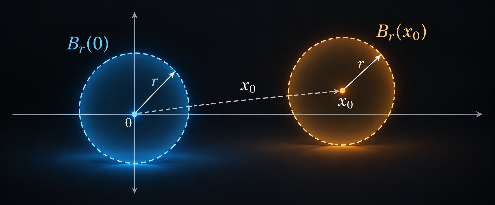
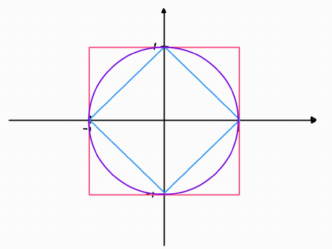
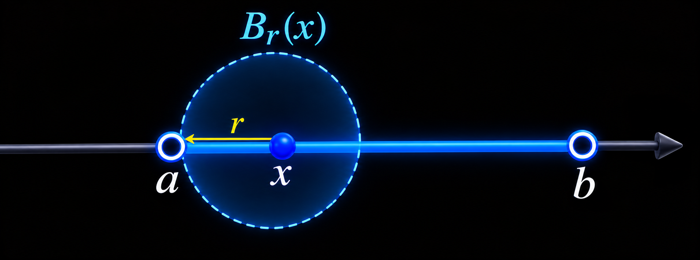
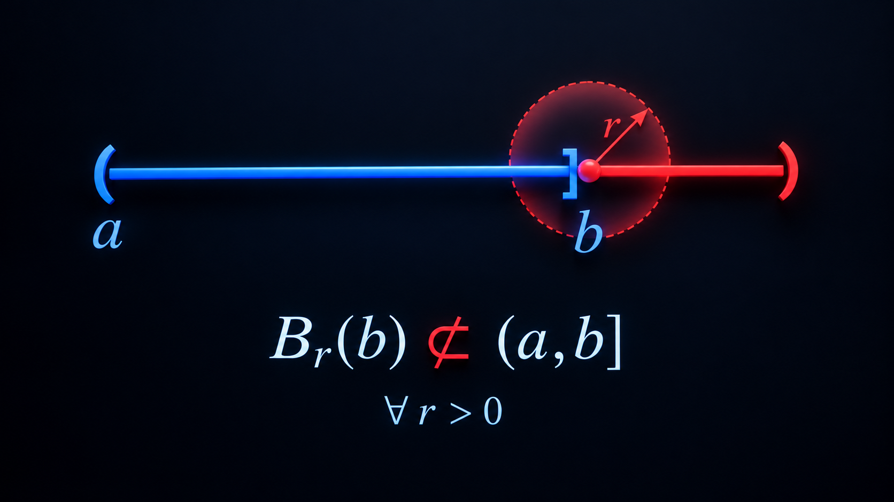
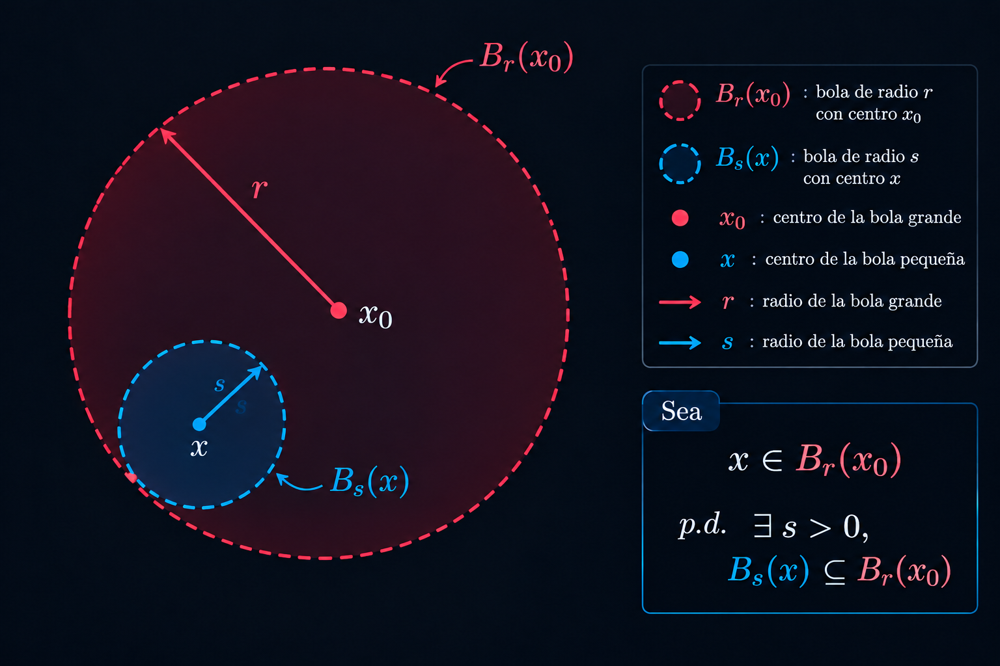
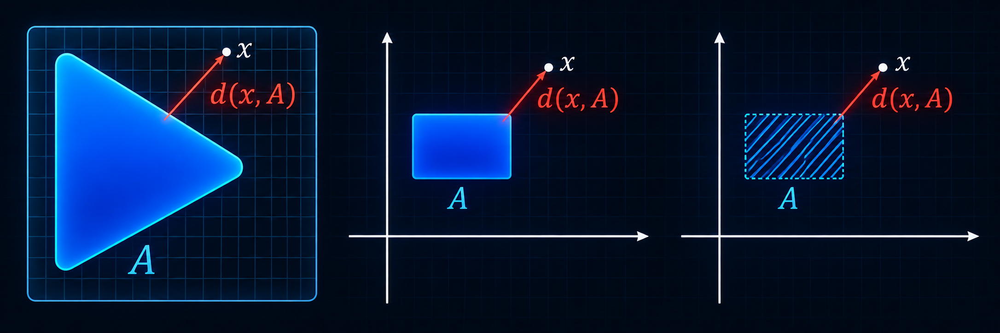

# Topología en espacios métricos

## 6.1 Introducción

La topología se refiere a la parte de las matemáticas que estudia la expansión del concepto de continuidad más allá de los espacios $\mathbb{R}^n$ o los especios métricos. La idea principal detrás de dicha generalización es que existen ciertos subconjuntos con características especiales que permiten definir los conceptos de continuidad. A estos subconjuntos especiales se les llama subconjuntos abiertos e intuitivamente son los que "miden" la cercania entre puntos de un espacio dado.

En esta sección se introducen los conceptos de conjuntos abiertos y cerrados en espacios métricos, se ven sus propiedades básicas así como algunos ejemplos concretos en los espacios $\mathbb{R}^n$ y $\mathcal{B}(X),$ el espacio de funciones acotadas.

## 6.2 Definición

Sea $(X,d)$ un espacio métrico. Una bola abierta de radio $r > 0$ y centrada en $x_0 \in X$ se define como el conjunto

$$B_r(x_0)=\{x \in X: d(x,x_0) < r\}$$

Si el espacio métrico proviene de un espacio vectorial normado $(V, \|\cdot\|)$, las bolas son

$$B_r(x_0)=\{x \in V:\;\|x-x_0\|<r\}$$

Gracias a la estructura de espacio vectorial, podemos expresar

$$
\begin{aligned}
B_r(x_0)&=x_0+B_r(0)  \\
&=\{x_0 + w \; : \; w \in B_r(0)\}
\end{aligned}
$$

 

  

 

**Demostración**

$\mathbf{\subseteq \big)}$

Sea $v \in B_r(x_0)$ y sea $w = v - x_0$. Entonces

$$\|w\| = \|v - x_0\| < r \;\Rightarrow\; w \in B_r(0)$$

y además $v = x_0 + w$. Por tanto, $v \in x_0 + B_r(0)$.

$\mathbf{\supseteq \big)}$

Sea $v = x_0 + w$ con $w \in B_r(0)$. Entonces

$$\|v - x_0\| = \|w\| < r$$

es decir, $v \in B_r(x_0)$.

**Observación**: En espacios vectoriales normados, las bolas abiertas están determinadas por las bolas abiertas con centro en $0$.

La forma de la bola depende del espcio métrico, como se ve en los siguientes ejemplos:

1. La métrica discreta

    Recordamos que, para un conjunto cualquiera $X \neq \emptyset$, la métrica discreta en $X$ se define por

    $$
    d(x,y)=
    \begin{cases}
    0, & x=y,\\
    1, & x\ne y.
    \end{cases}
    $$

    - $r \in (0,1]$:

        $$B_r(x_0)=\{x_0\}$$

    - $r \in (1,\infty]$:

        $$B_r(x_0)=X$$

2. La familia de normas-$p$

    En el espacio vectorial normado $(\mathbb{R}^n, \|\cdot\|_p)$, con $p \in [1,\infty]$, la forma de la bola depende del parámetro $p$. La siguiente figura abajo muestra algunas bolas en $\mathbb{R}^2$, centradas en el origen.

     

    

    
    

     

3. La norma uniforme o infinito

    Sea $X \neq \emptyset$ un conjunto cualquiera y considera el espacio vectorial normado de las funciones con valores reales, acotadas en $X$ y con la norma uniforme (o norma infinito), denotado $(\mathcal{B}(X), \|\cdot\|_\infty)$.

    Dibujar bolas abiertas en $(\mathcal{B}(X), \|\cdot\|_\infty)$ no es tan directo, pero tenemos cierta ayuda visual. En este caso una bola abierta es

    $$B_r(f_0)=\{f \in \mathcal{B}(X) : \|f-f_0\|_\infty < r\}$$

    donde $f, f_0$ son funciones acotadas sobre $X$ con valores reales. En el análisis de los límites en la norma uniforme notamos que la expresión $\|f-f_0\|_\infty < r$ implica

    $$|f(x)-f_0(x)| < r, \quad \text{para toda } x \in X$$

    En términos de las gráficas de $f$ y $f_0$ quiere decir que la gráfica de $f$ está encerrada en una franja de radio $r>0$ centrada en $f_0$. Por lo tanto podemos "dibujar" las bolas $B_r(f_0)$ como

     

    

    
    

     

    $\left(C[a,b],\|\cdot\|\right)$, norma uniforme

    $$\|f\|_{[a,b]}=\sup_{t \in [a,b]}\{|f(t)|\}$$

    $$B_r(f_0)=\{f\;:\;\|f-f_0\|_{[a,b]}<r\}$$

    $$\|f-f_0\|_[a,b]=max_{t \in [a,b]}\{|f(t)-f_0(t)|\}<r \iff f_0(t)-r<f(t)<f_0(t)+r$$

---

## 6.3 Definición

$(X,d)$ espacio metrico. $U \subseteq X$ es abierto si

$$\forall \; p \in U \; \exists \; r>0\;\text{tal que}\;B_r(p) \subseteq U$$

 

 

Notas:

1. Dado $x \in U$ el radio $r$ que cumple $B_r(x) \subseteq U$ usualmente depende de $x$.
2. El cuantificador «$\forall$» es importante. Si existe algún punto $x \in U$ para el cual no se pueda encontrar $r>0$ que satisfaga $B_r(x) \subseteq U,\;$ entonces el conjunto no es abierto.

 

- En $\;(\mathbb{R},|\cdot|),\;(a,b)$ son subconjuntos abiertos 

    $$\forall \; x \in (a,b), \; \text{si tomamos,} \; r = \min\{x-a,b-x\}\; \implies \; B_r(x) \subseteq (a,b)$$

 

 

- El intervalo $(a,b]$ no es abierto ya que, para el elemento $b \in (a,b]$, simpre se tiene que, sin importar que radio $r > 0$ que se tome, 

    $$\left(B_r(b) \cap (a,b]^c\right) \neq \emptyset$$

    $$\implies \, \forall \; r > 0, \; B_r(b) \nsubseteq (a,b]$$

 

 

- $\empty \; \land X\;$ son abiertos. Para cualquier otro conjunto la métrica $d$ «decide» si es abierto o no.

---

## 6.4 Lema

$(X,d)$ espacio métrico, $x_0 \in X\;\text{y}\; r>0$

$$\implies \; \forall \; B_r(x_0) \text{ es un subconjunto abierto de } X$$

i.e., tiene que cumplier la Definicion 6.3.

 

 

**Demostración**

Sea $x \in B_r(x_0)$

$\text{p.d.} \; \exists \; s > 0 \; \text{tal que} \; B_s(x) \subseteq B_r(x_0)$

Sea $s:=r-d(x,x_0)$

$$
\begin{aligned}
x \in B_r(x_0) &\implies d(x,x_0)<r \\
&\implies 0<r-d(x,x_0) = s
\end{aligned}
$$

$\text{p.d} \; B_s(x) \subseteq B_r(x_0)$

Sea $y \in B_s(x)$

$$
\begin{aligned}
\implies \; d(y,x) &< s \\
&= r - d(x,x_0)
\end{aligned}
$$

$$
\begin{aligned}
    \implies \; d(y,x_0) &\leq d(y,x) + d(x,x_0) \\
    &< s + d(x,x_0) \\
    &= \big(r - d(x,x_0)\big) + d(x,x_0) \\
    &= r
\end{aligned}
$$

$$\therefore \; y \in B_r(x_0) \; \blacksquare .$$

---

## 6.5 Proposición

$(X,d)$ espacio métrico

1. $\big\{U_i\big\}_{i \in I}$ una colección arbitraria de conjuntos abiertos (es decir, la cardinalidad de $I$ es arbitraria).

    $$\implies \bigcup_{i \in I}U_i\;\text{es un subconjunto abierto}.$$

    **Demostración**

    $$
    \begin{aligned}
    x \in \bigcup_{i \in I}U_i \; &\implies \; \exists \; j \in I \; \text{tal que} \; x \in U_j \\
    &\implies \exists \; r > 0 \; \text{tal que} \; B_r(x) \subseteq U_j
    \end{aligned}
    $$

    $$\therefore \; B_r(x) \subseteq U_j \subseteq \bigcup_{i \in I}U_i$$

    Por lo tanto, $\bigcup_{i \in I}U_i$ es abierto. $\blacksquare$

---

2. $\{U_i\}_{i=1}^n$ subconjuntos abiertos finitos.

    $$\implies \bigcap_{i=1}^nU_i \; \text{es abierto}.$$

    **Demostración**

    $$
    \begin{aligned}
    x \in \bigcap_{i=1}^nU_i &\implies \; x \in U_i, \;\; \forall \; i=1,2,\ldots,n \\
    &\implies \; \exists \; r_i>0 \; \text{tal que} \; B_{r_i}(x) \subseteq U_i, \;\; \forall \; i=1,2,\ldots,n
    \end{aligned}
    $$

    Sea $r:=\min\{r_1,\ldots,r_n\}>0$. Entonces, para todo $i=1,2,\ldots,n$,

    $$
    B_r(x) \subseteq B_{r_i}(x) \subseteq U_i
    $$

    $$\therefore \; B_r(x) \subseteq \bigcap_{i=1}^nU_i$$

    Por lo tanto, $\bigcap_{i=1}^nU_i$ es abierto. $\blacksquare$

---

3. Da un ejemplo de $\left\{U_i\right\}_{i=1}^{\infty}$ de abiertos, con $\;\bigcap_{i=1}^{\infty}U_i\;$ no abierto.

    **Demostración**

    Sean $a<b$ y $U_i=\left(a-\frac{1}{i},\,b+\frac{1}{i}\right)$ para $i\in\mathbb{N}$. Cada $U_i$ es un intervalo abierto, por lo tanto abierto en $\mathbb{R}$.

    Denotemos la intersección por $V=\bigcap_{i=1}^{\infty}U_i$. Como $a-\frac1i<a<b+\frac1i$ para todo $i$, se tiene $a\in V$.

    Sea $r>0$. Por la propiedad arquimediana existe $i_0\in\mathbb{N}$ con $\frac{1}{i_0}<\frac r2$. Entonces
    $$a-\frac r2<a-\frac{1}{i_0},$$
    así que $a-\frac r2\notin U_{i_0}$. Como $V\subseteq U_{i_0}$, se sigue que $a-\frac r2\notin V$. Pero $a-\frac r2\in B_r(a)$.

    Luego, ninguna bola $B_r(a)$ está contenida en $V$, es decir, $V$ no es abierto. $\blacksquare$

---

## 6.6 Definición

$(X,d)$ espacio métrico.

$$
F \subseteq X \; \text{es cerrado, si} \\[0.5em]
F^c = X \setminus F \; \text{es abierto}.
$$

**Ejemplo**

En $(\mathbb{R}, |\cdot|)$, el intervalo $[a,b]$ es un subconjunto cerrado ya que su complemento

$$[a,b]^c = \underbrace{\underbrace{(-\infty, a)}_{\text{abierto}} \cup \underbrace{(b, \infty)}_{\text{abierto}}}_{\text{abierto}}$$

Su complemento es abierto al ser la union de abiertos

$$(-\infty, a) \cup (b, \infty) = \bigcup_{i=1}^{\infty} (a-i, a) \cup \bigcup_{j=1}^{\infty} (b, b+j)$$

**Ejemplo**

$\mathbb{N} \subseteq \mathbb{R}$ es cerrado, ya que

$$\mathbb{N}^c = \underbrace{\underbrace{(-\infty, 0)}_{\text{abierto}} \cup \underbrace{\bigcup_{i=0}^{\infty}(i, i+1)}_{\text{abierto}}}_{\text{abierto}}$$

**Nota**: 

- $\emptyset \; \land \; X\;$ son cerrados y abiertos en $(X,d)$
- no abierto $\;\not\Rightarrow\;$ cerrado

**Ejemplo**

$(a,b] \subseteq \mathbb{R}\;$ no es abierto y tampoco es cerrado

$$(a,b]^c = \underbrace{(-\infty,a] \; \cup (b,\infty)}_{\text{no es abierto por el punto 'a'}}$$

---

## 6.7 Proposición

$(X,d)$ espacio métrico

1. $\{F_i\}_{i \in I}$ familia arbitraria de cerrados $\implies \; \bigcap_{i \in I}F_i\;$ es cerrado.

    **Demostración**

    Por las leyes de Morgan,

    $$
    \begin{aligned}
    \left(\bigcap_{i \in I}F_i\right)^c &= \left(F_1 \cap F_2 \cap \ldots\right)^c \\
    &= F_1^c \cup F_2^c \cup \ldots \\
    &= \bigcup_{i \in I}F_i^c
    \end{aligned}
    $$

    $$
    \begin{aligned}
    F_i \; \text{es cerrado}\; &\implies \; F_i^c \; \text{es abierto}, \;\; \forall \; i \in I \\
    &\implies \; \bigcup_{i \in I}F_i^c \; \text{es abierto} \qquad \left(\left\{U_i\right\}_{i \in I} \; \text{abiertos} \; \implies \; \bigcup_{i \in I}U_i \; \text{es abierto}\right) \\
    &\overset{\text{Morgan}}{\implies} \; \left(\bigcap_{i \in I}F_i\right)^c \; \text{es abierto} \\
    &\overset{\text{def}}{\implies} \; \bigcap_{i \in I}F_i \; \text{es cerrado} \quad \blacksquare
    \end{aligned}
    $$

---

2. $\{F_i\}_{i=1}^n\;$ familia finita de cerrados $\;\implies\;\bigcup_{i=1}^nF_i\;$ es cerrado.

    **Demostración**

    Por las leyes de Morgan,

    $$
    \left(\bigcup_{i=1}^nF_i\right)^c = \bigcap_{i=1}^nF_i^c
    $$

    $$F_i \; \text{es cerrado} \; \implies \; F_i^c \; \text{es abierto}, \;\; \forall \; i=1,2,\ldots,n$$

    $$
    \boxed{
    \begin{aligned}
    &\textbf{Propiedad anterior} \\[0.5em]
    &\left\{U_i\right\}_{i=1}^n \; \text{son abiertos} \; \implies \; \bigcap_{i=1}^nU_i \; \text{es abierto}
    \end{aligned}
    }
    $$

    $$
    \begin{aligned}
    \{F_i^c\}_{i=1}^n \; \text{son abiertos} &\implies \; \bigcap_{i=1}^nF_i^c \; \text{es abierto} \\
    &\overset{\text{Morgan}}{\implies} \; \left(\bigcup_{i=1}^nF_i\right)^c \; \text{es abierto} \\
    &\overset{\text{def}}{\implies} \; \bigcup_{i=1}^nF_i \; \text{es cerrado} \quad \blacksquare
    \end{aligned}
    $$

3. Da un ejemplo de $\{F_i\}_{i=1}^{\infty}$ familia cerrada con $\bigcup_{i=1}^{\infty}F_i\;$ no cerrada.

    $$F_n = \left(-\infty, -\frac{1}{n}\right] \; \longrightarrow \; \text{cerrado}$$

    $$\bigcup_{i=1}^{\infty}F_n=(-\infty,0) \; \text{no es cerrado}$$

    Ya que

    $$(-\infty, 0)^c = [0,\infty) \: \text{no es cerrado por '0'}$$

---

## 6.8 Definición

Sea $(X,d)$ un espacio métrico y $A \subseteq X$.

1. $x \in X\;$ es **punto interior** de $A$ si

    $$\exists \; r>0 \:\; \text{tal que} \; B_r(x) \subseteq A$$

    **Ejemplo**

    $$\forall \; x \in B_r(x_0) \; \text{es punto interior de} \; B_r(x_0)$$

2. $\;x \in X\;$ es **punto de acumulación** (o punto límite) de $A$ si

    $$
    \exists \; (a_n)_{n \in \mathbb{N}} \subseteq A \; \text{tal que} \\[0.5em]
    \forall \; n \in \mathbb{N}, \quad 0<d(a_n,x)<\frac{1}{n}
    $$

    **Ejemplo**

    - `0` es el único punto de acumulación del conjunto $A=\left\{\frac{1}{n}\right\}_{i=1}^{\infty}$

    - Para $\mathbb{N} \subseteq \mathbb{R}$ sus punto de acumulación son: $\empty$

3. $\;x \in X\;$ es **punto exterior** de $A\;$ si

    $$\exists \; r>0 \; \text{tal que} \; B_r(x) \subseteq A^c$$

4. $\; x \in X\;$ se llama **punto frontera** de $A\;$ si

    $$\big(\forall \; r>0,\;B_r(x) \cap A \neq \empty\big) \land \big(B_r(x) \cap A^c \neq \empty \big)$$

5. $\;x \in X$ es **punto aislado** de $A$ si

    $$\big(x \in A\big) \; \land \big(\exists \; r>0 \; \text{tal que} \; B_r(x) \cap A = \{x\}\big)$$

---

## 6.9 Teorema

Sea $(X,d)$ un espacio métrico, $A \subseteq X$. Son equivalentes:

1. $A$ es abierto.
2. Todo punto de $A$ es un punto interior de $A$.

**Demostración**

$A$ abierto

$$
\begin{array}{rc}
    \iff \; & \forall \; x \in A \; \exists \; r>0 \; \text{tal que} \; B_r(x) \subseteq A \\[0.5em]
    \iff \; & x \; \text{es punto interior de} \; A
\end{array}
$$

---

## 6.10 Teorema

Sea $(X,d)\;$ espacio métrico y $B \subseteq X$. Son equivalentes:

1. $\;\textbf{B}\;$ es cerrado.
2. $\;\textbf{B}\;$ contiene a todos sus puntos de acumulación.

**Demostración**

$1 \implies 2: \neg 2 \implies \neg 1$

$\neg 2 \;: \; \exists \; x \in X\;$ punto de acumulación de $B, \; x \notin B$.

$x \;$ punto de acumulación

$$\implies \exists \, (b_n)_{n=1}^{\infty} \subseteq B \setminus \{x\}\;\; \text{con}\;\; 0 < d(b_n, x) \leq \dfrac{1}{n}$$

Si $B$ fuese cerrado

$$
\begin{array}{rc}
\implies & B^c \; \text{abierto y como} \;\; x \in B^c \\[0.5em]
\implies & \exists \, r > 0, \; B_r(x) \subseteq B^c    
\end{array}
$$

Sea $\;n_0\;$ tal que $\dfrac{1}{n_0} < r$

$$
\begin{array}{rc}
\implies & d(b_{n_0}, x) \leq \dfrac{1}{n_0} < r \\[0.8em]
\implies & b_{n_0} \in B_r(x) \subseteq B^c \\[0.5em]
\implies & b_{n_0} \in B^c \;\; \textbf{!}
\end{array}
$$

$\text{Ya que} \;\; \forall \; n, \; b_n \in B$. Por lo tanto, $B$ no es cerrado, es decir, $\neg 1$.

$2 \implies 1: \neg 1 \implies \neg 2$

$\neg 1$: $B$ no es cerrado

$$
\begin{array}{rc}
\implies & B^c \;\; \text{no es abierto} \\[0.5em]
\implies & \exists \; x \in B^c \; \text{tal que} \;\; \forall \; r > 0, \; B_r(x) \not\subseteq B^c
\end{array}
$$

Tomando $\;r = \dfrac{1}{n}$, $\;\exists \; b_n \in B_{\frac{1}{n}}(x)$, $b_n \in B$

$$\implies 0 < d(b_n, x) \leq \dfrac{1}{n} \quad \forall \; n$$

(ya que $\;x \in B^c\;$ y $\;b_n \in B$, de modo que $\;b_n \neq x$).

Así, $x$ es punto de acumulación de $B$ y $x \notin B$, es decir, $\neg 2$. $\blacksquare$

---

## 6.13 Definición

$(X,d) \; \text{espacio métrico}. \;A \subseteq X$

El **interior de $A$** se define:

$$
\begin{aligned}
    int(A) &= A^{\circ} \\
    &= \bigcup\,\{U \subseteq X \;:\; U \; \text{abierto,} \; U \subseteq A \}
\end{aligned}
$$

La **cerradura de $A$** se define:

$$
\begin{aligned}
    Cer(A) &= \bar{A} \\
    &= \bigcap\,\{F \subseteq X \; : \; F \; \text{cerrado,} \; A \subseteq F\}
\end{aligned}
$$

Consecuencias inmediatas por las propiedades de abiertos y cerrados.

1. $\;A^{\circ}\;$ es abierto.
2. $\;\bar{A}\;$ es cerrado.
3. 
   $$
   A\;\text{cerrado} \; \implies \; A = \bar{A} \\
   A\;\text{abierto} \; \implies \; A=A^{\circ}
   $$

4. $\bar{A}\;$ es el cerrado más chico que contiene a $A,\;$ es decir, si $F$ es cerrado y $A \subseteq F \; \implies \bar{A} \subseteq F$
5. $A^{\circ}\;$ es el abierto más grande contenido en $A$

---

## 6.14 Lema

Sea $(X,d)$ un espacio métrico, $A \subseteq X$.

1. $x \in \bar{A} \; \iff \; \forall \; r>0, B_r(x) \; \cap \; A \neq \emptyset$
2. $x \in A^{\circ} \; \iff \; \exists \; r > 0, B_r(x) \subseteq A$

    **Demostración 1**

    $\mathbf{\implies \big]}:$

    Sea $x \in \bar{A}$

    $$
    \text{Suponga que} \; \exists \; r > 0 \; \text{tal que} \; B_r(x) \cap A = \emptyset \\[0.5em]
    \implies \; A \subseteq X \backslash B_r(x)
    $$

     

    

    
    

     

    $$
    \text{Sea} \; F:= X \backslash B_r(x) \\[0.5em]
    \text{es cerrado (pues } B_r(x) \text{ es abierto)} \;\; \text{y} \;\; A \subseteq F
    $$

    Por definición de cerradura (el menor cerrado que contiene a $A$): $\bar{A} \subseteq F$

    Pero

    $$x \in \bar{A} \subseteq F = X \backslash B_r(x)$$

    $$\implies \; x \notin B_r(x)$$

    Sin embargo, $d(x,x)=0<r$, es decir, $x \in B_r(x)$. $\textbf{!}$

    $$\therefore \; \forall \; r>0, \; B_r(x) \cap A \neq \emptyset$$

    $\mathbf{\Longleftarrow \big]}:$

    Hipótesis:

    $$\forall \; r>0, B_r(x) \; \cap \; A \neq \emptyset$$

    $\text{p.d.} \; x \in \bar{A}$

    Sea $F \subseteq X \; \text{cerrado,} \; A \subseteq F$

    $\text{p.d.} \; x \in F$

    Suponga que $x \notin F$

    $$
    \begin{aligned}
    x \notin F &\implies \; x \in X \backslash F \;\; \text{y} \;\; X \backslash F \; \text{es abierto} \\
    &\implies \; \exists \; r_0 > 0 \; \text{tal que} \; B_{r_0}(x) \subseteq X \backslash F \\
    &\implies \; B_{r_0}(x) \subseteq X \backslash A \;\;\; \big(\text{pues } A \subseteq F \implies X \backslash F \subseteq X \backslash A\big) \\
    &\implies \; B_{r_0}(x) \cap A = \emptyset \; \textbf{!}
    \end{aligned}
    $$

    Esto contradice la hipótesis con $r = r_0$.

    $$\therefore \; x \in F$$

    Como $F$ era un cerrado arbitrario que contiene a $A$:

    $$x \in \bigcap \{F \subseteq X : F \text{ cerrado},\; A \subseteq F\} = \bar{A}$$

---

2. $x \in A^{\circ} \; \iff \; \exists \; r > 0, B_r(x) \subseteq A$

    **Demostración**

    $\mathbf{\implies \big]}:$

    $$
    x \in A^{\circ}=\bigcup \big\{U\;:\; U \; \text{es abierto},\; U \subseteq A\big\} \\[0.5em]
    \implies \; \exists \; U_0 \; \text{abierto con} \; x \in U_0 \subseteq A
    $$

    $$
    \begin{aligned}
    U_0 \; \text{abierto} \; &\implies \; \exists \; r > 0 \; \text{tal que} \; B_r(x) \subseteq U_0 \subseteq A \\
    &\implies \; B_r(x) \subseteq A
    \end{aligned}
    $$

    $\mathbf{\Longleftarrow \big]}:$

    Hipótesis: $\; \exists \; r > 0 \; \text{tal que} \; B_r(x) \subseteq A$

    $$
    U:=B_r(x) \; \text{es abierta y} \; U \subseteq A \\[0.5em]
    x \in B_r(x) \;\; \big(\text{pues } d(x,x)=0<r\big) \\[0.5em]
    \implies \; x \in U \subseteq \bigcup \big\{V\;:\; V \; \text{es abierto},\; V \subseteq A\big\} = A^{\circ} \;\; \blacksquare
    $$

---

## 6.15 Lema

$(X,d)\;$ espacio métrico y $A \subseteq X$

$$
x \in \bar{A} \; \iff \; \exists \; (a_n)_{n=1}^{\infty}, \; a_n \in A \;\; \forall \; n, \;\;\text{tal que}\\[0.5em]
\lim_{n \to \infty}a_n = x
$$

**Demostración**

$\mathbf{\implies \big]}:$

$$x \in \bar{A} \; \implies \; \forall \; r>0, \; B_r(x) \cap A \neq \emptyset$$

Tomando $r=\frac{1}{n}, \; \exists \; a_n \in B_{\frac{1}{n}}(x) \cap A$

$$
\implies \; \big((a_n)_{n=1}^{\infty} \subseteq A\big) \; \land \left(d(a_n,x) < \frac{1}{n},\;\forall \; n\right) \\[0.5em]
\therefore \; \lim_{n \to \infty}a_n=x
$$

$\mathbf{\Longleftarrow \big]}:$

Hipótesis:

$$
\exists \; (a_n)_{n=1}^{\infty} \subseteq A \; \text{con} \\[0.5em]
\lim_{n \to \infty}a_n=x
$$

Sea $r > 0$. Como $a_n \to x$, $\; \exists \; n_0 \in \mathbb{N}$ tal que

$$
d(a_{n_0},x)<r \\[0.5em]
\implies \; a_{n_0} \in B_r(x) \cap A \\[0.5em]
\therefore \; B_r(x) \cap A \neq \emptyset
$$

Como $\;r>0\;$ es arbitrario, el Lema 6.14 asegura que $x \in \bar{A}$ $\;\blacksquare$

---

## 6.11 Lema

$$
\boxed{
\begin{array}{c}
\begin{array}{l}
\textbf{Ejercicio 5.23. Definición} \\[0.5em]
X \neq \emptyset \text{ conjunto. } d_1, d_2 \text{ métricas en } X, \; \text{son equivalentes si tienen las mismas} \\
\text{sucesiones convergentes. Es decir:}
\end{array} \\[2em]
\displaystyle \lim_{n \to \infty} d_1(x_n,x)=0 \iff \lim_{n \to \infty} d_2(x_n,x)=0
\end{array}
}
$$

$\emptyset \neq X, \; d_1,d_2 \; \text{métricas en} \; X$

$d_1,d_2\;\;\text{son equivalentes} \; \iff \;$ generan los mismos abiertos.

**Notación:** $\overline{A}^{d_i}$ es la cerradura de $A$ en $(X,d_i)$.

**Demostración**

$\mathbf{\implies \big]}:$

Hipótesis: $d_1,d_2$ equivalentes.

Sea $U$ abierto en $(X,d_1)$.

$\text{p.d.} \; U \; \text{es abierto en} \; (X,d_2)$

Sea $F:=X \setminus U$, que es cerrado en $(X,d_1)$.

$\text{p.d.} \; F \; \text{es cerrado en} \; (X,d_2)$

Sea $x \in \overline{F}^{d_2}$. Por el Lema 6.15,

$$\exists \; (a_n)_{n=1}^{\infty} \subseteq F \;\; \text{tal que} \;\; \lim_{n \to \infty}d_2(a_n,x)=0$$

Como $d_1,d_2$ son equivalentes,

$$\lim_{n \to \infty}d_1(a_n,x)=0$$

Por el Lema 6.15, $x \in \overline{F}^{d_1}=F$ (pues $F$ es cerrado en $(X,d_1)$).

Entonces $\overline{F}^{d_2} \subseteq F$, y como siempre $F \subseteq \overline{F}^{d_2}$,

$$F=\overline{F}^{d_2}$$

Como $\overline{F}^{d_2}$ es cerrado en $(X,d_2)$, $F$ es cerrado en $(X,d_2)$.

$$\implies \; U=X \setminus F \; \text{es abierto en} \; (X,d_2)$$

Similarmente (intercambiando los papeles de $d_1$ y $d_2$),

$$U \; \text{abierto en} \; (X,d_2) \implies U \; \text{abierto en} \; (X,d_1)$$

$$\therefore \; (X,d_1) \; \text{y} \; (X,d_2) \; \text{generan los mismos abiertos.}$$

---

$\mathbf{\Longleftarrow \big]}:$

Hipótesis: $(X,d_1)$ y $(X,d_2)$ generan los mismos abiertos.

$\text{p.d.} \; d_1,d_2 \; \text{son equivalentes}$

**Observación:** como generan los mismos abiertos, generan los mismos cerrados (los complementos de los abiertos). Como

$$\overline{A}^{d_i}=\bigcap\{F \subseteq X : F \; \text{cerrado en} \; (X,d_i), \; A \subseteq F\}$$

solo depende de la familia de cerrados, entonces

$$\overline{A}^{d_1}=\overline{A}^{d_2} \quad \forall \; A \subseteq X$$

Sean $(x_n)_{n=1}^{\infty} \subseteq X$ y $x \in X$ con

$$\lim_{n \to \infty}d_1(x_n,x)=0$$

$\text{p.d.} \; \lim_{n \to \infty}d_2(x_n,x)=0$

Suponga que no. Entonces

$$\exists \; \varepsilon>0 \; \text{y una subsucesión} \; (x_{n_k})_{k=1}^{\infty} \; \text{tal que} \; d_2(x_{n_k},x) \geq \varepsilon \;\; \forall \; k$$

Sea $A:=\{x_{n_k} : k \in \mathbb{N}\}$.

Como $(x_{n_k})$ es subsucesión de $(x_n)$, $\lim_{k \to \infty}d_1(x_{n_k},x)=0$.

Por el Lema 6.15,

$$x \in \overline{A}^{d_1}=\overline{A}^{d_2}$$

Por el Lema 6.14 (en $(X,d_2)$), para $\varepsilon>0$,

$$B^{d_2}_{\varepsilon}(x) \cap A \neq \emptyset$$

es decir,

$$\exists \; k \; \text{tal que} \; d_2(x_{n_k},x)<\varepsilon \; \textbf{!}$$

lo cual contradice $d_2(x_{n_k},x) \geq \varepsilon$ para todo $k$.

$$\therefore \; \lim_{n \to \infty}d_2(x_n,x)=0$$

La otra implicación ($d_2 \to d_1$) es similar. $\blacksquare$

---

## 6.12 Definición

Sean $(X, d_X)$ y $(Y, d_Y)$ dos espacios métricos. Recordemos que por el ejercicio 4.22 sabemos que las siguientes funciones son métricas en $X \times Y$:

$$d((x_1, y_1), (x_2, y_2)) = d_X(x_1, x_2) + d_Y(y_1, y_2)$$

$$\rho((x_1, y_1), (x_2, y_2)) = \max\{d_X(x_1, x_2),\, d_Y(y_1, y_2)\}$$

$$\sigma((x_1, y_1), (x_2, y_2)) = \sqrt{d_X(x_1, x_2)^2 + d_Y(y_1, y_2)^2}$$

Además, por el ejercicio 5.24 sabemos que son métricas equivalentes y por el lema 6.11 tenemos que generan los mismos conjuntos abiertos en $X \times Y$. Entonces:

Definimos el **producto de los espacios métricos** $(X, d_X)$ y $(Y, d_Y)$ como el espacio métrico $X \times Y$ equipado con cualquiera de las métricas anteriores.

---

## 6.16 Lema

Sea $(X, d)$ un espacio métrico y sea $A \subseteq X$ subconjunto no vacío. Entonces $\operatorname{diam}(A) = \operatorname{diam}(\bar{A})$.

---

### Demostración

Recordemos que
$$\operatorname{diam}(A) = \sup_{a, b \in A} \{d(a, b)\}.$$

Para ver que $\operatorname{diam}(A) = \operatorname{diam}(\bar{A})$ probaremos que $\operatorname{diam}(A) \leq \operatorname{diam}(\bar{A})$ y $\operatorname{diam}(\bar{A}) \leq \operatorname{diam}(A)$.

- P.d. $\operatorname{diam}(A) \leq \operatorname{diam}(\bar{A})$.

  Como $A \subseteq \bar{A}$ tenemos que
  $$\{d(a, b) : a, b \in A\} \subseteq \{d(x, y) : x, y \in \bar{A}\}$$

$$\Rightarrow \sup\{d(a, b) : a, b \in A\} \leq \sup\{d(x, y) : x, y \in \bar{A}\}$$

$$\Rightarrow \sup_{a, b \in A} \{d(a, b)\} \leq \sup_{x, y \in \bar{A}} \{d(x, y)\}$$

$$\Rightarrow \operatorname{diam}(A) \leq \operatorname{diam}(\bar{A}) \quad \dots \; \text{(i)}$$

- P.d. $\operatorname{diam}(\bar{A}) \leq \operatorname{diam}(A)$.

  Si $\operatorname{diam}(A) = +\infty$, como por $\dots$ (i) sabemos que $\operatorname{diam}(A) \leq \operatorname{diam}(\bar{A}) \Rightarrow \operatorname{diam}(\bar{A}) = +\infty$

  $\Rightarrow \operatorname{diam}(\bar{A}) = \operatorname{diam}(A)$.

  Supongamos que $\operatorname{diam}(A) < \infty$.

Sean $x, y \in \bar{A}$. Por lema 6.15 existen sucesiones $(x_n)_{n \in \mathbb{N}}, (y_n)_{n \in \mathbb{N}} \subseteq A$ de elementos de $A$ respectivamente tales que
$$\lim_{n \to \infty} x_n = x \quad \text{y} \quad \lim_{n \to \infty} y_n = y \quad \text{en } (X, d).$$

Como $x_n, y_n \in A$ $\forall n \in \mathbb{N}$ sabemos que
$$d(x_n, y_n) \leq \sup_{a, b \in A} \{d(a, b)\} = \operatorname{diam}(A) \quad \forall n \in \mathbb{N}$$

$$\Rightarrow d(x_n, y_n) \leq \operatorname{diam}(A) \quad \forall n \in \mathbb{N}$$

$$\Rightarrow \lim_{n \to \infty} d(x_n, y_n) \leq \lim_{n \to \infty} \operatorname{diam}(A)$$

$$\Rightarrow d(x, y) \leq \operatorname{diam}(A) \quad \forall x, y \in \bar{A}$$

$$\Rightarrow \sup_{x, y \in \bar{A}} d(x, y) \leq \operatorname{diam}(A)$$

$$\Rightarrow \operatorname{diam}(\bar{A}) \leq \operatorname{diam}(A) \quad \dots \; \text{(ii)}$$

Por $\dots$ (i) y $\dots$ (ii) tenemos que
$$\operatorname{diam}(\bar{A}) \leq \operatorname{diam}(A) \leq \operatorname{diam}(\bar{A})$$

$$\Rightarrow \operatorname{diam}(A) = \operatorname{diam}(\bar{A}) \;\blacksquare.$$

---

## 6.17 Lema

### Definición

Sea $(X,d)$ un espacio métrico y $A \subseteq X$ un subconjunto no vacío. Dado un punto $x \in X$ se define la distancia de $x$ al subconjunto $A$ como

$$
\begin{aligned}
d(x,A)&=\inf_{a \in A}\{d(x,a)\} \\
&=\inf\{d(x,a)\;:\;a \in A\}
\end{aligned}
$$

Ejemplo en $\mathbb{R}^2\;$ con su métrica usual. $A \subseteq \mathbb{R}^2$ 

 

  

 

---

**Lema:** Sean $(X, d)$ un espacio métrico, $A \subseteq X$ subconjunto no vacío y $x \in X$. Entonces
$$x \in \bar{A} \iff d(x, A) = 0.$$

### Demostracion

**Recordatorio: Caracterización del ínfimo**

Sea $B \subseteq \mathbb{R}$ no vacío y acotado inferiormente. $\beta = \inf B$ si y sólo si

1. $\beta$ es cota inferior de $B$.
2. $\forall \varepsilon > 0$ existe $b_\varepsilon \in B$ tal que $b_\varepsilon < \beta + \varepsilon$.

---

$\mathbf{\implies \big]}:$ 

Supongamos que $x \in \bar{A}$.

Por lema 6.15 existe una sucesión $(a_n)_{n \in \mathbb{N}} \subseteq A$ tal que
$$\lim_{n \to \infty} a_n = x \text{ en } (X, d) \;\Rightarrow\; \lim_{n \to \infty} d(a_n, x) = 0.$$

Como $d(x, A) = \inf_{a \in A} \{d(x, a)\}$ sabemos que
$$0 \leq d(x, A) \leq d(x, a_n) \quad \forall n \in \mathbb{N}$$

Sacando $\lim_{n \to \infty}$, como $\lim_{n \to \infty} d(x, a_n) = 0$ tenemos que
$$0 \leq d(x, A) \leq 0$$

$$\Rightarrow d(x, A) = 0.$$

$\mathbf{\Longleftarrow \big]}:$

Supongamos que $d(x, A) = 0$. P.d. $x \in \bar{A}$.

Para eso veamos que existe una sucesión $(a_n)_{n \in \mathbb{N}} \subseteq A$ tal que $\lim_{n \to \infty} a_n = x$ en $(X, d)$.

Como $d(x, A) = 0$ entonces
$$\inf\{d(x, a) : a \in A\} = 0.$$

Por la **caracterización del ínfimo** sabemos que $\forall n \in \mathbb{N}$ existe $a_n \in A$ tal que
$$d(x, a_n) < 0 + \frac{1}{n} = \frac{1}{n}$$

$$\Rightarrow 0 \leq d(x, a_n) < \frac{1}{n} \quad \forall n \in \mathbb{N}.$$

Como $\lim_{n \to \infty} 0 = 0$ y $\lim_{n \to \infty} \frac{1}{n} = 0$, por la ley del sándwich tenemos que
$$\lim_{n \to \infty} d(x, a_n) = 0 \;\Rightarrow\; \lim_{n \to \infty} a_n = x \text{ en } (X, d).$$

Entonces tenemos una sucesión $(a_n)_{n \in \mathbb{N}} \subseteq A$ tal que
$$\lim_{n \to \infty} a_n = x \text{ en } (X, d).$$

Por lema 6.15 tenemos que $x \in \bar{A} \;\blacksquare.$