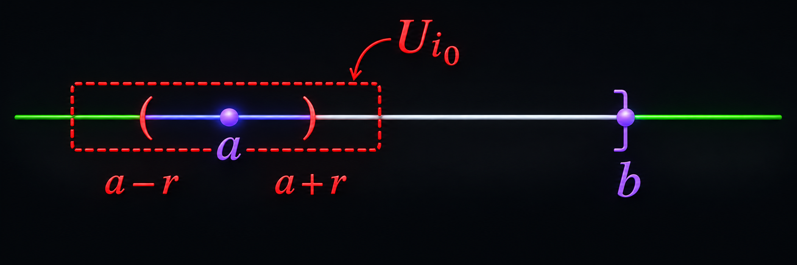
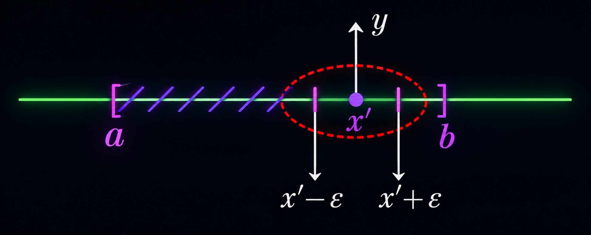
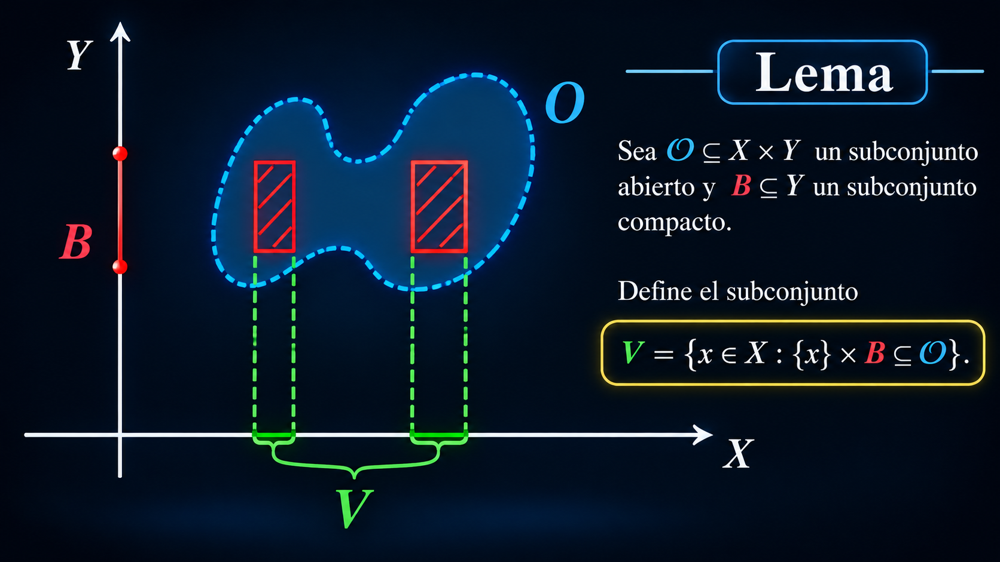
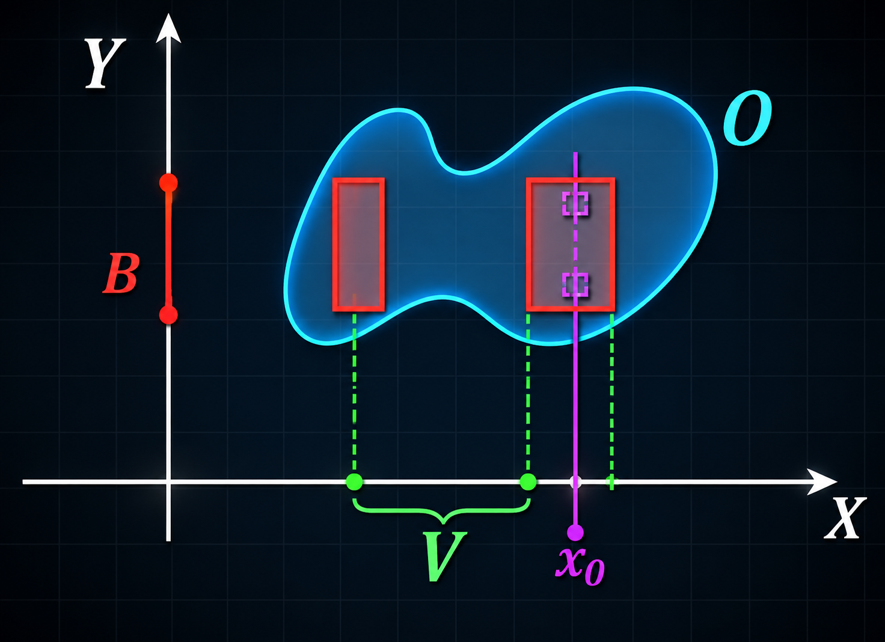

# Sección 7. Compacidad.

## 7.1 Introducción

Los conjuntos finitos, a pesar de no ser muy interesantes, tienen la ventaja de que son fáciles de manejar. Los conjuntos compactos se pueden pensar como lo "siguiente mejor" a ser finito. Algunas de las características de los conjuntos compactos son muy útiles: se pueden encontrar máximos o mínimos de funciones con valores reales; en ciertos tipos de espacios la compacidad está íntimamente relacionada con la existencia de soluciones a diferentes tipos de ecuaciones y, en varios casos, la compacidad permite asegurar que cierta receta/algoritmo para obtener o aproximar las soluciones es "una buena receta", es decir, el proceso realmente arroja una solución.

En esta sección introducimos los conjuntos compactos usando cubiertas abiertas, presentamos algunos ejemplos para después ver algunas de sus características y aplicaciones.

## 7.2 Definición

Sea $(X, d)$ un espacio métrico y $A \subseteq X$.

Una **cubierta abierta** de $A$ es una familia de subconjuntos abiertos de $X$,

$$\mathcal{U} = \{U_i\}_{i \in I} \; \text{que satisface}$$

$$A \subseteq \bigcup_{i \in I} U_i.$$

Una **subcubierta** de $\{U_i\}_{i \in I}$ es una subfamilia $\{U_j\}_{j \in J}$, con $J \subseteq I$, tal que

$$A \subseteq \bigcup_{j \in J} U_j.$$

Un conjunto $K \subseteq X$ se llama **compacto** si para toda cubierta abierta $\{U_i\}_{i \in I}$ de $K$ existe una subcubierta finita de $K$. Es decir, si $\mathcal{U} = \{U_i\}_{i \in I}$ es cualquier cubierta abierta de $K$, entonces existe

$$\mathcal{U}' = \{U_{i_1}, \dots, U_{i_n}\} \subseteq \mathcal{U} \; \text{tal que}$$

$$K \subseteq \bigcup_{j=1}^{n} U_{i_j} = U_{i_1} \cup \cdots \cup U_{i_n}.$$

**Nota.** La palabra clave de la definición es "cualquiera": no importa qué cubierta abierta del conjunto compacto se considere, siempre es posible encontrar una subcubierta finita. Si se puede dar una cubierta abierta para la cual no sea posible extraer una subcubierta finita, entonces el conjunto en consideración no es compacto.

Es más fácil dar ejemplos de conjuntos no compactos que de compactos.

**Ejemplo 1.** $\mathbb{R}^n$, con la métrica usual, no es compacto. Para verlo, consideramos la cubierta abierta

$$\mathcal{U} = \{B_j(0) : j \in \mathbb{N}\}.$$

Es claro que $\mathbb{R}^n = \bigcup_{j \in \mathbb{N}} B_j(0)$. Sin embargo, dada cualquier subfamilia finita de $\mathcal{U}$,

$$\mathcal{U}' = \{B_{j_1}(0), \dots, B_{j_m}(0)\},$$

se tiene que

$$B_{j_1}(0) \cup B_{j_2}(0) \cup \cdots \cup B_{j_m}(0) = B_r(0),$$

donde $r = \max\{j_1, j_2, \dots, j_m\}$, de lo que se sigue que

$$\mathbb{R}^n \not\subseteq B_{j_1}(0) \cup B_{j_2}(0) \cup \cdots \cup B_{j_m}(0).$$

Por lo tanto, $\mathcal{U}$ no admite una subcubierta finita y $\mathbb{R}^n$ no es compacto.

**Ejemplo 2.** Modificando un poco el ejemplo anterior, vemos que las bolas abiertas $B_r(0)$ no son compactas. Consideremos la familia de subconjuntos abiertos

$$\mathcal{U} = \{B_{r_j}(0) : j \in \mathbb{N}\},$$

donde $(r_j)_{j=1}^{\infty}$ es una sucesión de reales positivos que satisface

$$r_1 < r_2 < \cdots < r_j < \cdots < r \quad \text{y} \quad \lim_{j \to \infty} r_j = r.$$

Entonces $\mathcal{U}$ es una cubierta abierta de $B_r(0)$, pero no es posible extraer una subcubierta finita: dada cualquier subfamilia finita $\{B_{r_{j_1}}(0), \dots, B_{r_{j_m}}(0)\}$, su unión es $B_{r_{j_k}}(0)$ con $r_{j_k} = \max\{r_{j_1}, \dots, r_{j_m}\}$, y como $r_{j_k} < r$, esta unión no contiene a $B_r(0)$.

---

## 7.3 Teorema

Todo intervalo cerrado y acotado de $\mathbb{R}$ es compacto.

### Demostración

Denotemos al intervalo por $[a,b]$, con $a<b$, y sea $\{U_i\}_{i\in I}$ una cubierta abierta de $[a,b]$.

---

**Paso 1: Un abierto que cubre un entorno de $a$.**

$$
\begin{aligned}
a \in [a,b] \subseteq \bigcup_{i\in I} U_i
&\;\Longrightarrow\; \exists\, i_0 \in I \ \text{tal que}\ a \in U_{i_0} \\[4pt]
U_{i_0} \ \text{es abierto}
&\;\Longrightarrow\; \exists\, r>0 \ \text{tal que}\ (a-r,\,a+r) \subseteq U_{i_0}
\end{aligned}
$$

Tomando $r$ suficientemente pequeño podemos suponer $a+r<b$. Sea $x_0 = a + r/2$. Entonces

$$
\begin{aligned}
& a < x_0 < b \\
& [a,x_0] \subseteq U_{i_0}.
\end{aligned}
$$

 

  

 

---

**Paso 2: Definición del conjunto $S$.**

$$
S = \{\, x\in[a,b] \;:\; [a,x] \ \text{está contenido en una unión finita de elementos de}\ \{U_i\}_{i\in I} \,\}.
$$

$$
\begin{aligned}
S \subseteq [a,b] &\;\Longrightarrow\; S \ \text{está acotado superiormente (por } b\text{)} \\
x_0 \in S &\;\Longrightarrow\; S \neq \emptyset
\end{aligned}
$$

Por lo tanto existe

$$
x^* = \sup(S), \qquad x^* \in [a,b].
$$

En particular, $x^* \leq b$. Si no se da la igualdad, se debe tener $x^*<b$.

---

**Paso 3: Afirmamos que $x^* = b$.**

Procedemos por contradicción: supongamos $x^* < b$.

$$
\begin{aligned}
x^* \in [a,b] \subseteq \bigcup_{i\in I} U_i
&\;\Longrightarrow\; \exists\, j\in I \ \text{tal que}\ x^* \in U_j \\[4pt]
U_j \ \text{es abierto}
&\;\Longrightarrow\; \exists\, t>0 \ \text{tal que}\ (x^*-t,\,x^*+t) \subseteq U_j
\end{aligned}
$$

Como $x^*<b$, tomando $t$ suficientemente pequeño podemos suponer $x^*+t/2 < b$.

$$
\begin{aligned}
x^* = \sup(S)
&\;\Longrightarrow\; \exists\, y\in S \ \text{tal que}\ x^*-t < y \leq x^* \\[4pt]
y \in S
&\;\Longrightarrow\; \exists\, U_{i_1},\dots,U_{i_n} \ \text{tales que}\ [a,y] \subseteq \bigcup_{k=1}^{n} U_{i_k}
\end{aligned}
$$

Como $y > x^*-t$, se tiene $[y,\,x^*+t/2] \subseteq (x^*-t,\,x^*+t) \subseteq U_j$. Entonces

$$
[a,\,x^*+t/2] \;=\; [a,y] \,\cup\, [y,\,x^*+t/2] \;\subseteq\; \bigcup_{k=1}^{n} U_{i_k} \,\cup\, U_j.
$$

 

  

 

De lo anterior se sigue:

$$
\begin{aligned}
& x^*+t/2 \in S \\
& \sup(S) = x^* < x^*+t/2 \in S
\end{aligned}
$$

Esto es una **contradicción**. Por lo tanto,

$$
x^* = b.
$$

---

**Paso 4: Subcubierta finita de $[a,b]$.**

Por el paso anterior, $b = x^* \in U_j$ y

$$
[a,b] \;\subseteq\; [a,\,x^*+t/2] \;\subseteq\; \bigcup_{k=1}^{n} U_{i_k} \,\cup\, U_j.
$$

Así, $\{U_{i_1},\dots,U_{i_n},U_j\}$ es una subcubierta finita de $[a,b]$. Como la cubierta abierta $\{U_i\}_{i\in I}$ era arbitraria, $[a,b]$ es compacto. $\blacksquare$

---

## 7.4 Teorema

Sea $(X,d)$ un espacio métrico y $K \subseteq X$.

1. Si $K$ es compacto entonces toda subsucesión de elementos de $K$ admite una subsucesión que converge a un punto de $K$.

   Es decir, si $(x_n)_{n=1}^{\infty} \subseteq K$ entonces existe una subsucesión $(x_{n_k})_{k=1}^{\infty}$ y $x \in K$ tal que
   
   $$\lim_{k\to\infty} x_{n_k} = x.$$

2. Inversamente, si toda sucesión de elementos de $K$ admite una subsucesión convergente a un punto de $K$, entonces $K$ es compacto.

Nota: un subconjunto $K$ que satisface que toda subsucesión $(x_n)_{n=1}^{\infty}$ de elementos de $K$ admite una subsucesión convergente a un punto de $K$ se llama compacto por sucesiones. Este teorema nos dice que, en espacios métricos, compacto y compacto por sucesiones son equivalentes.

## Demostración del inciso 1

**Idea.** Como la compacidad es una propiedad sobre cubiertas abiertas de $K$, se relacionan las bolas abiertas con las subsucesiones de $(x_n)_{n=1}^{\infty} \subseteq K$.

Para $y \in K$ y $r > 0$ se define

$$I_r(y) = \{\, n \in \mathbb{N} : d(y, x_n) < r \,\}.$$

La idea de la prueba es que, si el resultado fuera falso, los conjuntos $I_r(y)$ cubrirían a $\mathbb{N}$ con una cantidad finita de conjuntos finitos, lo cual es una contradicción.

---

### Afirmación

Sea $y \in K$ arbitrario.

$$\nexists \text{ subsucesión de } (x_n) \text{ que converge a } y \;\Longrightarrow\; \exists\, r > 0 : \; I_r(y) \text{ es finito}.$$

**Prueba (por contrapositiva).** Supongamos que $I_r(y)$ es infinito para todo $r > 0$. Construimos una subsucesión que converge a $y$:

$$
\begin{aligned}
r = 1 &\;\Rightarrow\; \exists\, n_1 \in I_1(y) \\
r = \tfrac{1}{2} &\;\Rightarrow\; \exists\, n_2 \in I_{1/2}(y), \quad n_1 < n_2 \qquad (\text{pues } I_{1/2}(y) \text{ es infinito})
\end{aligned}
$$

Sea $k \in \mathbb{N}$ y supongamos que ya se eligieron $n_1 < n_2 < \cdots < n_k$ con $n_j \in I_{1/j}(y)$ para $j = 1, \dots, k$. Entonces

$$
\begin{aligned}
r = \tfrac{1}{k+1} &\;\Rightarrow\; I_{1/(k+1)}(y) \text{ es infinito} \\
&\;\Rightarrow\; \exists\, n_{k+1} \in I_{1/(k+1)}(y), \quad n_k < n_{k+1}.
\end{aligned}
$$

Por construcción, $(x_{n_k})_{k=1}^{\infty}$ es una subsucesión de $(x_n)_{n=1}^{\infty}$ y

$$
\begin{aligned}
n_k \in I_{1/k}(y) &\;\Rightarrow\; d(y, x_{n_k}) < \tfrac{1}{k} \quad \forall k \\
&\;\Rightarrow\; \lim_{k \to \infty} x_{n_k} = y.
\end{aligned}
$$

Esto termina la prueba de la afirmación. $\blacksquare$

---

### Prueba del inciso 1

Supongamos, por contradicción, que el resultado es falso. Por la Afirmación,

$$\forall\, y \in K \;\; \exists\, r(y) > 0 : \; I_{r(y)}(y) \text{ es finito}.$$

Consideremos la cubierta abierta de $K$ dada por $\{B_{r(y)}(y)\}_{y \in K}$. Por la compacidad de $K$,

$$\exists\, y_1, \dots, y_m \in K : \quad K \subseteq \bigcup_{j=1}^{m} B_{r(y_j)}(y_j).$$

Veamos que esta contención implica que $\mathbb{N}$ es finito. Sea $n \in \mathbb{N}$; entonces

$$
\begin{aligned}
n \in \mathbb{N} &\;\Rightarrow\; x_n \in K \\
&\;\Rightarrow\; x_n \in \bigcup_{j=1}^{m} B_{r(y_j)}(y_j) \\
&\;\Rightarrow\; \exists\, i \in \{1, \dots, m\} : \; d(y_i, x_n) < r(y_i) \\
&\;\Rightarrow\; n \in I_{r(y_i)}(y_i).
\end{aligned}
$$

Por lo tanto

$$\mathbb{N} \subseteq \bigcup_{j=1}^{m} I_{r(y_j)}(y_j).$$

Como cada $I_{r(y_j)}(y_j)$ es finito, la unión finita también lo es, de modo que $\mathbb{N}$ sería finito. Esto es una contradicción, así que el resultado es verdadero. $\blacksquare.$

---

## Demostración del inciso 2

**Hipótesis.** Toda sucesión de elementos de $K$ admite una subsucesión convergente a un punto de $K$. Debemos probar que $K$ es compacto.

### Afirmación

Sea $\{U_i\}_{i\in I}$ una cubierta abierta de $K$. Entonces

$$\exists\, r > 0 \;:\; \forall\, x \in K \;\; \exists\, i \in I \;:\; B_r(x) \subseteq U_i.$$

**Prueba (por contradicción).** Supongamos que la afirmación es falsa. Entonces para todo $n \in \mathbb{N}$ (tomando $r = 1/n$) existe $x_n \in K$ tal que

$$B_{1/n}(x_n) \not\subseteq U_i \quad \forall\, i \in I. \tag{1}$$

Por hipótesis, $(x_n)_{n=1}^{\infty}$ admite una subsucesión $(x_{n_k})_{k=1}^{\infty}$ con $\lim_{k\to\infty} x_{n_k} = x$ para algún $x \in K$.

Como $\{U_i\}_{i\in I}$ cubre a $K$ y $U_{i_0}$ es abierto,

$$
\begin{aligned}
x \in K &\;\Rightarrow\; \exists\, i_0 \in I : \; x \in U_{i_0} \\
&\;\Rightarrow\; \exists\, \rho > 0 : \; B_\rho(x) \subseteq U_{i_0}.
\end{aligned}
$$

Como $n_k \to \infty$ y $x_{n_k} \to x$, existe $k_0$ tal que

$$\frac{1}{n_{k_0}} < \frac{\rho}{2} \quad \wedge \quad d(x_{n_{k_0}}, x) < \frac{\rho}{2}.$$

Entonces

$$
\begin{aligned}
y \in B_{1/n_{k_0}}(x_{n_{k_0}}) &\;\Rightarrow\; d(y, x) \le d(y, x_{n_{k_0}}) + d(x_{n_{k_0}}, x) \\
&\;\Rightarrow\; d(y, x) < \tfrac{\rho}{2} + \tfrac{\rho}{2} = \rho \\
&\;\Rightarrow\; y \in B_\rho(x),
\end{aligned}
$$

es decir,

$$B_{1/n_{k_0}}(x_{n_{k_0}}) \subseteq B_\rho(x) \subseteq U_{i_0},$$

lo que contradice $(1)$. Esto termina la afirmación. $\blacksquare$

---

### Prueba del inciso 2

Sea $\{U_i\}_{i\in I}$ una cubierta abierta de $K$ y sea $r > 0$ como en la Afirmación. Construimos puntos de $K$ de manera recursiva.

- Tomamos $x_1 \in K$ arbitrario. Si $K \subseteq B_r(x_1)$, como $B_r(x_1) \subseteq U_i$ para algún $i$, entonces $\{U_i\}$ tiene una subcubierta finita (de un solo elemento) y terminamos.
- Si $K \not\subseteq B_r(x_1)$, tomamos $x_2 \in K$ con $d(x_1, x_2) \ge r$. Si $K \subseteq B_r(x_1) \cup B_r(x_2)$, terminamos.
- Si $K \not\subseteq B_r(x_1) \cup B_r(x_2)$, tomamos $x_3 \in K$ con $d(x_1, x_3) \ge r$ y $d(x_2, x_3) \ge r$.

En general, si ya se eligieron $x_1, \dots, x_n$ y $K \not\subseteq \bigcup_{i=1}^{n} B_r(x_i)$, tomamos

$$x_{n+1} \in K \setminus \bigcup_{i=1}^{n} B_r(x_i), \qquad\text{de modo que}\qquad d(x_i, x_{n+1}) \ge r \;\; \forall\, i \le n.$$

Al continuar este proceso hay dos posibilidades:

**Caso 1.** El proceso se detiene: existen $x_1, \dots, x_n \in K$ tales que

$$K \subseteq \bigcup_{i=1}^{n} B_r(x_i).$$

Por la elección de $r$, para cada $j$ existe $i_j \in I$ con $B_r(x_j) \subseteq U_{i_j}$, así que

$$K \subseteq \bigcup_{j=1}^{n} U_{i_j},$$

es decir, $\{U_i\}_{i\in I}$ admite una subcubierta finita.

**Caso 2.** El proceso nunca se detiene: se obtiene una sucesión $(x_n)_{n=1}^{\infty} \subseteq K$ tal que

$$d(x_n, x_m) \ge r \quad \forall\, n \neq m.$$

Toda subsucesión de $(x_n)$ cumple la misma propiedad, por lo que ninguna es de Cauchy y, en consecuencia, ninguna converge. Esto contradice la hipótesis sobre $K$, por lo que el Caso 2 no puede ocurrir.

Por lo tanto, toda cubierta abierta de $K$ admite una subcubierta finita, es decir, $K$ es compacto. $\blacksquare$

---

## 7.6 Lema

Sea $(X,d)$ un espacio métrico y $K \subseteq X$. Si $K$ es compacto entonces $K$ es acotado.

Es decir, existe $x \in X$ y $r > 0$, tal que $K \subseteq B_r(x)$.

### Demostración

Tomamos un punto $x \in X$ fijo y arbitrario. Vamos a probar que existe un $r > 0$ tal que $K \subseteq B_r(x)$.

Consideramos la cubierta abierta de $K$ dada por

$$\{B_r(y)\}_{r>0,\, y \in K}.$$

Por compacidad de $K$ existe una cantidad finita de números positivos $r_1, \dots, r_n$ y puntos $y_1, \dots, y_n$ tal que

$$K \subseteq \bigcup_{i=1}^{n} B_{r_i}(y_i).$$

Tomamos $r = \max\{r_1, \dots, r_n\} + \max\{d(y_1,x), \dots, d(y_n,x)\}$. Afirmamos que $K \subseteq B_r(x)$. Razón: dado $y \in K$ existe $y_j \in K$ y $r_j > 0$ tal que $y \in B_{r_j}(y_j)$. Por la desigualdad del triángulo:

$$d(y,x) \le d(y,y_j) + d(y_j,x) < r_j + d(y_j,x) \le r.$$

---

## 7.5 Lema

Sea $\mathbf{(X,d)}$ un espacio métrico y $\mathbf{K \subseteq X}$. Si $\mathbf{K}$ es compacto, entonces $\mathbf{K}$ es cerrado.

### Demostración 1

Si $K = \emptyset$, es cerrado. Supongamos $K \neq \emptyset$. Probaremos que $X \setminus K$ es abierto.

Sea $z \in X \setminus K$. Para todo $x \in K$ se tiene $x \neq z$, así que $r_x := \tfrac{1}{2}\, d(x,z) > 0$ y

$$B_{r_x}(x) \cap B_{r_x}(z) = \emptyset. \tag{2}$$

Consideremos la cubierta abierta de $K$ dada por $\{B_{r_x}(x)\}_{x \in K}$. Por compacidad,

$$\exists\, x_1, \dots, x_n \in K : \quad K \subseteq \bigcup_{i=1}^{n} B_{r_{x_i}}(x_i).$$

Sea $r = \min\{r_{x_1}, \dots, r_{x_n}\} > 0$. Afirmamos que $B_r(z) \subseteq X \setminus K$. En efecto, como $B_r(z) \subseteq B_{r_{x_i}}(z)$ para cada $i$,

$$
\begin{aligned}
B_r(z) \cap K &\subseteq B_r(z) \cap \left( \bigcup_{i=1}^{n} B_{r_{x_i}}(x_i) \right) \\
&= \bigcup_{i=1}^{n} \Big( B_r(z) \cap B_{r_{x_i}}(x_i) \Big) \\
&\subseteq \bigcup_{i=1}^{n} \Big( B_{r_{x_i}}(z) \cap B_{r_{x_i}}(x_i) \Big) \\
&= \emptyset,
\end{aligned}
$$

donde la última igualdad se sigue de $(2)$.

Por lo tanto, para todo $z \in X \setminus K$ existe $r > 0$ con $B_r(z) \subseteq X \setminus K$, es decir, $X \setminus K$ es abierto y $K$ es cerrado. $\blacksquare$

---

**Demostración 2**

Vamos a probar que todo punto en la cerradura de $K$ está también en $K$. Sea pues $x \in \overline{K}$. Entonces, por Lema 6.23 existe una sucesión de puntos en $K$, $(x_n)_{n=1}^{\infty}$, tal que

$$\lim_{n\to\infty} x_n = x. \tag{3}$$

Ahora, por el Teorema 7.12 existe $(x_{n_k})_{k=1}^{\infty}$, una subsucesión de $(x_n)_{n=1}^{\infty}$ y un punto $y \in K$, tal que

$$\lim_{k\to\infty} x_{n_k} = y \tag{4}$$

De $(3)$ y $(4)$ se sigue que $x = y$ por lo que $x \in K$.

---

## 7.7 Ejemplo

Este es un ejemplo de un subconjunto cerrado y acotado que no es compacto.

Considera el espacio vectorial normado $(\ell_p, \|\cdot\|_p)$ con $p \in [1,\infty]$ y la bola unitaria cerrada

$$\overline{B}_1(0) = \{x \in \ell_p : \|x\|_p \le 1\}.$$

Prueba que $\overline{B}_1(0)$ no es compacta.

Sugerencia: considera la sucesión $(e_n)_{n=1}^{\infty}$, donde $e_n$ es la sucesión de números reales que es cero en todas sus entradas excepto en el lugar $n$, donde tiene un $1$. Prueba que $\|e_n - e_m\|_p \ge 1$; de lo anterior deduce que no es posible extraer de $(e_n)_{n=1}^{\infty}$ una subsucesión convergente y concluye por Teorema 7.12 que la bola cerrada no es compacta.

### Demostración

Consideremos la sucesión $(e^{(n)})_{n=1}^{\infty}$ y comencemos por notar que $\|e^{(n)}\|_p = 1$ para cada $n \in \mathbb{N}$. Para $n, m \in \mathbb{N}$ arbitrarios tenemos que

$$\|e^{(n)} - e^{(m)}\|_p = (1^p + 1^p)^{1/p} = 2^{1/p} \ge 1,$$

por lo que la sucesión no puede tener ninguna subsucesión de Cauchy y en particular no puede tener ninguna subsucesión convergente. Por el Teorema 7.12 se tiene que $\overline{B}_1(0)$ no es compacta.

---

## 7.8 Lema

Sean $(X, d_X), (Y, d_Y)$ dos espacios métricos y considera el espacio métrico producto como $(X \times Y, d)$ (ver [Ejercicio 6.18](#)).

Sea $\mathcal{O} \subseteq X \times Y$ un subconjunto abierto y $B \subseteq Y$ un subconjunto compacto.

Define el subconjunto

$$V = \{x \in X : \{x\} \times B \subseteq \mathcal{O}\}.$$

 

  

 

Prueba que $\; \mathbf{V}\;$ es abierto en $\; \mathbf{X}$.

Fijemos $x_0 \in V$. Vamos a encontrar un número positivo $r > 0$ tal que $B_r^X(x_0) \subseteq V$.

Por definición de $V$ tenemos que $\{x_0\} \times B \subseteq \mathcal{O}$. Ya que $\mathcal{O}$ es abierto en $X \times Y$, para todo $b \in B$ existe $r_b > 0$ tal que

$$B_{r_b}((x_0, b)) \subseteq \mathcal{O}.$$

Ahora consideramos la cubierta abierta de $B$ dada por $\{B_{r_b/2}(b)\}_{b \in B}$. Por la compacidad de $B$ existen puntos $b_1, \ldots, b_n \in B$ tal que:

$$B \subseteq \bigcup_{i=1}^{n} B_{r_{b_i}/2}(b_i).$$

 

  

 

Definamos $r = \min\{r_{b_1}/2, \ldots, r_{b_n}/2\}$.

Tomemos $x \in B_r^X(x_0)$. Queremos probar que $x \in V$, es decir debemos de probar que $\{x\} \times B \subseteq \mathcal{O}$. Dado $b \in B$ existe $b_j$ tal que $b \in B_{r_{b_j}/2}^Y(b_j)$. Por lo tanto

$$d((x, b), (x_0, b_j)) = d_X(x, x_0) + d_Y(b, b_j) < r + r_{b_j}/2 \leq r_{b_j}$$

es decir, $(x, b) \in B_{r_{b_j}}((x_0, b_j)) \subseteq \mathcal{O}$. Concluimos que $\{x\} \times B \subseteq \mathcal{O}$.

---

## 7.9 Teorema

Sean $(X, d_X), (Y, d_Y)$ dos espacios métricos y $A \subseteq X, B \subseteq Y$ subconjuntos compactos.

Prueba que $A \times B$ es un subconjunto compacto.

**Demostración**

La idea es probar que cada "rebanada" de $A \times B$ se puede cubrir con una cantidad finita de abiertos y después asegurarnos que podemos usar una cantidad finita de rebanadas para cubrir a todo $A \times B$. Las rebanadas van a ser conjuntos de la forma $\{a\} \times B$.

Sea $\{\mathcal{O}_i\}_{i \in I}$ una cubierta abierta de $A \times B$.

Primero vamos a probar que, para todo $a \in A$, fijo y arbitrario, existe un conjunto finito de índices, $I_a \subseteq I$, tal que

$$\{a\} \times B \subseteq \bigcup_{i \in I_a} \mathcal{O}_i \tag{5}$$

En efecto, para todo $b \in B$ tenemos $(a, b) \in A \times B \subseteq \bigcup_{i \in I} \mathcal{O}_i$, por lo que existe un índice $i_b \in I$, que va a depender de $b$, tal que $(a, b) \in \mathcal{O}_{i_b}$. Variando la $b \in B$ obtenemos la siguiente contención:

$$\{a\} \times B \subseteq \bigcup_{b \in B} \mathcal{O}_{i_b}.$$

En efecto, para todo $b \in B$ tenemos $(a, b) \in A \times B \subseteq \bigcup_{i \in I} \mathcal{O}_i$, por lo que existe un índice $i_b \in I$, que va a depender de $b$, tal que $(a, b) \in \mathcal{O}_{i_b}$. Variando la $b \in B$ obtenemos la siguiente contención:

$$\{a\} \times B \subseteq \bigcup_{b \in B} \mathcal{O}_{i_b}.$$

Nota que varios puntos en $B$ pueden compartir el mismo abierto $\mathcal{O}_{i_b}$, pero gracias a la compacidad de $B$ vamos a quedarnos sólo con un número finito de los $\mathcal{O}_{i_b}$.

Considerando que $(a, b) \in \mathcal{O}_{i_b}$ y que éste es abierto existen bolas abiertas tales que $(a, b) \in B_{s_b}^X(a) \times B_{t_b}^Y(b) \subseteq \mathcal{O}_{i_b}$. Por lo tanto $\{B_{t_b}^Y(b)\}_{b \in B}$ es una cubierta abierta de $B$ y al ser $B$ compacto existen $b_1, \ldots, b_n$ tal que

$$B \subseteq \bigcup_{j=1}^{n} B_{t_{b_j}}^Y(b_j)$$

Si tomamos $I_a = \{i_{b_j} : j = 1, \ldots, n\}$ entonces

$$\{a\} \times B \subseteq \bigcup_{j=1}^{n} B_{s_{b_j}}^X(a) \times B_{t_{b_j}}^Y(b_j) \subseteq \bigcup_{i \in I_a} \mathcal{O}_i.$$

Con esto terminamos la prueba de [(5)](#).

Continuando con la prueba del teorema, para todo $a \in A$ definimos

$$\mathcal{O}_a = \bigcup_{i \in I_a} \mathcal{O}_i$$

y

$$V_a = \{x \in X : \{x\} \times B \subseteq \mathcal{O}_a\}.$$

Por el lema anterior $V_a$ es abierto en $X$ y por construcción de $\mathcal{O}_a$, $a \in V_a$. Entonces se tiene que $\{V_a\}_{a \in A}$ es una cubierta abierta de $A$. Por la compacidad de $A$ existen puntos $a_1, \ldots, a_n \in A$ tal que

$$A \subseteq \bigcup_{s=1}^{n} V_{a_s}. \tag{6}$$

Para terminar vamos a probar la contención

$$A \times B \subseteq \bigcup_{s=1}^{n} \bigcup_{i \in I_{a_s}} \mathcal{O}_i.$$

Tomamos $(a, b) \in A \times B$. Por [(6)](#) existe $s_0$ tal que $a \in V_{a_{s_0}}$ de lo cual obtenemos

$$\{a\} \times B \subseteq \mathcal{O}_{a_{s_0}}$$

y entonces

$$(a, b) \in \{a\} \times B \subseteq \mathcal{O}_{a_{s_0}} = \bigcup_{i \in I_{a_{s_0}}} \mathcal{O}_i$$

es decir, existe $i \in I_{a_{s_0}}$ con $(a, b) \in \mathcal{O}_i$.

---

## 7.10 Ejercicio

Prueba que el subconjunto

$$[a_1,b_1] \times [a_2,b_2] \times \cdots \times [a_n,b_n] \subseteq \mathbb{R}^n$$

es un subconjunto compacto.